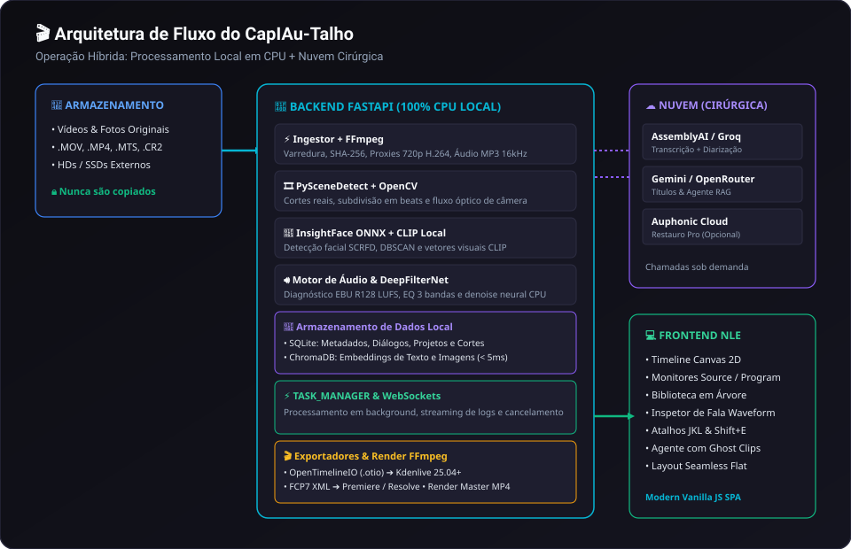

<div align="center">

# CapIAu-Talho

**Ilha de pré-edição, decupagem e assistência por IA para grandes acervos e documentários**

[](LICENSE)
[-3776AB?logo=python&logoColor=white)](https://www.python.org/)
[](docs/PLANO_IMPLEMENTACAO.md)
[](#arquitetura)

</div>

<!-- Capturas de tela e GIFs entrarão aqui, logo abaixo dos badges. Nomes e medidas em docs/images/README.md. -->

O **CapIAu-Talho** é uma ilha de pré-edição, logging e assistência por IA para **documentaristas,
editores de making-of e gestores de grandes acervos audiovisuais**. Ele integra modelos de linguagem
e visão a uma **timeline multipista em Canvas 2D**: você mapeia depoimentos palavra a palavra, busca
material por conceito visual, reconhece pessoas e monta cortes narrativos, e depois exporta tudo para
o editor em que vai finalizar. A indexação (busca vetorial e rostos) roda na sua CPU, sem GPU.



## Índice

- [O que é e o que não é](#o-que-e)
- [Início rápido em 5 minutos](#inicio-rapido)
- [Para quem é](#para-quem)
- [Recursos e status](#recursos)
- [Arquitetura](#arquitetura)
- [Configuração](#configuracao)
- [Segurança](#seguranca)
- [Documentação](#documentacao)
- [Roadmap](#roadmap)
- [Testes](#testes)
- [Contribuição](#contribuicao)
- [Licença](#licenca)

<a id="o-que-e"></a>
## O que é e o que não é

| É | Não é |
|---|---|
| Ferramenta de **triagem, decupagem e rough cut** com IA sobre acervos grandes | Um NLE de **finalização**: o acabamento é feito no Kdenlive, Premiere, Resolve ou Final Cut |
| Catalogação **in-place**: os originais ficam no seu disco e nunca são copiados | Um serviço na nuvem: roda na sua máquina, sem conta nem assinatura própria |
| Exporta `.otio`, `.xml` (FCP 7) e `.edl` com precisão de frames | Um sistema multiusuário: **ainda não tem autenticação** (veja [Segurança](#seguranca)) |

**O que sai da sua máquina.** Os vídeos originais não são enviados. Dependendo do que você ativar,
provedores externos recebem **keyframes** (análise visual, via OpenRouter), **áudio em MP3 mono
16 kHz** (transcrição na nuvem) e o **texto** das conversas com o agente. Rostos e embeddings são
processados localmente; só o reconhecimento facial opcional em nuvem (Azure Face) envia dados faciais.

<a id="inicio-rapido"></a>
## Início rápido em 5 minutos

Com [Docker](https://docs.docker.com/get-docker/) instalado:

```bash
cp .env.example .env          # 1. crie o arquivo de configuração
# 2. edite o .env: preencha OPENROUTER_API_KEY (essencial)
#    e ASSEMBLYAI_API_KEY (transcrição na nuvem, que é o motor padrão)
docker compose up --build     # 3. construa e suba o servidor
```

Abra **http://localhost:8000**. Coloque mídias na pasta `watch/` ou aponte uma pasta do seu HD na
interface para a primeira ingestão.

> **O primeiro build é demorado e grande.** A imagem instala PyTorch (CPU), OpenCV e o Chromium do
> Playwright (usado nos títulos do render), então conte com vários minutos e alguns gigabytes. As
> execuções seguintes reaproveitam o cache.

Prefere instalar sem Docker (Windows, Linux ou macOS)? Veja a
[Instalação e Configuração](https://github.com/fernangcortes/capiau-talho-v03/wiki/02.-Instalacao-e-Configuracao).
No Windows, `criar-atalho.bat` cria um ícone na Área de Trabalho. Depois da instalação, siga os
[Primeiros 15 minutos](https://github.com/fernangcortes/capiau-talho-v03/wiki/19.-Primeiros-15-Minutos-e-Receitas).

<a id="para-quem"></a>
## Para quem é

- **Documentaristas e diretores de making-of.** Transforme dezenas de horas de entrevistas em texto
  navegável, selecione frases na transcrição e leve-as à timeline (`Shift+E`). A IA agrupa os
  depoimentos por tema e a timeline suporta J/L-cuts nativos.
- **Gestores de acervos e arquivistas.** Catalogue centenas de gigabytes sem mover um arquivo, busque
  em linguagem natural (*"diretor gesticulando sob luz quente"*), identifique pessoas e organize por
  pastas, paletas de cor, escala de plano e falante.
- **Editores de montagem.** Faça triagem e rough cut com atalhos de NLE profissional (JKL, 3 e 4
  pontos, Match Frame, seis perfis de teclado) e exporte sem aprisionamento. O Kdenlive 25.04+ abre
  o `.otio` direto; veja [`docs/kdenlive_workflow.md`](docs/kdenlive_workflow.md).

<a id="recursos"></a>
## Recursos e status

**Legenda:** Estável = usado no dia a dia e coberto por testes. Beta = funciona, mas ainda muda ou
tem arestas. Experimental = pode ser lento ou instável; a nuvem segue como caminho recomendado.
Planejado = ainda não implementado. Os detalhes de cada recurso estão no
[Manual do Usuário](USER_MANUAL.md) e na [Wiki](https://github.com/fernangcortes/capiau-talho-v03/wiki).

| Área | Recurso | Status |
|---|---|---|
| Ingestão | Ingestão in-place com SHA-256, proxies 720p, miniaturas e relink de caminhos | Estável |
| Ingestão | Biblioteca em árvore, modo galeria, scroll peeker e smart bins | Estável |
| Transcrição | Transcrição na nuvem (AssemblyAI; Deepgram Nova-3 como alternativa) com diarização | Estável |
| Transcrição | Edição por texto e assistente de diarização com waveform e desambiguação facial | Beta |
| Transcrição | ASR local (Whisper, NVIDIA Canary, SenseVoice): lento em máquinas fracas | Experimental |
| Visão e rostos | Segmentação por shots e beats, títulos executivos e descrição por IA (OpenRouter) | Estável |
| Visão e rostos | Rostos locais (YuNet + SFace + DBSCAN), desambiguação em massa e autocura | Estável |
| Visão e rostos | **Camada de detecção facial no Source Player** (`Ctrl+Alt+B`; segurar `Alt` espia as caixas) | Beta |
| Visão e rostos | Detector de objetos YOLO-World e triagem "Sistema 1" (Jev/laya) | Experimental |
| Busca | Busca híbrida semântica + visual (CLIP local), "Encontrar similares" e busca em lote | Estável |
| Timeline e NLE | Timeline multipista: gaps, ripple/lift/extract, snapping, Sync Lock, J/L-cuts, marcadores | Estável |
| Timeline e NLE | Ferramentas: lâmina, slip, slide, rolling, rate stretch, mão, zoom, seleção por caixa | Estável |
| Timeline e NLE | Montagem de 3 e 4 pontos, Match Frame bidirecional, subclipes, replace edit, freeze frame | Estável |
| Timeline e NLE | **Trava total de pista com cadeado** (`Shift+L`; `Ctrl+Alt+Shift+L` para todas) | Estável |
| Timeline e NLE | **Margens de segurança e máscaras de aspecto no Program Player** (`Ctrl+Shift+G`; opções em `Ctrl+Alt+G`) | Estável |
| Timeline e NLE | **Diálogos próprios no estilo NLE**, com suporte a multi-monitor | Estável |
| Timeline e NLE | Workspaces, dock de painéis, janelas destacáveis e keymap com 6 perfis | Estável |
| Timeline e NLE | Múltiplas sequências em abas | Planejado |
| Áudio | Diagnóstico (LUFS, pico, clipping, ruído) e presets de tratamento renderizados em WAV derivado | Beta |
| Áudio | Denoise local por IA (DPDFNet, via sherpa-onnx); Auphonic na nuvem (opcional) | Beta |
| Áudio | Medidor VU ao vivo, keyframes de volume na timeline e auto-ducking | Planejado |
| Cor | Detecção e auditoria de perfis de cor (Rec.709, V-Log, S-Log, HLG etc.) | Beta |
| Cor | Transformações de cor com OpenColorIO | Planejado |
| Cor | Camada de ajuste, color matte e transições de vídeo | Beta |
| Exportação | Exportação `.otio`, `.xml` (FCP 7) e `.edl`, inclusive apontando para proxies | Estável |
| Exportação | Render de MP4 (rascunho e master) com preflight, fila e títulos; legendas `.srt`/`.vtt` | Beta |
| Agente IA | Agente editor por chat com ghost clips para aprovação e modal de alternativas (`Alt+A`) | Beta |
| Agente IA | Agentes externos via MCP e "Mesa de Montagem" | Planejado |

<a id="arquitetura"></a>
## Arquitetura

O CapIAu-Talho é um servidor **FastAPI** (`src/api/server.py`) com banco **SQLite** e **Qdrant**
locais, que serve uma interface web em **Canvas 2D** (HTML, CSS e JS puros em `src/ui/`). A ingestão
cataloga caminhos sem copiar arquivos, o FFmpeg gera proxies, o PySceneDetect divide o vídeo em
shots e beats, e embeddings (MiniLM para texto, CLIP para imagem) alimentam a busca. A timeline é
exportada por OpenTimelineIO. O fluxo completo está no diagrama acima e na
[Arquitetura Técnica](https://github.com/fernangcortes/capiau-talho-v03/wiki/15.-Arquitetura-Tecnica-e-API-REST).

| Roda local (sua máquina) | Usa nuvem (opcional, por configuração) |
|---|---|
| Ingestão, proxies, segmentação (FFmpeg, PySceneDetect) | Descrição de imagens e agente de texto (OpenRouter) |
| Embeddings de texto e imagem, busca vetorial (Qdrant) | Transcrição com diarização (AssemblyAI, Deepgram) |
| Rostos: detecção, embeddings e agrupamento | Reconhecimento facial alternativo (Azure Face) |
| Diagnóstico de áudio e cadeia FFmpeg; denoise DPDFNet | Tratamento de áudio avançado (Auphonic) |
| Transcrição local (Whisper, Canary, SenseVoice), **experimental** | Armazenamento de proxies em S3 |
| Render e exportação (FFmpeg, OpenTimelineIO) | |

A transcrição pode ser **local (experimental) ou na nuvem**; o padrão é a nuvem (AssemblyAI).

<a id="configuracao"></a>
## Configuração

Tudo vem do arquivo `.env` (modelo em [`.env.example`](.env.example)). Boa parte também pode ser
alterada no painel de configurações da interface, sem reiniciar, e **o valor do painel tem prioridade
sobre o `.env`**.

| Variável | Para que serve |
|---|---|
| `OPENROUTER_API_KEY` | **Essencial.** Descrição visual, temas, resumos e agente de edição |
| `ASSEMBLYAI_API_KEY` | Transcrição na nuvem com diarização (motor padrão) |
| `DEEPGRAM_API_KEY` | Transcrição alternativa Nova-3 (opcional) |
| `AUPHONIC_API_KEY` | Tratamento de áudio avançado; aceita o `.env` **ou** o painel (opcional) |
| `HF_TOKEN` | Para baixar modelos locais restritos do Hugging Face, como a diarização pyannote (opcional) |
| `TEXT_MODEL`, `VISION_MODEL`, `AGENT_MODEL` | Modelos de texto, visão e agente (padrões: `deepseek/deepseek-v4.1-flash`, `google/gemini-2.5-flash`, `deepseek/deepseek-v4.1-flash`) |
| `CAPIAU_DB_PATH`, `CAPIAU_WATCH`, `CAPIAU_PROXIES`, `CAPIAU_CACHE`, `CAPIAU_EXPORTS_DIR`, `CAPIAU_QDRANT_DB` | Caminhos de banco, pasta observada, proxies, cache, exportações e índice vetorial |

A lista completa (modelos reserva, desempenho, S3, Azure Face) está no `.env.example` e na
[Instalação e Configuração](https://github.com/fernangcortes/capiau-talho-v03/wiki/02.-Instalacao-e-Configuracao).
O `.env` é ignorado pelo Git de propósito: **nunca faça commit dele**. Para custos, veja
[`docs/costs_and_security.md`](docs/costs_and_security.md).

<a id="seguranca"></a>
## Segurança

> **Atenção.** A API **não tem autenticação**, aceita qualquer origem (CORS `*`) e o Docker publica a
> porta 8000 em todas as interfaces. Use o CapIAu-Talho **somente em máquina e rede confiáveis**.
> Não o exponha à internet nem a redes compartilhadas.

Para uso restrito a este computador, altere o mapeamento de porta em `docker-compose.yml` para
`127.0.0.1:8000:8000`. Existe um plano de autenticação e restrição de rede, ainda **não
implementado** (veja a [Ordem de implementação](docs/ORDEM_DE_IMPLEMENTACAO.md)).

<a id="documentacao"></a>
## Documentação

| Documento | Conteúdo |
|---|---|
| [Manual do Usuário](USER_MANUAL.md) | Operação das funcionalidades, para quem usa a ferramenta |
| [Wiki: Home](https://github.com/fernangcortes/capiau-talho-v03/wiki) | Manual completo por tema |
| [Wiki: Primeiros 15 minutos](https://github.com/fernangcortes/capiau-talho-v03/wiki/19.-Primeiros-15-Minutos-e-Receitas) | Do zero ao primeiro rough cut, com receitas |
| [Wiki: Instalação e Configuração](https://github.com/fernangcortes/capiau-talho-v03/wiki/02.-Instalacao-e-Configuracao) | Docker, Windows, Linux, macOS e todas as variáveis |
| [Wiki: Atalhos](https://github.com/fernangcortes/capiau-talho-v03/wiki/14.-Guia-Completo-de-Atalhos) | Guia completo de atalhos |
| [Wiki: Glossário](https://github.com/fernangcortes/capiau-talho-v03/wiki/18.-Glossario-Visual-e-Terminologia) | Terminologia de NLE e do projeto |
| [Wiki: Solução de problemas](https://github.com/fernangcortes/capiau-talho-v03/wiki/16.-Solucao-de-Problemas-e-FAQ) | Erros comuns e FAQ |
| [Wiki: Arquitetura e API](https://github.com/fernangcortes/capiau-talho-v03/wiki/15.-Arquitetura-Tecnica-e-API-REST) | Para desenvolvedores |
| [`docs/shortcuts.md`](docs/shortcuts.md) | Atalhos e mapa do teclado |
| [`docs/api_endpoints.md`](docs/api_endpoints.md) | Referência das rotas HTTP |
| [`docs/README.md`](docs/README.md) | Índice dos documentos internos (planos, propostas, guias) |
| [`docs/ORDEM_DE_IMPLEMENTACAO.md`](docs/ORDEM_DE_IMPLEMENTACAO.md) | Planos organizados em ondas, com status conferido no código |

<a id="roadmap"></a>
## Roadmap

A Suíte NLE Clássico (Tasks 0 a 18) está concluída, e as Tasks 23 (trava de pista) e 24 (margens de
segurança) também. Em andamento ou planejado: medidor VU, keyframes de áudio e auto-ducking
(Tasks 19 a 21), múltiplas sequências em abas (Task 25), Cartão de Contexto e sugestões de montagem
por IA, busca em 3 passos, agentes externos via MCP e **autenticação**. Detalhes em
[Roadmap e Contribuição](https://github.com/fernangcortes/capiau-talho-v03/wiki/17.-Roadmap-e-Guia-de-Contribuicao)
e na [Ordem de implementação](docs/ORDEM_DE_IMPLEMENTACAO.md).

<a id="testes"></a>
## Testes

```bash
pip install pytest
python -m pytest tests/ -v                 # backend (Python)
node tests/autoteste_match_frame.mjs       # um autoteste da interface (Node.js ESM)
python scripts/verificar_docs.py           # verificação da documentação
```

Os autotestes `tests/autoteste_*.mjs` são independentes. Para rodar todos em sequência:

```bash
node -e "import fs from 'node:fs'; import { execSync } from 'node:child_process'; for (const f of fs.readdirSync('tests').filter(f => f.startsWith('autoteste_') && f.endsWith('.mjs'))) execSync('node tests/' + f, { stdio: 'inherit' });"
```

<a id="contribuicao"></a>
## Contribuição

Contribuições são bem-vindas: abra uma issue para discutir a mudança e envie um pull request com
testes. As convenções estão no
[Roadmap e Guia de Contribuição](https://github.com/fernangcortes/capiau-talho-v03/wiki/17.-Roadmap-e-Guia-de-Contribuicao).
Para problemas de instalação ou uso, consulte antes a
[Solução de problemas](https://github.com/fernangcortes/capiau-talho-v03/wiki/16.-Solucao-de-Problemas-e-FAQ).

<a id="licenca"></a>
## Licença

Distribuído sob a **GNU General Public License v3.0** (veja [`LICENSE`](LICENSE)): você pode usar,
estudar, modificar e redistribuir; versões modificadas distribuídas também devem ser GPL-3.0.

Algumas dependências têm licenças próprias, por exemplo o `ultralytics` (AGPL-3.0, usado no
detector YOLO-World experimental). Confira o `requirements.txt` antes de redistribuir o software.
