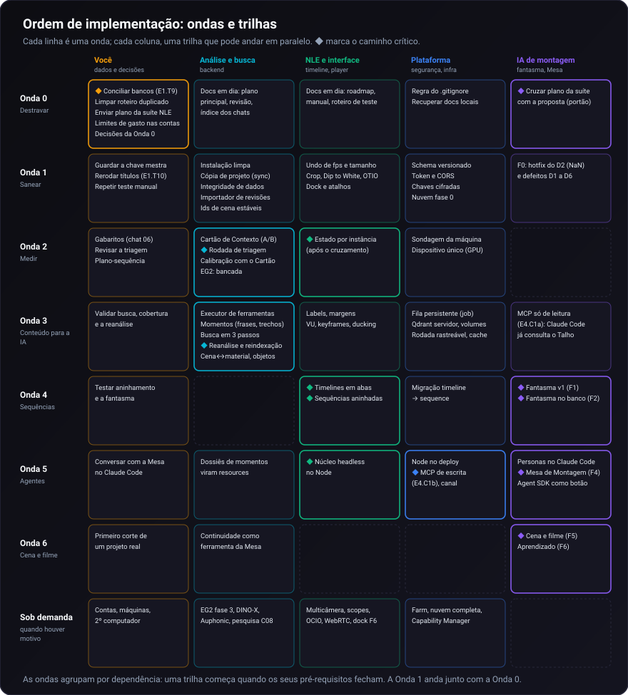

# Ordem de implementação

Todos os planos do repositório, conferidos contra o código em 18/10/2026, organizados numa ordem
que respeita dependências técnicas, dados que só o usuário tem, decisões pendentes, custo de API e
risco.

> **Índice dos itens:** cada id citado aqui (E3.A1, NUV.14, C03.1, SF.F2...) está em
> [`ORDEM_DE_IMPLEMENTACAO_itens.csv`](ORDEM_DE_IMPLEMENTACAO_itens.csv), com o documento e a linha de
> origem, o status no documento, o status conferido no código, o esforço, a evidência
> (`arquivo:linha` ou commit) e as dependências. Os ids dos planos sem numeração própria (NUV, EG2,
> OBJ, VPT, DOCK, RM, TM, C01 a C08, PCM, PCA, MCP, AUP, CUS) foram atribuídos nesta análise.
>
> **Fora desta análise:** `docs/PLANO_SUITE_NLE_CLASSICO.md` (o plano da suíte NLE), que não está no
> repositório. As Tasks 16 a 25 foram reconstruídas pelo roadmap e conferidas no código. Quando o
> plano chegar, ele é cruzado com este documento e com a proposta da Sequência Fantasma (seção 7).

---

## Resumo

- **20 documentos de plano, 560 itens.** No código: 171 implementados (31%), 74 parciais (13%),
  247 ausentes (44%), 48 que dependem de dados ou decisões fora do repositório (9%) e 19 que o código
  tornou obsoletos (3%).
- **Os documentos estão atrás do código.** Muito do que os planos e o roadmap dão como pendente já
  está feito (transições de vídeo, camada de ajuste, cor sólida, track lock, a maior parte do
  viewport, o chat 01, a taxonomia nova). Alguns itens dados como feitos não existem (OpenColorIO).
  A Onda 0 começa sincronizando os documentos, porque eles servem de prompt para os próximos chats.
- **A ordem tem sete ondas e uma trilha sob demanda:**

| Onda | Nome | Em uma linha | Tamanho |
| :--- | :--- | :--- | :--- |
| 0 | Destravar | Banco de casa, plano da suíte NLE, decisões e documentos em dia | pequena, quase sem código |
| 1 | Sanear | Instalação limpa, integridade de dados, segurança mínima e defeitos que corrompem | média, muitos itens P |
| 2 | Medir | Rodada de triagem, calibração, gabaritos e teste do EmbeddingGemma 2 | média, depende do usuário |
| 3 | Conteúdo para a IA | Cartão de Contexto, momentos, busca em 3 passos e **uma** grande reindexação | grande |
| 4 | Sequências | Estado por instância, timelines em abas, subsequências e Sequência Fantasma | muito grande |
| 5 | Agentes | Motor headless no Node, servidor MCP e Mesa de Montagem, com Claude Code primeiro | muito grande |
| 6 | Cena e filme | Construção de cena e de filme, aprendizado com o editor | grande |
| — | Sob demanda | Farm, nuvem completa, multicâmera, scopes, OCIO, WebRTC | quando houver motivo |

- **Os achados que mais mexem na ordem** (detalhe na seção 3):
  1. A conciliação com o banco de casa (E1.T9, prazo vencido em 19/08) trava todas as rodadas
     pagas de análise.
  2. Quatro mudanças mexem no mesmo índice do Qdrant. Juntas, viram **uma** reindexação, não quatro.
  3. O estado da timeline é um singleton global. Desfazer isso é a base comum de quatro planos.
  4. A API não tem autenticação e aceita qualquer origem. Isso precisa mudar antes de qualquer porta
     nova (MCP por HTTP, worker na rede local, backup na nuvem).
  5. O `.gitignore` ignora `docs/PLANO_*.md`: o plano da suíte NLE e outros planos citados podem
     nunca chegar ao repositório.
  6. A IA da timeline grava quadros `NaN` na timeline a cada turno do chat com edição direta
     (defeito D2, pior do que a proposta descrevia).

---

## 1. Como a análise foi feita

| Etapa | Modelo | O que fez | Saída |
| :--- | :--- | :--- | :--- |
| Extração | 4 × Claude Haiku, em paralelo | Leu os 20 documentos inteiros e extraiu cada item acionável, com linha, status declarado e dependências declaradas | 535 itens em JSON, mais 37 contradições entre e dentro dos documentos |
| Conferência | 5 × Claude Sonnet, por domínio | Conferiu cada item no código (busca, leitura, `git log -S`), com evidência, esforço, risco e dependências técnicas; registrou defeitos encontrados no caminho | 560 entradas conferidas e cerca de 60 achados fora dos planos |
| Síntese | Claude Opus | Conferiu de novo os achados de maior peso, montou o grafo de dependências e esta ordem | Este documento e o índice CSV |
| Revisão | 1 × Claude Sonnet | Procurou violações de dependência, itens esquecidos, itens já feitos postos na ordem e afirmações erradas | Lista de correções aplicadas ao documento |

Domínios da conferência: (1) viewport, transformação e testes manuais; (2) janelas e dock, roadmap
NLE e Sequência Fantasma; (3) pipeline de análise, triagem, categorias, áudio e modelos; (4) busca,
objetos, continuidade, plano-sequência, roteiro e embeddings; (5) infraestrutura, nuvem, plataforma,
MCP, farm e Auphonic.

Limites: a conferência é estática (nada foi executado); itens que dependem do banco de casa, de
contas na nuvem, de hardware ou de teste com mouse real ficaram como "não verificável".

---

## 2. Panorama por plano

| Documento | Itens | Feito | Parcial | Ausente | Fora do repo | Obsoleto | Leitura |
| :--- | ---: | ---: | ---: | ---: | ---: | ---: | :--- |
| `docs/PLANO_IMPLEMENTACAO.md` | 87 | 34 | 15 | 27 | 8 | 2 | Etapas 1 e 2 quase completas; da Etapa 3 só existe a parte de roteiro (P2); da Etapa 4, nada. Parado desde 23/08, contradiz o código (taxonomia antiga, limiar de rajada 0,93). |
| `docs/ORDEM_DAS_ANALISES.md` | 20 | 9 | 3 | 7 | 1 | 0 | As correções de 05 e 06/10 estão no código; sobram itens da seção 7. |
| `docs/REVISAO_CATEGORIAS.md` | 35 | 17 | 10 | 5 | 3 | 0 | Taxonomia, regras e perfis no código; falta o que depende de rodada paga e do banco de casa. |
| `docs/proximos_chats/01` | 8 | 8 | 0 | 0 | 0 | 0 | Feito. O prompt virou histórico. |
| `docs/proximos_chats/02` | 7 | 0 | 1 | 6 | 0 | 0 | Chaves sem leitor e `hardware.ai_device`, que nada lê. |
| `docs/proximos_chats/03` a `05` | 20 | 0 | 0 | 18 | 2 | 0 | Busca por objeto (rotas B, A/D e C): nada no código; depende de decisões. |
| `docs/proximos_chats/06` | 7 | 0 | 2 | 5 | 0 | 0 | Gabaritos humanos: falta a página de marcação e o importador das revisões. |
| `docs/proximos_chats/07` | 6 | 0 | 2 | 2 | 2 | 0 | Pendências externas (chaves, ambiente nemo, testes de modelos). |
| `docs/proximos_chats/08` | 24 | 0 | 3 | 17 | 3 | 1 | Plano-sequência: scripts de exploração; nada integrado ao app. |
| `docs/proximos_chats/README.md` | 8 | 3 | 1 | 4 | 0 | 0 | Decisões abertas sobre objetos. |
| `docs/PROMPT_CONFIGURAR_MODELOS_2026.md` | 5 | 2 | 2 | 0 | 0 | 1 | Histórico; resta tirar opções que não funcionam. |
| `docs/PROMPT_PROXIMO_CHAT_CATEGORIAS_AUDIO.md` | 10 | 2 | 3 | 4 | 1 | 0 | Camadas de áudio 1 e 2 feitas; o resto depende do banco de casa. |
| `docs/PLANO_EMBEDDINGGEMMA2.md` | 32 | 1 | 0 | 27 | 4 | 0 | Nada implementado; metade pode ser feita sem os arquivos do usuário. |
| `docs/PROPOSTA_BUSCA_OBJETOS.md` | 33 | 0 | 2 | 30 | 0 | 1 | Nada implementado; a categoria `obra` virou `cena` e os filtros do plano não acham nada. |
| `docs/PLANO_NUVEM.md` | 64 | 1 | 1 | 53 | 8 | 1 | Só NUV.1 feito; o resto depende de decisões e contas. |
| `docs/PESQUISA_VIDEO_AUDIO_MCP.md` | 13 | 0 | 2 | 2 | 5 | 4 | Superada pela decisão de um MCP próprio do Talho, com Claude Code. |
| `docs/AUPHONIC_AUDIO_RESTORATION_GUIDE.md` | 18 | 3 | 8 | 0 | 3 | 4 | A trilha Auphonic do código está à frente do guia. |
| `docs/costs_and_security.md` | 11 | 4 | 0 | 1 | 5 | 1 | Defasado (cita ChromaDB e modelos antigos); o resto é cuidado de conta do usuário. |
| `docs/PLANO_VIEWPORT_TRANSFORM_CROP.md` | 37 | 24 | 6 | 2 | 1 | 4 | Quase todo feito; sobram o undo de fps e tamanho e a paridade do crop. |
| `docs/HANDOFF_JANELAS_DRAG_DOCK.md` | 34 | 15 | 2 | 15 | 2 | 0 | Metade feita; as pendências reais são quase todas pequenas. |
| `docs/TESTE_MANUAL_TRACK_BASED_NLE.md` | 20 | 17 | 3 | 0 | 0 | 0 | Os recursos existem; o roteiro está desatualizado (atalhos) e precisa ser refeito. |
| Roadmap (`wiki/17`, `README.md`) | 47 | 31 | 7 | 9 | 0 | 0 | Desatualizado: Tasks 16 a 18 e track lock feitos; OpenColorIO dado como feito, mas não existe. |
| `docs/PROPOSTA_SEQUENCIA_FANTASMA_IA.md` | 14 | 0 | 1 | 13 | 0 | 0 | Nada implementado (é de 17/10). Defeitos D1 a D6 confirmados; D2 é pior e D6 é diferente do descrito. |
| **Total** | **560** | **171** | **74** | **247** | **48** | **19** | |

"Fora do repo" = não verificável sem o banco de casa, contas, hardware, teste com mouse real ou
decisão do usuário.

---

## 3. Achados que mudam a ordem

**3.1 O banco de casa trava as rodadas pagas.** A conciliação do banco desta máquina com o de casa
(E1.T9) está parada desde 19/08. Segundo o plano principal, o banco de casa já pagou a análise de
julho (532 vídeos com categoria, 196 rajadas); o desta máquina tinha zero categorias em 18/08. Sem
conciliar, a rodada de triagem (R8.3 = PCA.3 = R14.6), a calibração (R12 = PCA.4) e a reanálise
completa (R8.6 = PCA.5) podem pagar de novo o que já foi pago. A conciliação também é pré-requisito
da limpeza do roteiro duplicado (P1.4), da sincronização entre computadores (R14.5) e das chaves por
hash no armazenamento (NUV.32).

**3.2 Uma reindexação, não quatro.** Quatro mudanças mexem no mesmo índice do Qdrant:
- os trechos de entrevista por frase (hoje é um ponto por turno inteiro de falante:
  `src/search/semantic.py:176-218`);
- as facetas e o título no payload (E2.D3, E2.D4);
- a coluna de finalidade dos objetos (OBJ.I1 = C03.1);
- a decisão sobre o EmbeddingGemma 2 (EG2.13, indexação dupla).

O índice de imagens também precisa ser refeito (S7-a) e há transcrições a reindexar (R14.7). Juntar
tudo num lote, depois da calibração, evita pagar e esperar várias vezes. A reanálise completa entra
no mesmo lote.

**3.3 O estado da timeline é um singleton.** `timelineState.js` usa o estado global em 277 pontos
(151 só em `activeTimelineCuts`). Timelines em abas (RM.36), o Contracampo da Sequência Fantasma
(SF.F1), a timeline em faixas para monitor vertical (DOCK.1) e o motor headless no Node (SF.F3)
precisam da mesma coisa: um estado de timeline por instância. É uma refatoração única, com uma
fachada singleton para não quebrar os 75 autotestes.

**3.4 Segurança antes de abrir portas.** A API não tem autenticação e aceita qualquer origem
(`src/api/server.py:66-72`, `allow_origins=["*"]` com credenciais). Isso expõe a instalação de
pacotes, o backup do banco e a troca de chaves. As chaves `api.*` ficam em texto puro no banco, e o
backup levaria as chaves para o bucket. Token local, CORS restrito e chaves cifradas (NUV.14) vêm
antes do servidor MCP por HTTP, do worker na rede local e de qualquer backup na nuvem.

**3.5 O Qdrant embutido tem trava de arquivo.** O índice abre em modo embutido
(`src/search/semantic.py:93`) e só um processo por vez consegue usá-lo. Consequências:
- o servidor MCP precisa rodar **dentro** do processo do backend (HTTP com token), ou falar com a API
  do backend; um MCP stdio em processo separado não abre o índice;
- backfills e workers derrubam a busca enquanto rodam; Qdrant como servidor (NUV.15, NUV.16, NUV.24)
  vem antes do farm e de rodadas longas com o app aberto.

**3.6 Planos que podem sumir.** `.gitignore:53-54` ignora `docs/PLANO_*.md` e `docs/HANDOFF_*.md`. Os
planos versionados hoje entraram com `git add -f`. Estão citados como leitura obrigatória e ausentes
do repositório: `PLANO_SUITE_NLE_CLASSICO.md`, `HANDOFF_DESIGN_UI.md` (citado por 9 documentos),
`PLANO_AUDIO_CATEGORIAS.md`, `PLANO_AJUSTES_DE_AUDIO.md` e `PLANO_EXPORTACAO_VIDEO.md`.

**3.7 Instalação limpa quebrada.** Numa máquina nova:
- `face.embedding` não existe no schema, mas `src/vision/face_engine.py:237` grava nele, e os rostos
  falham em silêncio;
- `pypdf`, `psutil`, `onnxruntime`, `sherpa-onnx` e `soundfile` são usados e não estão no
  `requirements.txt`;
- o `Dockerfile` não instala `git`, mas o `requirements.txt` pede `clip @ git+...`;
- `init_db()` roda no import de `server.py` e testes abrem o banco real.

Isso precisa estar resolvido antes da nuvem, do multi-máquina e do Node no deploy.

**3.8 Unidade de segmentação.** A busca, o plano-sequência (C08.19), a busca por trecho do
EmbeddingGemma 2 (EG2.24) e os dossiês da Mesa de Montagem precisam da mesma unidade: frase de fala
com borda de palavra e trecho de imagem. Hoje os trechos são turnos inteiros de falante; as tabelas
`dialogue_utterance` e `dialogue_word` nunca são gravadas pelo app; `media_segment` tem um `CHECK`
que não aceita tipo novo. Decidir uma vez (decisão D-05) e gravar numa tabela nova.

**3.9 A IA da timeline corrompe a timeline.** Quando o agente edita direto (inserir, apagar, aparar,
mover, dividir), o chat grava os clipes no formato do payload (`in_s`/`out_s`) e o setter calcula
quadros `NaN` (`src/ui/js/chat.js:282-293`, `state.js:176`). O Ctrl+Z desfaz, mas o defeito acontece
em todo turno desse tipo. O conserto (SF.F0) não depende do plano da suíte NLE.

**3.10 Paridade e interoperabilidade.** O Dip to White faz flash branco no player e vira cross
dissolve no export (`grafo_video.py` só trata `video_dip_black`). A exportação OTIO, XML e EDL
descarta cor sólida e camada de ajuste (`otio_export.py:164-168`) e não escreve transições.

**3.11 Pontes que faltam.**
- O JSON de revisão exportado pelo relatório de triagem não é importado por nada: é o elo entre a
  revisão (R8.4), a conferência do Jev (R14.9), os gabaritos (C06.1), o piloto (E3.D2) e os exemplos
  das correções (E2.C3).
- Reextrair o roteiro apaga e recria as cenas com ids novos
  (`src/db/repositories/scenes.py:19`), o que destruiria os vínculos cena↔material (P3.1).
- A busca por rosto e falante compara a frase inteira com `LIKE` (`src/services/rag.py:206`), então
  "fotos do João na cozinha" nunca casa por rosto. O parser de consulta (E4.A1) vem antes da fusão
  com filtros (E4.A2).

---

## 4. Princípios desta ordem

1. **Destravar antes de construir.** Dados que só o usuário tem, decisões e documentos vêm primeiro.
2. **Consertar o que corrompe dados antes de recurso novo.**
3. **Medir antes de decidir e antes de gastar.** Gabaritos e calibração vêm antes da reanálise.
4. **Mudança cara, uma vez só.** Reindexação, migração de schema e a refatoração do estado da timeline
   acontecem uma vez cada, com tudo o que depende delas junto.
5. **Fundações compartilhadas primeiro.** Schema versionado, segurança, registro único de
   ferramentas, fila de jobs e estado por instância servem a vários planos.
6. **Até três trilhas em paralelo**, em áreas diferentes do código (backend, interface,
   plataforma), como já faz o índice de chats.
7. **Cada onda fecha com uma parada de teste do usuário.**

As ondas agrupam itens por dependência, não são etapas rígidas: uma trilha começa assim que os seus
pré-requisitos fecham. A Onda 1 começa junto com a Onda 0; só a Onda 2 precisa esperar o banco de
casa.

---

## 5. A ordem

### Onda 0 — Destravar

**Objetivo:** tirar do caminho o que só o usuário pode fazer e deixar os documentos fiéis ao código.

| Trilha | Itens | Por que aqui |
| :--- | :--- | :--- |
| Usuário | Conciliar os bancos (E1.T9), com backup dos dois e `scripts/comparar_bancos.py` | Trava a Onda 2 inteira (3.1). |
| Usuário | Enviar `PLANO_SUITE_NLE_CLASSICO.md` e os documentos locais da seção 3.6 | Portão da parte NLE e de toda a Sequência Fantasma. |
| Usuário | Responder as decisões D-01 a D-14 (seção 8) | Cada uma destrava uma trilha. |
| Usuário | Testes que já podem rodar: roteiro do E2.C2 (E2.E2), revisão do Jev (R14.9), gabarito de caminhada e chicotes (C08.23, C08.24), janelas reais (DOCK.7, DOCK.18) | Não dependem de código novo. |
| Documentos | Plano principal (taxonomia nova, limiar 0,80, E3.C1 parcial, opentimelineio resolvido); revisão de categorias; roadmap da wiki e do README (Tasks 16 a 18 feitas, OCIO não existe, 75 autotestes, subsequências no roadmap); `costs_and_security.md`; `USER_MANUAL.md` (máscara de 70% desativada); handoff do dock (2c commitada); índice dos chats (01 e PCM são histórico) | Documentos viram prompts dos próximos chats; hoje induzem ao erro. |
| Documentos | Reescrever o roteiro de teste manual com os atalhos atuais (U é Slide, Ctrl+L desvincula, arraste padrão é Clamp, Backspace é ripple delete) | O roteiro de 30/08 não bate mais com o app. |
| Documentos | Corrigir a proposta da Sequência Fantasma: D2 (quadros `NaN`), D6 (clipes sem vídeo viram "vídeo 0"), âncora por palavra via `transcript.id` (não `dialogue_word`), MCP dentro do processo do backend, canal servidor→navegador | Achados desta análise (3.5, 3.8, 3.9). |
| Documentos | Cruzar o plano da suíte NLE com esta ordem e com a proposta, assim que chegar | Seção 7. |

**Portão:** banco conciliado; decisões respondidas; documentos sincronizados; plano da suíte NLE no
repositório.

### Onda 1 — Sanear

**Objetivo:** instalação limpa, dados íntegros, segurança mínima e nenhum defeito que corrompa
dados. Quase tudo é P (até um dia de trabalho com IA).

| Trilha | Itens | Por que aqui |
| :--- | :--- | :--- |
| A · Backend | **Instalação limpa:** `face.embedding` no schema (S7-d = PCA.7); dependências no `requirements.txt` (E1.T6-b2 e as da seção 3.7); `Dockerfile` com `git` e sem `--reload` (NUV.52); `init_db` e `reset_stuck_tasks` fora do import (PCA.6); testes em banco temporário (NUV.58); conexões com WAL e timeout (NUV.44); `eval()` em `src/media/ffmpeg.py:62` | Base de tudo o que roda em outra máquina, inclusive Node no deploy. |
| A · Backend | **Integridade:** PATCH de metadados normaliza a categoria e registra feedback (causa do "Trilha", S7-e); `regenerate-titles` só por POST, com `video_ids` e sem sobrescrever título humano, **antes** de rerodar os títulos (E1.T10); `analyze_video_all` respeita a falha da visão; paleta para fotos membros de rajada; "Pessoa Desconhecida N" fora dos rostos confirmados no prompt; custo da detecção gravado (`cost_usd`); chave TypeSafe com reserva (R14.4); leitura de quadros paginada e ordenada (S7-c = PCA.8) | Erros que estragam dado já pago ou escondem custo. |
| A · Backend | **Opções que mentem:** chaves sem leitor (C02.1 a C02.3, C02.6, C02.7); motor `dino_x` e `api.local_vlm_endpoint` sem efeito (PCM.3); textos do onboarding offline; filtros e planos que usam `obra` passam a usar `cena` | A interface não pode prometer o que o código não faz. |
| A · Backend | **Pontes:** importador do JSON de revisão para `triage_feedback`; ids de cena estáveis ao reextrair o roteiro (upsert por documento e número, E3.C2); DOCX no upload de roteiro (E3.C1) | Destravam a Onda 2 (revisão) e a Onda 3 (cena↔material). |
| B · Interface | **Sequência Fantasma F0** (D1 a D6), começando pelo D2, se a decisão D-13 liberar | Defeitos existentes; não dependem do plano da suíte. |
| B · Interface | Undo com fps, largura e altura, e `setTimelineProperties` correto com velocidade, marcadores, In/Out e transições (VPT.16) | Base das sequências com configuração própria (Onda 4). |
| B · Interface | Alças de transformação somem no modo manual (`player.js:6314` e `2586`); crop com limites, teto, referência única e paridade no export, com teste de `geometria.py` (VPT.30 a VPT.33); Dip to White no export, com teste; OTIO, XML e EDL com cor sólida, camada de ajuste e transições; volume acima de 100% sem efeito | Paridade player × FFmpeg é regra da casa (`.agents/rules/`). |
| B · Interface | Atalhos duplicados nos perfis de teclado; regressão do workspace que não reabre painel (DOCK.15) e demais pendências pequenas do dock (DOCK.4, 5, 8, 9, 17, 31, 33); autoconfiguração do 1º clipe triplicada; autosave restaurado sem backup; testes que só conferem texto | Pequenos e independentes. |
| C · Plataforma | Schema versionado (NUV.43) | Pré-requisito de toda tabela nova (contexto, sequência, job, agent_run). |
| C · Plataforma | Token local e CORS restrito; chaves cifradas (NUV.14), inclusive a colada no chat do onboarding | Seção 3.4. |
| C · Plataforma | Restante da fase 0 da nuvem: NUV.2 a NUV.6, NUV.13; backup consistente (NUV.7, depois de NUV.14); testes com moto (NUV.8) | Pequenos, sem conta na nuvem. |
| C · Plataforma | Suíte completa verde com Node 22 e banco temporário (C07.4) | Linha de base antes das ondas grandes. |
| Usuário | Rerodar os títulos (E1.T10) depois do conserto da rota; repetir o teste manual reescrito | Valida a onda. |

**Portão:** suíte completa passa numa máquina limpa; teste manual repetido; nenhum defeito aberto que
corrompa dados.

### Onda 2 — Medir

**Objetivo:** números reais antes de gastar com a reanálise e antes de mudar padrões de modelo.
**Depende de E1.T9.**

| Trilha | Itens | Por que aqui |
| :--- | :--- | :--- |
| A · Análise (com o usuário) | Rodada de triagem só nos vídeos ainda sem categoria depois da conciliação (R8.3 = PCA.3 = R14.6) → revisão com o importador (R8.4) → calibração com bancada (R12 = PCA.4) → números por categoria (R9.8) → estimativa da reanálise (R8.5); intervalo de quadros por categoria e depoimento no lote (S7-f, S7-g) | A cadeia de calibração (3.1). |
| A · Análise (com o usuário) | Gabaritos do chat 06: página de marcação de 50 vídeos (C06.1), WER e DER em 3 minutos (C06.5, depois de recriar o ambiente nemo, C07.3), gabarito de objetos (C06.6), relatório (C06.7); só então a regra Jev + Laya (C06.4 = R14.3 = R.6) e, com pedido, o dataset da Laya (C06.3) | Decidir modelo por acerto medido, não por impressão. |
| A · Análise | Plano-sequência: correções de movimento (C08.21, C08.22), revisão do usuário (C08.18), proposta de integração (C08.19) | Alimenta a decisão D-05. |
| A · Busca | EmbeddingGemma 2 sem os arquivos do usuário (EG2.32: EG2.1, EG2.4, EG2.9, EG2.16), depois em casa (EG2.3, EG2.5, EG2.6) → decisão (EG2.7, EG2.8) | A decisão entra na grande reindexação. |
| C · Plataforma | Sondagem da máquina (E3.E1) junto com `hardware.ai_device` e DirectML numa função única de dispositivo (C02.4, C02.5) | Estimativas honestas de tempo (E3.D3) e uso real da GPU. |
| Usuário | SenseVoice com áudio real (C07.2), limpeza do cache do Hugging Face (C07.5) | Pendências externas pequenas. |

**Portão:** relatório de acerto contra os gabaritos; números por categoria aprovados; decisão do
EmbeddingGemma 2; estimativa da reanálise aprovada.

### Onda 3 — Conteúdo para a IA

**Objetivo:** o acervo vira matéria-prima precisa para busca e montagem (contexto do projeto, momentos
com in/out reais, busca com filtros e cena↔material), com uma reindexação só.

| Trilha | Itens | Por que aqui |
| :--- | :--- | :--- |
| A · Contexto | Cartão de Contexto e perfis (E3.A1 a E3.A3), com o objetivo do projeto editável nas configurações (R13.8 = PCA.9) | Melhora todas as análises e vira a "carta de intenção" da Mesa. |
| A · Contexto | Chat produtor (E3.B1, E3.B2) e piloto com estimativas (E3.D1 a E3.D3); interface da Sala de Projeto (E3.B3), conforme a decisão D-11 | O chat produtor é o mesmo briefing da fase 0 da Mesa. |
| A · Momentos | Frases de entrevista com borda de palavra (a partir de `transcript`) e trechos de imagem numa tabela nova (decisão D-05) | Unidade comum de busca, plano-sequência e dossiês (3.8). |
| A · Busca | Parser de consulta (E4.A1) → fusão com filtros (E4.A2), paleta de vídeo (E2.D2) e chips de facetas (E2.D3) → chat com ferramentas de busca (E4.B1) construído como **registro único de ferramentas**, que absorve o roteador antigo e tira a busca duplicada antes do laço | O registro único é a base do servidor MCP (Onda 5). |
| A · Reindexação | **Um lote:** trechos por frase; payload com facetas, título (E2.D4) e finalidade (OBJ.I1 = C03.1); índice de imagens refeito (S7-a = PCA.10); transcrições 39 e 361 (R14.7); indexação dupla do EmbeddingGemma 2 se adotado (EG2.9 a EG2.14, EG2.19 a EG2.22). Em seguida, a reanálise completa por categoria com custo mostrado antes (R8.6 = PCA.5), de preferência como rodada rastreável que pode ser promovida ou descartada (NUV.54 a NUV.56) | Seção 3.2. |
| A · Cenas | Cena↔material e relatório de cobertura (P3.1 a P3.3); ficha técnica para a galeria facial (E3.C4), depois de unificar os dois caminhos faciais (SFace 128-d na ingestão e ArcFace 512-d no `FacePipeline`) | Matéria-prima da construção de cena (Onda 6). |
| A · Objetos | Checagem técnica B só em `cena` (C03.1 a C03.7; a folha de comparação C03.3 leva à decisão do detector, R.1 = C03.4); busca por objeto A e D com um roteador único (C04.1 a C04.5, OBJ.P3 a OBJ.P6); depois continuidade C usando cena↔material como vínculo take-cena (C05.1 a C05.6) | Trilha opcional; depende das decisões D-02 a D-04. |
| B · Interface (após o cruzamento) | Recursos pequenos do roadmap: color labels (RM.33), margens de segurança persistentes (RM.35), VU meter (RM.30), keyframes de volume (RM.31) e ducking gerando keyframes (RM.32) | Servem ao editor já, e depois à persona Som. |
| B · Interface (após o cruzamento) | **Estado da timeline por instância** (núcleo puro, fachada singleton para os autotestes) | Seção 3.3; abre a Onda 4. |
| C · Plataforma | Fila persistente (E4.D1) com uma tabela `job` que também serve o `agent_run` | Rodadas longas sobrevivem a reinício; agentes rodam como job. |
| C · Plataforma | Conforme a decisão D-08: Qdrant como servidor (NUV.15, NUV.16, NUV.24), volumes portáteis (NUV.37 a NUV.41), blobs por hash (NUV.31, NUV.32) | Antes de duas máquinas e do farm (3.5). |

**Portão:** "fotos do João na cozinha" acha por rosto e lugar; o Cartão melhora a análise num teste
A/B; o relatório de cobertura das cenas é validado; a reanálise fecha dentro da estimativa.

### Onda 4 — Sequências e Sequência Fantasma

**Objetivo:** sequências como objeto de primeira classe e a primeira versão da Sequência Fantasma.
**Depende do cruzamento com o plano da suíte NLE e do estado por instância.**

| Trilha | Itens | Por que aqui |
| :--- | :--- | :--- |
| B · Interface | Múltiplas timelines em abas (RM.36), com migração de `timeline` para `sequence` e `sequence_revision` (depende de NUV.43) | Pré-requisito da fantasma persistida e do aninhamento. |
| B · Interface | Subsequências aninhadas: player, render cache, render FFmpeg e OTIO, com a bateria multipista em cascata | Construir filme por cenas (Onda 6). |
| D · IA de montagem | Sequência Fantasma v1 (SF.F1): Sobreposição sem a pista "IA", Contracampo com duas instâncias, A/B no Program, blocos com aceite parcial | Primeira entrega visível da nova IA. |
| D · IA de montagem | Fantasma no banco (SF.F2): `kind = ghost`, rebase e conflito; o ✨ Sugerir, o chat e o auto B-roll (RM.39) passam a gerar blocos | A proposta sobrevive a troca de máquina e a edições do usuário. |
| B · Interface | Timeline em faixas para monitor vertical (DOCK.1), opcional | Mesma base do estado por instância. |

**Portão:** um master com cenas aninhadas toca e exporta igual; uma proposta com blocos em V1, V2 e
T1 toca antes do aceite e aceita só o bloco escolhido.

### Onda 5 — Agentes

**Objetivo:** a Mesa de Montagem trabalhando pelo servidor MCP, primeiro conversando no Claude Code.

| Trilha | Itens | Por que aqui |
| :--- | :--- | :--- |
| C · Plataforma | Node em produção: núcleo puro num processo ao lado do backend; `Dockerfile`, bootstrap e lock de dependências (NUV.50, NUV.51), lançadores e CI | Decisão de 18/10; a proposta valida e aplica com o mesmo motor da interface. |
| C · Plataforma | Servidor MCP (E4.C1 = SF.F3) **dentro do processo do backend**, por HTTP com token: ferramentas do registro único, resources (Cartão, cenas, dossiês de momentos), prompts (personas do `prompt_registry`), canal servidor→navegador para a fantasma aparecer; recusas herdadas (Auphonic, render completo de áudio) | Seções 3.4 e 3.5. |
| D · IA de montagem | Claude Code como primeiro cliente: personas e lentes como subagentes (`.claude/agents/`) e skills | Valida ferramentas e personas conversando, sem código de orquestração. |
| D · IA de montagem | Mesa de Montagem (SF.F4): orquestrada no Claude Code; depois orquestrador interno com o Claude Agent SDK, como botão do Talho, rodando como job (E4.D1) | Decisão de 18/10. |
| Usuário | Parada de teste da Etapa 4 (E4.E): busca composta, chat variando sugestões, MCP de fora | Fecha a etapa do plano principal. |

**Portão:** de uma sessão do Claude Code, buscar momentos, abrir uma fantasma, aplicar dez operações
variadas e ver tocar no Talho; "melhore o corte da cena 4" devolve blocos de pelo menos três
personas, com custo informado antes e depois.

### Onda 6 — Cena e filme

| Trilha | Itens |
| :--- | :--- |
| D · IA de montagem | Construção de cena e de filme (SF.F5): cena do roteiro → sequência; selects → escaleta, que absorve o construtor de storyline (RM.38) → cenas → master; slugs viram lista do que falta filmar; versões curtas derivadas |
| D · IA de montagem | Aprendizado e avaliação (SF.F6): `editorial_feedback`, métricas por persona, gabarito com um corte humano, no mesmo método do chat 06 |
| A · Análise | A continuidade (C05) vira a ferramenta `check_continuity` da Mesa |

**Portão:** primeiro corte navegável por cenas aninhadas, a partir do roteiro e do acervo de um
projeto real, com a lista do que falta filmar.

### Sob demanda

| Item | Gatilho para começar |
| :--- | :--- |
| Farm de ilhas (E4.D2, E4.D3) | Duas ou mais máquinas, Qdrant como servidor, volumes portáteis, token |
| Nuvem completa: banco remoto (NUV.45 → NUV.46 ou NUV.47), trava de projeto (NUV.48), proxies na nuvem (NUV.11, NUV.12, NUV.33 a NUV.36, NUV.42, NUV.62, NUV.63), Qdrant Cloud (NUV.23, NUV.26 a NUV.29), cache de respostas pagas (NUV.57) | Decisão D-08 e contas criadas (NUV.59, NUV.60) |
| Capability Manager completo (E3.E2 a E3.E6), bancada de VLMs locais | Máquina com GPU NVIDIA (T2, 16 GB) |
| Sincronia multicâmera (RM.37) | Projeto com várias câmeras |
| Scopes (RM.40) e OpenColorIO (RM.14) | Necessidade de cor; a paridade de cor player × FFmpeg vale para os dois |
| Revisão colaborativa WebRTC (RM.41) | Precisa da Onda 1 C (autenticação) |
| Dock F6: animações, acessibilidade, monitor pela Window Management API, janela dupla e de grupo (DOCK.16, DOCK.26 a DOCK.28, DOCK.32) | Depois da Onda 4 |
| EmbeddingGemma 2 fase 3: busca por som, por trecho, unificada (EG2.23 a EG2.27) | Só se o modo Comparar mostrar ganho |
| DINO-X (C07.1), NVIDIA VSS (C07.6) | Chave DINO-X; método local provar valor |
| Perfis Auphonic (AUP.4 a AUP.6) e relatório de áudio (AUP.1, AUP.14, AUP.16 a AUP.18) | Cota Auphonic; `PLANO_AJUSTES_DE_AUDIO.md` no repositório |
| Cuidados de conta: limite no OpenRouter, rotação e alertas (CUS.1, CUS.2, CUS.9, CUS.10) | A qualquer momento, pelo usuário |

---

## 6. Caminho crítico

O objetivo final (a IA montando cenas e filmes) depende de duas cadeias que se encontram na Onda 5:

- **Cadeia de conteúdo:** banco de casa (E1.T9) → calibração e gabaritos (Onda 2) → momentos, busca e
  reindexação (Onda 3) → dossiês como resources do MCP.
- **Cadeia de montagem:** plano da suíte NLE → estado por instância (Onda 3) → abas e aninhamento
  (Onda 4) → Sequência Fantasma (Onda 4) → motor headless e MCP (Onda 5) → Mesa (Onda 5) → cena e
  filme (Onda 6).

A cadeia de montagem é a mais longa (itens GG em sequência). A de conteúdo precisa estar pronta
quando ela chegar à Onda 5. Por isso as duas andam em paralelo desde a Onda 1, e as fundações
compartilhadas (schema versionado, segurança, registro de ferramentas, fila de jobs) entram cedo.

---

## 7. Quando o plano da suíte NLE chegar

1. Comitá-lo com `git add -f` ou depois de mudar a regra do `.gitignore` (decisão D-01).
2. Mapear as Tasks 19 a 25 nas Ondas 3 (trilha B) e 4, e conferir se o plano já previa abas, um
   estado por instância ou outra forma de múltiplas timelines.
3. Encaixar as subsequências aninhadas, aceitas no roadmap em 18/10, junto com as abas.
4. Atualizar este documento, a proposta da Sequência Fantasma e o próprio plano da suíte.
5. Só então começar a trilha B da Onda 3 e as Ondas 4 a 6.

---

## 8. Decisões pendentes

| # | Decisão | Destrava | Recomendação |
| :--- | :--- | :--- | :--- |
| D-01 | Regra do `.gitignore` para planos | Plano da suíte e documentos locais no repositório | Versionar planos por padrão; rascunhos numa pasta própria não versionada |
| D-02 | Coluna `finalidade` em `detected_object` ou tabela separada (R.2 = OBJ.Q1) | Objetos (Onda 3) e a reindexação | Coluna |
| D-03 | "Na dúvida, busca comum (A)" (R.4 = OBJ.Q5) | Roteador de busca | Sim |
| D-04 | Chips de sugestão só no player ou também na biblioteca (R.3 = OBJ.Q4) | Interface de objetos | — |
| D-05 | Unidade de segmentação: frase de fala e trecho de imagem, em tabela nova | Momentos, plano-sequência, EG2.24, dossiês | Frase com borda de palavra; trecho em tabela nova |
| D-06 | Título executivo no texto do embedding ou só no payload (E2.D4) | Reindexação | Decidir junto com a reindexação |
| D-07 | EmbeddingGemma 2: RAM da máquina (EG2.29), motor global ou por projeto (EG2.30), indexação dupla ou backfill noturno (EG2.31) | Teste e adoção do EG2 | Por projeto |
| D-08 | Multi-máquina: uma por vez ou duas no mesmo projeto (NUV.61) | Urgência da trava e da nuvem | — |
| D-09 | A reanálise retria categoria errada? (S3c); fotos entram na triagem? (R9.4) | Rodada de triagem e reanálise | — |
| D-10 | GPU real desta máquina (os documentos divergem: Intel UHD 630 ou AMD Radeon 535) | Função única de dispositivo | — |
| D-11 | A Sala de Projeto substitui o Welcome Hub? (E3.B3) | Interface da Etapa 3 | — |
| D-12 | Escopo do MCP: só o servidor próprio do Talho (MCP.11) | Onda 5 | Sim; o `video-audio-mcp` fica de fora |
| D-13 | Consertar já os defeitos D1 a D6 da IA da timeline, antes do cruzamento com o plano da suíte | Onda 1 B | Sim: são defeitos, não recurso novo; o D2 corrompe a timeline |
| D-14 | Limiar de rajada do preset Econômico (0,95, contra o padrão 0,80) | Coerência dos presets | Alinhar ao padrão |

A decisão do detector padrão da checagem B (R.1 = C03.4) só faz sentido depois da folha de
comparação (C03.3), na Onda 3.

---

## 9. Como usar este documento

- Cada onda pode virar uma série de chats, no formato de `docs/proximos_chats/`: um prompt por
  trilha, com as regras do repositório repetidas e o portão de saída como critério de aceite.
- Antes de começar um item, confira a linha dele no CSV (evidência e dependências) e no documento de
  origem. A conferência foi estática e tem data.
- Ao fechar um item, atualize o documento de origem e o status no CSV, para a próxima análise partir
  do lugar certo.
