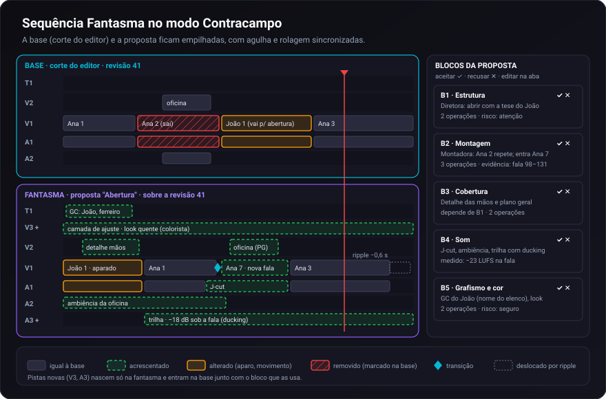
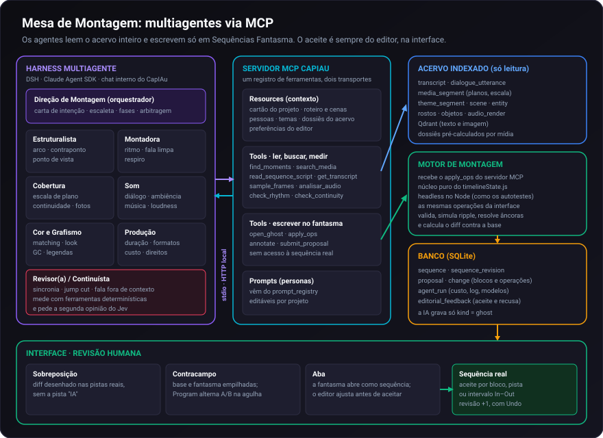

# Proposta: Sequência Fantasma e Mesa de Montagem

Como a IA do Talho deve sugerir cortes e construir cenas e filmes inteiros, pensando como uma
equipe de pós-produção e usando todas as ferramentas do NLE.

> Levantamento feito lendo o código em 17/10/2026. Referências `arquivo:linha` em `src/`, podem
> ter andado. Nada aqui foi implementado: o documento é diagnóstico, desenho e plano em fases.
>
> O plano da suíte NLE citado no README (`docs/PLANO_SUITE_NLE_CLASSICO.md`) **não está no
> repositório** (nenhum dos 611 commits o contém). O escopo das Tasks 16 a 25 foi reconstruído a
> partir do roadmap (`wiki/17.-Roadmap-e-Guia-de-Contribuicao.md`, README) e conferido no código.

---

## Resumo

- **Hoje** a sugestão da IA é uma lista de clipes soltos (INSERT, DELETE ou REPLACE de um clipe
  inteiro), ligada a uma pista especial `AI`. Ela não toca pistas de áudio, títulos, transições,
  aparos, J/L-cuts, efeitos nem a ordem das cenas; não dá para assistir à proposta; e as posições
  são absolutas, então envelhecem no primeiro ripple.
- **Proposta**: a sugestão deixa de ser uma pista e vira **uma sequência inteira derivada da sua**,
  a **Sequência Fantasma**. Ela é uma cópia ramificada da sequência base, com uma revisão de
  referência e um conjunto de mudanças agrupadas em blocos. Por ser uma sequência, é multipista,
  pode criar pistas e subsequências, toca no Program e pode ser comparada com a base.
- **Revisão** em três visões: *Sobreposição* (o diff desenhado nas pistas reais), *Contracampo*
  (base e fantasma empilhadas, com A/B no Program) e *Aba* (a fantasma abre como sequência e o
  editor ajusta antes de aceitar). O aceite é por bloco, por pista ou por intervalo In–Out.
- **Quem propõe** é a **Mesa de Montagem**: um orquestrador e personas especialistas
  (estrutura, montagem, cobertura, som, cor e grafismo, produção, revisão), com sub-personas como
  lentes. Elas falam com o Talho por um **servidor MCP** que lê o acervo inteiro e escreve só em
  fantasmas. O aceite continua sendo só do editor.
- **Pré-requisitos do NLE**: sequências como objeto de primeira classe (múltiplas timelines em
  abas, já no roadmap), **subsequências aninhadas** (fora do roadmap hoje) e um **motor de
  montagem único** que rode na interface e no servidor (o `timelineState.js` já roda sem
  navegador nos autotestes Node).
- **Plano** em sete fases (F0 a F6). A F0 conserta seis defeitos do fluxo atual e vale a pena mesmo que o
  resto demore.

---

## 1. Como é hoje

### 1.1 Dois caminhos geram ghost clips

| | Botão ✨ Sugerir e seletor de persona | Chat do Agente de Edição |
| :--- | :--- | :--- |
| Interface | `ui/js/panels.js:3254` (`runAiTimelineAnalysis`) | `ui/js/chat.js:277` |
| Rota | `POST /api/timeline/ai-suggest` (`api/routes/narrative.py:472`) | `POST /api/project/{id}/chat` (`narrative.py:805`) |
| Serviço | `TimelineAIService.suggest` (`services/timeline_ai.py:213`) | `ChatAgentService.chat_with_agent` (`services/chat_agent.py:1751`) |
| Forma | Uma chamada ao LLM, uma persona, de 1 a 5 sugestões | Laço com function-calling (até `agent.max_steps`) |
| Saída | `INSERT` / `DELETE` / `REPLACE` | `propose_bulk_edit` e `propose_rough_cut` viram ghosts; `insert_clip`, `trim_clip`, `move_clip`, `split_clip`, `set_av_offset`, `add_effect` são edições diretas |

### 1.2 O que um ghost consegue dizer

O ghost é um item plano em `TIMELINE_STATE.ghostTrack` (`ui/js/timelineState.js:419`, montado em
`setGhostSuggestions`, linha 5307):

```text
{ action: INSERT|DELETE|REPLACE, type: video|photo, video_id|photo_id, in/out,
  timelineStartFrame, track (destino), targetClipId, reason, persona, alternatives }
```

Consequências:

- **Vocabulário de três verbos sobre clipe inteiro.** Não há aparo, slip, slide, roll, split,
  mover, J/L-cut, transição, título, nível de áudio, cor, velocidade, marcador nem reordenação de
  blocos. As personas pedem coisas que esse vocabulário não expressa: a Sound Designer fala em
  J-cuts e medição de LUFS e a Colorista em casar temperatura de cor (`nlp/prompt_registry.py:542`
  e `553`), mas as duas só conseguem devolver "INSERT de b-roll".
- **Itens independentes.** Não há grupo, ordem nem dependência. "Inserir a fala nova" e "cobrir a
  fala nova com b-roll" são dois itens que podem ser aceitos um sem o outro.
- **Posição absoluta.** `timelineStartFrame` é calculado contra a timeline do momento da
  sugestão. Aceitar um INSERT na V1 magnética empurra o resto, mas os outros ghosts continuam nas
  posições antigas. Se o editor seguir editando enquanto a IA pensa, a proposta chega velha.
- **Persistência só local.** Os ghosts vão para o autosave no `localStorage`
  (`ui/js/timelineAutosave.js:33`), sem autoria, custo, base de referência nem histórico.

### 1.3 Onde aparece e como se interage

- A pista `AI` é permanente, travada e sempre a primeira (`timelineState.js:372`). Quando vazia,
  mostra um convite (`ui/js/timelineRenderer.js:764`).
- Mas o desenho já **não** usa a pista `AI` para INSERT: `getGhostRect` (`timelineRenderer.js:2841`)
  projeta INSERT e REPLACE na pista de destino e DELETE como hachura sobre o clipe alvo. A pista `AI`
  só recebe o ghost quando a pista de destino não existe.
- O clique, porém, continua procurando INSERT/REPLACE **só na pista `AI`**
  (`ui/js/timelineInteraction.js:580`). Resultado: o ghost verde desenhado na V2 não é clicável
  onde aparece (o clique pega o clipe real embaixo ou o gap), e quem acerta é um clique na faixa
  vazia da pista `AI`, na mesma altura de tempo. Ver defeito D1.
- Não há como **assistir** à proposta: clicar no ghost só leva o Source ao trecho de origem
  (`syncPlayerToClip`). Para um montador, ver o corte tocando é a avaliação principal.

### 1.4 O que a IA enxerga

`TimelineAIService.build_timeline_context` (`timeline_ai.py:60`) manda, para cada clipe de vídeo:
pista, posição, origem, fala transcrita do trecho (entrevistas) ou descrições de quadros (b-roll),
e as lacunas de fala sem cobertura. `build_candidates_context` (linha 149) manda até 25 vídeos e 15
fotos (`timeline.max_candidate_videos` e `max_candidate_photos`) com **descrição do arquivo inteiro**.

O que fica de fora, embora exista no banco:

| Dado | Onde está | Por que importa para montar |
| :--- | :--- | :--- |
| Trechos exatos dos candidatos | `transcript`, `dialogue_utterance` | O LLM inventa `source_in_s/out_s` a partir de um resumo do vídeo; a validação só prende o intervalo à duração (`timeline_ai.py:300` em diante). |
| Planos e escala de plano | `media_segment` (`shot`, `shot_scale`) | Variar escala, evitar jump cut, cortar em borda de plano. |
| Cenas do roteiro | `scene` | Montar por cena, saber o que falta cobrir. |
| Temas por trecho | `theme_segment` | Estrutura por assunto, contraponto. |
| Pessoas e elenco | `person`, `face_recognition`, `entity` | Ponto de vista, GC com nome certo, `realm` história × produção. |
| Objetos e props | `detected_object` | Continuidade visual. |
| Medição de áudio | `audio_render.analysis_json` | Escolher a melhor tomada pelo som, propor tratamento. |
| Momentos marcados | estrelas / key moments | O que o editor já disse que importa. |
| Objetivo do projeto | `project.objetivo` | O mesmo plano vale diferente no filme e no making of. |
| Marcadores do editor | `TIMELINE_STATE.markers` | Notas e pedidos já escritos na timeline. |
| Histórico de aceite e recusa | não é gravado | Aprender o gosto do editor. |

### 1.5 Personas

Quatro personas (`montadora`, `diretora`, `sound_designer`, `colorista`) são prefixos de prompt
(`prompt_registry.py:520` a `563`). Cada clique roda uma persona, sozinha. Não há debate,
divisão de trabalho, revisão cruzada nem fusão. O agente do chat é uma quinta voz, sem persona.

Do lado bom, já existe um porteiro determinístico (`evaluate_safety_gatekeeper`,
`chat_agent.py:1418`), a segunda opinião do Jev sobre cortes (`segunda_opiniao_jev`, linha 1493) e
a regra de ouro de nunca mutar sem clique do editor. Isso tudo se mantém.

### 1.6 Limites do próprio NLE que prendem a IA

- **Uma timeline ativa por vez.** O banco aceita várias (`timeline`, `db/schema.py:202`;
  `GET /api/timeline` lista), mas cada "salvar" cria uma linha nova e a interface carrega uma por
  vez, por prompt. Não há abas, versões nem "abrir sequência como fonte".
- **Sem aninhamento.** Não existe clipe do tipo sequência. A importação OTIO achata `Stack`
  aninhado (`export/otio_import.py:192`).
- **Situação das Tasks 16 a 25** (reconstruída do roadmap e conferida no código):

| Recurso | Situação no código | O que a IA ganha com ele |
| :--- | :--- | :--- |
| Transições de vídeo (dissolve, dips) | existe (`addVideoTransition`, `timelineState.js:7161`) | propor transição em vez de só corte seco |
| Crossfade de áudio | existe (`addAudioCrossfade`, linha 6826) | emendas de som sem estalo |
| Camada de ajuste | existe (`addAdjustmentCut`, linha 5088) | passe de cor por cena |
| Gerador de cor sólida | existe (`addColorMatteCut`, linha 5007) | cartelas, respiros em preto |
| Margens de segurança | existe (`ui/js/playerTextOverlay.js:53`) | posicionar GC sem invadir |
| Track lock | existe (`toggleTrackLock`, linha 1486) | a IA respeitar pista travada |
| Keyframes de volume (rubberband) | não encontrado | música abaixo da fala, fades longos |
| Auto-ducking | não encontrado | trilha sob depoimento sem trabalho manual |
| VU meter | não encontrado | só interface; a IA usa `analisar_audio` |
| Color labels de clipe | não encontrado | marcar o que a IA trouxe e por quê |
| Múltiplas timelines em abas | não encontrado | **pré-requisito** da Sequência Fantasma completa |
| Subsequências aninhadas | fora do roadmap | **pré-requisito** para construir filme por cenas |
| Sincronia multicâmera por áudio | planejada (v0.4) | escolher ângulo por quem fala |

### 1.7 Defeitos encontrados no fluxo atual

| # | Defeito | Onde | Efeito |
| :--- | :--- | :--- | :--- |
| D1 | INSERT/REPLACE são desenhados na pista de destino, mas o clique só os procura na pista `AI` | `timelineRenderer.js:2865` × `timelineInteraction.js:580` | O ghost não é clicável onde aparece; atalhos de aceitar/recusar dependem da seleção. |
| D2 | Edições diretas do agente somem quando o porteiro marca a resposta como prévia | `chat_agent.py:2274` e `2372`; `chat.js:282` | Com `insert_clip`, `delete_clip`, `trim_clip`, `move_clip` ou `split_clip`, `is_preview` fica verdadeiro, `final_cuts` volta igual ao que entrou e nada vira ghost (efeito e offset A/V sozinhos passam direto). O chat grava a timeline original. O card diz "Edição aplicada" ao chamar `acceptAllGhostSuggestions` sobre uma lista vazia. `shadow_cuts`, que tem o resultado, não é lido por ninguém. |
| D3 | Marcadores do rough cut não chegam à timeline | `chat_agent.py` devolve `markers`; `populateRoughCutMarkers` (`timelineState.js:5624`) só é chamado em teste | Os beats com justificativa dramática se perdem. |
| D4 | Pista de reserva errada quando o LLM manda pista inválida | `timeline_ai.py:294` usa `video_track_ids[-1]` | Com a ordem visual padrão (V2 acima de V1), a reserva é a **V1** magnética, não a V2 de cobertura. A interface usa a primeira pista de vídeo (`timelineState.js:5309`): as duas reservas discordam. |
| D5 | Rough cut sem chave é heurística cega | `parse_and_orchestrate_rough_cut`, `chat_agent.py:1674` | Pega os primeiros 40% (até 12 s) das quatro primeiras entrevistas, a partir do segundo zero. Sem aviso de que não houve IA. |
| D6 | O chat do agente quebra com clipe sem vídeo na timeline | `CapIAuAPI.chat` (`ui/js/api.js:638`) descarta `type` e `photo_id`; `TimelineShadowCopy.__init__` (`chat_agent.py:32`) faz `int(c.get("video_id", 0))` | Foto, título, cor sólida e camada de ajuste chegam com `video_id: null`; `int(None)` levanta `TypeError` antes do laço e a conversa falha. Mesmo sem o erro, o agente veria fotos como vídeo 0 e não veria títulos. |

---

## 2. Princípios da proposta

1. **Sugestão é sequência, não pista.** Um corte proposto é uma alternativa coerente da obra, com
   consequências de ripple em todas as pistas. Só uma sequência inteira representa remoções com
   ripple, reordenação de cenas, aparos, pistas novas e aninhamento, e só uma sequência toca.
2. **A IA lê tudo e escreve só em fantasma.** O aceite é humano, como já é hoje.
3. **Um único motor de montagem.** As operações que a IA propõe são as mesmas funções que a
   interface já usa e testa. É a mesma regra de paridade que o projeto aplica a player × FFmpeg.
4. **Medir antes de opinar.** Ritmo, sincronia, jump cut, loudness e duplicidade são medidos por
   ferramentas determinísticas; o LLM decide em cima das medições. O agente de áudio já segue
   essa regra.
5. **Toda decisão traz evidência clicável**: o trecho de fala, o plano, a cena ou a medição que a
   justifica.
6. **Alternativas em vez de consenso** nas decisões subjetivas de estrutura. Duas versões
   defensáveis valem mais para o editor que uma média das duas.
7. **Custo visível**, como na convenção do plano: estimativa antes de rodar, gasto real depois.

---

## 3. Sequência Fantasma

### 3.1 Nome

**Recomendado: Sequência Fantasma** para o objeto. Mantém a continuidade com "ghost clips", que
o usuário já conhece, e deixa claro que é uma sequência inteira (todas as pistas), não uma faixa.

Termos que completam o vocabulário:

| Termo | O que é |
| :--- | :--- |
| **Sequência Fantasma** | sequência derivada da base, escrita pela IA, nunca exportada |
| **Proposta** | uma rodada de sugestões dentro de uma fantasma (autor, brief, custo) |
| **Bloco** | grupo de operações que só fazem sentido juntas; unidade de aceite e de Undo |
| **Contracampo** | visão de comparação base × fantasma |
| **Mesa de Montagem** | o conjunto de agentes (orquestrador e personas) |

Alternativas consideradas: *Corte Sombra* (casa com a `TimelineShadowCopy` do backend, mas o
termo é técnico), *Versão* (como Avid e Resolve chamam cópias de sequência; bom, mas não diz que
foi a IA) e *Copião* (no jargão brasileiro é a cópia de trabalho; ambíguo com material bruto).

### 3.2 Modelo

```text
SequênciaFantasma = base (sequence_id + revisão) + Proposta[ Bloco[ Operação ] ]
materializar(fantasma) = aplicar(base na revisão, blocos aceitos ou pendentes, em ordem)
```

- A fantasma guarda a **revisão da base** sobre a qual foi pensada. Se a base mudou, a fantasma é
  reaplicada sobre a revisão nova (rebase). Operações cujas âncoras sumiram ficam em **conflito**
  e aparecem marcadas, sem aplicar nada no escuro.
- Cada clipe da fantasma guarda a **linhagem** do clipe da base de onde veio (um split gera dois
  filhos com a mesma linhagem). O diff compara por linhagem: igual, acrescentado, removido,
  alterado (aparo, slip, troca de fonte) ou deslocado por ripple.
- Deslocamento por ripple **não** pinta cada clipe seguinte de âmbar. A visão mostra uma única
  faixa "ripple −0,6 s a partir daqui"; alterado é só o que uma operação tocou de propósito.
- Blocos têm dependências. Recusar "inserir a fala da Ana 7" desabilita "cobrir a fala da Ana 7".

### 3.3 Três visões



| Visão | Como é | Quando usar |
| :--- | :--- | :--- |
| **Sobreposição** | o diff desenhado nas pistas reais (verde tracejado, âmbar, hachura vermelha, faixa de ripple); pistas novas aparecem como faixas finas tracejadas; **a pista `AI` deixa de existir** | sugestão pontual, poucos blocos |
| **Contracampo** | dois canvases empilhados (base em cima, fantasma embaixo) com agulha, zoom e rolagem sincronizados, mais o painel de blocos; o Program alterna base/fantasma na mesma agulha (atalho) | proposta grande, reestruturação |
| **Aba** | a fantasma abre como sequência própria; o editor pode mexer nela (as mexidas viram blocos do editor) antes de aceitar | quando a proposta está quase boa |

O que vale para as três:

- **Tocar a proposta.** A fantasma é uma sequência, então o player e o render cache a tocam como
  qualquer outra. Esse é o maior ganho para o editor.
- **Aceite parcial**: um bloco, todos os blocos de uma pista, ou tudo o que cai no intervalo
  In–Out. Cada aceite é um passo de Undo e uma revisão nova da base.
- **Evidência clicável** em cada bloco: tocar o trecho de fala citado, ver o plano, abrir a cena
  do roteiro, ler a medição de áudio.
- **Risco** do porteiro e do Jev por bloco, não só por lote.

### 3.4 Persistência

A fantasma sai do `localStorage` e vai para o banco, como sequência `kind = ghost`. Assim ela
sobrevive à troca de máquina (ver `docs/PLANO_NUVEM.md`), tem autor e custo, e alimenta o
aprendizado (seção 9). Esboço de schema:

```sql
-- substitui a tabela timeline (migração preserva as linhas atuais como kind='edit')
sequence(id, project_id, name, kind, parent_id, base_revision, revision,
         settings_json, tracks_json, clips_json, markers_json, transitions_json,
         author, status, created_at, updated_at)
  -- kind: edit | ghost | scene | selects | escaleta | master
sequence_revision(sequence_id, revision, snapshot_json, author, created_at)

proposal(id, project_id, ghost_sequence_id, base_sequence_id, base_revision,
         brief, agent_run_id, status, created_at)
change(id, proposal_id, block_id, seq, op, args_json, anchors_json, evidence_json,
       rationale, persona, confidence, depends_on_json, risk, status)
  -- status: pending | accepted | rejected | conflict

agent_run(id, project_id, graph_json, models_json, prompt_tokens, completion_tokens,
          cost_usd, started_at, finished_at, log_json)
editorial_feedback(id, change_id, decision, edited_after_accept, note, created_at)
```

---

## 4. Linguagem de operações de montagem

A IA passa a falar a mesma língua da interface. Cada operação é uma função que já existe no
`TIMELINE_STATE` (ou que o roadmap vai criar), com pré-condições, âncoras e evidência.

| Grupo | Operação | Função existente | Situação |
| :--- | :--- | :--- | :--- |
| Estrutura | `create_sequence`, `create_subsequence`, `nest_range`, `unnest` | — | depende da F2 |
| Estrutura | `add_track`, `rename_track` | `addVideoTrack`, `addAudioTrack`, `addTextTrack`, `renameTrack` | existe |
| Montagem | `insert` (ripple) e `overwrite` de trecho da fonte | `rippleInsertTimeRange`, `overwriteTimeRange`, `insertSourceClipAtPlayhead`, `overwriteSourceClipAtPlayhead` | existe |
| Montagem | `replace_edit`, trocar por alternativa | `replaceClip`, `replaceClipWithAlternative` | existe |
| Montagem | `lift`, `extract`, `ripple_delete`, fechar gap | `liftRange`, `extractRange`, `rippleDeleteClip`, `rippleDeleteGap` | existe |
| Montagem | `move` | `nudgeSelectedClips` e arraste | existe (precisa de forma sem seleção) |
| Refino | `trim`, `roll`, `slip`, `slide`, `split` | primitivas `aplicarCabeca`/`aplicarCauda`, `rollingEdit`, `slipClip`, `slideClip`, `splitClipAtFrame` | existe |
| Refino | J-cut e L-cut, vincular e desvincular | `set_av_offset` no agente; aparo independente do par A/V | existe |
| Tempo | velocidade e reverso, freeze, preencher gap | `changeClipSpeed`, `createFreezeFrameCut`, `fillTrackGap` | existe |
| Transição | dissolve, dip preto/branco, crossfade de áudio | `addVideoTransition`, `addAudioCrossfade` | existe |
| Imagem | transform, crop, Ken Burns em foto, cor básica | efeitos `transform`, `crop`, `color`, `fit` | existe |
| Imagem | camada de ajuste, cor sólida | `addAdjustmentCut`, `addColorMatteCut` | existe |
| Texto | GC, título, legenda a partir da transcrição | `addTextClip` e presets | existe (legenda automática não) |
| Áudio | ganho, EQ e dinâmica ao vivo, tratamento renderizado | `ajustar_audio_ao_vivo`, `aplicar_tratamento_audio` (só prévia sem pedido do usuário) | existe |
| Áudio | keyframes de volume, ducking | — | Tasks do roadmap |
| Anotação | marcador de beat, nota, pendência | `addMarker` | existe (marcador com duração não) |
| Anotação | **slug**: espaço reservado com rótulo ("falta plano da fachada") | — | novo; vira lista de pendências de captação |
| Seleção | subclipe, mandar para sequência de selects | subclipes virtuais (`Ctrl+U`) | existe em parte |
| Desativar | desligar clipe sem apagar | `toggleClipDisabled` | existe |

### 4.1 Âncoras estáveis

Para a proposta sobreviver ao ripple e ao rebase, o alvo da operação é uma referência estável, e
segundos absolutos ficam como último recurso:

```json
{"op": "insert", "block": "B2",
 "where": {"after_clip": "cut_1729_a"},
 "source": {"video_id": 41, "from_word": 98765, "to_word": 98790},
 "evidence": [{"type": "transcript", "video_id": 41, "words": [98765, 98790],
               "text": "a gente aprendeu a bater o ferro no tempo da respiração"}],
 "rationale": "Ana 2 repete a ideia da Ana 1; Ana 7 diz o mesmo com imagem concreta."}
```

Âncoras aceitas: clipe (`clip`, `after_clip`, `before_clip`), palavra da transcrição
(`transcript.id` e `dialogue_word.id` já existem), plano (`media_segment.id`), marcador, cena e,
por fim, tempo (`t`). O motor resolve a âncora na hora de aplicar.

### 4.2 Ajuste fino automático (snap)

Todo `in`/`out` proposto passa por um encaixe determinístico antes de virar operação: borda de
palavra em trecho de fala (com respiro configurável, nunca no meio da palavra), borda de plano em
b-roll, e respeito às folgas de mídia para transições (as mesmas regras de `tpad=clone` da
`.agents/rules/nle-parity-and-media-lifecycle.md`). O LLM escolhe o momento; a ferramenta
acerta o quadro.

---

## 5. Sequências como objeto de primeira classe (pré-requisito do NLE)

A Sequência Fantasma completa depende de três trabalhos de NLE, úteis também sem IA:

1. **Múltiplas timelines em abas** (já no roadmap, Tasks 16 a 25). Sequência com id, nome,
   configurações próprias, revisões, abas no painel da timeline, e "abrir sequência no Source"
   para montar a partir de selects e string-outs (montagem de 3 pontos com sequência como fonte).
2. **Subsequências aninhadas** (novo, não está no roadmap). Clipe do tipo `sequence` que aponta
   para outra sequência com in/out; "aninhar seleção" (Nest do Premiere, Compound Clip do
   Resolve); abrir a aninhada em aba. Toca em player, render cache, render FFmpeg e export OTIO
   (que suporta `Stack` aninhado; hoje a importação achata). A regra de paridade player × FFmpeg
   e a bateria multipista em cascata valem aqui também.
3. **Tipos de sequência**, para a IA e o editor organizarem o trabalho como numa ilha de verdade:

| Tipo | Conteúdo | Quem escreve |
| :--- | :--- | :--- |
| `selects` | os melhores momentos de cada fonte, como subclipes rotulados por tema, pessoa e cena | assistente (IA ou humano) |
| `escaleta` | beats como marcadores e slugs com duração-alvo, sem mídia ou com mídia candidata | estruturalista |
| `scene` | uma cena montada, em todas as pistas | montadora e especialistas |
| `master` | o filme: cenas aninhadas em ordem, mais trilha, títulos e cor geral | editor |
| `ghost` | qualquer uma das acima, proposta pela IA | Mesa de Montagem |

Com isso, construir um filme vira o fluxo clássico de pós: selects → escaleta → string-out por
cena → corte bruto → corte fino, com o master feito de cenas aninhadas. Versões curtas (1 min,
3 min, trailer) passam a ser sequências derivadas do master.

---

## 6. Motor de montagem único

Hoje há dois motores: o do navegador (`timelineState.js`, cerca de 8.500 linhas, coberto por 75
autotestes Node) e a cópia-sombra simplificada do backend (`TimelineShadowCopy`,
`chat_agent.py:20`), que não conhece ripple com sync lock, transições, freeze, velocidade nem
camada de ajuste. Uma proposta validada por um motor e aplicada por outro diverge.

**Recomendação**: extrair do `timelineState.js` um núcleo puro (estado e operações, sem DOM nem
`STATE` global), na forma `aplicar(estado, operação) → estado`, e rodá-lo:

- no navegador, como hoje;
- num **processo Node ao lado do backend** (sidecar), usado pelo servidor MCP e pelo agente do
  chat para validar, simular ripple, resolver âncoras e calcular o diff.

É viável: os autotestes já carregam o `timelineState.js` no Node com polyfills leves (ver o topo
de `tests/autoteste_advanced_nle_interactions.mjs`). Até essa extração ficar pronta, a F1 pode
materializar a fantasma só na interface, clonando o estado e chamando as funções existentes; o
backend valida apenas forma e ids.

Portar o motor para Python não é recomendado: duplica 8.500 linhas e cria a divergência que a
regra de paridade do projeto existe para evitar.

---

## 7. Servidor MCP do Talho



É o E4.C1 do `docs/PLANO_IMPLEMENTACAO.md`, ampliado. **Um registro único de ferramentas** com
dois transportes: o function-calling que o chat usa hoje (OpenRouter) e o MCP (stdio e HTTP local
com token). O chat interno vira só mais um cliente.

### 7.1 Resources (contexto, paginado e por id)

- Cartão do projeto: objetivo, brief, público, duração-alvo, tom, proibições (E3.A).
- Roteiro e cenas (`scene`), pessoas e elenco, entidades, temas.
- **Dossiês do acervo**, pré-calculados e em cache: por entrevista, as falas em frases limpas
  (borda de palavra) com tema, pessoa, duração e qualidade do áudio; por b-roll, os planos com
  escala, movimento, descrição, pessoas e objetos; por foto, descrição e pessoas. É o trabalho de
  decupagem que o assistente de montagem faz, e o projeto já tem quase todos os dados.
- Preferências do editor compiladas do histórico de aceite e recusa (seção 9).
- A especificação da linguagem de operações (seção 4).

### 7.2 Tools

| Grupo | Ferramentas | Observação |
| :--- | :--- | :--- |
| Buscar | `find_moments(query, filtros)`, `search_media`, `get_transcript`, `get_shots`, `get_scene` | `find_moments` devolve **momentos** com in/out reais (frase, plano, beat, trecho de tema, estrela), não vídeos inteiros |
| Ler a sequência | `list_sequences`, `get_sequence`, `read_sequence_script` | `read_sequence_script` devolve o **roteiro do corte**: o que se ouve e o que se vê, em ordem, com tempo. É a forma mais barata e mais útil de um LLM "assistir" a um corte |
| Ver e ouvir | `sample_frames(sequência, intervalo, passo)`, `analisar_audio` | folha de contato de quadros para modelo multimodal; medição real de áudio (já existe) |
| Medir | `check_rhythm`, `check_continuity`, `check_sync`, `check_coverage`, `check_runtime`, `check_rights` | determinísticos: duração de planos, cortes por minuto, jump cut, flash frame, gap, par A/V fora de sincronia, fala sem cobertura, trecho repetido, mistura `realm`, material `terceiros` |
| Escrever no fantasma | `open_ghost(base, brief)`, `apply_ops(ghost, ops)`, `annotate`, `submit_proposal` | `apply_ops` passa pelo motor, devolve diff, erros por operação e o estado novo |
| Auditar | `jev_audit(bloco)` | a segunda opinião que já existe, por bloco |

Fora de alcance dos agentes, sempre: escrever na sequência real, apagar mídia, acionar o Auphonic
(regra já existente: gasta a cota do dono), render completo de áudio sem pedido do usuário.

### 7.3 Prompts

As personas passam a ser **prompts MCP** servidos a partir do `prompt_registry`, que já tem
overrides por projeto e painel de edição. O harness externo recebe a biblioteca de personas do
Talho e o editor continua ajustando o texto pela interface.

---

## 8. Mesa de Montagem: multiagentes, personas e sub-personas

### 8.1 Elenco

| Persona | Responsabilidade | Sub-personas (lentes) | Pistas sob sua autoridade |
| :--- | :--- | :--- | :--- |
| **Direção de Montagem** (orquestradora) | carta de intenção, escaleta, divisão do trabalho, arbitragem, apresentação ao editor | — | ordem das cenas no master |
| **Estruturalista** | arco, beats, ordem, o que entra e o que sai | arco, contraponto e dialética, ponto de vista (`realm`), informação nova | sequências `escaleta` |
| **Montadora** | selects, string-out, corte bruto e fino da espinha | ritmo, fala limpa, respiro | V1/A1 |
| **Cobertura** | b-roll, fotos, escala de plano, continuidade | escala, continuidade visual (objetos, direção), arquivo e fotos | V2 e acima |
| **Som** | J/L-cuts, ambiência, crossfades, trilha, ducking, loudness | diálogo, ambiência, música, mix | A2 e acima, níveis e transições de áudio |
| **Cor e Grafismo** | casar planos, look por cena, GC, títulos, legendas, créditos | matching, look, GC, legendas | camadas de ajuste, T1 |
| **Produção** | duração-alvo, versões e formatos, custo, direitos | — | nenhuma (só restrições) |
| **Revisor(a)** | QA adversarial antes do editor ver | sincronia, jump cut, fala fora de contexto, direitos | nenhuma (só aponta) |

**Sub-personas como lentes, não como agentes.** Uma lente é uma lista de verificação, um
subconjunto de ferramentas e uma etiqueta nos blocos, aplicada dentro do contexto da persona.
Sai muito mais barato que um agente por lente. Vira subagente separado só quando o trabalho é
pesado e paralelizável: por exemplo, a lente "selects" varrendo 40 entrevistas em mapa-e-redução
sobre os dossiês.

**Autoridade por pista** reduz conflito: cada persona escreve nas pistas e aspectos que são seus.
Quando duas operações tocam o mesmo clipe ou intervalo, o motor acusa o conflito e a orquestradora
resolve, ou entrega as duas como fantasmas alternativas.

### 8.2 Fases e portões

| Fase | Quem | Produz | Portão humano |
| :--- | :--- | :--- | :--- |
| 0. Briefing | editor e orquestradora | carta de intenção (vira parte do Cartão de Contexto) | editor aprova |
| 1. Selects | Montadora (lente selects) | sequência `selects` fantasma | opcional |
| 2. Escaleta | Estruturalista (duas versões quando houver escolha subjetiva) | sequência `escaleta` fantasma | **editor escolhe a versão** |
| 3. String-out | Montadora | uma sequência `scene` por beat ou cena, aninhadas num master fantasma | editor revisa por cena |
| 4. Corte bruto | Montadora, Cobertura, Som em paralelo | blocos por persona sobre o master | aceite por bloco |
| 5. Corte fino | Som, Cor e Grafismo, Montadora (ritmo) | blocos de refino | aceite por bloco |
| 6. Revisão | Revisor(a), Jev | relatório e blocos de correção | — |

Estrutura vem primeiro e em série; os passes de acabamento (cobertura, som, cor, grafismo) rodam
em paralelo, porque quase não disputam as mesmas pistas. O Revisor passa antes de cada entrega ao
editor.

### 8.3 Modelos e custo

- Modelo forte para orquestradora e estruturalista; modelo barato para lentes, mapa dos selects e
  QA. Configurável por persona no `settings_registry`.
- Cada rodada é um `agent_run` com teto de tokens e de custo, estimativa antes de rodar e gasto
  real depois.
- Contexto enxuto: cada persona recebe só os beats e as cenas em que vai trabalhar, mais os
  dossiês por id; o resto ela busca pelas ferramentas.

### 8.4 Onde roda a orquestração

- **Harness externo via MCP** (DSH, Claude Agent SDK, Claude Code): máxima liberdade de
  orquestração, modelos e paralelismo. É o caminho pedido e o primeiro a construir.
- **Orquestrador interno**, no backend, para quem não tem harness: as mesmas fases com grafo fixo,
  usando o mesmo registro de ferramentas pelo OpenRouter.

Os dois escrevem os mesmos objetos (fantasma, proposta, bloco), então a revisão na interface é
uma só.

### 8.5 Escala de uso

| Nível | Pedido típico | Quem atende | Resultado |
| :--- | :--- | :--- | :--- |
| Pontual | selecionar um clipe ou gap: "alternativas", "cobrir isto" | um agente, modelo barato | bloco em Sobreposição, segundos |
| Passe de persona | "passe de som nesta cena" | uma persona e suas lentes | proposta numa fantasma |
| Mesa | "melhore o corte da cena 4" | várias personas, Revisor | proposta com blocos por persona |
| Cena | "monte a cena 12 do roteiro" | Mesa, fases 1 a 6 sobre uma cena | sequência `scene` fantasma |
| Filme | "primeiro corte de 25 min a partir da carta de intenção" | Mesa completa, com portões | `selects`, `escaleta`, cenas e `master` fantasmas |

---

## 9. Aprender com o editor e medir

- **Feedback como dado**, no mesmo espírito do `triage_feedback`: cada bloco aceito, recusado,
  editado na aba, ou aceito e desfeito/alterado em seguida vira linha em `editorial_feedback`.
- **Preferências do editor** compiladas desse histórico (exemplos: "recusa J-cut acima de 1 s",
  "b-roll de no máximo 4 s", "não corta respiração antes de resposta emocionada") entram nos
  prompts das personas, como o Cartão de Contexto do E3.A3.
- **Métricas**: taxa de aceite por persona e por tipo de operação; quanto o editor mexe depois de
  aceitar; tempo de revisão por bloco; violações apontadas pelo Revisor; probabilidade de "fala
  importante cortada" do Jev.
- **Gabarito**: um corte final feito por humano (export OTIO) sobre material já indexado. A Mesa
  roda no mesmo material e mede cobertura dos trechos usados, semelhança da ordem dos beats,
  erro de duração e preferência cega do editor entre versões. Liga com
  `docs/proximos_chats/06_gabaritos_avaliacao.md`.

---

## 10. Plano em fases

Cada fase fecha com uma parada de teste, como no plano principal.

### F0 — Consertar o fluxo atual (pequeno, independente)

- [ ] D1: hit-test dos ghosts na pista onde são desenhados.
- [ ] D2: edições diretas do agente viram ghosts (coerente com "aceite só humano"); o card só diz
  "aplicada" quando algo foi aplicado.
- [ ] D3: `chat.js` passa os `markers` da resposta para `populateRoughCutMarkers`.
- [ ] D4: reserva de pista igual nos dois lados e apontando para cobertura (V2), nunca para a V1
  magnética.
- [ ] D5: o rough cut sem chave avisa que é heurística.
- [ ] D6: o chat envia o clipe inteiro (pela mesma ponte `corteParaSalvar` do salvamento) e a
  cópia-sombra aceita foto, título, cor sólida e camada de ajuste.

*Aceite:* pedir ao chat um aparo e uma inserção mostra os dois como ghosts clicáveis onde estão
desenhados; aceitar aplica os dois; o rough cut deixa beats na régua.

### F1 — Sequência Fantasma v1 sobre o modelo atual

- [ ] Fantasma no front: base congelada (hash da timeline) mais lista de blocos; materialização
  clonando o estado e chamando as funções do `TIMELINE_STATE`.
- [ ] Visão Sobreposição com diff por linhagem e faixa de ripple; **remoção da pista `AI`**
  (migração no `setTracks`/`conformCuts`; o filtro de pistas `ai` do export continua inofensivo).
- [ ] Visão Contracampo (dois canvases sincronizados) e A/B no Program.
- [ ] Painel de blocos: aceitar e recusar por bloco, pista e intervalo In–Out, com evidência.
- [ ] Os dois caminhos atuais (✨ Sugerir e chat) passam a gerar blocos.

*Aceite:* uma proposta com inserção na V1, cobertura na V2 e GC na T1 toca no Program antes do
aceite; aceitar só o bloco de cobertura não traz os outros.

### F2 — Sequências de primeira classe

- [ ] Tabela `sequence` e `sequence_revision` (migrando `timeline`), abas, tipos.
- [ ] Clipe do tipo `sequence` (aninhamento) em player, render cache, render FFmpeg e OTIO, com a
  bateria multipista em cascata.
- [ ] Fantasma persistida no banco como `kind = ghost`, com rebase e conflito.
- [ ] Abrir sequência no Source para montagem de 3 pontos.

*Aceite:* um master com duas cenas aninhadas toca e exporta igual; uma fantasma criada antes de
o editor mexer na base é reaplicada sobre a revisão nova e marca só os blocos em conflito.

### F3 — Motor único, vocabulário completo e servidor MCP

- [ ] Núcleo puro extraído do `timelineState.js` e sidecar Node.
- [ ] Linguagem de operações da seção 4 com âncoras e snap.
- [ ] `find_moments`, `read_sequence_script`, `sample_frames`, `check_*` e dossiês em cache.
- [ ] Servidor MCP (stdio e HTTP local com token) com tools, resources e prompts; o chat interno
  passa a usar o mesmo registro.

*Aceite:* de uma sessão de harness externo, buscar momentos, abrir uma fantasma, aplicar dez
operações variadas e ver o resultado tocar na interface do Talho.

### F4 — Mesa de Montagem

- [ ] Personas e lentes como prompts MCP; autoridade por pista; detecção de conflito no motor.
- [ ] Orquestrador interno com as fases da seção 8.2 para quem não tem harness.
- [ ] `agent_run` com custo visível e log legível na interface ("Estruturalista lendo 14
  entrevistas...").
- [ ] Revisor com as ferramentas `check_*` e o Jev por bloco.

*Aceite:* "melhore o corte da cena 4" devolve uma proposta com blocos de pelo menos três personas,
sem conflito não resolvido, com custo informado antes e depois.

### F5 — Construção de cena e de filme

- [ ] Cena do roteiro → sequência `scene` fantasma (usa `scene` e o casamento cena ↔ material,
  E3.C5).
- [ ] Carta de intenção → `selects` → `escaleta` (duas versões) → cenas → `master`, com portões.
- [ ] Slugs viram lista de pendências de captação.
- [ ] Versões curtas derivadas do master.

*Aceite:* a partir do roteiro e do acervo de um projeto real, um primeiro corte navegável por
cenas aninhadas, com a lista do que falta filmar.

### F6 — Aprendizado e avaliação

- [ ] `editorial_feedback`, preferências compiladas nos prompts, painel de métricas.
- [ ] Rodada contra gabarito humano.

---

## 11. Decisões

Fechadas em 18/10/2026:

- **Nomes**: "Sequência Fantasma", "Contracampo" e "Mesa de Montagem" confirmados.
- **Primeiro cliente MCP**: Claude. Falta escolher entre Claude Code e Claude Agent SDK (item 1
  abaixo).
- **Subsequências aninhadas** entram no roadmap da suíte NLE.
- **Nada desta proposta é implementado** antes de `docs/PLANO_SUITE_NLE_CLASSICO.md` chegar ao
  repositório e os dois planos serem cruzados e atualizados juntos.

Em aberto:

1. **Claude Code ou Claude Agent SDK** como primeiro cliente: Claude Code para validar ferramentas
   e personas sem escrever código de orquestração; Agent SDK quando a Mesa virar um botão dentro
   do Talho.
2. **Node em produção**: aceitar o Node como dependência de execução do backend (hoje só roda os
   testes) para o motor único? A alternativa (validar só na interface) é mais fraca.
