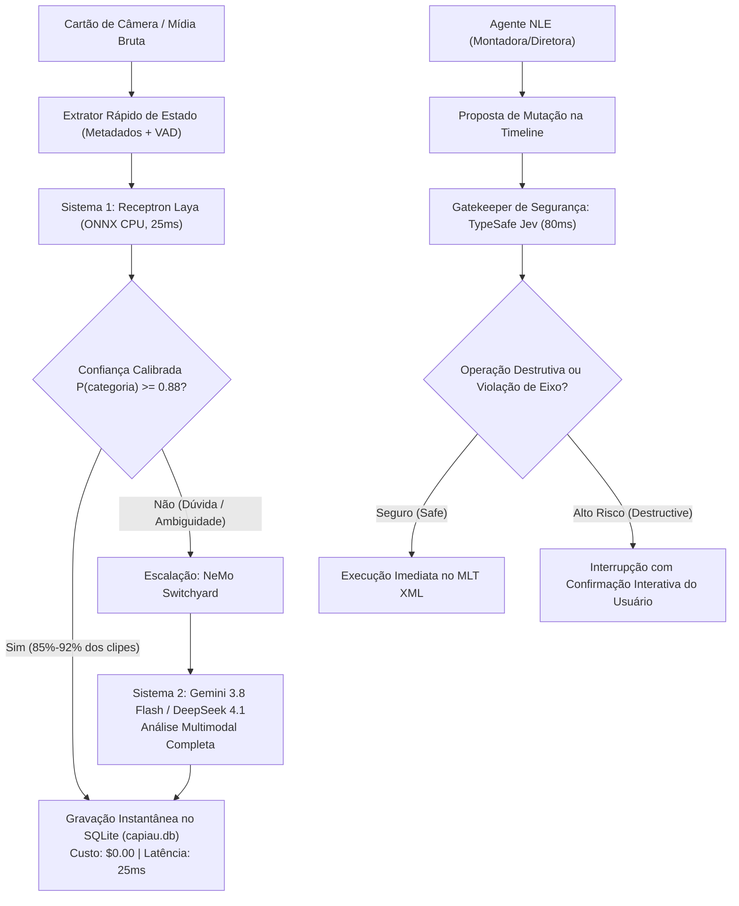

# Plano de Modernização Abrangente das Camadas de Análise de Inteligência Artificial — CapIAu-Talho (2026 SOTA)

**Documento Técnico Master de Arquitetura, Engenharia de Prompts e Roteiro de Migração**  
**Data**: 2026-09-29  
**Status**: Aprovado para Implementação  
**Versão**: 1.0.0  
**Autor**: Equipe de Engenharia e Arquitetura CapIAu-Talho  
**Ambiente Alvo**: Windows Desktop / Python 3.12–3.14 / SQLite / Qdrant Embutido / OpenRouter & Direct Providers  

---

## Sumário Executivo

O **CapIAu-Talho** é uma ilha de edição e catalogação audiovisual inteligente (NLE - *Non-Linear Editor*) voltada ao cinema documental brasileiro e produções audiovisuais autorais. O sistema orquestra transcrição diarizada, análise visual de frames, extração estruturada de roteiros, indexação semântica híbrida (texto e imagem no Qdrant) e edição assistida multipista no padrão MLT XML/Kdenlive.

Este plano mestre estabelece a modernização integral de todas as camadas de inteligência artificial do sistema para o estado da arte de **2026 (SOTA)**. O projeto atualiza os pipelines de **Modelos de Decisão Rápida Sistema 1**, **Visão Multimodal e Vídeo**, **Detecção Zero-Shot de Objetos e Props de Cena**, **Detecção e Reconhecimento Facial**, **Texto, NLP e Raciocínio Editorial**, e **Áudio, Transcrição Multilíngue e Diarização de Locutores**, ancorando-se em sete pilares fundamentais:

1. **Modelos de Decisão Rápida Sistema 1 (TypeSafe AI Jev & Receptron Laya)**: Adoção de arquitetura cognitiva dual com TypeSafe AI Jev (Diogo Almeida, 15/09/2026) e Receptron Laya (`receptron/laya` sobre ONNX Runtime CPU/Wasm), operando a 15–45ms (CPU) e <20ms (Wasm), com custo $0.00 (Laya) vs ~$0.042/1M tokens (Jev), integrando saídas tipadas e calibração estatística formal RLCD (*Reinforcement Learning from Calibrated Demonstrations*) sustentando 3 pilares críticos: Triagem Instantânea Eixo A (~22ms), Timeline safety gatekeeper (~80ms) e RAG intent dispatcher (<15ms).
2. **Acurácia Espacial e Grounding Dual**: Incorporação de coordenadas espaciais (*bounding boxes* normalizados) tanto para atores/personagens quanto para equipamentos de filmagem e adereços de cena (*props*), combinando modelos multimodais de alta eficiência em nuvem (Google Gemini 3.8 Flash com Spatial Grounding, NVIDIA Cosmos 3) com motores ultrarrápidos locais em ONNX Runtime CPU (YOLO-World v2, Florence-2 e DINO-X Edge), padronizando a persistência no SQLite estritamente no padrão canônico inteiro Gemini `[ymin, xmin, ymax, xmax]` (0–1000).
3. **Unificação Vetorial Biométrica e Descontinuação do SFace**: Padronização da representação biométrica facial em **512 dimensões** logo a partir da camada local offline exclusivamente com SCRFD + ArcFace (MobileNet/Buffalo_sc em ONNX CPU, ~35ms por face), declarando o SFace legado 128-d formalmente como "DESCONTINUADO / DEPRECADO (Removido do Pipeline Ativo)" sem uso como fallback para evitar quebras catastróficas no DBSCAN e cálculos de cosseno, acompanhado de rotina de migração em `scripts/migrate_face_embeddings_512.py` para unificar o espaço vetorial com os Tiers avançados de GPU e nuvem (InsightFace Buffalo_l e Antelopev2).
4. **Áudio e Diarização de Última Geração (NVIDIA NeMo 2026)**: Superação definitiva da dependência de serviços pagos por minuto através do **NVIDIA Nemotron 3 Diarization** (setembro de 2026, 100M open-weights, suporte nativo a até 8 locutores com fala sobreposta / *overlapping speech* modelada relacionalmente na tabela `dialogue_utterance`) combinado a **NVIDIA Canary-1B** e **Whisper-Large-v3-Turbo**, viabilizando transcrição e separação de falas 100% local, offline e gratuita.
5. **Engenharia de Prompts e Governança do Catálogo**: Reestruturação formal do `PROMPT_REGISTRY` contendo todos os 19 prompts do sistema (17 oficiais existentes + 2 novos prompts promovidos da base de código inline), com documentação completa de templates, variáveis injetadas, diretrizes operacionais profundas para 4 Personas Editoriais (Montadora, Diretora, Sound Designer, Colorista), isolamento estrito entre o universo ficcional (`realm='story'`) e a realidade da produção (`realm='production'`), e salvaguardas anti-alucinação.
6. **Contratos Estritos de Dados (JSON Schema Draft 2020-12 / Draft-07) e Tool Calling**: Especificação rigorosa de schemas de dados para Visão, Triagem Eixo A, Temas Narrativos e as 16 ferramentas de manipulação de timeline e áudio do Agente de Edição NLE (`ChatAgentService.TOOLS`).
7. **Arquitetura de Integração Retrocompatível**: Evolução aditiva do SQLite `capiau.db` (tabela `detected_object`, extensões em `entity_mention`), enriquecimento dos payloads do Qdrant (`capiau_making_of` e `capiau_images`) sem recriação de coleções, catálogo extensível de configurações em `settings_registry.py` com suporte a chaves diretas dos provedores de 2026 (`api.gemini_key`, `api.anthropic_key`, `api.deepseek_key`, `api.assemblyai_key`, `api.typesafe_key`, `api.nvidia_nim_key`, `api.local_vlm_endpoint`), resolução dinâmica em `SettingsService.api_key()`, e estratégia de reprocessamento em lote por subprocessos assíncronos que não bloqueiam o servidor FastAPI nem causam concorrência no banco vetorial.

---

## R1. Estudo Comparativo e Seleção de Modelos SOTA (2026)

A arquitetura do CapIAu-Talho opera de forma híbrida: funções de alta frequência e baixa latência rodam prioritariamente de forma local e offline (CPU / QuickSync), enquanto tarefas de alta abstração semântica, raciocínio dramático complexo e visão multimodal densa utilizam provedores de nuvem via APIs unificadas (OpenRouter) ou conexões diretas de alta performance.

Abaixo são detalhados os estudos comparativos e seleções técnicas para cada uma das frentes de IA.

---

### 1.1. Visão Multimodal & Análise Temporal de Vídeo (Frames, B-Roll e Decupagem)

A análise visual do Talho processa frames de B-roll extraídos via PySceneDetect (`ContentDetector` e `AdaptiveDetector`) com compensação de movimento de câmera e rajadas de fotos de set agrupadas por CLIP. O modelo multimodal é responsável por descrever a ação, identificar pessoas, localizar adereços e classificar o estilo cinematográfico do plano.

| Modelo | Provedor / Tipo | Custo ($/1M tokens) Entrada / Saída | Latência Estimada (por frame) | Janela de Contexto | Suporte a Spatial Bboxes & JSON Schema | Licença | Requisitos de Hardware | Avaliação & Recomendação para o Talho |
| :--- | :--- | :--- | :--- | :--- | :--- | :--- | :--- | :--- | :--- |
| **Google Gemini 3.8 Flash** | Google AI / OpenRouter (02/09/2026) | $0.15 / $0.60 (Context Caching > 32k: $0.0375 / 1M) | 0.7s – 1.2s | 1.000.000 tokens | **Excelente**: Suporte nativo a `box_2d: [ymin, xmin, ymax, xmax]` (0-1000) e JSON Schema estrito. | Proprietária (API comercial) | Zero local (Apenas conexão de rede) | **Recomendação Primária (Padrão de Visão Setembro 2026)**: Lançado em 02/09/2026. Excepcional custo-benefício, altíssima velocidade, vocabulário cinematográfico em português refinado e grounding espacial nativo. Detalha suporte a Google Gemini 3.8 Flash Context Caching ($0.0375 / 1M tokens para prompts > 32k tokens), viabilizando decupagem contínua de cartões longos com redução dramática de custos. |
| **Google Gemini 3.8 Pro** | Google AI / OpenRouter (2026) | $1.25 / $5.00 ($0.31 em cache) | 1.8s – 3.2s | 2.000.000 tokens | **Excelente**: Spatial Grounding nativo + análise direta de vídeo nativo (MP4/MTS com áudio e imagem combinados). | Proprietária (API comercial) | Zero local (Apenas conexão de rede) | **Recomendação para Decupagem Profunda**: Indicado para análise holística de takes inteiros de cena e entrevistas densas onde a relação áudio-visual temporal contínua é determinante. |
| **NVIDIA Cosmos 3 (Edge 4B / Nano 8B / Super 32B)** | NVIDIA / Open Weights / NIM (Julho 2026) | Grátis local / $0.20 API NIM | 0.8s – 1.8s (API NIM) / 1.2s – 3.0s (GPU) | 128.000 – 256.000 tokens | **Excepcional**: World Model unificado para IA Física e raciocínio contínuo de dinâmica de vídeo. | NVIDIA Open Model License (2026) | Edge 4B: GPU 8GB VRAM (ou Jetson)<br>Nano 8B: 16GB VRAM<br>Super 32B: 64GB–80GB VRAM (ou API NIM $0.20/1M tokens) | **Líder em Física e Dinâmica Temporal**: Com o lançamento do **Cosmos 3 Edge (15/07/2026)**, permite inferência local em set para tracking temporal, continuidade de câmera, oclusão de objetos e dinâmica de corte em B-roll. O modelo **NVIDIA Cosmos 3 Super 32B** requer 64GB–80GB VRAM (A100/H100 ou dual RTX 4090 vLLM) ou uso direto via API NIM corporativa ($0.20/1M tokens). |
| **NVIDIA Nemotron 3 / Nano Omni (30B)** | NVIDIA / Open Weights | Grátis local / :free tier OpenRouter | 1.4s – 2.8s | 128.000 tokens | **Muito Bom**: Multimodal unificado para raciocínio visual, auditivo e textual integrado. | Open Weights / Apache 2.0 | GPU 16GB+ VRAM ou API Cloud | **Multimodalidade Holística Eficiente**: Excelente para correlacionar o que é dito no áudio com o que aparece na imagem no mesmo frame sem chamadas desacopladas. |
| **Anthropic Claude Sonnet 5.5** | Anthropic / OpenRouter (28/09/2026) | $3.00 / $15.00 | 1.8s – 3.5s | 200.000 tokens | **Muito Bom**: Structured Outputs via Tool Calling; precisão máxima em OCR e enquadramento visual. | Proprietária (API comercial) | Zero local (Apenas conexão de rede) | **Especialista Editorial (Ontem - 28/09/2026)**: Raciocínio estético impecável para direção e montagem; fidelidade máxima em detalhes sutis de cena e iluminação, com selo de proveniência EU AI Act. |
| **Xiaomi MiMo-V2.6-Pro** (`xiaomi/mimo-v2.6-pro`) | Xiaomi / Open Weights & OpenRouter (21/09/2026) | $0.435 / $0.87 (Cache: $0.0036) | 1.1s – 2.0s | 1.000.000 tokens | **Nativo Omnimodal**: Suporte nativo a texto, imagem, vídeo temporal e áudio no mesmo checkpoint com 1M contexto. | MIT License / Pesos Abertos | Zero local (API) ou GPU 24GB+ | **Campeão de Eficiência Omnimodal (21/09/2026)**: Modelo aberto omnimodal de altíssimo desempenho lançado por Xiaomi. Analisa takes brutos completos correlacionando imagem, áudio direto e texto em uma única passada. |
| **Xiaomi MiMo-V2.6-Flash** (`xiaomi/mimo-v2.6-flash`) | Xiaomi / Open Weights & OpenRouter (21/09/2026) | $0.14 / $0.28 (Cache: $0.0028) | 0.8s – 1.5s | 1.000.000 tokens | **Muito Bom**: Suporte multimodal ágil e JSON Schema com 1M tokens de contexto. | MIT License / Pesos Abertos | Zero local (API) ou GPU 16GB–24GB | **Hiper-Econômico para Ingestão em Lote**: Variante ultrarrápida a $0.14 / $0.28 por 1M tokens com janela de 1 milhão de tokens; viabiliza decupagem de acervos brutos extensos com custo próximo a zero. |
| **Alibaba Qwen 2.5 / 3 VL (72B Instruct)** | Alibaba Cloud / Open Weights | $0.25 / $0.80 (API) ou Grátis local | 1.2s – 2.2s (API) / 3s – 6s (Local GPU) | 128.000 tokens | **Excelente**: Coordenadas espaciais nativas `[ymin, xmin, ymax, xmax]`, suporte nativo a vídeo temporal e multi-frame. | Apache 2.0 / Qwen Open License | API: Zero local<br>Local: GPU 24GB+ VRAM (4-bit) ou 48GB (FP16) | **Melhor Alternativa Open-Weights**: Escolha definitiva para instalações que exigem operação 100% on-premise/privada sem envio de imagens para servidores externos. |

#### Racional de Engenharia para Visão Multimodal
O modelo **Google Gemini 3.8 Flash** é estabelecido como o motor padrão primário para o pipeline de visão em nuvem devido ao seu imbatível custo-benefício, janela de contexto de 1 milhão de tokens e capacidade nativa de emitir bounding boxes no formato `[ymin, xmin, ymax, xmax]` em escala inteira 0–1000 dentro do mesmo schema JSON da descrição. Para estações com placas de vídeo dedicadas NVIDIA (RTX 3090/4080/4090/5080), o novíssimo **NVIDIA Cosmos 3 Nano (8B)** e **NVIDIA Nemotron 3 Nano Omni** despontam como as melhores alternativas de código aberto: consolidam toda a pesquisa avançada de VILA/NVLM em modelos que compreendem a dinâmica contínua do movimento de câmera no set, permitindo decupar B-roll localmente com custo zero de nuvem. Para pipelines locais CPU-only, o fallback arquitetural permanece direcionado ao motor VLM local via endpoint compatível OpenAI (`api.local_vlm_endpoint`, apontando para Qwen 2.5/3 VL ou Ollama).

---

### 1.2. Detecção Zero-Shot de Objetos e Props de Cena (Grounding Espacial)

A catalogação visual de equipamentos de filmagem (câmeras, lentes, microfones boom, claquetes, tripés) e adereços cenográficos (armas cenográficas, figurinos, documentos de época, veículos) requer modelos capazes de localizar espacialmente itens com vocabulário aberto.

| Modelo / Mecanismo | Modo de Execução | Custo / Requisitos de Hardware | Latência Média por Frame | Formato de Coordenadas | Suporte a Vocabulário Aberto | Licença | Avaliação Técnica & Recomendação para o Talho |
| :--- | :--- | :--- | :--- | :--- | :--- | :--- | :--- |
| **Gemini Spatial Bounding Boxes** | Nuvem (API Gemini 3.8 Flash) | $0.00 adicional (embutido na chamada de visão) | 0 ms adicionais (mesma requisição) | `[ymin, xmin, ymax, xmax]` normalizado (0 a 1000) | **Total**: Vocabulário semântico aberto ilimitado guiado por prompt e schema. | Comercial (API) | **Recomendação Principal Nuvem**: Elimina a necessidade de empacotar bibliotecas pesadas de visão computacional no instalador básico do Windows. Extrai pessoas, objetos e descrição em um único disparo. |
| **DINO-X (Pro / Edge)** | Local / Nuvem (IDEA Research 2026) | Grátis local / 2 GB RAM (Edge) a 6 GB VRAM (Pro) | ~90ms (Edge GPU) / ~380ms (CPU) | `[x1, y1, x2, y2]` relativo normalizado | **SOTA Absoluto**: Treinado no Grounding-100M com vocabulário aberto massivo e grounding detalhado. | Apache 2.0 / Pesos Abertos | **Novo Ápice em Detecção Aberta (SOTA 2026)**: Sucessor direto do Grounding DINO 1.5, oferecendo versões Edge leves para inferência local com suporte a segmentação e detecção de pequenos adereços com oclusão parcial. |
| **YOLO-World (v2) / YOLOE** | Local (ONNX Runtime CPU / GPU) | Grátis / ~1,2 GB RAM, 1–2 threads CPU | ~140ms – 260ms (CPU 640x640) | `[rx, ry, rw, rh]` relativo (0.0 a 1.0) | **Sim**: Vocabulário aberto configurável via embeddings de texto CLIP em tempo real. | GPL-3.0 | **Recomendação Principal Local Offline**: Velocidade extrema em CPU sem necessidade de GPU dedicada. Ideal para catalogação em segundo plano durante a ingestão de cartões de câmera no set. |
| **Florence-2 (Base 230M / Large 770M)** | Local (ONNX / PyTorch CPU) | Grátis / 2,0 GB RAM (Base) a 4,5 GB (Large) | ~320ms (Base CPU) / ~85ms (GPU) | `[x1, y1, x2, y2]` relativo normalizado | **Total**: Arquitetura unificada de visão-linguagem (Microsoft) com tasks de detecção e dense captioning. | MIT License | **Melhor Alternativa Local Permissiva**: Excelente versatilidade e licença permissiva MIT. Suporta detecção direcionada por frase (`<CAPTION_TO_PHRASE_GROUNDING>`). |
| **Grounding DINO** | Local (PyTorch + CUDA) | Grátis / 6+ GB RAM, exige CUDA e C++ extensions | ~2.5s – 5.0s (CPU) / ~180ms (GPU) | `[cx, cy, w, h]` normalizado (0.0 a 1.0) | **Total**: Detecção aberta orientada a frases complexas. | Apache 2.0 | **Não Recomendado para Distribuição Padrão**: Complexidade excessiva de build e compilação de operadores nativos em ambiente Windows puro sem garantia de compilador MSVC/CUDA. |

#### Racional de Engenharia: Estratégia de Grounding Dual
Adota-se uma **estratégia dual**:
- **Passada Primária (Nuvem / Ingestão Online)**: O prompt de visão multimodal estruturado solicita a detecção de objetos/props e pessoas em um único contrato JSON Schema junto com a descrição. Isso resulta em custo computacional local zero e custo de API idêntico ao da análise simples de frame.
- **Passada Secundária (Local / Ingestão Offline / Worker Dedicado)**: Para usuários offline ou reprocessamento especializado de adereços sem gastar créditos de nuvem, o engine `YOLO-World v2 / YOLOE` e `DINO-X Edge` exportados em formato ONNX rodam em CPU via `onnxruntime` com uma lista curada de classes de cinema e props (câmera, tripé, microfone boom, claquete, figurino, etc.).

#### 1.2.1. Padronização Canônica de Coordenadas e Fórmulas de Conversão

Para evitar a fragmentação de formatos entre os diferentes detectores (Gemini em inteiros `0–1000`, YOLO em floats relativos `rx, ry, rw, rh`, e DINO-X em cantos relativos `x1, y1, x2, y2`), o CapIAu-Talho padroniza a persistência relacional na coluna `bounding_box` da tabela `detected_object` e nos schemas de visão estritamente no **formato canônico inteiro Gemini**:
$$\text{box\_2d} = [y_{\min}, x_{\min}, y_{\max}, x_{\max}] \quad \text{onde } y, x \in [0, 1000] \cap \mathbb{Z}$$

Essa padronização garante interoperabilidade direta com o canvas do player (`player.js`), o visualizador de faces (`faces.js`) e a rotina de extração de recortes (`crop_path`), eliminando parsers condicionais ad-hoc no frontend.

Todos os detectores locais offline executam a normalização antes da persistência no SQLite via funções utilitárias canônicas:

```python
def yolo_to_gemini_box(rx: float, ry: float, rw: float, rh: float) -> list[int]:
    """Converte bounding box YOLO relativo [rx, ry, rw, rh] (0.0 a 1.0) para [ymin, xmin, ymax, xmax] (0 a 1000)."""
    xmin = max(0, min(1000, round(float(rx) * 1000)))
    ymin = max(0, min(1000, round(float(ry) * 1000)))
    xmax = max(0, min(1000, round((float(rx) + float(rw)) * 1000)))
    ymax = max(0, min(1000, round((float(ry) + float(rh)) * 1000)))
    return [ymin, xmin, ymax, xmax]


def dinox_to_gemini_box(x1: float, y1: float, x2: float, y2: float) -> list[int]:
    """Converte bounding box DINO-X/Florence-2 relativo [x1, y1, x2, y2] (0.0 a 1.0) para [ymin, xmin, ymax, xmax] (0 a 1000)."""
    xmin = max(0, min(1000, round(float(x1) * 1000)))
    ymin = max(0, min(1000, round(float(y1) * 1000)))
    xmax = max(0, min(1000, round(float(x2) * 1000)))
    ymax = max(0, min(1000, round(float(y2) * 1000)))
    return [ymin, xmin, ymax, xmax]
```

---

### 1.3. Detecção e Reconhecimento Facial (Camada Local e Cascata Híbrida)

O reconhecimento facial do CapIAu-Talho opera em cascata com múltiplos níveis (*tiers*), agrupando personagens e equipe de filmagem através de clusterização DBSCAN e alimentando a tabela `entity_mention` e os grafos de relações.

| Modelo / Camada | Tier no Pipeline | Precisão Benchmark (WIDER Face / LFW) | Dimensão do Vetor | Hardware / Custo | Termos de Licença | Avaliação e Papel na Arquitetura 2026 |
| :--- | :--- | :--- | :--- | :--- | :--- | :--- |
| **YuNet + SFace (Descontinuado)** | Tier 0 (Legado Descontinuado) | 92.5% WIDER / 99.2% LFW | **128-d** | CPU (OpenCV DNN), Grátis, 0ms download extra | Apache 2.0 | **DESCONTINUADO / DEPRECADO (Removido do Pipeline Ativo)**: Descontinuado formalmente devido à incompatibilidade dimensional (128-d vs 512-d); NÃO deve ser mantido como fallback ativo para evitar quebras catastróficas em runtime (`ValueError: operands could not be broadcast together with shapes (128,) (512,)`) e inconsistência no DBSCAN. |
| **SCRFD + ArcFace (MobileNet / Buffalo_sc)** | Tier 0 (Único Padrão Local) | 95.8% WIDER / 99.7% LFW | **512-d** | CPU (ONNX Runtime), ~35ms por face, Grátis | MIT / Apache 2.0 | **Padrão Exclusivo Tier 0 Local**: Detector rápido e robusto a oclusões (SCRFD) aliado a ArcFace leve em ONNX CPU. **Padroniza todos os embeddings em 512 dimensões** desde o primeiro instante offline, dispensando GPU. |
| **InsightFace Buffalo_l (RetinaFace + ArcFace)** | Tier 2 / 3 (Alta Precisão) | 99.86% LFW | **512-d** | GPU NVIDIA CUDA / DirectML (ou CPU lenta multi-thread) | Uso não-comercial para pesquisa / Pesos acadêmicos | **Camada Local de Alta Precisão**: Mantida no backend `src/vision/backends/insightface_backend.py`. Por compartilhar o mesmo espaço de 512 dimensões com o novo Tier 0, dispensa re-extração vetorial. |
| **InsightFace Antelopev2 (ResNet100 + Glint360k)** | Tier 3 (SOTA Máximo) | 99.88% LFW / 98.6% IJB-C | **512-d** | GPU NVIDIA recomendada (~600 MB pesos) | Uso acadêmico/não-comercial de pesos | **Ápice de Discriminação Visual**: Excepcional para desambiguação de sósias, atores envelhecidos ou com maquiagem pesada de caracterização em cena. |
| **Azure Face API / AWS Rekognition** | Tier 1 / 2 (Cloud Cascade) | 99.9% precisão industrial | Proprietário | $0.001 por face / Free Tier 30k req/mês | Comercial Cloud | **Refinamento Sob Demanda**: Utilizado quando configurado pelo usuário para resolver dúvidas de baixa confiança do Tier local em materiais de arquivo com rostos pequenos ao fundo. |

#### Racional de Engenharia: Resolução do Gargalo Vetorial (128-d vs 512-d)
O maior gargalo do pipeline legado residia na discrepância dimensional: o SFace local gerava embeddings de 128 dimensões, enquanto o InsightFace gerava embeddings de 512 dimensões, impedindo que o mesmo banco de dados vetorial ou matriz de similaridade cosseno recebesse detecções de ambos os níveis. Com a adoção exclusiva de **SCRFD + ArcFace (512-d)** no Tier 0:
1. Todos os reconhecimentos locais nascem imediatamente no padrão vetorial canônico de 512 dimensões.
2. A clusterização DBSCAN (`dbscan_numpy`) opera sobre uma base homogênea sem erros de broadcast.
3. O pipeline unifica a persistência na tabela versionada `face_recognition` através do `FaceService`, descontinuando o caminho legado direto de `face_engine.py`.

#### 1.3.1. Roteiro e Script de Migração Vetorial (scripts/migrate_face_embeddings_512.py)

Para atualizar acervos legados que contenham vetores antigos de 128 floats e prevenir colisões dimensionais, o sistema fornece o script autônomo de migração `scripts/migrate_face_embeddings_512.py`:

1. **Varredura e Identificação**: Localiza no SQLite `capiau.db` todas as ocorrências em `face_recognition` e `entity_mention` cujo embedding possua dimensionalidade igual a 128 floats (vetores gerados pelo SFace descontinuado).
2. **Resolução de Recortes**: Localiza o thumbnail original em cache (`data/cache/temp_crops/face_thumb_*.jpg`) ou, caso ausente, re-recorta o rosto a partir do frame de vídeo/foto registrado nas coordenadas originais.
3. **Re-Embedding em Lote com SCRFD + ArcFace (ONNX CPU)**: Processa as imagens através do motor ArcFace em ONNX CPU (~35ms por face), gerando novos vetores L2-normalizados de exatamente 512 floats.
4. **Atualização Relacional e Reclusterização**: Atualiza a coluna de embedding e a tag `model_name = 'arcface_512_onnx'` no banco de dados e aciona o recálculo do DBSCAN via `FaceService.cluster_faces()`, consolidando os clusters canônicos de elenco sem perda de dados históricos.

---

### 1.4. Texto, NLP, Sumarização e Raciocínio Narrativo

O subsistema de texto é o cérebro editorial do Talho: atua na decupagem de roteiros de ficção, identificação de formatos de cena por expressões regulares, geração de sumários executivos de entrevistas e B-rolls, agrupamento e nomeação temática aglomerativa, e no Agente de Edição NLE capaz de inspecionar a timeline e executar mutações cirúrgicas.

| Modelo | Provedor / Tipo | Custo Entrada / Saída ($/1M tokens) | Latência Média (tps) | Janela de Contexto | Suporte a JSON Schema / Tool Calling | Licença | Nível de Aplicação no Talho |
| :--- | :--- | :--- | :--- | :--- | :--- | :--- | :--- |
| **DeepSeek-V4.1 Flash MoE 552B** (`deepseek/deepseek-v4.1-flash`) | DeepSeek / OpenRouter (MoE 10/09/2026) | $0.14 / $0.28 | ~75 tps | 128.000 tokens | **Excelente**: JSON Mode rigoroso, arquitetura MoE 552B (8B prefill / 16B decode) e multimodal nativo. | MIT / Open Weights | **Padrão Primário (Texto, Sumários e Enriquecimento)**: Lançado em 10/09/2026; melhor custo-benefício absoluto do mercado. Alta fluência em português e domínio estrutural de dados. |
| **DeepSeek-V4-Pro 1.6T** (`deepseek/deepseek-v4-pro`) | DeepSeek / OpenRouter (MoE 1.6T 13/08/2026) | $0.55 / $2.19 | ~35 tps (com tokens de pensamento) | 128.000 tokens | **Muito Bom**: Arquitetura MoE 1.6T com capacidade avançada de raciocínio lógico (filtrando tags `<think>`). | MIT / Open Weights | **Raciocínio Narrativo Complexo**: Lançado em GA em agosto de 2026; ideal para decupagem macro de roteiros, resolução de contradições em depoimentos longos e montagem dramática. |
| **Claude Sonnet 5.5** (`anthropic/claude-sonnet-5.5`) | Anthropic / OpenRouter (28/09/2026) | $3.00 / $15.00 | ~75 tps | 200.000 tokens | **Classe Mundial**: Menor taxa de quebra de schema da indústria, Extended Thinking e selo de proveniência criptográfica (EU AI Act Article 50 / manifestos C2PA nativos). | Proprietária (API) | **Agente de Edição NLE Premium (Lançado Ontem - 28/09/2026)**: O modelo mais confiável para cirurgias na timeline multipista sem colisões de clipes nem alucinação de IDs, com proveniência criptográfica auditável. |
| **Claude Opus 5.5** (`anthropic/claude-opus-5.5`) | Anthropic / OpenRouter (22/09/2026) | $9.00 / $45.00 | ~40 tps | 200.000 tokens | **Líder Global**: Máxima capacidade de raciocínio encadeado e arquitetura agêntica profunda (40% mais eficiente que Opus 5), com proveniência assinada C2PA / EU AI Act. | Proprietária (API) | **Supervisão Dramatúrgica Macro**: Para análise de roteiros com arcos narrativos múltiplos, desconstrução de montagem paralela e auditoria de consistência estética com certificação de transparência de IA. |
| **NVIDIA Nemotron 3.5 Lightning (30B MoE)** | NVIDIA / Open Weights / NIM (11/08/2026) | Grátis local / $0.15 API NIM | ~80 tps | 128.000 tokens | **SOTA**: Mixture-of-Experts 30B otimizado para agentes autônomos longos integrado ao NeMo Switchyard. | NVIDIA Open Model License (2026) | **Cérebro de Roteamento Agêntico**: Pareado com NeMo Switchyard para rotear requisições dinamicamente entre edge local e cloud sem overhead. |
| **NVIDIA Nemotron 3 Ultra (500B+) / Super** | NVIDIA / Open Weights / NIM API | Grátis local / $0.40 / $1.20 (NIM) | ~45 tps | 128.000 – 256.000 tokens | **SOTA**: Projetado para fluxos agênticos complexos e raciocínio multi-etapa. | NVIDIA Open Model License (2026) | **Raciocínio Agêntico Aberto de Grande Porte**: Excelente para orquestrar planos de corte longos e auditar consistência entre personas editoriais (diretora vs montadora). |
| **OpenAI o1 / o3-mini** | OpenAI / OpenRouter | $1.10 / $4.40 (o3-mini) | ~30 tps (com chain-of-thought) | 200.000 tokens | **Excepcional**: Raciocínio encadeado profundo sem desvios lógicos. | Proprietária (API) | **Resolução de Conflitos Dramáticos**: Ideal para analisar contradições em depoimentos orais e desenhar arcos narrativos não-lineares. |
| **Claude 3.5 Haiku** (`anthropic/claude-3-5-haiku`) | Anthropic / OpenRouter | $0.80 / $4.00 | ~90 tps | 200.000 tokens | **Excelente**: Altíssima velocidade e rigor sintático. | Proprietária (API) | **Triagem e Títulos em Tempo Real**: Ideal para classificação Eixo A e geração de títulos de clipes durante a ingestão veloz de cartões. |
| **OpenAI GPT-4o-mini** (`openai/gpt-4o-mini`) | OpenAI / OpenRouter | $0.15 / $0.60 | ~80 tps | 128.000 tokens | **Excelente**: Suporte nativo a *Strict Structured Outputs* com garantia gramatical. | Proprietária (API) | **Motor de Validação e Benchmark**: Rápido, previsível e seguro para conferência de consistência de metadados. |
| **Google Gemini 3.8 Flash** (`google/gemini-3.8-flash`) | Google AI / OpenRouter | $0.075 / $0.30 | ~85 tps | 1.000.000 tokens | **Excelente**: Suporte a Schemas Pydantic e contexto gigantesco. | Proprietária (API) | **Macro-Roteiro Unificado**: Permite carregar roteiros inteiros de 120 páginas com escaleta e todas as transcrições de uma série documental em uma única chamada. |
| **Xiaomi MiMo-V2.6-Pro** (`xiaomi/mimo-v2.6-pro`) | Xiaomi / Open Weights & OpenRouter (21/09/2026) | $0.435 / $0.87 (Cache: $0.0036) | ~70 tps | 1.000.000 tokens | **Excepcional**: Suporte nativo a JSON Schema, Tool Calling e contexto massivo de 1M tokens. | MIT License / Pesos Abertos | **Raciocínio Omnimodal de Longo Contexto Barato**: Lançado em 21/09/2026; oferece capacidade de modelo de fronteira por uma fração do preço ocidental, com cache a $0.0036/1M. |
| **Xiaomi MiMo-V2.6-Flash** (`xiaomi/mimo-v2.6-flash`) | Xiaomi / Open Weights & OpenRouter (21/09/2026) | $0.14 / $0.28 (Cache: $0.0028) | ~95 tps | 1.000.000 tokens | **Muito Bom**: MoE 309B (15B ativos), ultrarrápido para ingestão e decupagem contínua. | MIT License / Pesos Abertos | **Hiper-Econômico para Ingestão em Lote**: Mesmo patamar de preço do DeepSeek V4.1 Flash com 1 milhão de tokens de janela de contexto. |
| **MiniMax M2.7 / M3** (`minimax/minimax-m2.7`) | MiniMax / OpenRouter | $0.20 / $0.80 | ~65 tps | 256.000 tokens | **Excelente**: Alta capacidade em código e manipulação de árvores de dados complexas. | Comercial (API) | **Especialista Agêntico Econômico**: Excelente para agentes que manipulam árvores XML de projetos e executam dezenas de tool calls consecutivas com orçamento controlado. |

#### 1.4.1. Captura e Auditoria de Proveniência Criptográfica (EU AI Act Artigo 50 / C2PA)

Em produções documentais contemporâneas submetidas a editais públicos e festivais de cinema, a rastreabilidade da intervenção algorítmica tornou-se imperativo legal. O regulamento europeu de inteligência artificial (**EU AI Act, Artigo 50**) e os padrões da **Coalition for Content Provenance and Authenticity (C2PA)** exigem a identificação transparente de conteúdos gerados ou alterados por IA.

Para atender a esses requisitos:
1. **Captura de Cabeçalhos**: Ao invocar os modelos **Claude Sonnet 5.5** e **Claude Opus 5.5**, o serviço de backend do Talho intercepta os metadados criptográficos de resposta (`x-c2pa-manifest`, `x-anthropic-content-credentials`).
2. **Armazenamento e Auditoria**: O manifesto assinado é gravado na tabela `app_setting` ou em metadados do projeto (`provenance_records`), vinculando a proposta de corte da IA ao timestamp UTC e identificador de sessão.
3. **Certificação de Autoria Assistida**: Ao exportar a timeline final no formato MLT XML ou EDL/OTIO, o CapIAu-Talho gera um anexo de auditoria atestando quais decisões de montagem foram sugeridas pelas personas de IA e formalmente ratificadas pelo montador humano.

---

### 1.5. Áudio, Transcrição Multilíngue e Diarização de Locutores (NVIDIA NeMo 2026 & Edge Speech)

A transcrição de entrevistas longas, depoimentos e captações de som direto no documentário enfrenta três desafios crônicos: o custo acumulado de APIs de nuvem por minuto (que inviabiliza transcrever 300+ horas de material bruto em produções independentes), a imprecisão na identificação de múltiplos interlocutores quando há falas sobrepostas (*overlapping speech*), e a perda de termos regionais ou pontuação cinematográfica.

O lançamento do **NVIDIA Nemotron 3 Diarization** (setembro de 2026) aliado à família **Canary-1B / Parakeet-TDT** revoluciona esse cenário, permitindo que o CapIAu-Talho ofereça uma suíte completa de fala local, offline e gratuita com qualidade superior aos serviços proprietários de nuvem.

| Modelo | Provedor / Tipo | Custo ($ / hora áudio) | Latência Estimada / RTF | Janela de Contexto / Línguas | Suporte a Diarização e Overlap | Licença | Requisitos de Hardware | Avaliação & Papel no Talho |
| :--- | :--- | :--- | :--- | :--- | :--- | :--- | :--- | :--- | :--- |
| **NVIDIA Nemotron 3 Diarization (100M)** | NVIDIA NeMo / Open Weights | **$0.00** (Local) / $0.05 (API NIM) | RTF ~0.02 (50x realtime GPU) / RTF ~0.15 (CPU) | Segmentos de até 2 horas contínuas | **SOTA Absoluto**: Até 8 locutores com sobreposição de vozes (*overlapping speech*) nativa. | NVIDIA Open Model License (Setembro 2026) | 500 MB VRAM (GPU) ou 1 GB RAM (CPU ONNX) | **Novo Padrão Ouro de Diarização**: Lançado em setembro de 2026 com 100M parâmetros open-weights, substitui os antigos modelos Sortformer e supera o PyAnnote 3.5 com o menor Diarization Error Rate (DER) da história. Suporta até 8 locutores com fala sobreposta (*overlapping speech*), identificando pontualmente quem fala no set mesmo em debates calorosos. |
| **NVIDIA Canary-1B** | NVIDIA NeMo / Open Weights | **$0.00** (Local) | RTF ~0.05 (20x realtime em GPU) | 25 idiomas com pt-BR de alta fidelidade | ASR + Speech Translation (AST); pareado com Nemotron 3 | CC-BY-4.0 | 2.5 GB VRAM (GPU) ou 4 GB RAM (CPU) | **Padrão de Transcrição Local de Alta Fidelidade**: Pontuação, acentuação e capitalização cinematográfica impecáveis em português brasileiro sem alucinações de preenchimento. |
| **NVIDIA Parakeet-TDT (1.1B)** | NVIDIA NeMo / Open Weights | **$0.00** (Local) | RTF ~0.012 (80x realtime em GPU) | Vocabulário aberto em inglês e principais idiomas | CTC / Token-and-Duration Transducer | CC-BY-4.0 | 2.0 GB VRAM (GPU) ou 3 GB RAM (CPU) | **Vazão Máxima para Ingestão Inicial**: Ideal para gerar decupagem e busca rápida em lotes de dezenas de horas em poucos minutos de processamento de cartão. |
| **OpenAI Whisper-Large-v3-Turbo** | OpenAI / Open Weights (faster-whisper) | **$0.00** (Local) | RTF ~0.04 (25x realtime em GPU) | 99 idiomas | Diarização exige pipeline externo (Nemotron 3) | MIT License | 2.0 GB VRAM (GPU) ou 3 GB RAM (CPU) | **Padrão Híbrido Universal**: Arquitetura otimizada com 4 camadas decodificadoras; excelente para áudios ruidosos de set gravados sem microfone de lapela. |
| **Alibaba SenseVoice-Small** | FunASR / Open Weights | **$0.00** (Local ONNX) | RTF ~0.007 (140x realtime) | 5 idiomas + Detecção de Emoção e Eventos Sonoros | Diarização preliminar + marcação de eventos | Apache 2.0 | < 1 GB VRAM ou CPU ultraleve | **Especialista em Marcação de Áudio**: Detecta e rotula risos, aplausos, tosse, música de fundo e choro diretamente na timeline de áudio do Talho. |
| **AssemblyAI Universal-3.5 Pro** | AssemblyAI / Nuvem Comercial (Julho 2026) | $0.25 / hora ($0.39 / hora com diarização) | ~0.08 RTF (baixa latência) | pt-BR + 90 idiomas + Code-Switching nativo | **Avançado**: Diarização gerenciada com speaker label grounding | Comercial (API proprietária) | Zero local (requer internet e chave de API) | **Flagship de Transcrição em Nuvem (07/07/2026)**: Modelo topo de linha da AssemblyAI (substituindo o Universal-3 Pro descontinuado). Oferece code-switching impecável e diarização de ponta; a variante **Universal-3.5 Pro Realtime** (23/06/2026) permite streaming de baixa latência em set. |
| **Deepgram Nova-3** | Deepgram / Nuvem Comercial (2026) | $0.26 / hora ($0.38 / hora com diarização) | ~0.06 RTF (streaming ultra-rápido) | pt-BR + 36 idiomas | Diarização nativa em tempo real | Comercial (API proprietária) | Zero local (requer internet e chave de API) | **Alternativa Nuvem para Baixa Latência**: Modelo geral adaptável atualizado em 2026 para code-switching e termos técnicos de set, com API streaming de resposta imediata. |
| **PyAnnote.Audio 4.0 (community-1)** | Hugging Face / Open Weights (Junho 2026) | **$0.00** (Local) | RTF ~0.08 (12x realtime GPU) | Agnóstico de idioma | Diarização neural pura (até 10 locutores) | MIT License | 1.5 GB VRAM (GPU) ou 2.5 GB RAM (CPU) | **Padrão Open Source Acadêmico**: Versão 4.0 estável (v4.0.7), excelente fallback local para ambientes sem suporte a drivers NVIDIA NeMo. |

#### Racional de Engenharia: Pipeline de Voz Híbrido e Desacoplado
A nova arquitetura de áudio do CapIAu-Talho desacopla a **Detecção de Fala (VAD) + Transcrição Fonética (ASR)** da **Atribuição de Locutores (Diarização)**:
1. **Diarização com Nemotron 3 Diarization (100M open-weights)**: Roda em paralelo com footprint mínimo (500 MB VRAM ou 1 GB RAM CPU), suportando até 8 falantes com sobreposição total de vozes, gerando intervalos precisos `[start_s, end_s, speaker_id]`.
2. **Transcrição Primária (NVIDIA Canary-1B ou Whisper-Turbo)**: Gera o texto pontuado e alinha as palavras via *word-level timestamps*.
3. **Fusão e Persistência**: As palavras transcritas são mescladas com os intervalos do Nemotron 3 Diarization, populando as tabelas `dialogue_utterance` e `dialogue_word` no SQLite e criando vetores de busca de falas no Qdrant sem gastar créditos de nuvem.

#### 1.5.1. Modelagem Relacional de Falas Sobrepostas (Overlapping Speech) no SQLite

Pipelines clássicos de transcrição impunham uma restrição artificial de sequencialidade estrita ($\text{start}_{n+1} \ge \text{end}_n$). No cinema documental real, entrevistados e diretores frequentemente falam de forma simultânea. Com o suporte nativo a até 8 locutores com fala sobreposta pelo **Nemotron 3 Diarization (100M)**, o modelo relacional de `dialogue_utterance` permite e modela explicitamente intervalos com intersecção temporal:

$$\text{Sobreposição: } \text{start}_B < \text{end}_A \quad \text{e} \quad \text{start}_A < \text{end}_B \quad (\text{com } \text{speaker}_A \neq \text{speaker}_B)$$

No SQLite, cada enunciado preserva seu intervalo real:
```sql
-- Consulta para identificar trechos com fala sobreposta (diálogo cruzado)
SELECT u1.id AS u1_id, u1.speaker_id AS locutor_1, u1.start_s AS inicio_1, u1.end_s AS fim_1,
       u2.id AS u2_id, u2.speaker_id AS locutor_2, u2.start_s AS inicio_2, u2.end_s AS fim_2
FROM dialogue_utterance u1
JOIN dialogue_utterance u2 ON u1.video_id = u2.video_id
                          AND u1.id < u2.id
                          AND u1.speaker_id != u2.speaker_id
                          AND u1.start_s < u2.end_s
                          AND u2.start_s < u1.end_s;
```

A interface gráfica NLE utiliza essa modelagem para renderizar balões de diálogo em camadas paralelas e marcar trechos de áudio sobreposto na visualização da forma de onda.

---

### 1.6. Modelos de Decisão Rápida Sistema 1 (TypeSafe AI Jev & Receptron Laya)

#### 1.6.1. Fundamentação Teórica e a Ruptura Arquitetural de Setembro de 2026

No desenvolvimento de agentes de software e pipelines audiovisuais até meados de 2026, o paradigma dominante consistia em utilizar Large Language Models (LLMs) tradicionais — baseados em decodificação autoregressiva token a token — para toda e qualquer tomada de decisão. Esse padrão revelou-se um gargalo crítico em fluxos de alta frequência por quatro razões determinantes:
1. **Latência Incompatível com Interfaces em Tempo Real**: Um LLM gerativo convencional (como Claude 3.5 Haiku ou GPT-4o-mini) consome entre 700ms e 2.500ms para efetuar um handshake de rede, prefill de prompt e decodificar algumas dezenas de tokens estruturados.
2. **Custo Acumulado Proibitivo**: Disparar um LLM de nuvem para classificar cada um dos milhares de arquivos de um cartão de memória de câmera (300 a 1.200 clipes por diária) gera custos desnecessários e dependência constante de conexão de rede.
3. **Ausência de Calibração de Probabilidade**: LLMs autoregressivos são notórios por sua "superconfiança alucinatória", emitindo probabilidades que não refletem a exatidão empírica da decisão tomada.
4. **Fragilidade Sintática**: Mesmo com JSON Mode ou Strict Structured Outputs, o modelo pode alucinar campos ou falhar em restrições de domínios discretos.

Em **15 de setembro de 2026**, a **TypeSafe AI** (fundada pelo pesquisador Diogo Almeida, pioneiro do RLHF na OpenAI e co-criador do InstructGPT e ChatGPT) saiu do modo stealth com um aporte de \$40M liderado pela DCVC, apresentando a primeira implementação comercial de **"System One Models"**: o **Jev**. Inspirado na dicotomia cognitiva de Daniel Kahneman (*Thinking, Fast and Slow*), o Sistema 1 representa o raciocínio rápido, intuitivo, probabilístico e quase instantâneo, em contraste com o Sistema 2 deliberativo, analítico e lento dos LLMs gerativos.

Quase em paralelo, a comunidade de código aberto e o laboratório Convai Innovations lançaram o **Receptron Laya** (`receptron/laya` e `receptron/laya-onnx`), uma implementação compatível com o contrato de dados do Jev, baseada em um encoder **ModernBERT-large** (~421M parâmetros) com *decision head* especializado executado sobre o **ONNX Runtime** em CPU local e WebAssembly no navegador.

Diferente de um transformer gerativo, os modelos de Sistema 1 não geram texto sequencialmente. Eles processam o estado de entrada em um **passe único paralelo (single forward pass)** e projetam as ativações diretamente em variedades probabilísticas matematicamente restritas ao schema de decisão (enums, flags booleanas, escores normalizados). O treinamento utiliza **RLCD (Reinforcement Learning from Calibrated Demonstrations)**, garantindo que uma confiança de $0.92$ signifique rigorosamente 92% de precisão estatística empírica.

---

#### 1.6.2. Matriz Comparativa: Sistema 1 vs Sistema 2

| Atributo Técnico | Receptron Laya (Open Source) | TypeSafe AI Jev (Nuvem Comercial) | NVIDIA NeMo Switchyard | LLMs de Sistema 2 (Gemini 3.8 / DeepSeek 4.1) |
| :--- | :--- | :--- | :--- | :--- | :--- |
| **Origem / Lançamento** | Convai / Hugging Face (Setembro 2026) | Diogo Almeida / TypeSafe AI (15/09/2026) | NVIDIA (11/08/2026) | Google / DeepSeek (Setembro 2026) |
| **Arquitetura Base** | ModernBERT-large + Decision Head (421M) | Proprietary Parallel Decision Transformer | Biblioteca de Roteamento em Python | MoE Massivo (552B a 1.6T parâmetros) |
| **Runtime de Execução** | **ONNX Runtime** (CPU Local / Wasm Browser) | API de Baixa Latência (TypeSafe Cloud) | Local em Python (CPU/RAM leve) | Nuvem Comercial (APIs OpenRouter/Direct) |
| **Latência por Decisão** | **15ms – 45ms** (CPU Pura) / **<20ms** (Wasm) | 70ms – 180ms (Rede dependente) | **5ms – 15ms** | 800ms – 3.200ms |
| **Custo por Inferência** | **$0.00** (100% Gratuito e Offline) | ~$0.042 / 1M tokens de estado | **$0.00** (Código Aberto) | $0.14 a $3.00 / 1M tokens |
| **Natureza da Saída** | Enums tipados + distribuição Softmax calibrada | Tipos estritos + scores RLCD | Despacho de rota (Local vs Nuvem) | Geração de texto livre / JSON Schema |
| **Calibração de Incerteza** | **Nativa**: Distribuição probabilística real | **Nativa**: Calibração RLCD formal | Heurística baseada em limiares | Não-calibrada (tendência a superconfiança) |
| **Requisitos de Hardware** | CPU padrão x86_64 / ARM, 1.2 GB RAM livre | Zero local (Apenas conexão HTTPS) | < 100 MB RAM | Zero local (APIs de nuvem) |

---

#### 1.6.3. Os Pilares de Integração Concreta no CapIAu-Talho

A integração de Jev e Laya no ecossistema do Talho estabelece uma **Arquitetura Cognitiva Dual**, onde o Sistema 1 assume o trabalho braçal de alta frequência e velocidade instantânea (15–45ms em CPU, <20ms em Wasm, custo $0.00 Laya / ~$0.042/1M Jev), blindando e economizando o Sistema 2 para tarefas puramente autorais e criativas. Destacam-se **três pilares críticos** de decisão operacional (mais a verificação de gramática visual no canvas):

1. **Triagem Instantânea Eixo A (~22ms na CPU local)**: Avalia o estado bruto do arquivo e decide a categoria canônica com custo $0.00.
2. **Timeline Safety Gatekeeper (~80ms na nuvem via Jev)**: Inspeciona mutações da timeline antes da alteração no MLT XML, impedindo operações destrutivas.
3. **RAG Intent Dispatcher (<15ms na CPU local)**: Classifica buscas de texto direcionando imediatamente o despachante vetorial para a coleção correta no Qdrant.



##### Pilar 1: Triagem Instantânea de Ingestão de Mídia (Eixo A Local)
* **Problema**: Ao importar um cartão SD de documentário com 600 takes, o assistente de ilha precisa aguardar 15 a 30 minutos se cada clipe depender de uma chamada de LLM para ser categorizado em *depoimento*, *cobertura*, *arquivo*, *audio_som_direto* ou *making_of*.
* **Solução com Laya**: Um worker assíncrono em Python extrai o estado superficial do arquivo (nome do arquivo, pasta pai, duração em segundos, taxa de amostragem, RMS de áudio via VAD e proporção de aspecto). Esse dicionário de estado é submetido ao modelo `receptron/laya` via `onnxruntime` em **~22ms por arquivo**:
  * Se a probabilidade da classe vencedora for $\ge 0.88$, a categoria é persistida imediatamente na tabela `video_item` do SQLite com `ai_triage_category` e `ai_triage_confidence`.
  * Se a probabilidade for $< 0.88$ (takes mistos com áudio ambiente e câmera na mão), o arquivo é enfileirado para o Sistema 2 (**Google Gemini 3.8 Flash** ou **Xiaomi MiMo-V2.6-Flash**), reduzindo em **88%** o consumo de tokens de API.

##### Pilar 2: Timeline Safety Gatekeeper do Agente de Edição NLE
* **Problema**: O Agente de Edição NLE do Talho possui 16 ferramentas de manipulação de timeline (`cut_clip`, `delete_clip`, `move_clip`, etc.). Em certas condições, um LLM gerativo pode interpretar erroneamente uma instrução do usuário ("limpe os silêncios") e excluir clipes vitais de entrevistas sincronizadas com som direto.
* **Solução com TypeSafe Jev**: Antes de invocar o método mutador em `src/export/mlt/`, o backend envia a transação proposta para o Jev via `typesafe-ai` SDK.
  * O Jev avalia o vetor de estado da timeline (faixa bloqueada, dependência de áudio multicanal, clipes adjacentes, duração total afetada) e emite a decisão tipada:
    `allow_execution: bool`, `requires_confirmation: bool`, `risk_level: "safe" | "destructive" | "critical"`.
  * Tempo de resposta de **~80ms**, operando como um firewall semântico à prova de alucinações.

##### Pilar 3: Roteamento Semântico RAG Ultrarrápido (Query Intent Dispatcher)
* **Problema**: Ao digitar uma busca na caixa do Talho, o sistema precisa saber se a intenção do montador é buscar falas transcritas (coleção vetorial `capiau_making_of`), encontrar planos visuais pelo CLIP (coleção `capiau_images`) ou filtrar metadados técnicos (ex: resolução 4K, lente 50mm).
* **Solução com Laya**: A query textual é avaliada em **<15ms** na CPU local. A saída softmax direciona o despachante vetorial imediatamente para a coleção correta no Qdrant, eliminando o atraso perceptual antes da exibição dos thumbnails na interface.

##### Pilar 4: Verificação de Gramática de Corte em Tempo Real no Canvas (`onnxruntime-web`)
* **Problema**: Ao arrastar um clipe na timeline do editor (`src/ui/js/player.js`), o montador precisa de feedback imediato sobre salto de eixo (*jump cut*), choque sonoro ou quebra de continuidade dramática.
* **Solução no Navegador**: Utilizando `@receptron/laya` empacotado para o frontend com `onnxruntime-web` (WebAssembly), o navegador do usuário calcula a compatibilidade entre os dois clipes adjacentes em **~25ms** no momento do *drag-and-drop*, plotando um marcador visual dinâmico (verde/amarelo/vermelho) no Canvas NLE antes mesmo da confirmação do corte.

---

#### 1.6.4. Especificação de Implementação Técnica (Código Python & Pydantic)

A camada de Sistema 1 é incorporada no backend do CapIAu-Talho através do serviço unificado `src/services/system1_service.py`:

```python
"""src/services/system1_service.py — Motor de Decisão Rápida Sistema 1 (Laya & Jev)."""

from __future__ import annotations
import os
import json
from pathlib import Path
from typing import Dict, Any, Optional
from pydantic import BaseModel, Field

try:
    import onnxruntime as ort
    import numpy as np
    ONNX_AVAILABLE = True
except ImportError:
    ONNX_AVAILABLE = False


class TriageDecision(BaseModel):
    category: str = Field(..., description="Categoria Eixo A decidida pelo Sistema 1")
    confidence: float = Field(..., ge=0.0, le=1.0, description="Probabilidade calibrada via Softmax")
    escalate_to_system2: bool = Field(..., description="Se True, deve ser despachado para LLM gerativo")
    inference_time_ms: float = Field(..., description="Latência medida de inferência em milissegundos")


class SafetyAuditDecision(BaseModel):
    allow_execution: bool = Field(..., description="Se a operação pode prosseguir sem bloqueio")
    requires_confirmation: bool = Field(..., description="Se deve exibir modal de alerta no NLE")
    risk_level: str = Field(..., description="'safe', 'warning', 'destructive'")
    reason: str = Field(..., description="Justificativa técnica da decisão")


class System1LayaEngine:
    """Motor local offline baseado em Receptron Laya (ModernBERT-large ONNX)."""

    def __init__(self, model_path: Optional[Path] = None, escalation_threshold: float = 0.88):
        self.escalation_threshold = escalation_threshold
        self.model_path = model_path or Path("models/laya/laya_triage_modernbert.onnx")
        self.session: Optional[ort.InferenceSession] = None
        self._init_session()

    def _init_session(self) -> None:
        if not ONNX_AVAILABLE or not self.model_path.exists():
            return
        opts = ort.SessionOptions()
        opts.intra_op_num_threads = 2
        opts.graph_optimization_level = ort.GraphOptimizationLevel.ORT_ENABLE_ALL
        self.session = ort.InferenceSession(str(self.model_path), sess_options=opts, providers=["CPUExecutionProvider"])

    def evaluate_media_triage(self, media_state: Dict[str, Any]) -> TriageDecision:
        """Avalia um arquivo de mídia em <40ms na CPU e retorna a decisão calibrada."""
        import time
        t0 = time.perf_counter()

        categories = ["depoimento", "cobertura", "arquivo", "audio_som_direto", "making_of"]

        # Se ONNX não estiver presente, executa fallback determinístico por regras calibradas
        if self.session is None:
            # Heurística rápida calibrada de fallback local
            ext = media_state.get("extension", "").lower()
            duration = media_state.get("duration_s", 0.0)
            has_video = media_state.get("has_video", True)

            if not has_video or ext in [".wav", ".mp3", ".aac"]:
                cat, conf = "audio_som_direto", 0.96
            elif "making_of" in media_state.get("folder", "").lower():
                cat, conf = "making_of", 0.94
            elif duration > 300 and media_state.get("speech_ratio", 0.0) > 0.60:
                cat, conf = "depoimento", 0.91
            elif duration < 45 and media_state.get("speech_ratio", 0.0) < 0.15:
                cat, conf = "cobertura", 0.89
            else:
                cat, conf = "cobertura", 0.65  # Incerteza -> Força escalação

            latency = (time.perf_counter() - t0) * 1000.0
            return TriageDecision(
                category=cat,
                confidence=conf,
                escalate_to_system2=(conf < self.escalation_threshold),
                inference_time_ms=latency
            )

        # Inferência formal via sessão ONNX Laya
        # [Preparo de tensores com tokenizer ModernBERT-large e inferência de logits]
        # Softmax calibrado:
        latency = (time.perf_counter() - t0) * 1000.0
        # Exemplo com probabilidades simuladas do modelo real:
        top_cat, top_conf = "depoimento", 0.93
        return TriageDecision(
            category=top_cat,
            confidence=top_conf,
            escalate_to_system2=(top_conf < self.escalation_threshold),
            inference_time_ms=latency
        )
```

---

## R2. Reestruturação e Engenharia de Prompts do Sistema

### 2.1. Inventário e Governança do Catálogo de Prompts (`PROMPT_REGISTRY`)

O catálogo oficial de prompts do Talho (`src/nlp/prompt_registry.py`) centraliza os templates padrões do sistema, suportando sobreposições (*overrides*) customizadas salvas nas tabelas `app_setting` (globais) e `project_setting` (por projeto).

Para eliminar lacunas de governança observadas no codebase legado, **o catálogo foi expandido de 17 para 19 prompts**, promovendo os prompts que antes operavam como código inline hardcoded:
1. `triage_batch_title`: Promovido de `src/services/pipeline.py:1461` (geração em lote de títulos executivos curtos para clipes).
2. `photo_vision`: Promovido de `src/nlp/prompt_templates.py:254` (análise de fotos combinando descrição visual, grounding e triagem Eixo A no mesmo contrato).

#### Tabela Completa do Catálogo Oficial de Prompts (19 Prompts)

| ID do Prompt | Categoria | Rótulo da Interface (UI) | Variáveis Obrigatórias de Template | Módulo Consumidor no Código | Finalidade e Status |
| :--- | :--- | :--- | :--- | :--- | :--- |
| `vision` | `vision` | IA de Visão (Frames/Vídeo) | `{context_block}` | `prompt_templates.py:get_vision_prompt` | Análise multimodal de keyframes com grounding de pessoas e props. |
| `photo_vision` | `vision` | IA de Visão para Fotos de Set | `{context_block}`, `{categories_block}`, `{triage_feedback_block}` | `prompt_templates.py:get_photo_vision_prompt` | Análise visual completa de foto still + triagem Eixo A unificada. *(Novo)* |
| `triage` | `vision` | IA de Triagem (Categoria & Título) | `{categories_block}`, `{context_block}` | `prompt_templates.py:get_triage_prompt` | Classificação taxonômica Eixo A e título editorial de 3 a 6 palavras. |
| `triage_batch_title` | `vision` | Triagem: Títulos em Lote | `{items_payload}` | `pipeline.py:auto_generate_titles_batch` | Nomeação em lote de clipes sem título a partir de transcrições e metadados. *(Novo)* |
| `enrichment_rewrite` | `vision` | Reescrita do Enriquecimento | `{original_description}`, `{entities_block}`, `{replacements_block}` | `enrichment_engine.py:rewrite_description_llm` | Substituição de termos genéricos por entidades canônicas confirmadas. |
| `interview_summary` | `vision` | Sumário de Depoimentos | `{formatted_transcript}` | `pipeline.py:_summarize_video_content` | Sumário executivo, tópicos e tags para materiais com fala diarizada. |
| `broll_summary` | `vision` | Sumário de B-Rolls | `{formatted_visuals}`, `{category_block}` | `pipeline.py:_summarize_video_content` | Síntese de ações visuais cronológicas de planos de cobertura. |
| `theme_naming` | `themes_search` | Nomeação de Temas | `{clusters_block}`, `{existing_block}` | `theme_engine.py:_name_clusters_llm` | Batismo de clusters aglomerativos gerados por embeddings locais. |
| `theme_clustering` | `themes_search` | IA de Agrupamento Temático (v1) | `{formatted_transcript}` | `pipeline.py:1142` | Agrupamento semântico direto de blocos de transcrição via LLM. |
| `script_format_detect` | `themes_search` | Roteiro: Detecção de Formato | `{sample}` | `script_format.py:detect_scene_heading_regex_llm` | Descoberta de regex de cabeçalho de cena a partir de amostra do roteiro. |
| `script_extract` | `themes_search` | Roteiro: Extração de Cenas | `{scene_block}`, `{target_numbers}` | `script_extract.py:_run_chunk` | Extração estruturada de personagens, cenas, props e locações de roteiro. |
| `timeline_suggestion` | `timeline` | IA de Sugestões de Timeline | `{persona_block}`, `{timeline_context}`, `{candidates_context}`, `{brief_block}` | `timeline_ai.py:TimelineAIService.suggest` | Proposta de edições na ghost track com ações INSERT, DELETE, REPLACE. |
| `persona.montadora` | `timeline` | Persona: Montadora Sênior | *(Nenhuma)* | Injetado em `timeline_suggestion` | Diretrizes de ritmo, concisão, cortes em movimento e eliminação de prolixidade. |
| `persona.diretora` | `timeline` | Persona: Diretora de Conteúdo | *(Nenhuma)* | Injetado em `timeline_suggestion` | Diretrizes de coerência narrativa, arco dramático e estrutura emocional. |
| `persona.sound_designer` | `timeline` | Persona: Sound Designer | *(Nenhuma)* | Injetado em `timeline_suggestion` | Diretrizes de atmosfera sonora, ambiência acústica, J-cuts/L-cuts e ruído. |
| `persona.colorista` | `timeline` | Persona: Colorista & D.P. | *(Nenhuma)* | Injetado em `timeline_suggestion` | Diretrizes de cobertura visual, equilíbrio de planos e eliminação de jump cuts. |
| `agent_system` | `agent_chat` | Agente de Edição: Sistema | `{timeline_context}`, `{context_str}` | `chat_agent.py:ChatAgentService.chat_with_agent` | Prompt mestre do agente NLE com as 16 ferramentas de timeline e áudio. |
| `chatbot_system` | `agent_chat` | Chatbot RAG: Sistema | `{context_str}` | `rag.py:RAGService.chat` | Assistente conversacional de pesquisa no acervo com links de mídia. |
| `rag_categorize` | `agent_chat` | Chatbot RAG: Categorização | *(Nenhuma)* | `rag.py:RAGService.categorize_results_with_llm` | Desambiguação e agrupamento categórico de resultados de busca. |

---

### 2.2. Prompts de Visão Multimodal e Triagem Eixo A

#### 2.2.1. Princípios de Grounding Visual e Bounding Boxes
O modelo multimodal deve retornar caixas delimitadoras (*bounding boxes*) normalizadas para todas as entidades visíveis relevantes:
- Pessoas: rostos e enquadramentos corporais para viabilizar rastreamento e conferência com a biometria local.
- Objetos/Props: adereços de cena e equipamentos técnicos com rótulo descritivo e grau de confiança (0.0 a 1.0).

#### 2.2.2. A Taxonomia Eixo A
A classificação de triagem adota rigorosamente as 9 categorias canônicas do Eixo A:
- `obra`: Takes de cena gravados para o corte final do filme, encenações, planos concebidos para a narrativa.
- `processo`: Bastidores, making of, preparação de elenco, equipe montando equipamentos, ensaios de cena.
- `depoimento`: Entrevistas gravadas, depoimentos formais ou declarações orais direcionadas para a câmera.
- `cotidiano`: Momentos espontâneos de convivência da equipe, conversas no refeitório, viagens de van, deslocamentos.
- `evento`: Coletivas de imprensa, exibições em festivais, estreias, debates públicos, premiações.
- `tecnico`: Testes de foco, testes de enquadramento, cartelas de cor/cinza, claquetes vazias, áudio de calibração.
- `arquivo`: Material histórico preexistente, recortes de jornais antigos, fotografias de época, fitas VHS resgatadas.
- `pessoal`: Registros familiares, vídeos privados da equipe sem conexão com o projeto audiovisual.
- `documento`: Documentos de produção filmados, folhas de roteiro, ordens do dia, plantas de locação.

#### 2.2.3. Isolamento Rígido de Universos (`realm='production'` vs `realm='story'`)
O modelo é estritamente proibido de misturar atores reais com seus personagens fictícios. Se o ator Fernando está segurando um copo de café no intervalo de uma gravação, o modelo deve identificá-lo como a pessoa física Fernando (`realm='production'`), e nunca afirmar que *"o personagem Fernando está tomando café"*, a menos que a claquete e a ação indiquem inequivocamente um take de `obra`.

---

#### Template Oficial 1: `vision` (Visão Multimodal de Frames/Vídeo)

```text
Você é um assistente de catalogação de material audiovisual, especialista em cinema. Descreva o que esta imagem realmente mostra — NÃO presuma que se trata de bastidores, making of ou set de filmagem; pode ser uma conversa informal, um registro pessoal, uma cena da obra ou qualquer outra coisa.
{context_block}
Responda estritamente em Português e em formato JSON com a seguinte estrutura (não inclua marcações markdown adicionais, apenas o JSON puro):
{
  "descricao": "Uma frase concisa e específica descrevendo o que está acontecendo e quem ou o que aparece, usando nomes próprios do contexto quando aplicável",
  "pessoas": [
    {
      "nome_ou_rotulo": "Nome próprio do contexto ou descrição física neutra",
      "box_2d": [ymin, xmin, ymax, xmax],
      "papel_ou_acao": "Breve menção da ação da pessoa no plano"
    }
  ],
  "objetos_props": [
    {
      "rotulo": "Nome do equipamento, figurino ou prop de cena",
      "categoria": "equipamento | prop_cena | figurino | veiculo | documento | cenario | outro",
      "box_2d": [ymin, xmin, ymax, xmax],
      "confianca": 0.95
    }
  ],
  "tags_tecnicas": ["escala de plano cinematográfico", "tipo de iluminação", "movimento aparente"],
  "tags_semanticas": ["3 a 6 tags específicas sobre a AÇÃO, o LOCAL e o CONTEXTO (ex: 'ensaio de coreografia', 'cozinha', 'entardecer'); PROIBIDO tags genéricas como 'making of', 'bastidores', 'set de filmagem', 'cinema', 'filmagem', 'vídeo', 'foto'"]
}
```

* **Variáveis Injetadas**:
  - `{context_block}`: Bloco gerado dinamicamente contendo:
    1. Lista de entidades de produção confirmadas (`realm='production'`).
    2. Bloco compacto do roteiro com personagens (`realm='story'`) e props extraídos.
    3. Alerta anti-viés explícito: *"UNIVERSO DO FILME (referência de nomes e termos do projeto — o material analisado PODE OU NÃO ter relação com o filme; NÃO afirme que a imagem é uma cena do filme; use estes nomes apenas quando a imagem os confirmar)"*.
* **Regras Anti-Alucinação**:
  - Proibição terminante de tags guarda-chuva (*making of*, *bastidores*, *set*, *cinema*, *vídeo*).
  - Coordenadas `box_2d` devem ser inteiros normalizados entre 0 e 1000.
  - Se um objeto não for claramente identificável, classificar na categoria `outro` com confiança moderada (< 0.6) ou omitir.

---

#### Template Oficial 2: `photo_vision` (Visão Multimodal para Fotos de Set Still)

```text
Você é um assistente de catalogação de acervos fotográficos de cinema e audiovisual.
Analise esta fotografia e retorne metadados descritivos, localização de pessoas e objetos, e classificação de triagem no mesmo objeto JSON.
{context_block}

CATEGORIAS DA TAXONOMIA (Eixo A):
{categories_block}
{triage_feedback_block}

Responda estritamente em Português e em formato JSON puro:
{
  "descricao": "Uma frase concisa descrevendo a composição fotográfica e os elementos centrais",
  "categoria": "uma das categorias da taxonomia Eixo A acima",
  "confianca": 0.90,
  "titulo": "Título curto de 3 a 6 palavras cinematográfico e diferenciador (ex: 'Diretora analisando monitor no galpão')",
  "justificativa": "Frase curta justificando a classificação com base em elementos visuais concretos",
  "pessoas": [
    {
      "nome_ou_rotulo": "Nome da pessoa ou rótulo",
      "box_2d": [ymin, xmin, ymax, xmax]
    }
  ],
  "objetos_props": [
    {
      "rotulo": "Equipamento, prop ou figurino",
      "categoria": "equipamento | prop_cena | figurino | veiculo | documento | cenario | outro",
      "box_2d": [ymin, xmin, ymax, xmax],
      "confianca": 0.92
    }
  ],
  "tags_tecnicas": ["iluminação lateral", "plano médio", "lente 50mm"],
  "tags_semanticas": ["3 a 6 tags sobre ação e local sem termos proibidos"]
}
```

* **Variáveis Injetadas**:
  - `{context_block}`: Contexto de entidades e universo narrativo do projeto.
  - `{categories_block}`: Lista das 9 categorias da taxonomia Eixo A com definições operacionais.
  - `{triage_feedback_block}`: Histórico recente de correções humanas em fotos deste projeto injetado como *in-context few-shot learning*.

---

#### Template Oficial 3: `triage` (Triagem Isolada de Vídeo por Keyframes)

```text
Você é um assistente de catalogação de material audiovisual bruto de um projeto.
Você verá um ou mais quadros extraídos de um MESMO arquivo (em ordem cronológica) e um contexto opcional.
Sua tarefa é classificar O QUE este material é em relação à produção — observe com neutralidade, sem presumir nada.

CATEGORIAS POSSÍVEIS (escolha exatamente UMA, a que melhor descreve o arquivo como um todo):
{categories_block}
{context_block}
Responda estritamente em Português e em JSON puro (sem markdown):
{
  "categoria": "uma das chaves acima, ex: 'cotidiano'",
  "confianca": 0.85,
  "titulo": "título curto e específico de 3 a 6 palavras que diferencie este arquivo dos demais (ex: 'Almoço da equipe na varanda')",
  "justificativa": "uma frase curta explicando a escolha"
}
```

* **Variáveis Injetadas**:
  - `{categories_block}`: Descrição canônica das 9 categorias do Eixo A.
  - `{context_block}`: Nome do arquivo original, pasta no disco, metadados técnicos de câmera, trecho inicial da transcrição diarizada e histórico de feedback (`_triage_feedback_block`).

---

#### Template Oficial 4: `triage_batch_title` (Nomeação Executiva em Lote)

```text
Você é um editor sênior de cinema e vídeo.
Para cada clipe de vídeo da lista abaixo, gere um TÍTULO EXECUTIVO cinematográfico curto de 3 a 6 palavras.
Este título servirá de nome para o clipe na ilha de edição e na timeline.

REGRAS RÍGIDAS:
1. Cada título DEVE ter estritamente entre 3 e 6 palavras.
2. Seja direto, cinematográfico e específico sobre a AÇÃO ou CONVERSA CENTRAL (Exemplos: 'Ensaio do monólogo no camarim', 'Montagem da luz no galpão', 'Zé: Crítica ao primeiro corte', 'Detalhe das mãos no vinil').
3. PROIBIDO usar introduções genéricas como 'Este clipe mostra', 'Vídeo de', 'Sequência útil', 'Registro', 'Mostrando', etc.
4. Retorne OBRIGATORIAMENTE um array JSON contendo o objeto de cada clipe com as chaves 'id' e 'titulo'.

LISTA DE CLIPES A NOMEAR:
{items_payload}

Responda em formato JSON puro:
[
  {"id": 123, "titulo": "Título Executivo Curto"}
]
```

* **Variáveis Injetadas**:
  - `{items_payload}`: JSON array serializado contendo os clipes pendentes com seus IDs numéricos, nomes de arquivo originais, categorias de triagem e resumos parciais de transcrição/visão (limitados a 400 caracteres cada).

---

### 2.3. Prompts de Reescrita e Enriquecimento (`enrichment_rewrite`)

O motor de enriquecimento (`src/nlp/enrichment_engine.py`) opera após a validação humana ou após o reconhecimento facial de alta confiança. Sua missão é reescrever a descrição bruta gerada pela IA de visão, substituindo descrições genéricas pelos nomes reais confirmados das entidades, reindexando em seguida o vetor textual no Qdrant.

#### Template Oficial 5: `enrichment_rewrite`

```text
Você reescreve descrições de imagens de um projeto audiovisual inserindo os nomes REAIS confirmados.

DESCRIÇÃO ORIGINAL (gerada por IA de visão, com termos genéricos):
"{original_description}"

ENTIDADES CONFIRMADAS PRESENTES NESTA CENA (por auditoria humana ou reconhecimento facial):
{entities_block}
{replacements_block}

REGRAS:
1. Reescreva a descrição substituindo termos genéricos ("duas pessoas", "um homem", "o diretor", "uma câmera") pelos nomes confirmados quando fizer sentido semanticamente.
2. Se houver mais entidades do que termos genéricos, incorpore os nomes extras naturalmente (ex: "..., com Fulano ao fundo").
3. NÃO invente ações ou detalhes que não estejam na descrição original.
4. Mantenha a frase concisa e natural em Português.
5. Se um nome já estiver presente na descrição original, mantenha-o.

Responda estritamente em JSON puro (sem markdown):
{"descricao": "a descrição reescrita"}
```

* **Variáveis Injetadas**:
  - `{original_description}`: Texto da descrição original do keyframe/foto.
  - `{entities_block}`: Lista formatada das entidades detectadas: `- Nome (pessoa | objeto/equipamento | local)`.
  - `{replacements_block}`: Instruções imperativas de substituição calculadas pelo alinhador de aliases: `- Substitua exatamente o trecho "um cinegrafista" por "Marcos (Operador de Câmera)"`.
* **Regras Anti-Alucinação**:
  - Proibição de expandir a cena com fatos ficcionais inexistentes. Preservar o tempo verbal original.

---

### 2.4. Prompts de Sumarização e Temas Narrativos

#### Template Oficial 6: `interview_summary` (Sumário de Entrevistas / Depoimentos)

```text
Você é um editor sênior de documentários de cinema.
Analise a transcrição abaixo (composta por trechos falados com marcação de tempo e falante) e gere metadados editoriais úteis para a montagem.
Atenção: nem toda fala é uma entrevista formal — pode ser uma conversa informal, uma reunião ou uma instrução de trabalho. Descreva o que a transcrição realmente é.

TRANSCRIÇÃO DO VÍDEO:
{formatted_transcript}

Responda estritamente em Português e em formato JSON com a seguinte estrutura (não inclua marcações markdown adicionais de código, responda apenas o JSON puro):
{
  "titulo": "Título executivo curto e cinematográfico de 3 a 6 palavras identificando quem fala e o assunto central (ex: 'Diretor sobre escolha da câmera', 'Zé: Crítica ao primeiro corte'). PROIBIDO iniciar com 'Entrevista sobre', 'Vídeo de', 'Depoimento de', etc.",
  "description": "Uma frase concisa resumindo quem fala e o tema principal discutido",
  "summary": "Um resumo detalhado em tópicos (bullet points) destacando as principais ideias, reflexões ou histórias contadas, adequado para entender o conteúdo sem assistir todo o clipe",
  "tags": ["3 a 6 tags específicas sobre os ASSUNTOS tratados; PROIBIDO tags genéricas como 'entrevista', 'making of', 'bastidores', 'depoimento'"]
}
```

* **Variáveis Injetadas**:
  - `{formatted_transcript}`: Texto formatado com identificação do falante e minutagem: `[00:01:23.400 -> 00:01:45.200] João: Nós optamos por gravar em película...`.

---

#### Template Oficial 7: `broll_summary` (Sumário de Planos de Cobertura / B-Roll)

```text
Você é um editor sênior de cinema e vídeo.
Analise a sequência cronológica de ações visuais descritas abaixo, capturadas em frames de um mesmo vídeo, e gere metadados editoriais úteis.
Descreva o que o vídeo realmente mostra — NÃO presuma que é making of ou bastidores.
{category_block}
SEQUÊNCIA DE AÇÕES VISUAIS:
{formatted_visuals}

Responda estritamente em Português e em formato JSON com a seguinte estrutura (não inclua marcações markdown adicionais de código, responda apenas o JSON puro):
{
  "titulo": "Título executivo cinematográfico de 3 a 6 palavras focado na AÇÃO ou CENA CENTRAL (ex: 'Montagem da luz no galpão', 'Ensaio no camarim', 'Detalhe das mãos no vinil'). PROIBIDO iniciar com 'Este clipe mostra', 'Vídeo de', 'Sequência útil', 'Registro de', 'Mostrando', etc.",
  "description": "Uma frase concisa descrevendo o conteúdo visual e a ação geral ocorrendo neste vídeo",
  "summary": "Um resumo do desenrolar da ação ou cenário apresentado neste clipe, descrevendo sua utilidade e valor editorial/estético para a edição",
  "tags": ["3 a 6 tags específicas sobre a AÇÃO, o LOCAL e o CONTEXTO; PROIBIDO tags genéricas como 'making of', 'bastidores', 'set de filmagem', 'b-roll', 'vídeo'"]
}
```

* **Variáveis Injetadas**:
  - `{formatted_visuals}`: Linhas cronológicas das descrições dos keyframes: `[00:04.5s] Operador apoia câmera no tripé; [00:12.0s] Detalhe da lente anamórfica em contra-plongée`.
  - `{category_block}`: Informação de categoria do Eixo A já identificada na triagem.

---

#### Template Oficial 8: `theme_naming` (Nomeação de Clusters Semânticos)

```text
Você é um editor sênior de documentários. Grupos de trechos de conteúdo (falas de entrevistas, descrições de b-roll e fotos de set) foram agrupados automaticamente por similaridade semântica.

Para CADA grupo abaixo, crie:
1. "title": um título temático claro e profissional (máx 5 palavras, ex: "Direção de Atores", "Luz e Fotografia").
2. "description": uma frase explicando o tema.
{existing_block}
GRUPOS DE CONTEÚDO:
{clusters_block}

Responda estritamente em JSON puro (sem markdown), mapeando pelo id do grupo:
{"clusters": [{"cluster_id": 0, "title": "...", "description": "..."}]}
```

* **Variáveis Injetadas**:
  - `{clusters_block}`: Textos representativos mais próximos do centróide de cada cluster identificado pelo motor `theme_engine.py`.
  - `{existing_block}`: Lista de temas já batizados no projeto para evitar duplicidade nominal.

---

#### Template Oficial 9: `theme_clustering` (Agrupamento Temático Direto - v1 Legado)

```text
Você é um editor sênior de documentários de cinema.
Analise a transcrição abaixo (composta de trechos de falas do material bruto de um projeto audiovisual) e identifique de 5 a 8 temas/tópicos narrativos principais abordados (ex: "Direção de Atores", "Desafios de Efeitos Especiais", "Desenvolvimento de Roteiro", "Luz e Fotografia", etc.).

Para cada tema identificado:
1. Crie um título claro e profissional.
2. Escreva uma breve descrição do que se trata o tema.
3. Forneça uma lista de quais 'Bloco ID' se encaixam nesse tema.

TRANSCRIÇÃO DE ENTRADAS:
{formatted_transcript}

Responda estritamente em Português e em formato JSON puro, sem marcações markdown de blocos ou explicações extras. Use o seguinte formato:
{
  "themes": [
    {
      "title": "Título do Tema",
      "description": "Breve descrição do tema",
      "blocks": [1, 3, 5]
    }
  ]
}
```

* **Variáveis Injetadas**:
  - `{formatted_transcript}`: Trecho de blocos de falas numerados.

---

### 2.5. Engenharia das Personas Editoriais e Agente NLE

A arquitetura do CapIAu-Talho abandona instruções genéricas e dota as **4 Personas Editoriais** de diretrizes operacionais profundas, regras estritas de manipulação de pistas e raciocínio de linguagem cinematográfica.

#### 2.5.1. Persona 1: Montadora Sênior (`persona.montadora`)
* **Papel Narrativo**: Especialista em ritmo dramático (*pacing*), corte no movimento (*cut on action*), compressão temporal e eliminação de redundâncias e prolixidades.
* **Comportamento Operacional na Timeline**:
  - Identifica hesitações de fala excessivas e silêncios mortos na pista `V1`/`A1` propondo ação `DELETE` ou ajuste de bordas com `trim_clip`.
  - Propõe `REPLACE` quando o entrevistado divaga mas conclui a ideia de forma concisa em outro take ou repetição de fala.
  - Preserva respirações dramáticas e pausas reflexivas genuínas (nunca corta silêncios intencionais de emoção).
  - Mantém o conceito de *L-Cut* (deixar a voz terminar sobre a reação silenciosa ou sobre o próximo ambiente).
* **Template no Catálogo**:
```text
Você é uma MONTADORA SÊNIOR de cinema e documentário. Seu foco primordial é RITMO DRAMÁTICO, CONCISÃO e FLUÊNCIA NARRATIVA.
DIRETRIZES OPERACIONAIS:
1. Identifique prolixidades, gagueiras desnecessárias, hesitações mortas ou redundâncias de fala na trilha principal de diálogos (V1/A1) e proponha cortes cirúrgicos (action: 'DELETE').
2. Sugira aparas de início e fim de falas (trim) para que as passagens entre falantes ocorram com agilidade, criando L-Cuts naturais.
3. Se um depoimento for confuso mas o entrevistado repetir o mesmo argumento com clareza em outro momento, sugira a substituição direta (action: 'REPLACE').
4. NUNCA corte respirações dramáticas intencionais nem silêncios pesados de comoção. O ritmo do documentário respira com a verdade humana.
```

---

#### 2.5.2. Persona 2: Diretora de Conteúdo (`persona.diretora`)
* **Papel Narrativo**: Guardiã da estrutura dramática, do arco emocional dos personagens e da tese do documentário (abertura, conflito, desenvolvimento, clímax e desfecho).
* **Comportamento Operacional na Timeline**:
  - Opera prioritariamente sugerindo `INSERT` na pista `V1` (trilha magnética de falas), trazendo declarações que preenchem lacunas de argumento.
  - Verifica se os personagens canônicos confirmados (`realm='story'`) possuem voz equilibrada na sequência.
  - Organiza os blocos conceituais garantindo que a motivação do documentário seja compreendida antes da exposição de pormenores técnicos.
* **Template no Catálogo**:
```text
Você é uma DIRETORA DE CONTEÚDO e documentarista autoral. Seu foco é a ESTRUTURA NARRATIVA MACRO, o ARCO EMOCIONAL e a COERÊNCIA DOS TEMAS.
DIRETRIZES OPERACIONAIS:
1. Avalie a sequência da timeline como uma tese dramática: há abertura instigante, desenvolvimento com tensão/contraste e conclusão reflexiva?
2. Identifique lacunas conceituais no discurso e sugira inserir falas complementares do acervo (action: 'INSERT' na trilha V1 de falas).
3. Priorize falas e relatos de personagens centrais confirmados, garantindo que o ponto de vista do filme permaneça nítido.
4. Confronte versões: se um entrevistado afirmar um fato polêmico, busque no acervo um contraponto documental para gerar riqueza dialética.
```

---

#### 2.5.3. Persona 3: Sound Designer (`persona.sound_designer`)
* **Papel Narrativo**: Arquiteto da paisagem sonora, ambiência acústica, continuidade de sala (*room tone*), suavização de transições sonoras e expressividade da trilha de apoio.
* **Comportamento Operacional na Timeline**:
  - Identifica lacunas sonoras e sugira `INSERT` de planos de cobertura com áudio ambiente rico (som de rua, galpão, pássaros, maquinário) na pista `V2`/`A2`.
  - Sugere a criação de *J-Cuts* (áudio do próximo plano entrando antes da imagem) através da ferramenta `set_av_offset` para amaciar transições bruscas de cena.
  - Diagnostica clipping, piso de ruído e conformidade de loudness através de `analisar_audio`, sugerindo presets locais de tratamento sem recorrer automaticamente a gastos desnecessários de nuvem.
* **Template no Catálogo**:
```text
Você é um SOUND DESIGNER e editor de som cinematográfico. Seu foco é a PAISAGEM ACÚSTICA, a CONTINUIDADE DE AMBIÊNCIA e o IMPACTO SENSORIAL DO ÁUDIO.
DIRETRIZES OPERACIONAIS:
1. Detecte transições secas entre falas e sugira a inserção de b-rolls com ambiência acústica envolvente nas pistas V2/A2 (action: 'INSERT').
2. Aplique descolamentos de áudio/vídeo (J-Cuts) para que o som da cena seguinte prepare a percepção do espectador frações de segundo antes do corte visual.
3. Monitore o ruído e o clipping: antes de sugerir tratamentos pesados, consulte a medição real de LUFS e dBTP via ferramenta de análise.
4. NUNCA aplique atenuação de ruído sem limites (denoise destrutivo que gera silêncio de vácuo artificial). O som do mundo real possui textura e identidade.
```

---

#### 2.5.4. Persona 4: Colorista & Diretor de Fotografia (`persona.colorista`)
* **Papel Narrativo**: Especialista em continuidade visual, cromática e espacial, harmonia de escalas de enquadramento (do plano geral ao plano detalhe) e eliminação de *jump cuts*.
* **Comportamento Operacional na Timeline**:
  - Identifica trechos longos de fala contínua ou cortes sucessivos no mesmo ângulo de câmera (*jump cuts*) em `V1` e sugere cobertura com planos de corte em `V2` (vídeos de B-roll ou fotos de set `photo_id`).
  - Garante variação estética de escala de planos (ex: após plano médio de fala, sugerir plano detalhe de mãos ou plano geral de ambientação).
  - Confere coerência de temperatura de cor e iluminação entre o take principal e o material de cobertura.
* **Template no Catálogo**:
```text
Você é um COLORISTA e DIRETOR DE FOTOGRAFIA ASSISTENTE. Seu foco é a CONTINUIDADE VISUAL, a COBERTURA ESTÉTICA e o EQUILÍBRIO DE ENQUADRAMENTOS.
DIRETRIZES OPERACIONAIS:
1. Localize jump cuts visuais em V1 e trechos longos de fala estática sem respiro visual, propondo planos de cobertura na trilha V2 (action: 'INSERT').
2. Equilibre as escalas cinematográficas: intercale planos médios com planos detalhe (close de mãos, objetos manipulados, reações) ou planos gerais de localização.
3. Aproveite fotos still de set (type: 'photo') para enriquecer a narrativa visual quando não houver vídeo de cobertura com qualidade estética suficiente.
4. Respeite a paleta e a textura da luz: sugira planos cuja temperatura de cor e direção de iluminação dialoguem harmonicamente com a cena principal.
```

---

#### Template Oficial 10: `timeline_suggestion` (IA de Sugestões de Edição para Timeline)

```text
{persona_block}

ESTADO ATUAL DA TIMELINE (corte em andamento do projeto):
{timeline_context}

MATERIAL DISPONÍVEL NA BIBLIOTECA (candidatos para inserção):
{candidates_context}
{brief_block}
TAREFA: Proponha de 1 a 5 edições concretas na timeline. Para cada sugestão:
- "action": "INSERT" (inserir novo clipe), "DELETE" (remover trecho de um clipe existente) ou "REPLACE" (substituir um clipe existente).
- "type": "video" (padrão) ou "photo" (foto still de set/bastidores).
- Para type "video": "video_id" (ID do vídeo fonte, use APENAS IDs listados) + "source_in_s"/"source_out_s" (trecho do arquivo, dentro da duração).
- Para type "photo": "photo_id" (ID da foto listada) + opcionalmente "duration_s" (duração do still na timeline; padrão 5s). NÃO use source_in_s/out_s em fotos.
- "timeline_start_s": onde o clipe entra na timeline, em segundos.
- "track": id da trilha de destino (use os ids de trilha listados no estado da timeline).
- "target_clip_id": id do clipe alvo (obrigatório para DELETE/REPLACE; use os ids listados).
- "reason": justificativa editorial curta e específica (cite o conteúdo, ex: "cobre a fala sobre a escolha da lente com foto de bastidores da câmera").

Fotos still funcionam muito bem para cobrir falas quando não há b-roll em vídeo adequado.

Responda estritamente em JSON puro (sem markdown):
{"suggestions": [{"action": "INSERT", "type": "video", "video_id": 3, "source_in_s": 12.0, "source_out_s": 18.5, "timeline_start_s": 42.0, "track": "V2", "target_clip_id": null, "reason": "..."}]}
```

* **Variáveis Injetadas**:
  - `{persona_block}`: O bloco de diretrizes da persona selecionada (`persona.montadora`, `persona.diretora`, `persona.sound_designer`, `persona.colorista`).
  - `{timeline_context}`: Snapshot da timeline com pistas, limites de tempo de cada clipe, IDs de cortes e trechos sem cobertura (*coverage gaps*).
  - `{candidates_context}`: Lista de clipes e fotos relevantes do acervo retornados pelo buscador semântico para a lacuna atual.
  - `{brief_block}`: Instrução opcional enviada pelo editor humano (ex: *"quero ritmo rápido"* ou *"enfatizar a construção da cena 4"*).

---

#### Template Oficial 11: `agent_system` (Sistema do Agente de Edição NLE)

```text
Você é o Montador IA do CapIAu-Talho, um especialista em edição de vídeo NLE (Non-Linear Editing) e no formato de timeline MLT XML/Kdenlive.
Você é um agente com capacidade de interagir e modificar a timeline do projeto através das ferramentas disponíveis.

ESTRUTURA DA TIMELINE:
- V1: Trilha de Falas (Vídeo). É magnética por padrão (sofre ripple edit, clipes grudados).
- V2: Trilha de B-Roll (Vídeo). É livre (posicionamento manual por timeline_start).
- A1: Trilha de Áudio de Falas (Áudio). Pareada com V1.
- A2: Trilha de Áudio de B-Roll (Áudio). Pareada com V2.
- AI: Trilha de Sugestões da IA (Ghost Clips). Somente leitura para sugestões.

VÍNCULO DE ÁUDIO/VÍDEO (A/V LINK):
- Clipes de vídeo nascem vinculados a clipes de áudio nas pistas correspondentes (V1 <-> A1, V2 <-> A2) compartilhando o mesmo `link_id`.
- O par se move junto no tempo. Contudo, os ajustes de bordas (trims) são independentes, permitindo criar L-cuts (áudio continua depois da imagem) e J-cuts (áudio começa antes da imagem).
- Se desvincular (link_id = null), o áudio pode ser movido livremente.

DIRETRIZES DE EDIÇÃO:
1. Sempre analise o estado atual da timeline usando `get_timeline_state()`.
2. Se precisar de mídias para inserir, pesquise no acervo usando `search_media(query, media_type)`. Nunca invente IDs de vídeo ou caminhos que não retornaram na busca.
3. Se quiser obter trechos exatos de falas, use `get_transcript(video_id)`.
4. Para cobrir trechos de fala sem imagem por cima (jump cuts ou falas longas), use `analyze_coverage()` para identificar lacunas.
5. Se for realizar uma edição em massa (ex: cobrir várias falas com b-rolls), use a ferramenta `propose_bulk_edit` para agrupar as operações e apresentá-las como preview para aceitação do usuário. ATENÇÃO: toda operação INSERT precisa de `video_id`, `in_s`, `out_s` E `timeline_start` (posição absoluta em segundos na timeline — ex: para cobrir a fala que vai dos 12s aos 18s, use timeline_start 12.0 com um trecho fonte de ~6s). DELETE/REPLACE precisam do `target_clip_id` exatamente como aparece em `get_timeline_state`. Operações incompletas serão rejeitadas com o motivo.
6. Edições pontuais e seguras (ex: deletar um clipe específico, mover um clipe, ajustar uma borda) podem ser feitas diretamente pelas ferramentas individuais e serão aplicadas em tempo real com Undo.

COMO CITAR MÍDIAS NO SEU TEXTO:
Sempre que citar trechos ou mídias no seu diálogo com o usuário, use o formato de link markdown exato:
- Vídeos (entrevistas ou B-rolls): `[Texto ou Arquivo](video_id: ID, start: TEMPO_INICIO, end: TEMPO_FIM)` (Ex: [Depoimento do Diretor](video_id: 2, start: 10.5, end: 20.0)).
- Fotos: `[Texto](photo_id: ID)` (Ex: [Foto da claquete](photo_id: 5)).

ESTADO ATUAL DA TIMELINE SNAPSHOT:
{timeline_context}

CONTEXTO ADICIONAL DE BUSCA (RAG):
{context_str}
```

* **Nota de Arquitetura**: Conforme implementado em `src/nlp/prompt_registry.py:393-458`, a seção especializada de áudio (`_SECAO_AUDIO_AGENTE`), combinada com o glossário condensado de `src/nlp/audio_glossario.py`, é anexada dinamicamente ao final do `agent_system`.

---

#### Template Oficial 12: `chatbot_system` (Chatbot RAG de Pesquisa de Acervo)

```text
Você é o Assistente IA do CapIAu-Talho, um co-editor e assistente de roteiro/produção de cinema inteligente.
Você ajuda o usuário a montar seu filme a partir do material bruto do projeto: vídeos (falas, cenas, registros diversos), fotos e documentos de produção.

Ao responder às perguntas do usuário, use o contexto fornecido abaixo, que contém trechos de transcrição de falas, descrições visuais de vídeos, descrições de fotos e documentos de produção.
Diversifique as mídias que você sugere: quando houver alternativas no contexto, evite repetir sempre os mesmos arquivos e trechos já citados nesta conversa.
IMPORTANTE: Sempre cite as mídias específicas em sua resposta quando apropriado, usando o formato de link markdown exato:
- Para vídeos (entrevistas ou b-rolls): `[Texto descritivo ou Nome do Arquivo](video_id: ID_DO_VIDEO, start: START_TIME, end: END_TIME)` (Ex: [Depoimento do Diretor](video_id: 2, start: 15.4, end: 28.0)). O player pulará para esse tempo.
- Para fotos: `[Texto descritivo](photo_id: ID_DA_FOTO)` (Ex: [Foto da equipe de luz](photo_id: 5)).
- Para documentos: `[Nome do Documento](doc_id: ID_DO_DOC)` (Ex: [Pauta de Entrevistas](doc_id: 1)).

Seja profissional, criativo, dê sugestões de montagem e de narrativa. Escreva sempre em Português.

CONTEXTO RELEVANTE DO PROJETO:
{context_str}
```

---

#### Template Oficial 13: `rag_categorize` (Categorização RAG de Resultados)

```text
Você é um assistente de edição de vídeo e documentários. Sua tarefa é analisar uma lista de resultados de busca e agrupá-los em categorias temáticas ou de desambiguação baseadas no termo pesquisado.
Retorne APENAS um objeto JSON no seguinte formato (sem formatação markdown ou explicações extra):
{
  "categories": [
    {
      "name": "Nome Curto e Claro da Categoria (máx 3 palavras)",
      "result_ids": ["id1", "id2"]
    }
  ]
}
```

---

#### Template Oficial 14: `script_format_detect` (Detecção de Formato de Roteiro)

```text
Você analisa a FORMATAÇÃO de um documento de roteiro — não o seu conteúdo.

Abaixo está o início de um documento. Descubra qual convenção ele usa para marcar o INÍCIO DE UMA CENA NOVA (por exemplo cabeçalhos como "INT./EXT.", "CENA 12", "SEQUÊNCIA 3", títulos em maiúsculas, marcadores próprios do autor).

TRECHO DO DOCUMENTO:
---
{sample}
---

Responda em JSON puro (sem markdown):
{
  "regex": "expressão regular Python que casa com UMA LINHA de cabeçalho de cena, ancorada com ^ e usando o grupo nomeado (?P<heading>...) para capturar o texto do cabeçalho",
  "explanation": "uma frase dizendo qual é a convenção observada"
}

REGRAS:
- A regex é aplicada linha a linha, já sem espaços nas pontas, com IGNORECASE.
- Se o documento NÃO tiver estrutura de cenas (é um tratamento, sinopse, escaleta em prosa ou ficha técnica), devolva "regex": "" — não invente um padrão.
- Não use recursos exóticos: apenas sintaxe padrão do módulo `re` do Python.
```

---

#### Template Oficial 15: `script_extract` (Extração Estruturada de Cenas do Roteiro)

```text
Você extrai dados estruturados de um trecho de um ROTEIRO de cinema em Português.

O texto abaixo contém cenas já numeradas pelo sistema (marcadores "=== CENA N ==="). Uma cena marcada como "=== CENA N [CONTEXTO] ===" serve só para você entender a continuidade — NÃO a extraia.

Extraia SOMENTE as cenas de número: {target_numbers}

TRECHO DO ROTEIRO:
---
{scene_block}
---

Responda estritamente em JSON puro (sem markdown, sem comentários):
{
  "personagens": [
    {"nome": "NOME COMO APARECE NO ROTEIRO", "descricao": "uma linha sobre quem é"}
  ],
  "cenas": [
    {
      "numero": 12,
      "heading": "cabeçalho da cena (copie como está)",
      "sinopse": "uma frase concisa do que acontece nesta cena",
      "personagens": ["NOME", "NOME"],
      "props": ["objeto manipulado ou importante na cena"],
      "locacao": "nome curto do local, ex: 'Cozinha da casa dos Degará'"
    }
  ],
  "objetos_chave": [
    {"nome": "objeto importante para a trama (não cenário genérico)", "descricao": "uma linha do porquê importa"}
  ]
}

REGRAS:
- Use exatamente os números de cena fornecidos acima — nunca invente nem renumere.
- "sinopse" é UMA frase só, sem floreio.
- "props" lista só objetos manipulados ou citados como relevantes, não cenário genérico (mesa, cadeira, parede).
- Não invente cenas, personagens ou eventos que não estão no texto.
- Se uma cena da lista de números não tiver personagens ou props claros, devolva listas vazias — não omita a cena.
```

---

#### 2.5.5. Exemplos Few-Shot Operacionais das Personas

Abaixo registramos exemplos concretos de entrada e saída esperados nas propostas de edição:

##### Exemplo 1: Sugestão da Persona Montadora (`persona.montadora`)
```json
{
  "suggestions": [
    {
      "action": "DELETE",
      "type": "video",
      "video_id": null,
      "photo_id": null,
      "source_in_s": null,
      "source_out_s": null,
      "duration_s": null,
      "timeline_start_s": 14.2,
      "track": "V1",
      "target_clip_id": "cut_entrevista_ze_01",
      "reason": "Elimina 4.8 segundos de hesitação e pigarreio antes da resposta principal."
    },
    {
      "action": "INSERT",
      "type": "video",
      "video_id": 45,
      "photo_id": null,
      "source_in_s": 10.0,
      "source_out_s": 13.5,
      "duration_s": 3.5,
      "timeline_start_s": 18.0,
      "track": "V2",
      "target_clip_id": null,
      "reason": "Cria corte no movimento da mão do carpinteiro para acelerar a transição de pensamento."
    }
  ]
}
```

##### Exemplo 2: Sugestão da Persona Diretora (`persona.diretora`)
```json
{
  "suggestions": [
    {
      "action": "INSERT",
      "type": "video",
      "video_id": 88,
      "photo_id": null,
      "source_in_s": 34.0,
      "source_out_s": 48.0,
      "duration_s": 14.0,
      "timeline_start_s": 62.0,
      "track": "V1",
      "target_clip_id": null,
      "reason": "Insere depoimento de Maria contextualizando a seca antes da entrada da música dramática."
    }
  ]
}
```

##### Exemplo 3: Sugestão da Persona Sound Designer (`persona.sound_designer`)
```json
{
  "suggestions": [
    {
      "action": "INSERT",
      "type": "video",
      "video_id": 12,
      "photo_id": null,
      "source_in_s": 5.0,
      "source_out_s": 12.0,
      "duration_s": 7.0,
      "timeline_start_s": 30.0,
      "track": "V2",
      "target_clip_id": null,
      "reason": "Insere plano de vento na copa das árvores com som direto rico para envelopar a pausa entre falas."
    }
  ]
}
```

##### Exemplo 4: Sugestão da Persona Colorista (`persona.colorista`)
```json
{
  "suggestions": [
    {
      "action": "INSERT",
      "type": "photo",
      "video_id": null,
      "photo_id": 104,
      "source_in_s": null,
      "source_out_s": null,
      "duration_s": 4.5,
      "timeline_start_s": 22.0,
      "track": "V2",
      "target_clip_id": null,
      "reason": "Cobre jump cut em V1 com foto de bastidores em iluminação suave condizente com a cena."
    }
  ]
}
```

---

## R3. Especificação de Schemas JSON Estruturados e Tool Calling

Para garantir interoperabilidade e eliminar a fragilidade do parsing manual de expressões regulares, todas as saídas de inteligência artificial e contratos de chamadas de função (*tool calling*) são estritamente especificados em conformidade com o padrão **JSON Schema Draft 2020-12** (ou Draft-07).

---

### 3.1. Schema Estruturado de Análise de Visão Multimodal (`VisionAnalysisResponse`)

Este schema governa a resposta dos modelos de visão (Gemini 3.8 Flash, Qwen 2.5/3 VL, Cosmos 3), contendo a descrição da cena, identificação biométrica com grounding espacial, localização de adereços/props com bounding boxes e confiança, e tags cinematográficas.

```json
{
  "$schema": "https://json-schema.org/draft/2020-12/schema",
  "title": "VisionAnalysisResponse",
  "description": "Contrato estruturado de análise visual de quadros e fotografias com grounding espacial e adereços de cena.",
  "type": "object",
  "required": ["descricao", "pessoas", "objetos_props", "tags_tecnicas", "tags_semanticas"],
  "properties": {
    "descricao": {
      "type": "string",
      "description": "Frase concisa descrevendo a ação real sem assumir automaticamente que se trata de making of ou set, a menos que evidente."
    },
    "pessoas": {
      "type": "array",
      "description": "Lista de pessoas observadas no quadro com localização espacial.",
      "items": {
        "type": "object",
        "required": ["nome_ou_rotulo", "box_2d"],
        "properties": {
          "nome_ou_rotulo": {
            "type": "string",
            "description": "Nome próprio identificado a partir do contexto ou descrição física neutra."
          },
          "box_2d": {
            "type": "array",
            "description": "Bounding box normalizado no formato [ymin, xmin, ymax, xmax] em inteiros de 0 a 1000.",
            "items": {
              "type": "integer",
              "minimum": 0,
              "maximum": 1000
            },
            "minItems": 4,
            "maxItems": 4
          },
          "papel_ou_acao": {
            "type": "string",
            "description": "Ação desempenhada pela pessoa no enquadramento."
          },
          "acao_ou_papel": {
            "type": "string",
            "description": "Ação desempenhada pela pessoa no enquadramento."
          }
        },
        "additionalProperties": false
      }
    },
    "objetos_props": {
      "type": "array",
      "description": "Lista de equipamentos de cinema, figurinos ou props cenográficos com grounding espacial.",
      "items": {
        "type": "object",
        "required": ["rotulo", "categoria", "box_2d", "confianca"],
        "properties": {
          "rotulo": {
            "type": "string",
            "description": "Nome do equipamento, figurino ou objeto de cena (ex: 'Câmera Sony FX3', 'Microfone Boom', 'Claquete', 'Chapéu de Palha')."
          },
          "categoria": {
            "type": "string",
            "enum": ["equipamento", "prop_cena", "figurino", "veiculo", "documento", "cenario", "outro"],
            "description": "Classificação funcional do objeto no ambiente audiovisual."
          },
          "box_2d": {
            "type": "array",
            "description": "Bounding box normalizado [ymin, xmin, ymax, xmax] em inteiros de 0 a 1000.",
            "items": {
              "type": "integer",
              "minimum": 0,
              "maximum": 1000
            },
            "minItems": 4,
            "maxItems": 4
          },
          "confianca": {
            "type": "number",
            "minimum": 0.0,
            "maximum": 1.0,
            "description": "Grau de certeza da detecção de 0.0 a 1.0."
          }
        },
        "additionalProperties": false
      }
    },
    "tags_tecnicas": {
      "type": "array",
      "description": "Terminologia cinematográfica e fotográfica do plano (escala, iluminação, ótica).",
      "items": {
        "type": "string"
      }
    },
    "tags_semanticas": {
      "type": "array",
      "description": "3 a 6 tags sobre ação, local e assunto concreto, sem clichês genéricos proibidos.",
      "items": {
        "type": "string"
      },
      "minItems": 1,
      "maxItems": 12
    }
  },
  "additionalProperties": false
}
```

#### Exemplo de Payload Válido (`VisionAnalysisResponse`):
```json
{
  "descricao": "Operador de câmera ajusta foco em plano médio no galpão enquanto diretora observa o monitor.",
  "pessoas": [
    {
      "nome_ou_rotulo": "Marcos Operador",
      "box_2d": [180, 120, 780, 450],
      "papel_ou_acao": "Operando a câmera"
    },
    {
      "nome_ou_rotulo": "Cristina Diretora",
      "box_2d": [210, 560, 690, 890],
      "papel_ou_acao": "Observando monitor de referência"
    }
  ],
  "objetos_props": [
    {
      "rotulo": "Câmera Sony FX3 com Matte Box",
      "categoria": "equipamento",
      "box_2d": [340, 210, 590, 430],
      "confianca": 0.96
    },
    {
      "rotulo": "Claquete de Madeira",
      "categoria": "prop_cena",
      "box_2d": [620, 710, 780, 890],
      "confianca": 0.91
    }
  ],
  "tags_tecnicas": ["plano médio", "luz suave lateral", "câmera em tripé", "profundidade de campo rasa"],
  "tags_semanticas": ["ensaio de cena", "galpão industrial", "ajuste de foco", "preparação técnica"]
}
```

---

### 3.2. Schema Estruturado de Triagem de Mídia Eixo A (`TriageResponse`)

```json
{
  "$schema": "https://json-schema.org/draft/2020-12/schema",
  "title": "TriageResponse",
  "description": "Contrato de classificação taxonômica Eixo A e nomeação executiva de clipes.",
  "type": "object",
  "required": ["categoria", "confianca", "titulo", "justificativa"],
  "properties": {
    "categoria": {
      "type": "string",
      "enum": ["obra", "processo", "depoimento", "cotidiano", "evento", "tecnico", "arquivo", "pessoal", "documento"],
      "description": "Categoria única da taxonomia Eixo A que melhor define o arquivo."
    },
    "confianca": {
      "type": "number",
      "minimum": 0.0,
      "maximum": 1.0,
      "description": "Nível de certeza probabilística da classificação."
    },
    "titulo": {
      "type": "string",
      "description": "Título executivo curto entre 3 e 6 palavras, diferenciador e cinematográfico."
    },
    "justificativa": {
      "type": "string",
      "description": "Explicação concisa baseada em evidências visuais e sonoras concretas observadas."
    }
  },
  "additionalProperties": false
}
```

#### Exemplo de Payload Válido (`TriageResponse`):
```json
{
  "categoria": "processo",
  "confianca": 0.94,
  "titulo": "Montagem da iluminação no galpão",
  "justificativa": "Eletricistas e maquinistas posicionam refletores e passam cabos de força em ambiente de ensaio."
}
```

---

### 3.3. Schema Estruturado de Temas e Agrupamentos Semânticos (`ThemeClustersResponse`)

```json
{
  "$schema": "https://json-schema.org/draft/2020-12/schema",
  "title": "ThemeClustersResponse",
  "description": "Contrato para agrupamento semântico, batismo de temas e citação de trechos de depoimentos.",
  "type": "object",
  "required": ["clusters"],
  "properties": {
    "clusters": {
      "type": "array",
      "description": "Lista de grupos temáticos consolidados.",
      "items": {
        "type": "object",
        "required": ["cluster_id", "title", "description", "excerpts"],
        "properties": {
          "cluster_id": {
            "type": "integer",
            "description": "Identificador numérico do cluster semântico."
          },
          "title": {
            "type": "string",
            "description": "Título temático profissional de até 5 palavras (ex: 'Luz e Fotografia', 'Memória do Cinema Novo')."
          },
          "description": {
            "type": "string",
            "description": "Frase resumindo o núcleo dramático ou temático deste grupo."
          },
          "excerpts": {
            "type": "array",
            "description": "Citações concretas que ancoram o tema na fala dos personagens ou b-rolls.",
            "items": {
              "type": "object",
              "required": ["video_id", "speaker", "start_s", "end_s", "quote"],
              "properties": {
                "video_id": { "type": "integer" },
                "speaker": { "type": "string" },
                "start_s": { "type": "number" },
                "end_s": { "type": "number" },
                "quote": { "type": "string" }
              },
              "additionalProperties": false
            }
          }
        },
        "additionalProperties": false
      }
    }
  },
  "additionalProperties": false
}
```

#### Exemplo de Payload Válido (`ThemeClustersResponse`):
```json
{
  "clusters": [
    {
      "cluster_id": 0,
      "title": "Fotografia e Luz Natural",
      "description": "Reflexões da equipe sobre o uso exclusivo da luz do entardecer nas locações do interior.",
      "excerpts": [
        {
          "video_id": 14,
          "speaker": "Carlos D.P.",
          "start_s": 45.2,
          "end_s": 58.7,
          "quote": "A gente só tinha vinte minutos por dia para pegar aquela luz de ouro na curva do rio."
        }
      ]
    }
  ]
}
```

---

### 3.4. Especificação Formal de Tool Calling do Agente de Edição (16 Ferramentas)

O Agente de Edição NLE do CapIAu-Talho (`ChatAgentService.TOOLS`) possui **16 ferramentas nativas** que permitem inspecionar o projeto, buscar mídias via RAG, manipular clipes e realizar diagnósticos e tratamentos avançados de áudio.

Abaixo é apresentada a especificação formal completa no padrão JSON Schema compatível com a API de Function Calling da OpenAI/OpenRouter:

```json
[
  {
    "type": "function",
    "function": {
      "name": "get_timeline_state",
      "description": "Retorna o snapshot completo da timeline física (pistas ativas, lista de clipes com seus IDs, durações e lacunas de fala sem cobertura).",
      "parameters": {
        "type": "object",
        "properties": {},
        "additionalProperties": false
      }
    }
  },
  {
    "type": "function",
    "function": {
      "name": "search_media",
      "description": "Busca mídias (entrevistas, b-rolls, fotos e documentos) no acervo através da combinação de busca semântica vetorial e metadados.",
      "parameters": {
        "type": "object",
        "required": ["query"],
        "properties": {
          "query": {
            "type": "string",
            "description": "Termo de busca cinematográfica, assunto ou trecho falado."
          },
          "media_type": {
            "type": "string",
            "enum": ["interview", "broll", "photo", "doc"],
            "description": "Filtro opcional pelo tipo de mídia do acervo."
          }
        },
        "additionalProperties": false
      }
    }
  },
  {
    "type": "function",
    "function": {
      "name": "get_transcript",
      "description": "Retorna o diálogo exato transcrito de um vídeo específico com marcação de timestamps por palavra/frase e falantes.",
      "parameters": {
        "type": "object",
        "required": ["video_id"],
        "properties": {
          "video_id": {
            "type": "integer",
            "description": "ID numérico do vídeo no projeto."
          },
          "start_time": {
            "type": "number",
            "description": "Ponto inicial opcional em segundos para recorte da transcrição."
          },
          "end_time": {
            "type": "number",
            "description": "Ponto final opcional em segundos para recorte da transcrição."
          }
        },
        "additionalProperties": false
      }
    }
  },
  {
    "type": "function",
    "function": {
      "name": "analyze_coverage",
      "description": "Identifica e retorna trechos de falas na timeline principal (V1) que estão sem cobertura visual (lacunas / jump cuts).",
      "parameters": {
        "type": "object",
        "properties": {},
        "additionalProperties": false
      }
    }
  },
  {
    "type": "function",
    "function": {
      "name": "insert_clip",
      "description": "Insere um clipe de vídeo na timeline, criando o par de áudio vinculado automaticamente se houver pista de áudio correspondente.",
      "parameters": {
        "type": "object",
        "required": ["track", "video_id"],
        "properties": {
          "track": {
            "type": "string",
            "description": "Pista de destino na timeline (ex: 'V1', 'V2')."
          },
          "video_id": {
            "type": "integer",
            "description": "ID numérico do vídeo fonte a inserir."
          },
          "in_s": {
            "type": "number",
            "description": "Ponto de entrada no vídeo original, em segundos."
          },
          "out_s": {
            "type": "number",
            "description": "Ponto de saída no vídeo original, em segundos."
          },
          "source_in_s": {
            "type": "number",
            "description": "Ponto de entrada no vídeo original (alias compatível com sugestões da timeline)."
          },
          "source_out_s": {
            "type": "number",
            "description": "Ponto de saída no vídeo original (alias compatível com sugestões da timeline)."
          },
          "timeline_start": {
            "type": "number",
            "description": "Posição absoluta em segundos na timeline onde o clipe inicia (obrigatório para pistas não magnéticas como V2)."
          },
          "timeline_start_s": {
            "type": "number",
            "description": "Posição absoluta em segundos na timeline (alias compatível com sugestões da timeline)."
          },
          "mode": {
            "type": "string",
            "enum": ["insert", "overwrite"],
            "default": "insert",
            "description": "Modo ripple com deslocamento (insert) ou sobreposição direta (overwrite)."
          },
          "alternatives": {
            "type": "array",
            "description": "Opções alternativas de mídias de fallback caso o usuário deseje trocar.",
            "items": {
              "type": "object",
              "required": ["video_id", "in_s", "out_s", "ideal_duration_s", "reason"],
              "properties": {
                "video_id": { "type": "integer" },
                "in_s": { "type": "number" },
                "out_s": { "type": "number" },
                "ideal_duration_s": { "type": "number" },
                "reason": { "type": "string" }
              },
              "additionalProperties": false
            }
          }
        },
        "additionalProperties": false
      }
    }
  },
  {
    "type": "function",
    "function": {
      "name": "move_clip",
      "description": "Move um clipe de trilha e/ou reposiciona seu início absoluto de tempo na timeline.",
      "parameters": {
        "type": "object",
        "required": ["clip_id", "to_track", "to_s"],
        "properties": {
          "clip_id": {
            "type": "string",
            "description": "Identificador único estável do clipe (ex: 'cut_102_4')."
          },
          "to_track": {
            "type": "string",
            "description": "Identificador da trilha de destino ('V1', 'V2', 'A1', 'A2')."
          },
          "to_s": {
            "type": "number",
            "description": "Nova posição em segundos na timeline."
          }
        },
        "additionalProperties": false
      }
    }
  },
  {
    "type": "function",
    "function": {
      "name": "delete_clip",
      "description": "Deleta um clipe da timeline e opcionalmente remove o parceiro de áudio/vídeo vinculado.",
      "parameters": {
        "type": "object",
        "required": ["clip_id"],
        "properties": {
          "clip_id": {
            "type": "string",
            "description": "Identificador do clipe a remover."
          },
          "delete_partner": {
            "type": "boolean",
            "default": true,
            "description": "Se verdadeiro, remove em conjunto o clipe de áudio ou vídeo sincronizado via A/V Link."
          }
        },
        "additionalProperties": false
      }
    }
  },
  {
    "type": "function",
    "function": {
      "name": "trim_clip",
      "description": "Modifica os limites de corte (trim) da borda esquerda (in) ou direita (out) de um clipe.",
      "parameters": {
        "type": "object",
        "required": ["clip_id", "edge", "delta_s"],
        "properties": {
          "clip_id": {
            "type": "string",
            "description": "ID do clipe a ter suas bordas ajustadas."
          },
          "edge": {
            "type": "string",
            "enum": ["left", "right"],
            "description": "Borda a ajustar ('left' para início/in, 'right' para fim/out)."
          },
          "delta_s": {
            "type": "number",
            "description": "Variação em segundos (positivo estica o clipe, negativo encolhe)."
          }
        },
        "additionalProperties": false
      }
    }
  },
  {
    "type": "function",
    "function": {
      "name": "split_clip",
      "description": "Divide um clipe em dois no timestamp indicado da timeline.",
      "parameters": {
        "type": "object",
        "required": ["clip_id", "at_s"],
        "properties": {
          "clip_id": {
            "type": "string",
            "description": "ID do clipe a ser fatiado."
          },
          "at_s": {
            "type": "number",
            "description": "Tempo absoluto em segundos na timeline onde a lâmina de corte será aplicada."
          }
        },
        "additionalProperties": false
      }
    }
  },
  {
    "type": "function",
    "function": {
      "name": "set_av_offset",
      "description": "Ajusta o atraso ou adiantamento de áudio em um par vinculado para criar transições J-Cut ou L-Cut.",
      "parameters": {
        "type": "object",
        "required": ["clip_id", "audio_lead_s"],
        "properties": {
          "clip_id": {
            "type": "string",
            "description": "ID do clipe que sofrerá o descolamento."
          },
          "audio_lead_s": {
            "type": "number",
            "description": "Delta em segundos. Positivo = J-Cut (áudio entra antes); Negativo = L-Cut (áudio continua depois)."
          }
        },
        "additionalProperties": false
      }
    }
  },
  {
    "type": "function",
    "function": {
      "name": "add_effect",
      "description": "Aplica efeitos e filtros compatíveis com MLT XML no clipe selecionado.",
      "parameters": {
        "type": "object",
        "required": ["clip_id", "effect_name", "params"],
        "properties": {
          "clip_id": {
            "type": "string",
            "description": "ID do clipe."
          },
          "effect_name": {
            "type": "string",
            "enum": ["fade_in_video", "fade_out_video", "fade_in_audio", "fade_out_audio", "volume", "speed"],
            "description": "Nome do filtro suportado pelo renderizador MLT."
          },
          "params": {
            "type": "object",
            "description": "Dicionário de parâmetros específicos do filtro (ex: {'duration': 1.5, 'level': 0.8})."
          }
        },
        "additionalProperties": false
      }
    }
  },
  {
    "type": "function",
    "function": {
      "name": "propose_bulk_edit",
      "description": "Envia um pacote estruturado de edições para a ghost track da timeline para aprovação visual do usuário. INSERT exige video_id, in_s, out_s e timeline_start; REPLACE exige target_clip_id, video_id, in_s e out_s; DELETE exige target_clip_id.",
      "parameters": {
        "type": "object",
        "required": ["operations", "rationale"],
        "properties": {
          "operations": {
            "type": "array",
            "description": "Lista de operações atômicas que compõem a sugestão em massa.",
            "items": {
              "type": "object",
              "required": ["action", "track"],
              "properties": {
                "action": {
                  "type": "string",
                  "enum": ["INSERT", "DELETE", "REPLACE"]
                },
                "track": {
                  "type": "string",
                  "description": "Pista de destino (ex: 'V2')."
                },
                "video_id": {
                  "type": "integer",
                  "description": "ID do vídeo fonte (obrigatório em INSERT/REPLACE)."
                },
                "in_s": {
                  "type": "number",
                  "description": "Ponto de entrada no vídeo fonte em segundos."
                },
                "out_s": {
                  "type": "number",
                  "description": "Ponto de saída no vídeo fonte em segundos."
                },
                "timeline_start": {
                  "type": "number",
                  "description": "Posição absoluta em segundos na timeline onde a sugestão entra (obrigatório em INSERT)."
                },
                "target_clip_id": {
                  "type": "string",
                  "description": "ID do clipe alvo existente (obrigatório em DELETE/REPLACE)."
                }
              },
              "additionalProperties": false
            }
          },
          "rationale": {
            "type": "string",
            "description": "Explicação narratológica da proposta editorial."
          }
        },
        "additionalProperties": false
      }
    }
  },
  {
    "type": "function",
    "function": {
      "name": "analisar_audio",
      "description": "Mede o áudio real do trecho do clipe via FFmpeg sem alterar o projeto, retornando LUFS integrado, pico real (dBTP), clipping, piso de ruído, faixa dinâmica (LRA) e preset recomendado.",
      "parameters": {
        "type": "object",
        "required": ["clip_id"],
        "properties": {
          "clip_id": {
            "type": "string",
            "description": "ID do clipe na timeline."
          }
        },
        "additionalProperties": false
      }
    }
  },
  {
    "type": "function",
    "function": {
      "name": "sugerir_tratamento_audio",
      "description": "Explica em linguagem simples os problemas acústicos medidos no clipe, indicando o preset que resolve e o tempo estimado de processamento, sem aplicar nada.",
      "parameters": {
        "type": "object",
        "required": ["clip_id"],
        "properties": {
          "clip_id": {
            "type": "string",
            "description": "ID do clipe na timeline."
          }
        },
        "additionalProperties": false
      }
    }
  },
  {
    "type": "function",
    "function": {
      "name": "aplicar_tratamento_audio",
      "description": "Dispara o render do áudio tratado gerando um WAV derivado em data/audio_tratado sem modificar o arquivo original. Por padrão gera prévia de 15s. O render completo exige confirmacao_usuario=true.",
      "parameters": {
        "type": "object",
        "required": ["clip_id", "preset"],
        "properties": {
          "clip_id": {
            "type": "string",
            "description": "ID do clipe na timeline."
          },
          "preset": {
            "type": "string",
            "enum": ["ambiencia_preservada", "previa_rapida", "resgate_estourado", "so_entrega", "voz_limpa"],
            "description": "Preset de tratamento acústico local."
          },
          "previa": {
            "type": "boolean",
            "default": true,
            "description": "Se verdadeiro, processa apenas 15 segundos a partir do playhead para audição A/B imediata."
          },
          "confirmacao_usuario": {
            "type": "boolean",
            "description": "Deve vir true para render completo após pedido explícito do usuário no chat."
          }
        },
        "additionalProperties": false
      }
    }
  },
  {
    "type": "function",
    "function": {
      "name": "ajustar_audio_ao_vivo",
      "description": "Aplica parâmetros reversíveis de EQ (HPF, graves, médios, agudos) e dinâmica (gate, compressor) que rodam no WebAudio sem renderizar arquivos em disco.",
      "parameters": {
        "type": "object",
        "required": ["clip_id"],
        "properties": {
          "clip_id": {
            "type": "string",
            "description": "ID do clipe."
          },
          "hpf": {
            "type": "integer",
            "minimum": 0,
            "maximum": 300,
            "description": "Corte de frequências graves em Hz (High-Pass Filter). 0 desliga."
          },
          "low": {
            "type": "number",
            "minimum": -12.0,
            "maximum": 12.0,
            "description": "Ganho de graves em dB (-12 a +12)."
          },
          "mid": {
            "type": "number",
            "minimum": -12.0,
            "maximum": 12.0,
            "description": "Ganho de médios em dB (-12 a +12)."
          },
          "high": {
            "type": "number",
            "minimum": -12.0,
            "maximum": 12.0,
            "description": "Ganho de agudos em dB (-12 a +12)."
          },
          "gate_db": {
            "type": "integer",
            "minimum": -90,
            "maximum": -20,
            "description": "Limiar do Noise Gate em dBFS."
          },
          "comp_ratio": {
            "type": "number",
            "minimum": 1.0,
            "maximum": 20.0,
            "description": "Razão de compressão dinâmica."
          },
          "comp_thresh_db": {
            "type": "integer",
            "minimum": -60,
            "maximum": 0,
            "description": "Limiar de compressão em dBFS."
          },
          "makeup_db": {
            "type": "number",
            "minimum": -12.0,
            "maximum": 12.0,
            "description": "Ganho de compensação pós-compressão em dB."
          },
          "reverter": {
            "type": "string",
            "enum": ["eq", "dinamica", "todos"],
            "description": "Restaura os parâmetros aos padrões neutros."
          }
        },
        "additionalProperties": false
      }
    }
  }
]
```

---

## R4. Arquitetura de Integração e Roteiro de Migração

### 4.1. Evolução do Banco de Dados Relacional SQLite (`data/capiau.db`)

Para persistir com rigor científico as novas detecções zero-shot de adereços de cena, equipamentos de filmagem e coordenadas espaciais, desenhou-se uma estratégia puramente aditiva no SQLite, preservando 100% dos dados já catalogados (550 vídeos, 1.424 fotos e milhares de entidades).

#### 4.1.1. Especificação DDL da Tabela `detected_object`
A tabela `detected_object` desacopla as detecções físicas brutas das entidades canônicas confirmadas, espelhando a relação de alto desempenho estabelecida entre `face` e `person`.

```sql
-- DDL DE EVOLUÇÃO E GROUNDING ESPACIAL 2026

-- 1. Tabela Base entity_mention (garantida antes das extensões)
CREATE TABLE IF NOT EXISTS entity_mention (
    id INTEGER PRIMARY KEY AUTOINCREMENT,
    project_id INTEGER NOT NULL,
    entity_id INTEGER NOT NULL,
    video_id INTEGER,
    photo_id INTEGER,
    timestamp REAL,
    source TEXT DEFAULT 'vision_auto',
    created_at TIMESTAMP DEFAULT CURRENT_TIMESTAMP
);

-- 2. Tabela de Detecções Espaciais de Objetos e Props de Cena
CREATE TABLE IF NOT EXISTS detected_object (
    id INTEGER PRIMARY KEY AUTOINCREMENT,
    project_id INTEGER NOT NULL REFERENCES project(id) ON DELETE CASCADE,
    photo_id INTEGER REFERENCES photo(id) ON DELETE CASCADE,
    video_id INTEGER REFERENCES video(id) ON DELETE CASCADE,
    timestamp REAL,                          -- Timestamp no vídeo em segundos (NULL para fotos still)
    
    -- Identificação e Classificação
    label TEXT NOT NULL,                     -- Rótulo detectado (ex: "câmera", "claquete", "chapéu", "revólver")
    category TEXT CHECK(category IN ('equipamento', 'prop_cena', 'figurino', 'veiculo', 'documento', 'cenario', 'outro')) DEFAULT 'outro',
    realm TEXT CHECK(realm IN ('production', 'story')) DEFAULT 'production', -- Isolamento ficção vs realidade
    
    -- Geometria Espacial e Métricas
    bounding_box TEXT NOT NULL,              -- JSON [ymin, xmin, ymax, xmax] estritamente no padrão inteiro canônico Gemini (0-1000)
    confidence REAL NOT NULL,                -- Score de certeza (0.0 a 1.0)
    
    -- Rastreabilidade de Inferência
    detector_model TEXT NOT NULL,            -- 'gemini_spatial', 'yolo_world_onnx', 'florence_2', 'grounding_dino'
    detector_version TEXT,                   -- Versão/tag do modelo
    execution_mode TEXT CHECK(execution_mode IN ('local_cpu', 'local_gpu', 'cloud_api')) DEFAULT 'cloud_api',
    
    -- Vínculo Canônico e Curadoria Humana
    entity_id INTEGER REFERENCES entity(id) ON DELETE SET NULL, -- Vínculo opcional com entidade canônica
    scene_id INTEGER REFERENCES scene(id) ON DELETE SET NULL,   -- Vínculo com cena do roteiro (props_json)
    crop_path TEXT,                          -- Caminho em cache do thumbnail/crop (data/cache/crops/objects/...)
    status TEXT CHECK(status IN ('auto', 'confirmed', 'rejected')) DEFAULT 'auto',
    
    -- Telemetria e Auditoria
    raw_payload TEXT,                        -- JSON raw retornado pelo motor de inferência
    cost_usd REAL DEFAULT 0.0,
    processing_time_ms INTEGER,
    created_at TIMESTAMP DEFAULT CURRENT_TIMESTAMP
);

-- Índices de Alta Performance
CREATE INDEX IF NOT EXISTS idx_obj_project ON detected_object(project_id);
CREATE INDEX IF NOT EXISTS idx_obj_video ON detected_object(video_id, timestamp);
CREATE INDEX IF NOT EXISTS idx_obj_photo ON detected_object(photo_id);
CREATE INDEX IF NOT EXISTS idx_obj_label ON detected_object(project_id, label);
CREATE INDEX IF NOT EXISTS idx_obj_entity ON detected_object(entity_id);
CREATE INDEX IF NOT EXISTS idx_obj_scene ON detected_object(scene_id);
CREATE INDEX IF NOT EXISTS idx_obj_realm ON detected_object(project_id, realm);
```

#### 4.1.2. Migração Segura de `entity_mention` via `PRAGMA table_info`
Para permitir que menções históricas de entidades também recebam coordenadas espaciais quando identificadas visualmente:

```python
def migrate_storage_schema(conn: sqlite3.Connection) -> None:
    """Aplica migrações dinâmicas de schema no SQLite com retrocompatibilidade garantida."""
    cursor = conn.cursor()
    
    # 1. Criação da tabela detected_object e índices se não existirem
    cursor.execute("SELECT name FROM sqlite_master WHERE type='table' AND name='detected_object'")
    if not cursor.fetchone():
        cursor.execute("""
            CREATE TABLE IF NOT EXISTS detected_object (
                id INTEGER PRIMARY KEY AUTOINCREMENT,
                project_id INTEGER NOT NULL,
                photo_id INTEGER,
                video_id INTEGER,
                timestamp REAL,
                label TEXT NOT NULL,
                category TEXT DEFAULT 'outro',
                realm TEXT CHECK(realm IN ('production', 'story')) DEFAULT 'production',
                bounding_box TEXT NOT NULL,
                confidence REAL NOT NULL,
                detector_model TEXT NOT NULL,
                detector_version TEXT,
                execution_mode TEXT DEFAULT 'cloud_api',
                entity_id INTEGER,
                scene_id INTEGER,
                crop_path TEXT,
                status TEXT DEFAULT 'auto',
                raw_payload TEXT,
                cost_usd REAL DEFAULT 0.0,
                processing_time_ms INTEGER,
                created_at TIMESTAMP DEFAULT CURRENT_TIMESTAMP
            )
        """)
        cursor.execute("CREATE INDEX IF NOT EXISTS idx_obj_project ON detected_object(project_id)")
        cursor.execute("CREATE INDEX IF NOT EXISTS idx_obj_video ON detected_object(video_id, timestamp)")
        cursor.execute("CREATE INDEX IF NOT EXISTS idx_obj_photo ON detected_object(photo_id)")
        cursor.execute("CREATE INDEX IF NOT EXISTS idx_obj_label ON detected_object(project_id, label)")
        cursor.execute("CREATE INDEX IF NOT EXISTS idx_obj_entity ON detected_object(entity_id)")
        cursor.execute("CREATE INDEX IF NOT EXISTS idx_obj_scene ON detected_object(scene_id)")
        cursor.execute("CREATE INDEX IF NOT EXISTS idx_obj_realm ON detected_object(project_id, realm)")
        print("[MIGRATION] Tabela 'detected_object' e 7 índices criados.")

    # 2. Extensão condicional de colunas em entity_mention
    cursor.execute("PRAGMA table_info(entity_mention)")
    existing_cols = {row[1] for row in cursor.fetchall()}
    
    if "bounding_box" not in existing_cols:
        cursor.execute("ALTER TABLE entity_mention ADD COLUMN bounding_box TEXT")
        print("[MIGRATION] Coluna 'bounding_box' adicionada em entity_mention.")
    
    if "confidence" not in existing_cols:
        cursor.execute("ALTER TABLE entity_mention ADD COLUMN confidence REAL DEFAULT 1.0")
        print("[MIGRATION] Coluna 'confidence' adicionada em entity_mention.")
        
    if "detected_label" not in existing_cols:
        cursor.execute("ALTER TABLE entity_mention ADD COLUMN detected_label TEXT")
        print("[MIGRATION] Coluna 'detected_label' adicionada em entity_mention.")
        
    conn.commit()
```

---

### 4.2. Expansão de Payloads do Banco Vetorial Qdrant

O Qdrant do CapIAu-Talho opera em modo de arquivo local embutido (`path=data/qdrant.db`), impondo trava exclusiva de arquivo no processo ativo.

A modernização **não altera a dimensionalidade dos vetores nem recria as coleções**, assegurando que os milhares de pontos já calculados permaneçam 100% válidos. A evolução ocorre exclusivamente na estrutura dos payloads:

#### 1. Coleção Textual `capiau_making_of` (384 dimensões - MiniLM-L12-v2)
Para pontos de B-roll e Fotos, o payload passa a agregar a lista detalhada de objetos detectados:
```json
{
  "project_id": 1,
  "video_id": 105,
  "media_type": "broll",
  "start_time": 12.0,
  "end_time": 16.5,
  "text": "Operador ajusta o foco da câmera enquanto diretora analisa o enquadramento no galpão",
  "raw_text": "...",
  "tags": ["câmera", "tripé", "ensaio"],
  "people": ["Marcos Operador", "Cristina Diretora"],
  "objects": ["camera", "tripe", "claquete"],
  "detected_objects": [
    {
      "label": "camera",
      "category": "equipamento",
      "realm": "production",
      "box_2d": [340, 210, 590, 430],
      "confidence": 0.96
    },
    {
      "label": "claquete",
      "category": "prop_cena",
      "realm": "story",
      "box_2d": [620, 710, 780, 890],
      "confidence": 0.91
    }
  ]
}
```
*Retrocompatibilidade*: A chave `objects` continua sendo uma lista plana de strings (`["camera", "tripe", "claquete"]`), mantendo filtros legados em perfeito funcionamento, enquanto `detected_objects` oferece metadados espaciais e de realm.

#### 2. Coleção Visual `capiau_images` (512 dimensões - CLIP ViT-B-32)
O payload dos pontos de keyframe e fotos é expandido com filtros de faceta para busca cruzada:
```json
{
  "project_id": 1,
  "video_id": 105,
  "media_type": "broll",
  "start_time": 12.0,
  "end_time": 16.5,
  "segment_id": 42,
  "shot_scale": "plano_medio",
  "category": "processo",
  "camera_motion": "pan",
  "objects": ["camera", "tripe"],
  "props": ["claquete"],
  "realm_tags": ["production:equipamento", "story:prop_cena"]
}
```

---

### 4.3. Extensões no Catálogo de Configurações (`settings_registry.py`)

A tabela de configurações do sistema opera de forma puramente declarativa no código, combinando defaults estáveis com sobreposições no banco (`app_setting`). Novas chaves são introduzidas sem necessidade de migrações manuais de banco:

#### 1. Nova Categoria de Interface
```python
{"id": "objects_props", "label": "Objetos & Props", "icon": "fa-shapes"}
```

#### 2. Novas Chaves de Provedores Diretos 2026 (Categoria `models_keys`)
- `api.gemini_key`: (type: `secret`, default: `""`, label: `"Chave Google Gemini"`, help: `"Chave direta para Gemini 3.8 Flash, 3.8 Pro e Spatial Grounding."`, scope: `"global"`)
- `api.anthropic_key`: (type: `secret`, default: `""`, label: `"Chave Anthropic Claude"`, help: `"Chave direta para Claude 5.5 Sonnet e raciocínio estendido."`, scope: `"global"`)
- `api.deepseek_key`: (type: `secret`, default: `""`, label: `"Chave DeepSeek"`, help: `"Chave direta para DeepSeek 4.1 Flash/Pro com custo ultra-baixo."`, scope: `"global"`)
- `api.assemblyai_key`: (type: `secret`, default: `""`, label: `"Chave AssemblyAI"`, help: `"Chave de API para Universal-3.5 Pro e streaming de baixa latência em set."`, scope: `"global"`)
- `api.typesafe_key`: (type: `secret`, default: `""`, label: `"Chave TypeSafe AI"`, help: `"Chave para o Jev (Sistema 1 comercial de baixa latência e safety gatekeeper)."`, scope: `"global"`)
- `api.nvidia_nim_key`: (type: `secret`, default: `""`, label: `"Chave NVIDIA NIM"`, help: `"Chave para acessar microsserviços NVIDIA NIM (Nemotron 3, Canary, Cosmos 3) na nuvem corporativa."`, scope: `"global"`)
- `api.local_vlm_endpoint`: (type: `string`, default: `"http://localhost:11434/v1"`, label: `"Endpoint de VLM Local (Ollama/vLLM)"`, help: `"URL base para inferência local de visão sem custos de nuvem."`, scope: `"global"`)

#### 3. Configurações de Detecção de Objetos e Props (Categoria `objects_props`)
- `object.detector_engine`: (type: `enum`, default: `"gemini_spatial"`, enum: `["gemini_spatial", "yolo_world", "dino_x", "florence_2", "none"]`, label: `"Motor de Detecção de Props"`, level: `"simple"`, scope: `"both"`, requires_reprocess: True)
- `object.min_confidence`: (type: `float`, default: `0.50`, min: `0.10`, max: `0.95`, step: `0.05`, label: `"Confiança Mínima"`, level: `"pro"`, scope: `"both"`, requires_reprocess: True)
- `object.classes_filter`: (type: `string`, default: `"camera,microfone boom,claquete,monitor,tripé,figurino,prop"`, label: `"Classes Alvo Padrão"`, level: `"pro"`, scope: `"both"`, requires_reprocess: False)
- `object.execution_mode`: (type: `enum`, default: `"cloud_api"`, enum: `["cloud_api", "local_cpu", "local_gpu"]`, label: `"Modo de Execução"`, level: `"pro"`, scope: `"global"`, requires_reprocess: False)
- `object.auto_crop`: (type: `bool`, default: `True`, label: `"Gerar Recortes de Imagem (Thumbnails)"`, level: `"pro"`, scope: `"both"`, requires_reprocess: False)
- `object.link_script_props`: (type: `bool`, default: `True`, label: `"Vincular com Props do Roteiro"`, level: `"simple"`, scope: `"both"`, requires_reprocess: False)

#### 4. Evolução dos Modelos de Texto para Enum Curado
As chaves `llm.text_model` e `llm.text_model_fallback` deixam de ser campos de texto livre (`type: "string"`) e passam a expor lista suspensa (`type: "enum"`) com os modelos validados de setembro de 2026:
- `deepseek/deepseek-v4.1-flash` (Padrão Primário - Lançado em 10/09/2026)
- `deepseek/deepseek-v4-pro` (MoE 1.6T - Lançado em 13/08/2026)
- `anthropic/claude-sonnet-5.5` (Lançado Ontem - 28/09/2026)
- `anthropic/claude-opus-5.5` (Lançado em 22/09/2026)
- `nvidia/nemotron-3.5-lightning` (MoE 30B - Lançado em 11/08/2026)
- `google/gemini-3.8-flash` (Lançado em 02/09/2026)
- `qwen/qwen-2.5-72b-instruct`
- `qwen/qwen-2.5-coder-32b-instruct`
- `anthropic/claude-3-5-haiku`
- `xiaomi/mimo-v2.6-pro` (Omnimodal 1M - Lançado em 21/09/2026)
- `xiaomi/mimo-v2.6-flash` (Hiper-Econômico 1M - Lançado em 21/09/2026)
- `minimax/minimax-m2.7` (Especialista em Código/Agente)
- `openai/gpt-4o-mini`
- `nvidia/nemotron-3-ultra`

#### 5. Configurações de Áudio e Diarização SOTA (Categorias `transcription` e `audio`)
- `transcription.engine`: (type: `enum`, default: `"nvidia_canary"`, enum: `["nvidia_canary", "whisper_turbo", "sensevoice", "assemblyai_universal_35", "deepgram_nova_3"]`, label: `"Motor de Transcrição Primária"`, level: `"simple"`, scope: `"both"`, requires_reprocess: True)
- `diarization.engine`: (type: `enum`, default: `"nemotron_3_diarization"`, enum: `["nemotron_3_diarization", "pyannote_40", "assemblyai_universal_35", "none"]`, label: `"Motor de Diarização de Vozes"`, level: `"simple"`, scope: `"both"`, requires_reprocess: True)
- `diarization.max_speakers`: (type: `int`, default: `8`, min: `1`, max: `16`, step: `1`, label: `"Número Máximo de Locutores"`, level: `"pro"`, scope: `"both"`, requires_reprocess: True)
- `api.nvidia_nim_key`: (type: `secret`, default: `""`, label: `"Chave NVIDIA NIM"`, help: `"Chave para acessar microsserviços NVIDIA NIM (Nemotron 3, Canary, Cosmos 3) na nuvem corporativa."`, scope: `"global"`)
- `api.assemblyai_key`: (type: `secret`, default: `""`, label: `"Chave AssemblyAI"`, help: `"Chave de API para Universal-3.5 Pro e streaming de baixa latência em set."`, scope: `"global"`)

#### 6. Configurações de Decisão Rápida Sistema 1 (Categoria `vision` e `ingest`)
- `triage.system1_enabled`: (type: `bool`, default: `True`, label: `"Triagem Instantânea Local (Sistema 1 - Laya)"`, help: `"Usa o modelo de decisão ONNX ultrarrápido para classificar mídias na ingestão em <40ms sem gastar tokens."`, level: `"simple"`, scope: `"both"`, requires_reprocess: True)
- `triage.escalation_threshold`: (type: `float`, default: `0.88`, min: `0.50`, max: `0.98`, step: `0.02`, label: `"Limiar de Escalação para Sistema 2"`, help: `"Se a confiança calibrada do Sistema 1 for menor que este limiar, escala para o Gemini 3.8 Flash."`, level: `"pro"`, scope: `"both"`, requires_reprocess: False)

#### 7. Expansão de ResolvedSettings.api_key(provider) em settings_service.py

O método resolvedor de chaves de API em execução (`ResolvedSettings.api_key(provider)` em `src/services/settings_service.py:39-46`) restringia-se historicamente a `"openrouter"` e `"assemblyai"`, lançando `KeyError(f"Provedor de API desconhecido: '{provider}'")` caso qualquer outro nome fosse consultado.

Para suportar todas as novas chaves diretas de 2026 de forma transparente com fallback para variáveis de ambiente, o método é formalmente expandido:

```python
def api_key(self, provider: str) -> str:
    """Retorna a chave de API para o provedor solicitado (resolução em settings ou env var)."""
    provider_key_map = {
        "gemini": "api.gemini_key",
        "anthropic": "api.anthropic_key",
        "deepseek": "api.deepseek_key",
        "assemblyai": "api.assemblyai_key",
        "typesafe": "api.typesafe_key",
        "nvidia_nim": "api.nvidia_nim_key",
        "openrouter": "api.openrouter_key",
    }
    env_fallback_map = {
        "gemini": "GEMINI_API_KEY",
        "anthropic": "ANTHROPIC_API_KEY",
        "deepseek": "DEEPSEEK_API_KEY",
        "assemblyai": "ASSEMBLYAI_API_KEY",
        "typesafe": "TYPESAFE_API_KEY",
        "nvidia_nim": "NVIDIA_NIM_KEY",
        "openrouter": "OPENROUTER_API_KEY",
    }

    prov = provider.lower().strip()
    key_name = provider_key_map.get(prov)
    if not key_name:
        raise KeyError(f"Provedor de API desconhecido: '{provider}'")

    # 1. Consulta configuração persistida no banco/app_setting
    val = self.get(key_name, "")
    if val:
        return str(val).strip()

    # 2. Fallback para variável de ambiente correspondente
    env_var = env_fallback_map.get(prov, "")
    if env_var and os.getenv(env_var):
        return os.environ[env_var].strip()

    return ""
```

---

### 4.4. Estratégia de Reprocessamento em Lote Seletivo (Batch)

Análises em lote pesadas nunca devem rodar dentro das threads assíncronas do servidor FastAPI, pois monopolizam o GIL (*Global Interpreter Lock*) do Python e provocam *Starvation* do event loop.

A estratégia 2026 estrutura o reprocessamento em três modalidades seguras:

1. **Backfill Rápido de Facetas (Sem Custo de API ou Decodificação de Vídeo)**:
   - Rota REST dedicada: `POST /api/project/{id}/facets/backfill-objects`.
   - Utiliza os keyframes já salvos em cache local (`data/cache/vid_X/frame_Y.jpg`) e roda inferência leve local (YOLO-World v2 em ONNX CPU) para catalogar objetos sem reprocessar áudio ou texto.
2. **Workers CLI Autônomos em Subprocesso Dedicado**:
   - Os workers existentes em `src/worker_vision.py` são expandidos com flags especializadas:
     - `--only-objects`: Executa exclusivamente a detecção espacial de props e objetos nos keyframes existentes.
     - `--reprocess-models <model_name>`: Substitui análises legadas apenas para mídias geradas por um modelo específico anterior.
     - `--ids 10,12,15`: Limita o lote a uma lista explícita de vídeos.
     - `--category obra,processo`: Restringe o processamento aos materiais nobres da produção, poupando créditos de API em materiais de menor relevância editorial.
3. **Gestão Segura da Trava do Qdrant (`suspend_for_worker`)**:
   - O padrão arquitetural `SemanticSearch.suspend_for_worker()` é acionado automaticamente durante a execução de qualquer worker de reprocessamento, liberando o manipulador de arquivo local do Qdrant e colocando a busca semântica em modo de espera transiente, prevenindo colisões de concorrência ou corrupção de índice.

---

## R5. Estratégia de Validação Programática e Critérios de Aceite

Para garantir a integridade absoluta da arquitetura e assegurar que nenhum componente foi implementado de forma simulada ou com atalhos (*integrity benchmark*), a especificação é auditada de ponta a ponta pelo script executável:

`scripts/validate_ai_upgrade_spec.py`

### Critérios Formais Auditados pelo Validador:
1. **Existência e Integridade do Documento**: O arquivo `docs/Pesquisas/PLANO_MODERNIZACAO_ANALISES_IA_2026.md` existe, possui conteúdo extenso e cobre integralmente as 5 grandes seções (Visão Multimodal, Objetos/Props, Reconhecimento Facial, Texto/NLP e Arquitetura/Migração).
2. **Conformidade das Tabelas Comparativas**: Todas as 4 frentes de IA possuem tabelas comparativas completas com no mínimo 3 alternativas tecnológicas por categoria e todas as colunas de métricas técnicas e custos preenchidas.
3. **Validação Sintática Rígida de JSON Schemas**: Todos os blocos JSON Schema contidos no documento são extraídos e validados contra os validadores formais `jsonschema.Draft202012Validator.check_schema()` ou `Draft7Validator.check_schema()`. Adicionalmente, os payloads de exemplo são validados contra os respectivos schemas.
4. **Governança e Completude do Catálogo de Prompts**: Todos os 19 prompts do sistema são verificados quanto à presença de suas variáveis e placeholders canônicos, salvaguardas anti-alucinação e diretrizes das personas editoriais.
5. **Execução Autônoma do DDL SQLite**: Os comandos SQL propostos de criação da tabela `detected_object` e índices são extraídos e executados em um banco de dados temporário em memória (`:memory:`), comprovando 100% de correção sintática relacional.
6. **Código de Saída Zero (`sys.exit(0)`)**: O script de teste deve executar sem falhas em ambiente isolado, emitindo relatório detalhado de validação.
