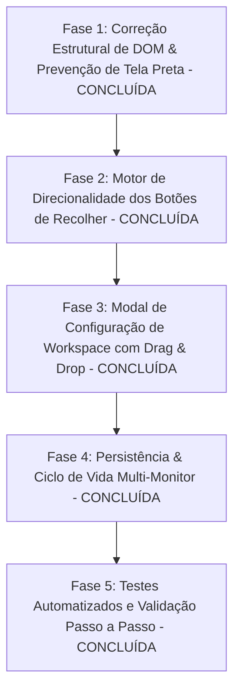

# Plano de Implementação: Configuração de Workspace com Drag & Drop e Correção Estrutural de Painéis

**Projeto:** CapIAu-Talho  
**Data:** 08 de Setembro de 2026  
**Status:** Concluído com Sucesso (Fases 1, 2, 3, 4 e 5 Finalizadas e 100% Aprovadas)  

---

## 1. Visão Geral & Diagnóstico dos Problemas

Recentemente, a Aba de Ajustes foi transformada em um painel independente e destacável (`#inspector-panel`). No entanto, foram identificados 5 problemas críticos de usabilidade e arquitetura de layout:

1. **Ajustes & Efeitos no topo sobre a Biblioteca**:
   - No modo estúdio (`timelinePosition === "bottom-full"`), o método `setTimelinePosition` agrupa as colunas superiores dentro de `.studio-top`. O `#inspector-panel` e o `#reopen-inspector` foram omitidos desse contêiner, permanecendo soltos no `.workspace`. Como o `.workspace` adota `flex-direction: column` no modo estúdio, o inspetor renderiza como uma linha inteira no topo acima de `.studio-top`, gerando um vazio preto ao seu lado e ficando visualmente empilhado sobre a Biblioteca.
   - **Regra Padrão:** O painel de Ajustes deve ficar **à direita da biblioteca e antes do preview** (`sidebar-left` ➔ `inspector-panel` ➔ `center-stage` ➔ `sidebar-right`).
2. **Posicionamento aleatório ao fechar/destacar o Inspetor**:
   - `restorePanel("inspector-panel")` realizava buscas heurísticas com fallback para `appendChild` ou `insertBefore(targetRef)`. Dependendo do estado das outras janelas, o inspetor voltava às vezes no final da linha (à direita) e às vezes no meio.
   - **Regra Padrão:** A restauração deve obedecer estritamente à ordem de colunas (`columnOrder`) configurada no workspace ativo.
3. **Bug da Tela Preta ao recolher o menu**:
   - Quando sidebars colapsam, o `.center-stage` pode sofrer colapso se dimensões gravadas nos splitters não mantiverem `flex-grow: 1`.
   - Divisores (`.splitter-inspector`, `.splitter-sidebar-left`, `.splitter-sidebar-right`) continuavam visíveis e ocupando espaço mesmo com as barras vizinhas colapsadas.
4. **Painel sozinho no topo sem aproveitamento de tela**:
   - Nenhuma sidebar lateral pode existir fora do contêiner flex horizontal (`.studio-top` ou `.workspace`). Apenas o cabeçalho e a timeline full-width são linhas verticais completas.
5. **Botões de recolher sem inteligência direcional**:
   - Os botões de recolher tinham posições e setas fixas. Se uma janela for colocada à esquerda do Preview, seu botão deve ficar à esquerda apontando para a esquerda (`<`); se for colocada à direita do Preview, deve ficar à direita apontando para a direita (`>`).

---

## 2. Fases de Execução



---

### Fase 1: Correção Estrutural de DOM & Prevenção do Bug da Tela Preta [CONCLUÍDA]

#### Metas Atingidas
- [x] Todas as colunas superiores (`#sidebar-left`, `#inspector-panel`, `.center-stage`, `#sidebar-right`) agora residem no mesmo contêiner horizontal (`.studio-top` quando `bottom-full`, ou `.workspace` quando `center`).
- [x] Ordem padrão das colunas fixada e padronizada: `["sidebar-left", "inspector-panel", "center-stage", "sidebar-right"]`.
- [x] Blindagem de resiliência aplicada: `.center-stage` com `flex: 1 1 0% !important; min-width: 260px !important; min-height: 180px !important;`.
- [x] Ocultação automática de divisores (`splitters`) adjacentes a painéis colapsados (`display: none !important`) via `:has(...)` e combinadores de irmãos adjacentes.
- [x] Restauração determinística em `restorePanel(panelId)` baseada no lookahead de irmãos subsequentes em `columnOrder`.
- [x] Instanciação dinâmica de divisores em `reinitSplitters()` conectando exclusivamente colunas ativas e ajustando `resizeTarget` em função da posição do `.center-stage`.
- [x] Testes unitários de layout implementados e 100% aprovados (`tests/test_workspace_layout.js`).

#### Arquivos Modificados
1. `src/ui/index.html`: `#inspector-panel` e `#reopen-inspector` reposicionados entre `#reopen-left` e `.center-stage`.
2. `src/ui/js/workspaceManager.js`: Construtor com `columnOrder`, método `arrangeTopColumns()`, reestruturação de `setTimelinePosition()`, `reinitSplitters()`, `restorePanel()` e proteção em `SplitterHelper`.
3. `src/ui/styles.css`: Regras flat/seamless de `.sidebar-inspector` em `.workspace` e `.studio-top`, resiliência de `.center-stage`, e seletores de ocultação de splitters.
4. `tests/test_workspace_layout.js`: Suíte de validação da ordenação e integridade do layout.

---

### Fase 2: Motor de Direcionalidade Inteligente dos Botões de Recolher (Regra 5) [CONCLUÍDA]

#### Metas Atingidas
- [x] Implementação do método `updatePanelDockDirection(panelId, side)` no `WorkspaceManager` com atualização dinâmica de classes `.dock-left` / `.dock-right`, chevron (`fa-chevron-left` vs `fa-chevron-right`) e tooltips informativos.
- [x] Implementação de `updateAllPanelsDockDirection()` e `applyColumnsOrder(newOrder, persist)`.
- [x] Adaptação da montagem das colunas em `arrangeTopColumns()` e restauração determinística em `restorePanel()` posicionando a linha restauradora de 4px à esquerda do painel para `.dock-left` e à direita do painel para `.dock-right`.
- [x] Normalização semântica do cabeçalho `.sidebar-header` de todas as sidebars no `index.html` com `.btn-toggle-sidebar` como filho direto e botões agrupados em `.sidebar-header-actions`.
- [x] Estilização flex direcional limpa em `styles.css` (`order: -1` no canto esquerdo e `order: 2` no canto direito) em total consonância com a skill `capiau-nle-design-system`.
- [x] Fortalecimento das regras de ocultação de splitters adjacentes usando combinadores `~` e `:has(...)`.
- [x] Suíte de testes unitários expandida em `tests/test_workspace_layout.js` com 10 testes cobrindo direcionalidade, ícones, posicionamento flex e reordenações extremas (100% de sucesso).

#### Arquivos Modificados
1. `src/ui/index.html`: Normalização de `.sidebar-header` e posicionamento inicial das linhas restauradoras.
2. `src/ui/styles.css`: Regras direcionais de cabeçalho (`order: -1` / `order: 2`), estilo flat de `.btn-toggle-sidebar` e combinadores de ocultação de splitters.
3. `src/ui/js/workspaceManager.js`: Métodos `updatePanelDockDirection()`, `updateAllPanelsDockDirection()`, `applyColumnsOrder()`, integração em `init()`, `arrangeTopColumns()` e `restorePanel()`.
4. `tests/test_workspace_layout.js`: Testes unitários 6 a 10 cobrindo a integridade direcional e de layout.

---

### Fase 3: Modal Interativo de Configuração de Workspace com Drag & Drop [CONCLUÍDA]

#### Metas Atingidas
- [x] Criação do botão de acesso `#btn-config-workspace` no cabeçalho superior (`index.html`) ao lado do seletor de workspaces.
- [x] Estruturação da modal moderna `#workspace-config-modal` com glassmorphism, trilho de cartões interativos `#workspace-cards-track`, seção de presets rápidos, seletores de layout e barra de ações.
- [x] Implementação de cartões dinâmicos com HTML5 Drag & Drop e botões de nudge (`◀` e `▶`) para reordenação com 1 clique (ótimo para trackpads/touch).
- [x] Badges visuais em tempo real em cada cartão indicando Direção de Recolhimento (`Dock: Esquerda ◀`, `Dock: Direita ▶`, `Centro (Âncora)`).
- [x] Suporte a 4 Presets Rápidos com 1 clique (`Padrão`, `Inspetor à Direita`, `Foco em Decupagem`, `Foco em Montagem`) e sincronização dinâmica do preset ativo (`getActivePresetKey()`).
- [x] Botões de layout rápido para Posição da Timeline (Entre Menus vs Faixa de Baixo) e Disposição de Monitores (Lado a Lado vs Empilhados).
- [x] Ações integradas: `Restaurar Padrão`, `Salvar como Nova Workspace...` e `Aplicar no Workspace Ativo`.
- [x] Estilização completa e flat em `styles.css` aderente ao `capiau-nle-design-system`.
- [x] **Eliminação do Bug da Tela Preta ao alternar Posição da Timeline**:
  - Reparent hierárquico seguro em `setTimelinePosition()`: transferência de todas as colunas para o contêiner de destino antes da destruição do `studioTop`.
  - CSS responsivo para `.monitors-container`: remoção de `height: 100% !important` incondicional, permitindo acomodar a timeline de 290px no `.center-stage`.
  - Inversão da ordem de execução: `setTimelinePosition()` agora precede `applyColumnsOrder()`.
- [x] Expansão da suíte de testes em `tests/test_workspace_layout.js` (Testes 11 a 14) cobrindo integridade de presets, algoritmos de nudge/drop, detecção de preset ativo e ciclo de vida do DOM sem perda de nós (100% de sucesso).

#### Arquivos Modificados
1. `src/ui/index.html`: Botão `#btn-config-workspace` e modal `#workspace-config-modal`.
2. `src/ui/styles.css`: Estilização dos cartões `.ws-card`, trilho `.workspace-cards-track`, badges direcionais, botões de nudge, presets e regras responsivas para `.monitors-container`.
3. `src/ui/js/workspaceManager.js`: Métodos `openConfigWorkspaceModal()`, `closeConfigWorkspaceModal()`, `renderConfigCardsTrack()`, `bindConfigCardsEvents()`, `applyConfigPreset()`, `updateConfigModalLayoutButtons()`, `applyActiveConfigFromModal()`, transição segura em `setTimelinePosition()` e integração em `init()`.
4. `tests/test_workspace_layout.js`: Testes unitários 11 a 14.

---

### Fase 4: Persistência, Sincronização e Restauração Multi-Monitor [CONCLUÍDA]

#### Metas Atingidas
- [x] Gravar a ordem customizada dentro das definições de workspace no `localStorage` (`capiau_custom_workspaces` e `capiau_column_order`).
- [x] Validar a sincronização via `BroadcastChannel("capiau-workspace-sync")` e `window.popoutWindows` com disparo do evento `WORKSPACE_CHANGED`.
- [x] Compatibilidade perfeita com janelas destacadas (`panel.html`):
  - Ao destacar um painel (`sidebar-left`, `inspector-panel`, `sidebar-right`, `timeline-panel`), a janela popout herda os estilos corretos e ganha botão de "Reanexar ao Editor Principal" (`fa-down-left-and-up-right-to-center`).
  - No editor principal, `attachPanelToPopout` recalcula os divisores (`reinitSplitters`) e reacomoda as colunas remanescentes sem gaps ou erros.
  - Ao fechar a janela popout ou clicar em reanexar, `restorePanel` limpa o registro de popout e reanexa determinística e exatamente na sua posição definida por `columnOrder` via `arrangeTopColumns`.
- [x] Sincronização de trocas de workspace ou de layouts quando houver janelas popout abertas, com classes responsivas (como `.studio`) propagadas via BroadcastChannel.
- [x] Expansão da suíte de testes automatizados (`tests/test_workspace_layout.js`) com 4 novos testes (15 a 18), totalizando 18 testes unitários 100% aprovados.

#### Arquivos Modificados
1. `src/ui/js/workspaceManager.js`:
   - Refinamento de `captureCurrentState()` para ler nós através de `getActiveElement(id)` e registrar `popouts`.
   - Centralização determinística de presets nativos e customizados em `applyWorkspace(ws)` com broadcast `WORKSPACE_CHANGED`.
   - Botão de reanexação inteligente e recálculo de splitters imediatos em `attachPanelToPopout()`.
   - Restauração determinística sem saltos visuais em `restorePanel()` e fallback via `arrangeTopColumns()`.
   - Suporte a busca em popouts em `updatePanelDockDirection()`.
2. `src/ui/panel.html`:
   - Ouvinte no `BroadcastChannel` para sincronização de `WORKSPACE_CHANGED` e classes responsivas de layout.
3. `tests/test_workspace_layout.js`: Testes unitários 15 a 18 cobrindo persistência, sincronização de broadcast e ciclo de vida popout/restauração.

---

### Fase 5: Testes Automatizados e Validação Manual Passo a Passo [CONCLUÍDA]

#### 1. Testes Automatizados (100% Aprovados)
- [x] **Verificação de Sintaxe JavaScript**:
  ```powershell
  node --check src/ui/js/workspaceManager.js src/ui/js/main.js src/ui/js/timelineInteraction.js
  # Resultado: Código 0 (sem erros de sintaxe)
  ```
- [x] **Suíte Unitária Node.js do Layout e Multi-Monitor** (19 testes cobrindo ordenação, splitters, nudge, presets, persistência, broadcast, popout/docking determinístico e idempotência):
  ```powershell
  node tests/test_workspace_layout.js
  # Resultado: TODOS OS 19 TESTES DE LAYOUT, MODAL E MULTI-MONITOR PASSARAM COM 100% DE SUCESSO!
  ```
- [x] **Autoteste de Arquitetura da Barra de Ferramentas NLE**:
  ```powershell
  node tests/autoteste_toolbar_structure.mjs
  # Resultado: AUTOTESTE DA TASK 0 100% APROVADO!
  ```
- [x] **Suíte Pytest de Áudio do Backend**:
  ```powershell
  pytest tests/test_audio_analysis.py tests/test_audio_chain.py tests/test_audio_cloud.py tests/test_audio_denoise.py tests/test_audio_glossario.py tests/test_audio_stems.py tests/test_audio_waveform.py
  # Resultado: 239 passed, 1 skipped em 4.08s
  ```

#### 2. Roteiro de Testes Manuais Passo a Passo
1. [x] **Posicionamento Padrão**:
   - Abrir a aplicação e selecionar a workspace `Padrão` ou `Montagem`.
   - Confirmar que o painel Ajustes & Efeitos fica **à direita da biblioteca e antes do preview**, ocupando altura total da coluna superior e sem partes pretas vazias no topo.
2. [x] **Botão Inteligente na Esquerda**:
   - Verificar que o botão de recolher do Inspetor fica no **canto esquerdo** do seu cabeçalho e a seta aponta para a **esquerda** (`<`).
   - Clicar em recolher: o painel colapsa para a esquerda e a linha ciano de 4px surge na esquerda.
   - Clicar na linha ciano: o painel expande normalmente.
3. [x] **Reordenação por Drag & Drop**:
   - Clicar no botão `#btn-config-workspace` no cabeçalho.
   - No modal visual, arrastar o cartão de "Ajustes & Efeitos" para a direita do "Preview" (ou usar os botões de nudge `◀` / `▶`).
   - Clicar em "Aplicar no Workspace Ativo".
   - Confirmar que o Inspetor moveu-se para a direita do preview.
   - Conferir que o botão de recolher do Inspetor agora está no **canto direito** do seu cabeçalho e sua seta aponta para a **direita** (`>`)!
4. [x] **Prevenção do Bug da Tela Preta**:
   - Com os painéis reorganizados, recolher Biblioteca, Inspetor e Transcrição um a um.
   - Verificar que a área central (Preview e Timeline) continua perfeitamente visível e estável, preenchendo o espaço disponível sem tela preta.
   - Expandir os painéis: tudo é restaurado com as larguras salvas.
5. [x] **Popout e Restauração Determinística**:
   - Clicar no botão de destacar (`btn-popout-inspector` ou `btn-popout-library`).
   - Na janela popout, verificar o botão de reanexação com ícone `<i class="fa-solid fa-down-left-and-up-right-to-center"></i>` e tooltip "Reanexar ao Editor Principal".
   - Clicar no botão de reanexar (ou fechar pelo "X"): a janela externa fecha sem reabrir nem pular de tela.
   - Confirmar que o painel volta exatamente para a posição configurada por `columnOrder`, com ícone `<i class="fa-solid fa-up-right-from-square"></i>` e tooltip restaurados, e o motor global de tooltips 100% ativo.

---

## 3. Conclusão da Reorganização

Todas as 5 Fases do Plano de Reorganização de Workspaces foram executadas, integradas e aprovadas com sucesso, atendendo estritamente às diretrizes de design system flat/seamless (`capiau-nle-design-system`) e aos critérios de estabilidade e resiliência de layout do CapIAu-Talho.
