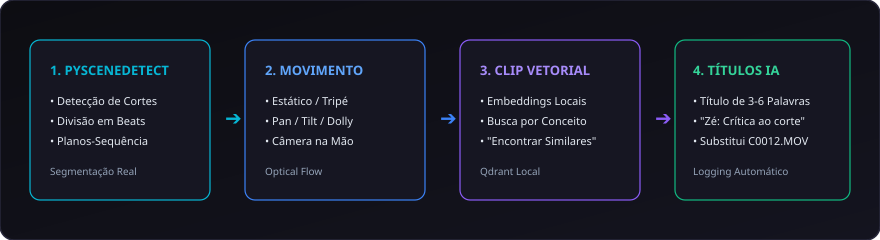

# 06. Decupagem e Visão Computacional

A decupagem de imagens no **CapIAu-Talho** vai muito além da extração periódica de frames fixos. O sistema utiliza **visão computacional local** e **modelos multimodais** para segmentar, catalogar e entender o conteúdo de cada plano de forma cinematográfica.

---

## 🎞️ Segmentação por Shots e Beats (PySceneDetect)

Em vez de capturar um frame arbitrário a cada 10 segundos, o Talho analisa a estrutura visual real dos vídeos:

1. **Detecção de Cortes (Shot Boundaries):** Identifica transições secas e dissoluções, criando segmentos exatos para cada tomada.
2. **Beats Narrativos em Planos-Sequência:** Em tomadas longas contínuas (ex: a câmera passeia pelo set e foca em diferentes objetos), o algoritmo detecta a mudança de centro de interesse e subdivide o clipe em *beats*, facilitando a busca e a inserção cirúrgica de trechos na timeline.

---

## 🎥 Classificação Automática de Movimento de Câmera

Cada shot é analisado através de fluxo óptico (Optical Flow) para classificar o movimento da câmera:

| Badge Visual | Tipo de Movimento | Descrição Técnica |
| :--- | :--- | :--- |
| 🟢 **ESTÁTICO** | Câmera Fixa no Tripé | Sem movimentação significativa de eixos ou enquadramento. |
| 🔵 **PAN (E/D)** | Panorâmica Horizontal | Movimento contínuo para a esquerda ou direita. |
| 🟣 **TILT (C/B)** | Panorâmica Vertical | Movimento de inclinação para cima ou para baixo. |
| 🟡 **TRACK / DOLLY** | Movimento de Acompanhamento | Câmera sobre trilhos ou operador caminhando com gimbal. |
| 🟠 **MÃO LIVRE** | Câmera na Mão (Handheld) | Movimentação orgânica com micro-trepidações típicas de set. |
| 🔴 **WHIP PAN** | Panorâmica Chicote | Movimento ultra-rápido usado frequentemente como transição de corte. |

---

## 🏷️ Títulos Executivos Gerados por IA

Para acabar com a confusão de arquivos como `C0012.MP4` ou `IMG_9043.JPG`, o Talho gera automaticamente títulos executivos curtos (de 3 a 6 palavras) que sintetizam o que o clipe realmente representa:

- ❌ *Evitado:* "Um vídeo de câmera mostrando um homem sentado numa cadeira..."
- ✅ *Gerado pelo Talho:* **"Zé: Crítica ao primeiro corte"**
- ✅ *Gerado pelo Talho:* **"Operador ajustando foco na lente 50mm"**
- ✅ *Gerado pelo Talho:* **"Iluminação quente no fundo do cenário"**

Esses títulos são gravados no banco de dados e aparecem nos cartões de mídia, nas tooltips e nos blocos da timeline.

---

## 👁️ Indexação Visual com CLIP Local (Sem Custo de Nuvem)

Todo keyframe e foto de making-of é processado localmente pelo modelo **OpenCLIP / Multilingual CLIP**:

- **Busca por Conceito Visual:** Permite pesquisar em português por elementos que nunca foram descritos explicitamente em texto (ex: *"olhar tenso através do vidro"*, *"luz azulada refletida na claquete"*).
- **Encontrar Similares:** Um clique no botão **Encontrar Similares** nos cards de mídia ou no inspetor localiza instantaneamente todos os planos do acervo com iluminação, enquadramento ou estética visual semelhantes.

---

## 🎨 Análise de Paleta de Cores, Fita Cromática e Barra de Decupagem

A decupagem visual integra visão computacional local para analisar e classificar a atmosfera luminosa e cromática de cada plano:

### 1. Ponderação de Dominância no OpenCV k-means
Para extrair a paleta dominante sem contaminação por pequenos detalhes ou barras pretas (letterboxing), o extrator calcula a dominância por abundância real de pixels:
- Filtra extremos de iluminação (pretos puros $< 20$ e brancos estourados $> 245$).
- Pondera os clusters k-means por ordem de dominância física:
  $$\mathbf{dominanceWeight} = \max(0.25, 1.0 - (\mathbf{idx} \times 0.22))$$
- Classifica os planos em famílias cromáticas consistentes (ex: *Âmbar / Pôr do Sol*, *Azul / Frio*, *Rubi / Quente*, *Verde / Natureza*).

### 2. Barra Superior de Decupagem Visual & Fita Cromática
A biblioteca integra duas ferramentas de navegação coordenadas:
1. **Fita Cromática Vertical (`#library-scroll-color-ribbon`):** Minimap contínuo na calha de rolagem gerado por coalescência de planos contíguos de cor similar (distância euclidiana ponderada $\le 52$).
2. **Barra de Decupagem Visual (`#library-decoupage-strip`):** Régua superior interativa que permite navegar e fatiar o acervo em blocos lógicos.

### 3. Sistema de Chips Minimalistas Inteligentes (Tiered Smart Chips)
Projetado para painéis laterais estreitos ($320\text{px}$ a $400\text{px}$), o sistema adota dimensionamento escalonado (altura de $16\text{px}$ e largura a partir de $16\text{px}$), acomodando de 10 a 15 grupos simultâneos sem necessidade de rolagem horizontal:

| Categoria | Apresentação Visual | Classe CSS | Comportamento |
| :--- | :--- | :--- | :--- |
| **Paleta Global** | `145` ou `[■]` | `.chip-number-only` / `.chip-swatch-only` | **Nunca exibe nome de cor** (a cor já comunica a identidade). $\le 3$ itens vira swatch puro de $16\times 16\text{px}$; $\ge 4$ itens exibe apenas a contagem numérica. |
| **Cenas por Cor** | `1 • 24` ou `[■]` | `.chip-compact` / `.chip-swatch-only` | $\le 2$ itens vira swatch; $3$ a $9$ itens exibe índice (`1`, `2`); $\ge 10$ itens exibe índice e contagem. |
| **Escala de Plano** | `CU 12`, `PM 8` | `.chip-compact` | Siglas clássicas de montagem cinematográfica (`CU`, `PM`, `PA`, `PG`, `DET`, `AER`, `VAR`). |
| **Pessoas & Falantes** | `Emily 14`, `Dina 20` | `.chip-compact` | Apenas primeiro nome do falante + contagem de mídias. |
| **Diárias / Datas** | `24 Out 15` | `.chip-compact` | Dia + Mês abreviado + contagem. |
| **Smart Bins** | `Entrev. 8`, `Elenco 10` | `.chip-compact` | Taxonomia sucinta de 1 palavra (`Entrev.`, `Elenco`, `Ação`, `Câmera`, `Luz`, `Direção`, `Áudio`, `Set`, `Bastid.`). |
| **Palavras-Chave** | `Bastid. 10` | `.chip-compact` | Truncamento limpo a 7 caracteres + contagem. |

### 4. Micro-interações e Controles
- **Clique Simples:** Rola suavemente até o início do grupo correspondente e dispara pulso visual (`applyRevealPulse`) nos cards de mídia.
- **Alt + Clique:** Aplica **filtro exclusivo**, ocultando as demais cenas e exibindo o botão `[X Todas]`.
- **Descarte Automático:** Clicar normalmente em qualquer outro chip após um filtro exclusivo descarta o filtro e navega direto para a nova cena, sem exigir a tecla `Escape`.
- **Modo Multi-Linhas (`[⌄ Expandir / Recolher]`):** Alterna entre linha única e modo expandido com quebra de linha (`flex-wrap: wrap`) e rolagem vertical de até $180\text{px}$.
- **Tooltips Globais Completas:** Passar o mouse sobre qualquer chip (mesmo swatches sem texto) projeta a tooltip flutuante com nome por extenso, código hexadecimal da cor, minutagem total (`00:00:00`), contagem exata e instruções de atalhos.

---

> Próximo passo: Aprenda sobre transcrição fonética e edição por texto em [[07. Transcrição e Edição por Texto|07.-Transcricao-ASR-e-Edicao-por-Texto]].

> Termo desconhecido? Veja o [[Glossário|18.-Glossario-Visual-e-Terminologia]]
