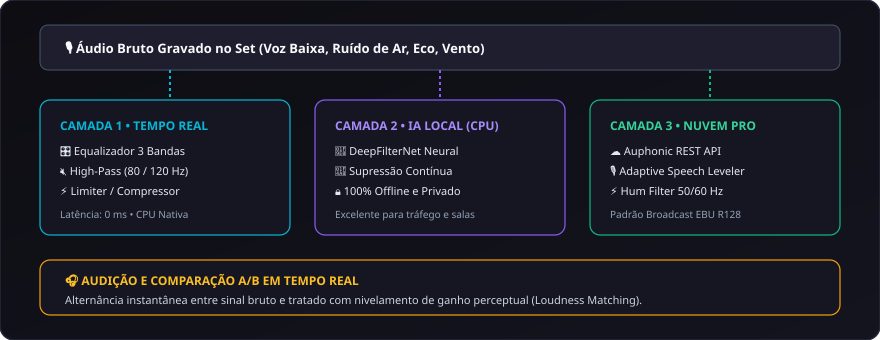

# 10. Diagnóstico e Restauração de Áudio

O **CapIAu-Talho** inclui uma suíte completa de **análise técnica, equalização e restauração inteligente de áudio**, projetada para resolver problemas acústicos típicos de captação documental (ruído de gerador, eco de sala, vento, vazamentos e níveis desbalanceados).

---

## 📊 Diagnóstico Técnico de Áudio (EBU R128)

Ao inspecionar qualquer mídia ou clipe da timeline, o sistema calcula métricas de engenharia de áudio em tempo real:

| Métrica | Padrão / Alvo | O que Significa |
| :--- | :--- | :--- |
| **Integrated LUFS** | -23.0 LUFS (Broadcast) / -14.0 LUFS (Web) | Volume percebido integrado ao longo de todo o clipe. |
| **True Peak (dBTP)** | ≤ -1,0 dBTP | Nível máximo de pico para evitar distorção digital pós-compressão. |
| **Loudness Range (LRA)** | 4 a 12 LU | Variação dinâmica entre os momentos mais suaves e mais intensos da voz. |
| **Relação Sinal-Ruído (SNR)** | ≥ 20 dB (bom) / < 10 dB (crítico) | Nível de clareza da voz em relação ao ruído de fundo da sala/set. |

---

## 🎛️ As Duas Frentes: Ao Vivo (WebAudio) vs. Renderizado (WAV)

O CapIAu-Talho estabelece uma fronteira clara e visível entre processamento instantâneo e renderização pesada em segundo plano:

1. **Ao Vivo (Navegador via WebAudio):**
   - EQ paramétrico de 3 bandas, filtro passa-altas (low-cut), noise gate e compressor suave rodam em tempo real no motor de áudio do navegador.
   - **Latência zero, totalmente não-destrutivo e reversível:** não gera arquivos em disco e não requer renderização intermediária.

2. **Renderizado (Background Worker & Nuvem):**
   - Reparo cirúrgico de clipping, denoise neural e masterização EBU R128 rodam em processos dedicados fora do servidor principal.
   - Produzem um arquivo derivado WAV Broadcast de alta fidelidade (48 kHz, 24 bits) em `data/audio_tratado/`. O arquivo original de câmera **nunca é modificado**, e o clipe guarda apenas um ponteiro para a versão tratada.
   - **Botão "Prever 15 s":** Como modelos neurais de denoise rodam a RTF que depende da máquina (referência: ~0,7 a 0,8; uma entrevista de 22 min pode levar ~15 min na CPU), o botão de prévia gera um trecho demonstrativo de 15 segundos em poucos instantes antes de comprometer o arquivo inteiro.
   - **Momentos Críticos Clicáveis:** A medição `ebur128` mapeia os trechos de pico real (> -1.0 dBTP) ou clipping digital em uma faixa visual com marcadores clicáveis que movem a agulha do player diretamente ao ponto de distorção.
   - **Glossário Técnico (39 Verbetes) & Chat:** Ícones informativos ⓘ abrem explicações da engenharia de som a partir de `audio_glossario.py`, o mesmo conhecimento consumido pelas 4 ferramentas de áudio do agente de IA no chat.

---

## 🎛️ As Três Camadas de Tratamento de Áudio

### Camada 1: Equalizador Paramétrico e Filtros Locais
- **Filtro Passa-Altas (High-Pass / Low-Cut):** Corte seletivo em 80 Hz ou 120 Hz para eliminar ruídos de manuseio de microfone e roncos graves de ar-condicionado.
- **Equalizador de 3 Bandas:** Ajuste cirúrgico de graves, médios e agudos com ganho de ±12 dB.
- **Compressor / Limiter Suave:** Nivela falas tímidas e segura picos sem gerar artefatos audíveis.

### Camada 2: Denoise por IA local (DPDFNet e GTCRN)
- Supressão de ruído por rede neural rodando na CPU, via ONNX e **sherpa-onnx**, sem enviar áudio para a internet. Implementado em `src/media/audio_denoise.py`.
- **DPDFNet (48 kHz):** o modelo de **entrega**; saída em 48 kHz, RTF que depende da máquina: 0,82 é a referência do motor e 0,71 foi o medido na máquina do autor. O valor medido fica em `audio.denoise.rtf_medido` e alimenta a estimativa de tempo da interface.
- **GTCRN (16 kHz):** modelo leve, 3 a 4 vezes mais rápido que o tempo real, mas com saída de 16 kHz: serve **só para prévia**, nunca como arquivo final.
- A atenuação é limitada de propósito (entre 6 e 18 dB, conforme o piso de ruído medido) para não destruir a ambiência da cena.
- **Opcional e sob demanda:** não vem instalado. Instale com `pip install sherpa-onnx soundfile` e baixe o modelo com `python scripts/baixar_modelo_denoise.py` (veja [[02. Instalação e Configuração|02.-Instalacao-e-Configuracao]]). Sem eles, o programa informa o que falta em vez de fingir que processou.

### Camada 3: Restauração de Alta Precisão via Auphonic Cloud API
Para arquivos de áudio gravemente degradados, o Talho integra-se à API da **Auphonic**:
- **Nivelador de Voz Dinâmico (Adaptive Leveler):** Equilibra entrevistados que falam muito baixo ou afastados do microfone.
- **Dereverb, AutoEQ e alargamento de banda**, além de denoise preservando a ambiência.
- **Cota:** o plano gratuito dá 2 h/mês; a cota restante aparece no painel e, sem chave ou sem cota, a rota recusa antes de tocar na rede.
- **Chave:** `AUPHONIC_API_KEY` no `.env` **ou** em Configurações (o valor do painel vence o `.env`).

---

## 📏 Medições de referência

Números medidos no acervo de desenvolvimento (a sua máquina pode variar):

| Medição | Resultado |
| :--- | :--- |
| Cadeia clássica de FFmpeg (loudness, limitador, reparo) | 31x a 44x o tempo real: uma entrevista de 22 min leva ~43 s. |
| Denoise por IA (DPDFNet, CPU) | RTF ~0,71 a 0,82: a mesma entrevista leva ~15 min, cerca de 45 vezes mais lento. |
| Piso de ruído (janela de teste de 6:45 a 8:15) | -26,7 dB original; -36,4 dB com o filtro clássico; -49,4 dB com a IA (13 dB mais fundo). |
| Alvos de saída | Loudness -16 LUFS e pico abaixo de -1,5 dBTP nos dois caminhos. |
| Arquivo derivado | WAV 48 kHz, 24 bits, ~360 MB por entrevista de 22 min, com cache por hash da cadeia. |

Presets existentes na cadeia: `so_entrega`, `resgate_estourado`, `ambiencia_preservada`, `previa_rapida`, `resgate_ia` e `voz_limpa_ia`. Os de nome terminado em `_ia` usam o denoise por IA.

## 🤖 Glossário e agente de áudio

Os ícones ⓘ abrem verbetes de `src/nlp/audio_glossario.py`, a mesma fonte usada pelo chat. O agente de edição tem ferramentas de áudio (medir, sugerir, aplicar, ajustar ao vivo); ele **não** aciona o Auphonic (gastaria a sua cota: apenas recomenda e explica) e nunca liga corte automático de silêncio.

---

## 🎚️ Presets da cadeia renderizada

| Preset | O que faz | Quando usar |
| :--- | :--- | :--- |
| `so_entrega` | Normalização de loudness (2 passes) e limitador; não toca no timbre. | Áudio já bom que só precisa chegar no nível de entrega. |
| `resgate_estourado` | Reparo de clipping, denoise clássico (sem IA), loudness e limitador. | Áudio estourado e com ruído, sem esperar a IA. |
| `ambiencia_preservada` | Denoise leve de 6 dB e loudness, sem limitador. | Externas e feiras, onde a ambiência faz parte da cena. |
| `previa_rapida` | Apenas loudness. | Conferir rapidamente o nível. |
| `resgate_ia` | Reparo de clipping, denoise por IA forte (até 18 dB), loudness e limitador. | Estourado e ruidoso; é o mais caro. |
| `voz_limpa_ia` | Denoise por IA leve (6 dB) e loudness, sem limitador. | Entrevista bem captada onde só incomoda o chiado. |

Os presets de IA são **caros** (o passo de IA domina o custo) e por isso são presets separados, com nome distinto: nenhum preset clássico usa IA.

---

## 🔄 Comparação A/B em Tempo Real

No painel de áudio, clique no botão **Comparar A/B**:
- Alterna instantaneamente entre o áudio bruto gravado e o sinal processado.
- Inclui **compensação automática de ganho (Loudness Matching)** para que o usuário avalie a qualidade real da limpeza sem ser enganado por diferenças de volume.

---

> Próximo passo: Conheça os recursos de cor e viewport em [[11. Cor e Viewport NLE|11.-Cor-Grading-e-Transformacoes-Visuais]].

> Termo desconhecido? Veja o [[Glossário|18.-Glossario-Visual-e-Terminologia]]
