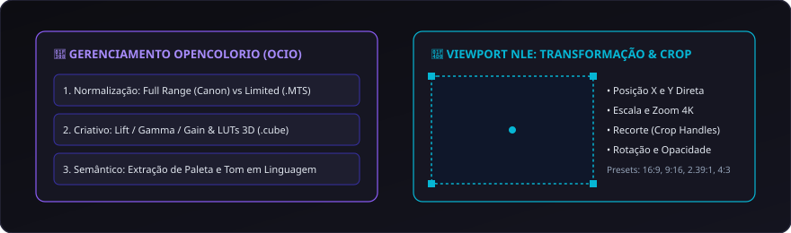

# 11. Cor e Viewport NLE

O tratamento de cor e as transformações espaciais no **CapIAu-Talho** combinam a normalização automática do perfil de cor das câmeras com ajustes criativos simples e edição visual direta no viewport do player.

> [!NOTE]
> Gerenciamento de cor com OpenColorIO, LUTs 3D `.cube`, rodas de cor (Lift/Gamma/Gain) e curvas **não existem na versão atual**. Estão previstos como trabalho futuro (veja [[17. Roadmap e Guia de Contribuição|17.-Roadmap-e-Guia-de-Contribuicao]]).

---

## 🌈 Arquitetura de Cor em Três Camadas

```
[Camada Técnica]    Resolve o perfil de cor de cada mídia a partir das tags do FFprobe (range full/limited, primárias)
         ↓
[Camada Criativa]   Ajustes no painel de Efeitos: brilho, contraste, saturação, matiz, sépia, tons de cinza e desfoque
         ↓
[Camada Semântica]  Indexa a luz e a paleta em linguagem natural (ex: "luz quente de fim de tarde", "tons azulados")
```

### O Desafio das Múltiplas Câmeras em Acervos
Em um documentário real, câmeras diferentes convivem na mesma timeline:
- **Canon DSLR / Mirrorless:** Grava em *Full Range (0-255 / `pc`)* com formato `yuvj420p`.
- **Camcorders AVCHD (.MTS):** Gravam em *Limited Range (16-235)* sem tags explícitas.
- **Fotos RAW (.CR2):** Espaço de cor linear de sensor com demosaicing específico.

O Talho lê as tags do FFprobe e resolve um perfil utilizável para cada mídia, registrando de onde ele veio (tag, ausente, heurística ou ajuste humano). Quando a câmera não etiqueta nada, assume-se Rec.709 como hipótese de trabalho, sem fingir certeza.

---

## 🎨 Controles de Correção Criativa de Cor

No painel de Efeitos e Inspetor de Vídeo:

| Controle | Aplicação prática |
| :--- | :--- |
| **Brilho e contraste** | Corrige exposição geral. |
| **Saturação e matiz** | Ajusta o impacto e o desvio de cor. |
| **Sépia e tons de cinza** | Looks de arquivo e preto e branco. |
| **Desfoque** | Suaviza ou esconde detalhes. |
| **Camada de Ajuste** | Aplica os ajustes a todas as pistas abaixo dela. |
| **Cor Sólida (Color Matte)** | Gera fundos e cartelas de cor. |

Os mesmos ajustes são reproduzidos no render de vídeo, com a mesma ordem de operações do player (veja [[15. Arquitetura Técnica e API REST|15.-Arquitetura-Tecnica-e-API-REST]]).

---

## 📐 Viewport NLE: Alças de Transformação e Recorte (Crop)

No monitor de programa, o editor pode interagir diretamente com a imagem através de alças visuais na tela:



### 1. Transformação Direta e Conformação Fiel
- **Conformação Padrão "Fit" (Contain):** Todas as rotas de inserção de mídias na timeline adotam por padrão o enquadramento *fit* (proporção nativa contida no frame da sequência sem cortes), em paridade matemática estrita com o renderizador Python de exportação (`geometria.py` e `grafo_video.py`).
- **Caixa de Overlay em % que Acompanha o Zoom do Preview:** As dimensões da caixa delimitadora (*bounding box*) e as translações X/Y são calculadas dinamicamente em porcentagens derivadas do aspecto nativo da mídia. Isso impede que a imagem seja cortada ao navegar com o zoom de pré-visualização (`previewZoom` via `Shift + Roda`).
- **Cursores de Alça Rotation-Aware:** As 8 alças perimetrais de escala e reposicionamento possuem mapeamento inteligente de quadrantes girados, recalculando a orientação das setas do cursor do mouse conforme a rotação ativa do clipe (0°, 90°, 180° e 270°).
- **Rotação Não-Destrutiva Rápida (`R` / `Shift + R`):** Gira fotos ou vídeos em 90° horário ou anti-horário diretamente no teclado, propagando automaticamente para a timeline e exportação em `transform.rotation`.
- **Posição (X / Y):** Reposicione o plano na tela com o mouse ou via teclado.
- **Escala e Zoom:** Amplie planos em 4K para criar falsos planos médios a partir de um plano geral.
- **Opacidade:** Ajuste o nível de transparência para sobreposições de camadas entre V1 e V2.

### 2. Recorte Interativo (Crop)
- Alterne para o modo **Recorte (Crop)** para cortar bordas indesejadas (ex: microfone boom aparecendo no topo do quadro).
- **Proporções Predefinidas de Sequência:**
  - 🎬 **16:9 (1920x1080 / 4K UHD):** Formato padrão para TV e cinema widescreen.
  - 📱 **9:16 (1080x1920):** Formato vertical para Reels, TikTok e Shorts.
  - 🎞️ **2.39:1 (Cinemascope):** Formato anamórfico cinematográfico.
  - 📺 **4:3 (1440x1080):** Formato clássico para filmes de arquivo e acervos históricos em fita (VHS/Betacam).

---

> Próximo passo: aprenda a criar cartelas e legendas em [[12. Titler NLE, Legendas e Animação|12.-Titler-NLE-Legendas-e-Animacao]].

> Termo desconhecido? Veja o [[Glossário|18.-Glossario-Visual-e-Terminologia]]
