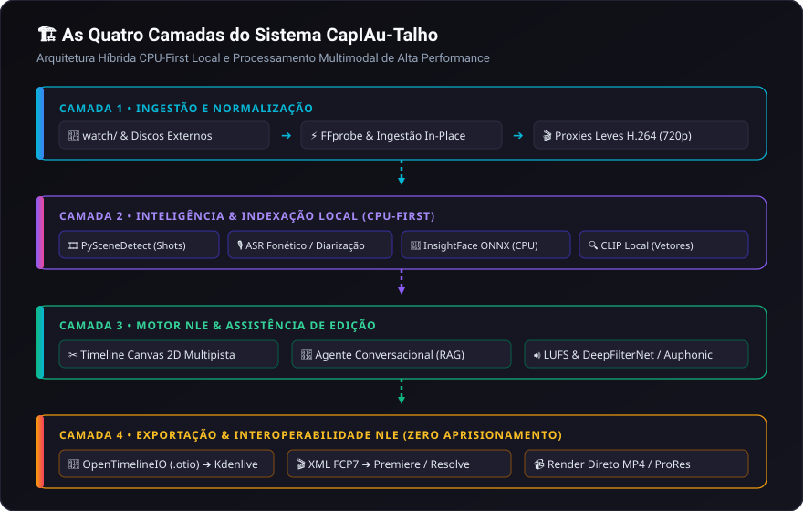
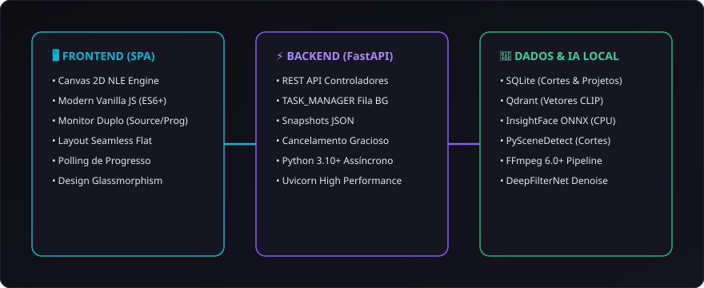

# 15. Arquitetura Técnica e API REST

Visão técnica do **CapIAu-Talho**: como o código se organiza, por onde uma mídia passa da ingestão à exportação, onde os dados ficam e como falar com o servidor pela API REST.

---

## Visão geral em camadas



| Camada | Onde roda | O que faz | Custo |
| :--- | :--- | :--- | :--- |
| **Armazenamento** | HD externo ou SSD | Guarda os originais, que nunca são copiados nem alterados. | — |
| **Backend** | Sua CPU, local (FastAPI) | Ingestão, proxies, segmentação, embeddings, biometria facial, banco vetorial, render. | Grátis |
| **Nuvem** | APIs externas, opcionais | Transcrição com diarização, descrição de imagens, texto, tratamento de áudio (Auphonic). | Pago, por uso |
| **Frontend** | Navegador | Timeline em Canvas 2D, players Source e Program, biblioteca, chat do agente. | — |



### Mapa do código (`src/`)

| Pasta | Responsabilidade |
| :--- | :--- |
| `api/` | Aplicação FastAPI (`server.py`), rotas em `api/routes/` (projetos, mídia, narrativa e busca, rostos, entidades, cenas, configurações, modelos locais) e esquemas. |
| `services/` | Regras de negócio: pipeline de análise, agente de chat, serviço de rostos, configurações (`settings_service`, `settings_registry`), modelos locais, S3, nuvem de áudio, sincronização. |
| `ingest/` | Varredura da pasta monitorada (`watcher.py`). |
| `media/` | Wrappers de FFmpeg, análise e cadeia de áudio, denoise local (`audio_denoise.py`), waveforms, processamento de imagem. |
| `transcription/` | Motores de ASR e diarização (`motores.py`, `asr_engine.py`) e o worker do ambiente `.venv-nemo`. |
| `vision/` | Análise multimodal, detectores, motor e pipeline facial em cascata (`backends/`), paleta, segmentação. |
| `search/` | Busca semântica de texto (`semantic.py`) e de imagem CLIP (`image_semantic.py`) sobre o Qdrant. |
| `nlp/` | Temas, resumos, enriquecimento, prompts, glossário de áudio e chamadas de LLM. |
| `db/` | Conexão SQLite, `schema.py` e repositórios. |
| `color/` | Resolução do perfil de cor da mídia a partir das tags do FFprobe. |
| `export/` | Exportação OTIO/XML/EDL, legendas, stems de áudio e o motor de render (`video_render/`). |
| `ui/` | Interface web: `index.html`, `styles.css` e os módulos em `ui/js/`. |
| `core/` | Gerenciador de tarefas (`tasks.py`), exceções e log. |
| `worker_vision.py`, `worker_transcricao.py`, `worker_audio.py` | Workers de lote em processo separado. |

---

## Caminho de uma mídia, da ingestão à exportação

1. **Ingestão.** O ingestor varre a pasta, calcula um SHA-256 de cada arquivo (para nunca catalogar o mesmo material duas vezes) e grava só o caminho no SQLite. O original não sai do lugar.
2. **Proxies.** O FFmpeg gera uma cópia leve em 720p para o player e um áudio mono de 16 kHz para a transcrição. O vídeo original não é enviado a nenhuma API.
3. **Segmentação.** O PySceneDetect quebra o vídeo nos cortes reais e subdivide planos longos em beats, escolhendo um keyframe representativo de cada trecho.
4. **Análise.** Os keyframes escolhidos vão para o modelo de visão (OpenRouter), que devolve descrições; o áudio vai para o motor de ASR configurado, que devolve a transcrição separada por falante.
5. **Indexação.** Texto e imagem viram vetores (embeddings multilíngues para texto, CLIP para imagem) gravados no Qdrant local. Isso permite buscar "contraluz na janela" sem a palavra estar na descrição.
6. **Rostos.** Em paralelo, o detector facial local encontra rostos, o extrator gera vetores e o DBSCAN os agrupa. Correções manuais ficam travadas contra reagrupamentos.
7. **Tratamento de áudio (opcional, sob demanda).** Um passe de FFmpeg mede loudness, pico real e piso de ruído e sugere um preset; renderizar grava um WAV derivado em `data/audio_tratado/` e o clipe passa a apontar para ele.
8. **Edição e exportação.** Você monta na timeline e exporta em `.otio`, `.xml` ou `.edl`, ou renderiza um MP4.

---

## Dados e armazenamento

| O quê | Onde (padrão) | Variável para mudar |
| :--- | :--- | :--- |
| Banco relacional SQLite (WAL) | `data/capiau.db` | `CAPIAU_DB_PATH` |
| Banco vetorial Qdrant, embutido em arquivo | `data/qdrant.db` | `CAPIAU_QDRANT_DB` |
| Proxies e miniaturas | `data/proxies/` (`thumbnails/`, `photos/`) | `CAPIAU_PROXIES` |
| Originais copiados (quando há cópia) | `data/originals/` | `CAPIAU_ORIGINALS` |
| Caches e waveforms | `data/cache/` | `CAPIAU_CACHE` |
| Exportações | `data/exports/` | `CAPIAU_EXPORTS_DIR` |
| Áudio tratado | `data/audio_tratado/` | — |
| Modelos locais | `data/models/` | — |
| Logs e progresso dos workers | `data/logs/` | — |
| Pasta monitorada | `watch/` | `CAPIAU_WATCH` |

O SQLite guarda projetos, mídias (`video`, `photo`), rostos e pessoas, transcrições (`transcript`, `dialogue_utterance`, `dialogue_word`), temas, entidades, cenas, timelines, configurações e histórico de metadados. O Qdrant guarda as coleções de texto (`capiau_making_of`) e de imagem (`capiau_images`).

> [!IMPORTANT]
> O Qdrant embutido só aceita **um processo por vez**. Enquanto um worker de lote roda, a busca semântica fica indisponível e volta sozinha ao fim da rodada.

### Backup

Copie a pasta `data/` (especialmente `capiau.db` e `qdrant.db`) e o seu `.env`.

---

## Filas e acompanhamento de progresso

Operações pesadas rodam fora do caminho da requisição.

- **`TASK_MANAGER`** (`src/core/tasks.py`): gerenciador central de tarefas em threads, subprocessos FFmpeg e progresso. Cada tarefa tem uma chave única (por exemplo `scan_proj_{project_id}`), suporta pausa, retomada e cancelamento (os laços verificam `is_cancelled`).
- **Workers de lote** (`worker_vision.py`, `worker_transcricao.py`, `worker_audio.py`): processos separados do servidor, para que um lote longo não sufoque a interface. Cada um grava um snapshot de progresso em `data/logs/worker_progress_<tipo>.json` e um arquivo de PID (instância única); a tela de Tarefas lê esses arquivos por polling, sem WebSocket.
- **Pré-visualização de custo:** o disparo da transcrição em lote tem modo `dry_run`, usado pela interface para mostrar horas de áudio e custo estimado antes de gastar.

---

## Modelos padrão

Definidos em `src/config.py` e ajustáveis em **Configurações** ou no `.env` (o painel tem prioridade).

| Uso | Padrão | Reserva ou alternativas |
| :--- | :--- | :--- |
| Texto, resumos, temas, chat | `deepseek/deepseek-v4.1-flash` | `deepseek/deepseek-v4-pro`, `~deepseek/deepseek-flash-latest`, Gemini, Claude |
| Agente de edição | `deepseek/deepseek-v4.1-flash` | mesma lista de texto |
| Visão | `google/gemini-2.5-flash` | reserva `nvidia/nemotron-3-nano-omni-30b-a3b-reasoning:free` após `VISION_MAX_RETRIES` falhas |
| Embeddings de texto | `sentence-transformers/paraphrase-multilingual-MiniLM-L12-v2` (384 dimensões) | trocar exige `POST /api/search/reindex` |
| Embeddings de imagem | CLIP `clip-ViT-B-32` (512 dimensões), texto via `clip-ViT-B-32-multilingual-v1` | — |
| Transcrição | AssemblyAI (Universal-3.5, com Universal-2 de reserva) | Deepgram Nova-3; Whisper local (`large-v3-turbo`), Canary e SenseVoice, experimentais |

### Decisões registradas

- **Visão: de volta ao Gemini.** Em teste de 17/07/2026 o Nemotron `:free` teve qualidade equivalente numa amostra pequena, mas em produção cerca de 30% das chamadas bateram em "Upstream idle timeout exceeded" (504 do gateway da OpenRouter esperando o modelo `:free`), projetando dias só para as fotos restantes contra poucas horas com o Gemini. O Gemini voltou a ser o padrão; o Nemotron continua selecionável e como reserva.
- **Embeddings multilíngues.** O modelo antigo (`all-MiniLM-L6-v2`) é focado em inglês e ranqueava mal buscas em português. O multilíngue entende português de verdade; após trocar de modelo, reindexe o acervo.
- **Modelos gratuitos (`:free`) ficam por último nas listas.** Limite do OpenRouter de 20 requisições por minuto e, para 1000 por dia, conta com pelo menos US$ 10 em compras (senão 50 por dia).
- **Nenhum modelo DeepSeek na lista de visão:** nenhum da linha aceitava imagem no OpenRouter na data da conferência.
- **Processamento local primeiro.** Indexação, biometria e embeddings rodam na CPU do usuário; a nuvem é acionada só nos fluxos configurados.
- **Segurança.** Hoje CORS `*` e sem autenticação (há plano de autenticação e restrição de rede, ainda não implementado). Veja [[02. Instalação e Configuração|02.-Instalacao-e-Configuracao]].

---

## Render e paridade com o player

O motor de render (`src/export/video_render/`) traduz a timeline em um grafo de FFmpeg que reproduz o monitor de Programa **na mesma ordem** em que o navegador aplica os efeitos:

enquadramento → cor → borrão → opacidade → recorte → transformação → composição.

Trocar duas dessas etapas de lugar já muda a imagem, então a ordem é contrato. Pontos principais:

- **Cor como no CSS.** `brightness` e `contrast` viram dois estágios `lutrgb` encadeados (o CSS satura entre uma função e outra); `saturate`, `hue-rotate`, `sepia` e `grayscale` viram matrizes `colorchannelmixer`, na ordem, pulando as neutras.
- **Fades** com a curva desenhada, avaliada quadro a quadro.
- **Preflight.** Antes de começar, o programa diz o que existe e o que falta: mídia ausente ou master sem o HD dos originais bloqueiam a exportação em vez de renderizar preto; limitações conhecidas viram aviso com a lista de clipes afetados.
- **Rascunho e master** usam o mesmo grafo: o rascunho parte dos proxies, o master dos originais.
- **Encoder por hardware** (NVENC, QSV ou AMF) detectado automaticamente, com queda para `libx264`.

Os títulos entram por captura de um navegador headless (Playwright); veja [[02. Instalação e Configuração|02.-Instalacao-e-Configuracao]].

---

## Estrutura de pastas do repositório

```
capiau-talho-v03/
├── data/              Bancos locais, proxies, caches, modelos (não versionado)
├── docs/              Documentação complementar e planos
├── scripts/           Utilitários (lançadores, retriagem, calibração, deploy da wiki)
├── src/               Código (veja o mapa acima)
├── tests/             pytest e autotestes Node.js (.mjs)
├── watch/             Pasta monitorada de ingestão
└── wiki/              Fonte desta wiki
```

---

## API REST

O servidor é uma aplicação FastAPI (`src.api.server:app`), com base em `http://localhost:8000`.

- **Documentação interativa:** `http://localhost:8000/docs` (Swagger UI) e `http://localhost:8000/redoc`. O esquema OpenAPI fica em `/openapi.json`.
- **Saúde:** `GET /api/health` devolve o estado do SQLite, do Qdrant e do hardware.
- **Arquivos estáticos:** `/proxies`, `/originals`, `/exports` e `/cache` servem mídia; a interface web é servida na raiz `/`.
- **Autenticação:** nenhuma hoje. Use somente em máquina ou rede confiável.

A tabela abaixo é **gerada automaticamente a partir do código**. Não a edite à mão.

<!-- GERADO:API:INICIO -->

Total: 190 rotas em 9 grupos. A documentação interativa completa (parâmetros e esquemas) fica em `/docs` com o servidor em execução.

### AI Settings

| Método | Rota | Descrição |
| :--- | :--- | :--- |
| GET | `/api/settings` | Valores resolvidos (default -> global -> projeto) com origem de cada um. Secrets mascarados. |
| PUT | `/api/settings/global` | Grava overrides globais (apenas as chaves enviadas). |
| POST | `/api/settings/global/reset` | Remove overrides globais (todos, ou apenas as chaves informadas). |
| POST | `/api/settings/preset` | Aplica um preset no escopo pedido. |
| PUT | `/api/settings/project/{project_id}` | Grava overrides do projeto (apenas as chaves enviadas). |
| POST | `/api/settings/project/{project_id}/reset` | Remove overrides do projeto (todos, ou apenas as chaves informadas). |
| GET | `/api/settings/prompts` | Lista todos os prompts do sistema com os valores resolvidos e suas origens. |
| PUT | `/api/settings/prompts/{prompt_id}` | Grava ou atualiza um override de prompt (global ou por projeto). |
| DELETE | `/api/settings/prompts/{prompt_id}` | Remove o override de um prompt, restaurando o padrão de fábrica. |
| GET | `/api/settings/registry` | Metadados do catálogo (sem valores): o painel da UI se auto-gera a partir daqui. |

### Entities

| Método | Rota | Descrição |
| :--- | :--- | :--- |
| POST | `/api/entities` | Cria manualmente uma entidade (ex: cadastrar equipamento antes da análise). |
| POST | `/api/entities/bulk-status` | Aceita/rejeita entidades sugeridas pela extração de roteiro em massa (P2.5). |
| POST | `/api/entities/merge` | Funde duas entidades (E-A2): `source` some, `target` sobrevive com as menções |
| GET | `/api/entities/project/{project_id}` | Lista as entidades do projeto com contagem de menções. |
| POST | `/api/entities/project/{project_id}/backfill-legacy` | Migra rotulagens legadas (face.name e hack 'text:') para a camada de entidades. |
| POST | `/api/entities/project/{project_id}/enrich` | Dispara o re-enriquecimento das descrições: reescreve com os nomes confirmados |
| POST | `/api/entities/project/{project_id}/enrich/cancel` | Cancela a sincronização de descrições ativa do projeto. |
| DELETE | `/api/entities/project/{project_id}/enrich/cancel` | Cancela a sincronização de descrições ativa do projeto. |
| PATCH | `/api/entities/{entity_id}` | Edita uma entidade: nome/tipo/descrição/função/universo/vínculo/aliases. |
| DELETE | `/api/entities/{entity_id}` | Remove uma entidade e suas menções. |

### Faces

| Método | Rota | Descrição |
| :--- | :--- | :--- |
| POST | `/api/faces/confirm-cluster` | Operador confirma manualmente TODOS os rostos de um grupo/cluster (Tier 4). |
| POST | `/api/faces/confirm-identity` | Operador confirma manualmente a identidade de uma face (Tier 4). |
| POST | `/api/faces/face` | Insere manualmente uma face ou objeto desenhado pelo usuario no frame/foto. |
| GET | `/api/faces/face/{face_id}` | Retorna detalhes completos de uma face com todos os reconhecimentos. |
| GET | `/api/faces/face/{face_id}/context-media` | Retorna mídias de contexto temporal (fotos da mesma rajada/momento ou janela temporal de vídeo). |
| POST | `/api/faces/face/{face_id}/enhance` | Restaura/realça o rosto em alta definição para desambiguação (crop do rosto). |
| POST | `/api/faces/face/{face_id}/label` | Rotula uma face ou cluster de faces inteiro, gerenciando conflitos. |
| POST | `/api/faces/face/{face_id}/precise` | Processa uma face com Tier 3 (InsightFace GPU) para maxima precisao. |
| POST | `/api/faces/face/{face_id}/refine` | Refina uma face com tiers superiores (Azure/AWS). |
| POST | `/api/faces/face/{face_id}/reject` | Marca uma face como rejeitada/nao relevante (nao e rosto) e opcionalmente especifica o objeto. |
| GET | `/api/faces/face/{face_id}/thumbnail` | Retorna o thumbnail da face, priorizando cache/crop_path para máxima velocidade. |
| POST | `/api/faces/photo/{photo_id}/detect` | Executa deteccao facial Tier 0 em uma foto. |
| GET | `/api/faces/photo/{photo_id}/faces` | Retorna rostos da foto com compatibilidade, excluindo detecções descartadas. |
| POST | `/api/faces/pipeline/install-insightface` | Instala o InsightFace e dependências de runtime (onnxruntime) no Python local. |
| GET | `/api/faces/pipeline/s3/status` | Retorna o status da integracao S3, tamanho do bucket e travas de seguranca. |
| GET | `/api/faces/pipeline/status` | Retorna status dos backends disponiveis no pipeline. |
| GET | `/api/faces/project/{project_id}/face-clusters` | Lista todos os grupos de rostos agrupados no projeto. |
| GET | `/api/faces/project/{project_id}/face-clusters/{cluster_id}/faces` | Retorna todas as faces individuais de um cluster com paths de midias para preview. |
| GET | `/api/faces/project/{project_id}/faces` | Retorna todas as faces do projeto com reconhecimento autoritativo. |
| POST | `/api/faces/project/{project_id}/faces/cluster` | Clusteriza todas as faces do projeto usando DBSCAN. |
| POST | `/api/faces/project/{project_id}/faces/dissociate` | Remove a identificação de um conjunto de faces, voltando a serem desconhecidas. |
| POST | `/api/faces/project/{project_id}/faces/merge` | Mescla dois clusters em um unico. |
| POST | `/api/faces/project/{project_id}/faces/reassign` | Reatribui faces de forma unitaria (desambiguacao manual). |
| POST | `/api/faces/project/{project_id}/faces/reset-unconfirmed` | Reseta nomes e cluster_ids de faces nao confirmadas manualmente pelo usuario. |
| POST | `/api/faces/project/{project_id}/names/delete` | Remove a associação de um nome/falante globalmente no projeto (faces, falas, pessoa, entidades). |
| POST | `/api/faces/project/{project_id}/names/merge` | Mescla as ocorrências de um nome (src_name) em outro (dest_name). |
| POST | `/api/faces/project/{project_id}/names/rename` | Renomeia uma pessoa/falante globalmente no projeto, atualizando rostos, falas e entidades. |
| GET | `/api/faces/project/{project_id}/people` | Retorna todas as pessoas identificadas no projeto. |
| POST | `/api/faces/project/{project_id}/people` | Cria uma nova pessoa no projeto. |
| POST | `/api/faces/project/{project_id}/recover-photo-faces` | Dispara em background: detecção facial nas fotos sem detecção + re-clustering |
| GET | `/api/faces/project/{project_id}/unlabeled-faces` | Retorna rostos nao rotulados (ou placeholders) para desambiguacao rapida, ordenados cronologicamente. |
| GET | `/api/faces/video/{video_id}/faces` | Retorna rostos do video com compatibilidade, excluindo detecções descartadas. |
| POST | `/api/faces/video/{video_id}/frame/detect` | Executa deteccao facial Tier 0 em um frame de video. |

### Media & Ingestion

| Método | Rota | Descrição |
| :--- | :--- | :--- |
| GET | `/api/audio/glossario` | Serve o glossário de áudio para a interface (contrato N1). |
| GET | `/api/audio/nuvem/campos` | Grade viva dos campos ajustáveis do Auphonic (contratos L1 e L2/L4). |
| GET | `/api/audio/nuvem/cota` | Retrato da cota gratuita mensal do Auphonic (contratos H4 e H6). |
| GET | `/api/audio/tratado/{video_id}/{chain_hash}.wav` | Serve o WAV tratado para o player (A/B do contrato F4). |
| GET | `/api/conversions` | Retorna o progresso em tempo real das conversões de vídeo/foto em execução. |
| POST | `/api/editor/heartbeat` | Reporta atividade do usuário no editor para desacelerar tarefas de segundo plano. |
| POST | `/api/ingest/external` | Varre uma pasta ou arquivo externo inserindo os caminhos em formato Link (in-place) para uma pasta virtual. |
| POST | `/api/ingest/external-files` | Ingere múltiplos arquivos externos in-place em background para uma pasta virtual. |
| POST | `/api/ingest/select-files` | Abre uma caixa de diálogo nativa do Windows para seleção múltipla de arquivos de mídia se suportado. |
| POST | `/api/ingest/select-folder` | Abre uma caixa de diálogo nativa do Windows para seleção de diretório se suportado. |
| POST | `/api/ingest/upload-files` | Recebe arquivos enviados via drag & drop e salva na pasta originals/ para ingestão. |
| POST | `/api/media/batch-move-to-bin` | Move múltiplas mídias em lote para uma pasta virtual. |
| POST | `/api/media/cancel-all-analyses` | Cancela todas as análises de visão/reanálises em andamento no projeto ou globalmente. |
| GET | `/api/media/failed-count` | Retorna o número de vídeos afetados por falhas visuais ou status de erro. |
| POST | `/api/media/move-to-bin` | Move uma mídia individual para uma pasta virtual. |
| GET | `/api/media/photo/{photo_id}/similar` | Fotos visualmente próximas via CLIP local (E2.B6). |
| POST | `/api/media/reanalyze-failed` | Dispara a reanálise em lote das mídias afetadas por falha visual. |
| POST | `/api/media/similar-batch` | Busca de mídias por similaridade multimodal (visual ou textual) em lote (E2.B6). |
| GET | `/api/media/video/{video_id}/similar` | Trechos/fotos visualmente próximos do keyframe indexado mais perto do timestamp (E2.B6). |
| PATCH | `/api/media/{media_type}/{media_id}/metadata` | Atualiza campos de metadados editoriais, data de gravação/diária e pasta virtual da mídia. |
| POST | `/api/media/{media_type}/{media_id}/rotate` | Gira a foto ou vídeo em passos de 90 graus (0, 90, 180, 270). |
| DELETE | `/api/photo/{photo_id}` | Exclui a foto do banco e remove o proxy físico WebP. |
| POST | `/api/photo/{photo_id}/analyze-all` | Executa o pipeline completo de IA (Visão + Rostos + Indexação Vetorial) para uma única foto. |
| POST | `/api/photo/{photo_id}/analyze-vision` | Inicia a análise visual e tags por IA da foto bastidores de forma síncrona. |
| PATCH | `/api/photo/{photo_id}/category` | Correção humana de categoria da foto. Fotos de rajada compartilham a mesma |
| GET | `/api/photo/{photo_id}/file` | Retorna uma imagem exibível no browser. |
| DELETE | `/api/photo/{photo_id}/proxy` | Cancela tarefas e apaga o arquivo proxy WebP físico da foto no disco. |
| POST | `/api/photo/{photo_id}/retry` | Reinicia a geração de proxy e análise de uma foto individual. |
| GET | `/api/photo/{photo_id}/thumbnail` | Miniatura pequena da foto, gerada uma vez e cacheada em disco. |
| PATCH | `/api/photo/{photo_id}/title` | Atualização manual/humana do título da foto. |
| GET | `/api/photos` | Lista todas as fotos e injeta caminhos relativos de proxies se existirem. |
| POST | `/api/project/open-folder-in-explorer` | Abre um diretório ou a pasta do arquivo no Windows Explorer nativo. |
| POST | `/api/project/open-proxies-folder` | Abre a pasta local de proxies no Windows Explorer. |
| POST | `/api/project/{project_id}/analyze-all-vision` | Analisa de forma assíncrona todas as mídias pendentes ou todas (se force=True) de visão, aplicando detecção facial e burst-sequencing de fotos. |
| GET | `/api/project/{project_id}/bins` | Retorna a lista de todas as pastas virtuais (bins) do projeto. |
| POST | `/api/project/{project_id}/bins` | Cria ou atualiza uma pasta virtual no projeto. |
| DELETE | `/api/project/{project_id}/bins` | Remove uma pasta virtual da biblioteca sem apagar nenhum arquivo físico. |
| PATCH | `/api/project/{project_id}/bins/color` | Altera a cor temática do bin. |
| PATCH | `/api/project/{project_id}/bins/rename` | Renomeia uma pasta virtual e propaga para subpastas e mídias. |
| GET | `/api/project/{project_id}/regenerate-titles` | Dispara a regeneração em lote dos títulos executivos curtos (3 a 6 palavras) via IA. |
| POST | `/api/project/{project_id}/regenerate-titles` | Dispara a regeneração em lote dos títulos executivos curtos (3 a 6 palavras) via IA. |
| POST | `/api/project/{project_id}/relink` | Varre uma pasta raiz com subpastas para relincar automaticamente mídias desconectadas. |
| POST | `/api/project/{project_id}/retry-failed` | Efetua retry em lote de todas as mídias falhas (status error) ou com proxies físicos ausentes. |
| POST | `/api/project/{project_id}/scan-watch` | Escaneia a pasta watch/ em background e registra os novos arquivos. |
| POST | `/api/project/{project_id}/transcribe-all` | Inicia transcrição ASR em lote para todos os depoimentos pendentes do projeto. |
| POST | `/api/project/{project_id}/transcribe-worker` | Lança o worker de transcrição em PROCESSO SEPARADO e devolve o PID. |
| GET | `/api/project/{project_id}/triage/review` | Mídias cuja triagem merece revisão humana: confiança abaixo de |
| POST | `/api/projects/{project_id}/generate-waveforms` | Gera waveforms em background para todos os vídeos cadastrados no projeto. |
| POST | `/api/projects/{project_id}/relink` | Varre um diretório recursivamente buscando arquivos originais para reconectar |
| POST | `/api/task/{task_key}` | Remove ou cancela a tarefa da lista de progresso em segundo plano. |
| DELETE | `/api/task/{task_key}` | Remove ou cancela a tarefa da lista de progresso em segundo plano. |
| POST | `/api/task/{task_key}/cancel` | Cancela qualquer tarefa em segundo plano via seu task_key. |
| DELETE | `/api/task/{task_key}/cancel` | Cancela qualquer tarefa em segundo plano via seu task_key. |
| DELETE | `/api/video/{video_id}` | Deleta o vídeo do banco e apaga seu proxy físico correspondente. |
| POST | `/api/video/{video_id}/analyze-all` | Executa o pipeline completo de IA (ASR + Visão + Rostos + Indexação Vetorial) para um único vídeo. |
| POST | `/api/video/{video_id}/analyze-vision` | Inicia a decupagem visual multimodal do B-roll via OpenRouter Vision. |
| GET | `/api/video/{video_id}/audio/analysis` | Pre-analise de audio do clipe (plano de ajustes de áudio, não versionado, secao 5). |
| POST | `/api/video/{video_id}/audio/render` | Aplica a cadeia ffmpeg e gera o WAV tratado (Tipo B, secao 6 do plano). |
| GET | `/api/video/{video_id}/audio/render/{chain_hash}` | Estado do render (contrato F2): status, path, progresso na tela de Tarefas |
| POST | `/api/video/{video_id}/cancel-conversion` | Cancela o processo ativo de codificação ou análise visual de um vídeo. |
| POST | `/api/video/{video_id}/cancel-thumbnails` | Cancela a geração progressiva de miniaturas de um vídeo. |
| PATCH | `/api/video/{video_id}/category` | Correção humana de categoria: persiste com confiança 1.0, registra o |
| POST | `/api/video/{video_id}/crucial-moments` | Adiciona, remove ou substitui momentos cruciais de um vídeo. |
| POST | `/api/video/{video_id}/hover-duration` | Define ou limpa a duração customizada de hover play para um vídeo específico. |
| GET | `/api/video/{video_id}/metadata-history` | Versões anteriores da decupagem editorial, mais recente primeiro. |
| POST | `/api/video/{video_id}/metadata-history/{history_id}/restore` | Restaura uma versão arquivada. A versão atual é arquivada antes, então dá para voltar. |
| POST | `/api/video/{video_id}/override-status` | Permite ao usuário alternar manualmente o status de uma mídia entre 'error' e 'analyzed'. |
| PUT | `/api/video/{video_id}/override-status` | Permite ao usuário alternar manualmente o status de uma mídia entre 'error' e 'analyzed'. |
| POST | `/api/video/{video_id}/pause-thumbnails` | Pausa a geração progressiva de miniaturas de um vídeo. |
| DELETE | `/api/video/{video_id}/proxy` | Cancela conversões e apaga o arquivo proxy MP4 físico do disco. |
| POST | `/api/video/{video_id}/relink` | Relinca o caminho do arquivo de vídeo original com um novo arquivo no disco. |
| POST | `/api/video/{video_id}/resume-thumbnails` | Retoma a geração progressiva de miniaturas de um vídeo. |
| POST | `/api/video/{video_id}/retry` | Reinicia a codificação de proxy de um vídeo individual. |
| GET | `/api/video/{video_id}/stream` | Retorna o arquivo de vídeo original ou proxy para streaming no player/card. |
| GET | `/api/video/{video_id}/thumbnail` |  |
| POST | `/api/video/{video_id}/thumbnail` | Extrai e define uma miniatura específica no timestamp fornecido. |
| GET | `/api/video/{video_id}/thumbnail-at` | Retorna o thumbnail do vídeo no timestamp fornecido com suporte a carregamento progressivo e extração sob demanda. |
| PATCH | `/api/video/{video_id}/title` | Atualização manual/humana do título executivo do vídeo. |
| POST | `/api/video/{video_id}/transcribe` | Inicia a transcrição ASR AssemblyAI e indexação semântica em background. |
| GET | `/api/videos` | Lista todos os vídeos cadastrados no projeto. |
| GET | `/api/videos/{video_id}/waveform` | Retorna os picos Min/Max normalizados (-1.0 a 1.0) do arquivo de áudio/vídeo. |

### Modelos locais

| Método | Rota | Descrição |
| :--- | :--- | :--- |
| GET | `/api/modelos` |  |
| POST | `/api/modelos/{modelo_id}/baixar` |  |

### Narratives & Search

| Método | Rota | Descrição |
| :--- | :--- | :--- |
| GET | `/api/agent/models` | Retorna os modelos de agente de edição configurados e o padrão do sistema (Fase 1). |
| POST | `/api/project/cluster-themes` | Dispara processamento de clustering de temas em background. |
| POST | `/api/project/{project_id}/chat` | Interface chatbot RAG (legado) ou Agente de Edição ativo (se timeline for enviada). |
| POST | `/api/project/{project_id}/facets/backfill-palette` | Backfill de paleta/temperatura de cor das FOTOS (E2.D2) a partir dos proxies locais. |
| POST | `/api/project/{project_id}/facets/backfill-shot-scale` | Backfill das facetas visuais (E2.D1/D3) para o acervo JÁ indexado. |
| POST | `/api/render/revelar` | Abre o gerenciador de arquivos com o arquivo renderizado SELECIONADO. |
| GET | `/api/search` | Busca híbrida inteligente cruzando metadados relacionais e Qdrant vetorial. |
| POST | `/api/search/categorize` | Agrupa os resultados da busca em categorias semânticas via LLM. |
| POST | `/api/search/reindex` | Re-embeda todo o acervo com o modelo de embeddings atual (após troca de modelo). |
| GET | `/api/search/visual` | Busca visual pura por CLIP local (texto → imagem, sem custo de API), com facetas. |
| POST | `/api/theme/segment` | Associa um trecho de vídeo a um tema narrativo. |
| DELETE | `/api/theme/segment/{segment_id}` | Remove uma associação de tema segmentado. |
| GET | `/api/theme/{theme_id}/segments` | Retorna os trechos exatos (mídia + intervalo de tempo) vinculados a um tema. |
| GET | `/api/themes` | Retorna os temas catalogados com contagem de segmentos (trechos com timecode). |
| GET | `/api/timeline` | Retorna todas as timelines cadastradas do projeto. |
| POST | `/api/timeline` | Salva um novo rascunho de timeline (formato v2 multipista). |
| POST | `/api/timeline/ai-suggest` | Analisa o corte ATUAL da timeline (transcrições dos trechos, descrições visuais, |
| POST | `/api/timeline/import` | Importa um arquivo de timeline (.otio/.xml/.edl) e recria a timeline no projeto. |
| GET | `/api/timeline/{timeline_id}` | Carrega uma timeline salva (normalizada para o formato v2 com trilhas e posições). |
| GET | `/api/timeline/{timeline_id}/export/{export_format}` | Exporta a timeline em formato XML/EDL/OTIO e retorna o arquivo para download. |
| POST | `/api/timeline/{timeline_id}/render` | Valida, recusa em bloqueio e ENFILEIRA o render -- nunca segura o request. |
| POST | `/api/timeline/{timeline_id}/render/preflight` | Diagnóstico do modal de exportação: NÃO renderiza nada. |
| GET | `/api/timeline/{timeline_id}/render/ultimo` | Resultado do último render, para o modal reabrir com estado. |
| GET | `/api/video/{video_id}/diarization-clues` | Calcula e retorna pistas de diarização baseadas em silêncios, perguntas e rostos. |
| POST | `/api/video/{video_id}/edit-dialogue` | Atualiza o diálogo em um trecho específico e re-indexa no Qdrant. |
| POST | `/api/video/{video_id}/rename-speaker` | Renomeia um falante local ou globalmente e atualiza o índice semântico. |
| POST | `/api/video/{video_id}/split-transcript` | Divide a fala em um timestamp específico e atualiza falantes subsequentes. |
| GET | `/api/video/{video_id}/transcript` | Retorna a transcrição interativa agrupada por blocos de diálogos e palavras individuais. |
| GET | `/api/video/{video_id}/vision` | Retorna descrições de frames de B-roll enriquecidas com rostos/objetos do banco de dados (tolerância 5.0s). |

### Projects

| Método | Rota | Descrição |
| :--- | :--- | :--- |
| DELETE | `/api/docs/{doc_id}` | Remove um documento de contexto e limpa seus vetores associados. |
| POST | `/api/onboarding/api-key` | Salva a chave de API fornecida no onboarding nas configurações globais. |
| POST | `/api/onboarding/chat` | Chat inteligente de onboarding com IA em nuvem ou inteligência especializada nativa. |
| POST | `/api/onboarding/chat/stream` | Mesmo chat de /api/onboarding/chat, com o texto chegando aos poucos (Server-Sent Events). |
| POST | `/api/project/backup-db` | Faz backup manual do arquivo de banco de dados SQLite para o S3. |
| POST | `/api/project/import` | Recebe um ZIP exportado e reconstrói o projeto, mídias e índices vetoriais. |
| GET | `/api/project/{project_id}/docs` | Retorna a lista de documentos de contexto cadastrados do projeto. |
| POST | `/api/project/{project_id}/docs` | Faz upload de um documento de roteiro/pauta e indexa no Qdrant. |
| PUT | `/api/project/{project_id}/drive-link` | Atualiza o link do Google Drive de referência do projeto. |
| POST | `/api/project/{project_id}/export` | Agrupa metadados e arquivos de mídia do projeto em um arquivo ZIP para download. |
| GET | `/api/project/{project_id}/fonts` | Fontes enviadas para o projeto: [{familia, arquivo, tamanho, url}]. |
| POST | `/api/project/{project_id}/fonts` | Guarda um arquivo de fonte (.ttf/.otf/.woff/.woff2) no projeto. |
| GET | `/api/project/{project_id}/fonts/{arquivo}` |  |
| DELETE | `/api/project/{project_id}/fonts/{arquivo}` |  |
| PUT | `/api/project/{project_id}/objetivo` | Objetivo do projeto (ex.: 'making of do longa MONSTRO'). A triagem e a Laya leem |
| GET | `/api/project/{project_id}/speakers` | Retorna lista consolidada de falantes e rostos rotulados do projeto. |
| GET | `/api/projects` | Retorna uma lista com todos os projetos cadastrados. |
| POST | `/api/projects` | Cria um novo projeto de documentário ou making of. |
| DELETE | `/api/projects/{project_id}` | Deleta um projeto e todas as suas mídias associadas no SQLite (em cascata). |

### Scenes

| Método | Rota | Descrição |
| :--- | :--- | :--- |
| POST | `/api/docs/{doc_id}/extract-structure` | Dispara a extração estruturada em background. IO-bound (chamadas HTTP |
| GET | `/api/docs/{doc_id}/extraction` | Última rodada de extração deste documento (status, custo, estratégia usada). |
| GET | `/api/docs/{doc_id}/structure-preview` | Roda a detecção de formato do roteiro sem gastar API (a menos que llm=true), |
| GET | `/api/project/{project_id}/scenes` |  |
| POST | `/api/scenes/bulk-status` | Aceita/rejeita cenas sugeridas em massa (curadoria da aba Docs). |

### Sistema

| Método | Rota | Descrição |
| :--- | :--- | :--- |
| GET | `/api/health` | Retorna o status de saúde do backend: SQLite, Qdrant, Hardware/GPU e porta em execução. |

<!-- GERADO:API:FIM -->

---

> Próximo passo: resolva eventuais problemas em [[16. Solução de Problemas e FAQ|16.-Solucao-de-Problemas-e-FAQ]].
>
> Termo desconhecido? Veja o [[Glossário|18.-Glossario-Visual-e-Terminologia]]
