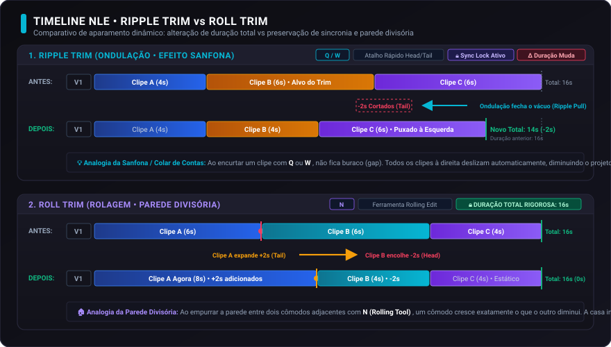
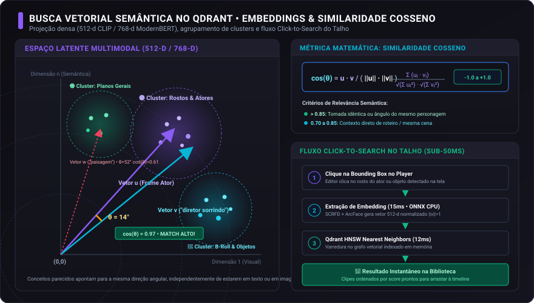
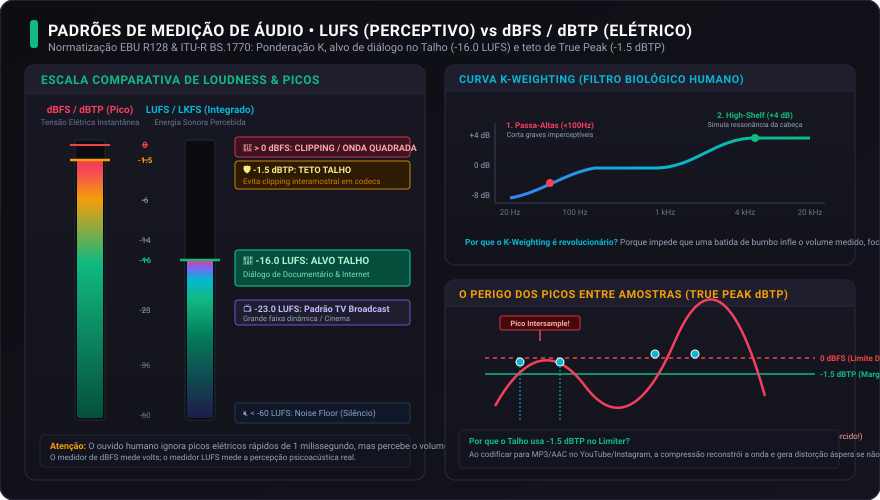
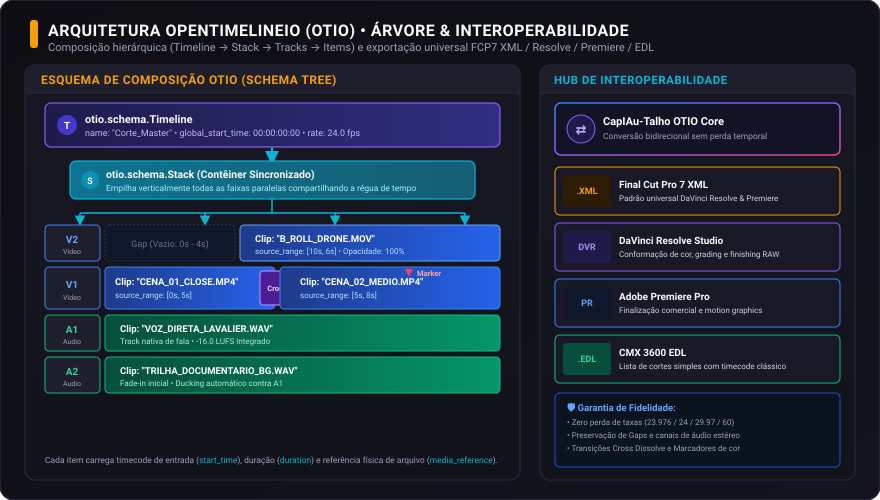

# 18. Glossário Visual e Terminologia NLE & IA

**O dicionário ilustrado de edição de vídeo multipista, inteligência artificial, visão computacional, acústica e intercâmbio de projetos do CapIAu-Talho.**

---

## Apresentação e Guia de Leitura

O mundo da montagem audiovisual e da inteligência artificial aplicada ao cinema é cheio de jargões: *Ripple trim*, *LUFS*, *True Peak*, *Embeddings*, *DBSCAN*, *OpenTimelineIO*, *Ghost Clips*, entre outros. Este capítulo reúne **91 verbetes** que explicam esses termos e dizem onde cada um aparece no CapIAu-Talho.

Cada verbete segue o mesmo formato:

1. **Nível:** um selo que indica a quem o verbete se dirige (veja a tabela abaixo). Quando o recurso ainda não está completo, o selo traz também o **Status no Talho** (Parcial, Experimental, Planejado ou Não implementado).
2. **Definição Semântica:** o conceito, sem circularidades.
3. **No dia a dia:** o que isso significa para quem edita, sem jargão de programação.
4. **No código (CapIAu-Talho):** arquivos, funções, tabelas e atalhos reais, para quem desenvolve ou audita o sistema.
5. **Analogia Didática:** uma metáfora do cotidiano.
6. **Veja também:** links para verbetes relacionados.

| Nível | Para quem | O que esperar |
| :--- | :--- | :--- |
| **Básico** | Quem está começando ou não programa | Conceitos e termos do dia a dia da edição |
| **Editor** | Quem edita no Talho com frequência | Operações e decisões de montagem, áudio, cor e IA |
| **Técnico** | Quem desenvolve, integra ou audita | Detalhes de modelos, formatos, métricas e arquitetura |

> **Sobre os atalhos:** os atalhos mostrados nos verbetes foram gerados a partir de `src/ui/js/keymapService.js`, a fonte única de atalhos do Talho. A mesma combinação de teclas pode ter funções diferentes conforme o contexto (painel em foco, ferramenta ativa, hover, sugestão de IA ativa etc.); veja o [Capítulo 14](14.-Guia-Completo-de-Atalhos) para a tabela completa.

---

## Índice Remissivo A-Z

Navegue rapidamente para a letra desejada (letras sem verbetes foram omitidas):

[**0-9**](#letra-0-9) • [**A**](#letra-a) • [**B**](#letra-b) • [**C**](#letra-c) • [**D**](#letra-d) • [**E**](#letra-e) • [**F**](#letra-f) • [**G**](#letra-g) • [**H**](#letra-h) • [**I**](#letra-i) • [**J**](#letra-j) • [**K**](#letra-k) • [**L**](#letra-l) • [**M**](#letra-m) • [**N**](#letra-n) • [**O**](#letra-o) • [**P**](#letra-p) • [**Q**](#letra-q) • [**R**](#letra-r) • [**S**](#letra-s) • [**T**](#letra-t) • [**V**](#letra-v) • [**W**](#letra-w) • [**Z**](#letra-z)

---

## Navegação por Eixos Temáticos

Prefere explorar os conceitos agrupados por área de trabalho? Escolha um dos 8 eixos temáticos:

* [**Eixo 1 — Timeline e Ferramentas de Edição NLE**](#eixo-1) *(24 verbetes: Ripple Trim, Rolling Edit, Slip Tool, Slide Tool, Gap, Razor / Blade Tool, Lift vs Extract, Replace Edit...)*
* [**Eixo 2 — Ingestão e Processamento de Mídia**](#eixo-2) *(11 verbetes: Proxies de Mídia, Watch Folder, Bins, Conforming, Timecode SMPTE, Drop-Frame vs Non-Drop-Frame, Frame Rate / FPS, Containers Multimídia...)*
* [**Eixo 3 — Inteligência Artificial e Visão Computacional**](#eixo-3) *(22 verbetes: Embedding Vetorial, CLIP, Detecção de Cortes e Limites de Plano, Beats Narrativos por Deriva Visual, Classificação de Movimento de Câmera, Escala de Plano Zero-Shot, Bounding Box Canônico Gemini, Agrupamento Facial DBSCAN...)*
* [**Eixo 4 — Transcrição e Processamento Fonético**](#eixo-4) *(6 verbetes: ASR, Diarização de Locutores, Alinhamento Temporal por Palavra, Edição Baseada em Texto, Pistas Dinâmicas de Diálogo, Confiança da Transcrição)*
* [**Eixo 5 — Áudio e Diagnóstico Sonoro**](#eixo-5) *(11 verbetes: LUFS, dBFS vs. LUFS, True Peak, RMS, Noise Floor, Loudness Range, Denoise Neural Local, RTF...)*
* [**Eixo 6 — Cor e Transformações Visuais**](#eixo-6) *(4 verbetes: OpenColorIO, Espaço de Cor de Trabalho, Matriz de Transformação Cromática, Saturação)*
* [**Eixo 7 — Exportação e Interoperabilidade**](#eixo-7) *(6 verbetes: OpenTimelineIO, Final Cut Pro 7 XML, EDL CMX 3600, Render Graph, Compressão Lossless vs Lossy, Codecs Intermediários de Edição)*
* [**Eixo 8 — Design System e Interface NLE**](#eixo-8) *(7 verbetes: Seamless Layout, Linhas Restauradoras de 4px, Canvas DPR 1:1 e Anti-Flicker, Painéis Laterais em Três Estados, Duplo Clique para Reabrir e Destacar Painéis, Motor Global de Tooltips com Flip Inteligente, Multi-painel & Workspace Numpad)*

---

## Eixo 1 — Timeline e Ferramentas de Edição NLE

Neste eixo encontram-se as operações fundamentais que moldam o tempo, o ritmo e o fluxo narrativo da montagem sobre a régua temporal.

---

### 1. Ripple Trim (Aparagem com Ondulação / Puxar Espaço)
* **Nível:** Editor
* **Nome Técnico (PT / EN):** Aparagem com Ondulação / *Ripple Trim (Head / Tail)*.
* **Definição Semântica:** Ação de cortar a ponta inicial (*head*) ou final (*tail*) de um clipe na posição exata da agulha de reprodução (*playhead*), fechando automaticamente a lacuna temporal (*gap*). Todos os clipes posteriores nas pistas com trava de sincronia (*sync lock*) são puxados em bloco para a esquerda, encurtando a duração total da timeline.
* **No dia a dia:** Você corta o começo ou o fim de um clipe e o resto da sequência anda junto, sem deixar buraco.
* **No código (CapIAu-Talho):**
  * `rippleTrimToPlayhead(side, targetClipId)` em `src/ui/js/timelineState.js`; o comando de teclado (`edit.ripple_trim_head`, `edit.ripple_trim_tail`) é tratado em `src/ui/js/timelineInteraction.js`.
  * O deslocamento é aplicado por `applyRippleShift()`, que mantém juntos os pares de áudio e vídeo vinculados (`link_id`) e só move as pistas com Sync Lock ligado e destravadas.
  * **Atalhos por perfil** (gerados de `src/ui/js/keymapService.js`; o mesmo combo pode ter outra função conforme o contexto):
    * Aparar início até a agulha (`edit.ripple_trim_head`): CapIAu Padrão `Q`; Premiere `Q`; DaVinci Resolve `Shift + [` ou `Q`; Final Cut Pro `Alt + [` ou `Q`; Kdenlive `[` ou `Q`.
    * Aparar da agulha até o fim (`edit.ripple_trim_tail`): CapIAu Padrão `W`; Premiere `W`; DaVinci Resolve `Shift + ]` ou `W`; Final Cut Pro `Alt + ]`; Kdenlive `]` ou `W`.
* **Analogia Didática:** Imagine que você está enfiando contas em um colar de fio elástico. Se uma conta ficou longa demais e você corta uma fatia dela com a tesoura, o colar puxa sozinho todas as contas seguintes para encostar novamente na fatia, sem deixar nenhum espaço de fio vazio no meio.
* **Veja também:** [Rolling Edit](#rolling-edit) • [Sync Lock](#sync-lock) • [Gap](#gap) • [Lift vs Extract](#lift-extract)

---

### 2. Rolling Edit (Corte Contínuo Adjacente / Rolagem de Emenda)
* **Nível:** Editor
* **Nome Técnico (PT / EN):** Corte Contínuo Adjacente / *Rolling Edit (Roll Trim)*.
* **Definição Semântica:** Ajuste simultâneo do ponto de junção entre dois clipes contíguos na mesma pista. Ao arrastar a emenda para a esquerda ou direita, o clipe anterior ganha quadros na mesma proporção em que o clipe seguinte perde (ou vice-versa). A duração global da sequência e a posição de todos os outros clipes da timeline permanecem rigorosamente intactas.
* **No dia a dia:** Você ajusta onde um plano termina e o outro começa, sem mudar a duração do filme.
* **No código (CapIAu-Talho):**
  * `rollingEdit(leftClipId, rightClipId, deltaFrames)` em `src/ui/js/timelineState.js`.
  * Cursor especializado `CURSOR_ROLLING` em `src/ui/js/timelineInteraction.js`.
  * **Atalhos por perfil** (gerados de `src/ui/js/keymapService.js`; o mesmo combo pode ter outra função conforme o contexto):
    * Ferramenta Rolling (`tools.rolling`): CapIAu Padrão `Shift + N`; Premiere `N`; DaVinci Resolve `N` ou `T`; Final Cut Pro `N` ou `T`; Kdenlive `N`.
* **Analogia Didática:** É exatamente como a parede divisória de gesso entre dois quartos contíguos em um apartamento. Se você mover a parede 1 metro para a esquerda, o quarto da esquerda diminui 1 metro e o da direita aumenta 1 metro, mas o tamanho total da casa não muda nem um centímetro.
* **Veja também:** [Ripple Trim](#ripple-trim) • [Slip Tool](#slip-tool) • [Slide Tool](#slide-tool)

---

### 3. Slip Tool (Deslizar Conteúdo Interno / Janela Fixa)
* **Nível:** Editor
* **Nome Técnico (PT / EN):** Deslizar Conteúdo Interno / *Slip Tool*.
* **Definição Semântica:** Modificação dos pontos de entrada (*inFrame*) e saída (*outFrame*) do material bruto interno de um clipe sem alterar sua posição na timeline nem a sua duração física na sequência. Os clipes vizinhos não são afetados.
* **No dia a dia:** Você escolhe outro pedaço do mesmo take sem mexer em onde o clipe está nem em quanto dura.
* **No código (CapIAu-Talho):**
  * `slipClip(clipId, deltaFrames)` em `src/ui/js/timelineState.js`; o limite do deslize é a duração real da mídia de origem (`getMaxMediaFrames()`).
  * Arrasto contínuo tratado em `src/ui/js/timelineInteraction.js` (estado `dragState = "slip"`).
  * **Atalhos por perfil** (gerados de `src/ui/js/keymapService.js`; o mesmo combo pode ter outra função conforme o contexto):
    * Ferramenta Slip (`tools.slip`): CapIAu Padrão `Y`; Premiere `Y`; DaVinci Resolve `Shift + Y` ou `Y`; Final Cut Pro `Y`; Kdenlive `Y`.
* **Analogia Didática:** Imagine que você está olhando a rua através de uma janela retangular de madeira. Você não mexe na janela nem na parede da casa, mas pede para a pessoa do lado de fora dar dois passos para o lado para enquadrar melhor o rosto dela no vão da janela.
* **Veja também:** [Slide Tool](#slide-tool) • [Rolling Edit](#rolling-edit)

---

### 4. Slide Tool (Deslizar Posição na Trilha / Escorregar Clipe)
* **Nível:** Editor
* **Nome Técnico (PT / EN):** Escorregar Posição na Trilha / *Slide Tool*.
* **Definição Semântica:** Movimentação de um clipe inteiro ao longo da pista temporal. Ao deslizar o clipe para um dos lados, o clipe vizinho anterior é estendido ou encurtado, e o vizinho posterior faz o movimento oposto. O clipe manipulado mantém sua duração e seu conteúdo interno intactos.
* **No dia a dia:** Você empurra um clipe para outro ponto da pista e os vizinhos compensam.
* **No código (CapIAu-Talho):**
  * `slideClip(clipId, deltaFrames)` em `src/ui/js/timelineState.js`; valida a mídia disponível nos dois clipes vizinhos.
  * **Atalhos por perfil** (gerados de `src/ui/js/keymapService.js`; o mesmo combo pode ter outra função conforme o contexto):
    * Ferramenta Slide (`tools.slide`): todos os perfis `U`.
* **Analogia Didática:** É como uma pessoa se espremendo no banco traseiro de um carro com três passageiros. Se ela escorrega o corpo para a esquerda, ela espreme a pessoa da esquerda e abre espaço confortável para a pessoa da direita, mas ela própria continua com o mesmo tamanho.
* **Veja também:** [Slip Tool](#slip-tool) • [Rolling Edit](#rolling-edit)

---

### 5. Gap (Lacuna Vazia na Timeline)
* **Nível:** Básico
* **Nome Técnico (PT / EN):** Lacuna / *Gap*.
* **Definição Semântica:** Intervalo sem nenhum clipe numa pista. Gaps aparecem ao apagar um clipe sem fechar o espaço (Lift), ao mover clipes ou ao trabalhar em pistas sem ripple. Podem ser intencionais (silêncio, respiro) ou erros (buracos pretos de 1 quadro).
* **No dia a dia:** Um espaço vazio entre dois clipes na mesma pista.
* **No código (CapIAu-Talho):**
  * `drawGaps()` em `src/ui/js/timelineRenderer.js` desenha as lacunas; `fillTrackGap()` (comando `edit.fit_to_gap`) preenche o espaço com o clipe escolhido em `src/ui/js/timelineState.js`.
  * O Ripple Delete e o Extract fecham o gap automaticamente. No OpenTimelineIO, o gap é um objeto próprio (`Gap`), exportado por `src/export/otio_export.py`.
  * **Atalhos por perfil** (gerados de `src/ui/js/keymapService.js`; o mesmo combo pode ter outra função conforme o contexto):
    * Preencher espaço (Fit to Gap) (`edit.fit_to_gap`): CapIAu Padrão `Ctrl + Alt + R`; Premiere `Ctrl + Alt + R`; DaVinci Resolve `Ctrl + Alt + R` ou `Cmd + Alt + R`; Final Cut Pro `Ctrl + Alt + R` ou `Cmd + Alt + R`; Kdenlive `Ctrl + Alt + R`.
    * Ripple Delete (`edit.ripple_delete`): CapIAu Padrão `R` ou `Backspace` ou `Shift + Delete`; Premiere `Shift + Delete` ou `Alt + Backspace`; DaVinci Resolve `Shift + Backspace` ou `Delete`; Final Cut Pro `Shift + Delete` ou `Backspace`; Kdenlive `Delete` ou `Shift + Delete`.
* **Analogia Didática:** Um vão entre dois livros numa estante: pode ser um espaço deixado de propósito ou um livro que alguém tirou e esqueceu de repor.
* **Veja também:** [Ripple Trim](#ripple-trim) • [Lift vs Extract](#lift-extract) • [OpenTimelineIO](#opentimelineio)

---

### 6. Razor / Blade Tool (Lâmina de Corte / Gilete)
* **Nível:** Básico
* **Nome Técnico (PT / EN):** Lâmina de Corte / *Razor Tool (Blade)*.
* **Definição Semântica:** Operação de fatiamento atômico que divide um clipe em dois segmentos independentes no ponto exato indicado pela agulha ou pelo clique do cursor, preservando a continuidade dos quadros e a integridade de reprodução.
* **No dia a dia:** Você divide um clipe em dois no ponto que quiser.
* **No código (CapIAu-Talho):**
  * `splitClipAtFrame(clipId, splitFrame, splitLinked)` e `splitAllTracksAtFrame(splitFrame)` em `src/ui/js/timelineState.js`.
  * O comando `edit.split` divide no playhead; `tools.blade` ativa a ferramenta Lâmina e `tools.blade_global` corta todas as pistas na agulha.
  * **Atalhos por perfil** (gerados de `src/ui/js/keymapService.js`; o mesmo combo pode ter outra função conforme o contexto):
    * Ferramenta Lâmina (`tools.blade`): CapIAu Padrão `C`; Premiere `C`; DaVinci Resolve `B`; Final Cut Pro `B`; Kdenlive `C`.
    * Dividir no playhead (`edit.split`): CapIAu Padrão `E` ou `Z` ou `Alt + E` ou `Alt + Z`; Premiere `Ctrl + K`; DaVinci Resolve `Ctrl + \`; Final Cut Pro `Cmd + B`; Kdenlive `Shift + R` ou `X`.
    * Lâmina global na agulha (`tools.blade_global`): CapIAu Padrão `Shift + C`; Premiere `Shift + C` ou `Ctrl + Shift + K`; DaVinci Resolve `Shift + B` ou `Ctrl + Shift + \`; Final Cut Pro `Shift + B` ou `Cmd + Shift + B` ou `Ctrl + Shift + B`; Kdenlive `Shift + C`.
* **Analogia Didática:** Passar um estilete cirúrgico ou uma tesoura bem afiada em uma fita de película fotográfica esticada sobre a mesa de luz, separando-a em dois pedaços que continuam colados lado a lado.
* **Veja também:** [Playhead](#playhead) • [Snapping](#snapping)

---

### 7. Lift vs Extract (Apagar Deixando ou Fechando o Espaço)
* **Nível:** Editor
* **Nome Técnico (PT / EN):** *Lift* (retirar) e *Extract* (extrair).
* **Definição Semântica:** Duas formas de remover um trecho. **Lift** apaga o conteúdo e deixa o espaço vazio (um gap), mantendo tudo o que está depois exatamente onde estava. **Extract** (ou Ripple Delete) apaga e puxa o que vem depois para fechar o espaço, encurtando a sequência. Valem para um clipe ou para o intervalo entre as marcas IN e OUT.
* **No dia a dia:** Lift apaga o trecho e deixa o buraco; Extract apaga e fecha o buraco.
* **No código (CapIAu-Talho):**
  * `liftRange(inF, outF)` e `extractRange(inF, outF)` em `src/ui/js/timelineState.js`, ambas só nas pistas destravadas; despacho dos comandos `edit.lift_in_out` e `edit.extract_in_out` em `src/ui/js/player.js` e `src/ui/js/timelineInteraction.js`.
  * Para clipes isolados: `edit.lift_delete` (deixa o espaço) e `edit.ripple_delete` (fecha o espaço).
  * **Atalhos por perfil** (gerados de `src/ui/js/keymapService.js`; o mesmo combo pode ter outra função conforme o contexto):
    * Lift no intervalo IN-OUT (`edit.lift_in_out`): CapIAu Padrão `;` ou `Alt + Delete`; Premiere `;` ou `Alt + Delete`; DaVinci Resolve `Backspace` ou `;`; Final Cut Pro `Delete` ou `;`; Kdenlive `Alt + Backspace` ou `;`.
    * Extract no intervalo IN-OUT (`edit.extract_in_out`): CapIAu Padrão `'` ou `Alt + Shift + Delete`; Premiere `'` ou `Shift + Delete`; DaVinci Resolve `Shift + Backspace` ou `'`; Final Cut Pro `Shift + Delete` ou `'`; Kdenlive `Shift + Delete` ou `'`.
    * Lift Delete (clipe) (`edit.lift_delete`): CapIAu Padrão `Delete` ou `Alt + R`; Premiere `Backspace`; DaVinci Resolve `Backspace`; Final Cut Pro `Delete`; Kdenlive `Backspace`.
    * Ripple Delete (clipe) (`edit.ripple_delete`): CapIAu Padrão `R` ou `Backspace` ou `Shift + Delete`; Premiere `Shift + Delete` ou `Alt + Backspace`; DaVinci Resolve `Shift + Backspace` ou `Delete`; Final Cut Pro `Shift + Delete` ou `Backspace`; Kdenlive `Delete` ou `Shift + Delete`.
* **Analogia Didática:** Tirar um livro da estante: no Lift você deixa o vão onde ele estava; no Extract você empurra os livros ao lado para fechar o vão.
* **Veja também:** [In / Out Marks](#in-out-marks) • [Gap](#gap) • [Ripple Trim](#ripple-trim) • [Track Lock](#track-lock)

---

### 8. Replace Edit (Substituir Clipe)
* **Nível:** Editor
* **Nome Técnico (PT / EN):** Edição de Substituição / *Replace Edit*.
* **Definição Semântica:** Troca um clipe da timeline por outro (vindo do Source Player), mantendo a posição e respeitando a duração: a nova mídia assume o lugar do clipe antigo e é alinhada pelo ponto IN, pelo ponto OUT ou por um trecho explícito IN-OUT. A substituição nunca invade o clipe seguinte.
* **No dia a dia:** Você troca um clipe da timeline por outro, mantendo a posição e a duração.
* **No código (CapIAu-Talho):**
  * `replaceClip(targetClipId, newMediaId, alignMode, options)` em `src/ui/js/timelineState.js` (`alignMode`: `in`, `out` ou `range`); chamada pelo player em `replaceClipFromSource()` (`src/ui/js/player.js`).
  * Só substitui clipes de vídeo ou foto em pistas de vídeo (não substitui títulos nem camadas de ajuste).
  * **Atalhos por perfil** (gerados de `src/ui/js/keymapService.js`; o mesmo combo pode ter outra função conforme o contexto):
    * Substituir clipe (`edit.replace_clip`): todos os perfis `Ctrl + Shift + R`.
* **Analogia Didática:** Trocar a foto de um porta-retrato: a moldura (posição e tamanho) continua igual, só a imagem muda.
* **Veja também:** [Match Frame](#match-frame) • [Ghost Clips e Sequência Fantasma](#ghost-clips)

---

### 9. Match Frame (Localizar o Quadro Original)
* **Nível:** Editor
* **Nome Técnico (PT / EN):** *Match Frame* e *Reverse Match Frame*.
* **Definição Semântica:** O **Match Frame** pega o quadro sob a agulha da timeline e abre, no Source Player, o mesmo quadro do arquivo original, para você ver o material em volta e escolher outro trecho. O **Reverse Match Frame** faz o caminho contrário: parte do quadro do Source e localiza onde ele já foi usado na timeline.
* **No dia a dia:** Você descobre de onde, no arquivo original, veio o quadro que está na timeline.
* **No código (CapIAu-Talho):**
  * `matchFrameFromTimeline()` e `reverseMatchFrameFromSource(direction)` em `src/ui/js/player.js`; comandos `edit.match_frame` e `edit.reverse_match_frame`.
  * **Atalhos por perfil** (gerados de `src/ui/js/keymapService.js`; o mesmo combo pode ter outra função conforme o contexto):
    * Match Frame (`edit.match_frame`): CapIAu Padrão `Alt + F`; Premiere `F`; DaVinci Resolve `F`; Final Cut Pro `Shift + F`; Kdenlive `Alt + F`.
    * Reverse Match Frame (`edit.reverse_match_frame`): CapIAu Padrão `Shift + F`; Premiere `Shift + F`; DaVinci Resolve `Shift + F`; Final Cut Pro `Alt + F`; Kdenlive `Shift + F`.
* **Analogia Didática:** Achar a página de um livro a partir de uma frase que você viu citada, e depois voltar à citação.
* **Veja também:** [Replace Edit](#replace-edit) • [Playhead](#playhead)

---

### 10. Rate Stretch (Esticar ou Comprimir a Velocidade)
* **Nível:** Editor
* **Nome Técnico (PT / EN):** Ferramenta de Esticar Velocidade / *Rate Stretch Tool*.
* **Definição Semântica:** Muda a velocidade de um clipe arrastando sua borda: ao encurtar o clipe sem cortar conteúdo, ele acelera; ao alongar, desacelera (câmera lenta). O trecho de origem permanece o mesmo, só muda quanto tempo ele ocupa.
* **No dia a dia:** Você arrasta a ponta do clipe para fazê-lo durar mais (câmera lenta) ou menos (acelerado).
* **No código (CapIAu-Talho):**
  * Ferramenta `rate-stretch` em `src/ui/js/timelineState.js` (`setTool()`); arrasto tratado em `src/ui/js/timelineInteraction.js` (`rate-stretch-left` / `rate-stretch-right`).
  * Para digitar a velocidade ou a duração: comando `edit.clip_speed`.
  * **Atalhos por perfil** (gerados de `src/ui/js/keymapService.js`; o mesmo combo pode ter outra função conforme o contexto):
    * Ferramenta Rate Stretch (`tools.rate_stretch`): CapIAu Padrão `Shift + R` ou `X`; Premiere `R`; DaVinci Resolve `R` ou `Shift + R`; Final Cut Pro `R`; Kdenlive `Shift + R`.
    * Velocidade/duração do clipe (`edit.clip_speed`): CapIAu Padrão `Ctrl + R`; Premiere `Ctrl + R`; DaVinci Resolve `Ctrl + R`; Final Cut Pro `Ctrl + R` ou `Cmd + R`; Kdenlive `Ctrl + R`.
* **Analogia Didática:** Esticar um elástico com um desenho: o desenho é o mesmo, mas ocupa mais (lento) ou menos (rápido) espaço.
* **Veja também:** [Freeze Frame](#freeze-frame) • [Keyframes Paramétricos](#keyframes)

---

### 11. Freeze Frame (Congelar Quadro)
* **Nível:** Básico
* **Nome Técnico (PT / EN):** Quadro Congelado / *Freeze Frame*.
* **Definição Semântica:** Transforma o quadro atual numa imagem parada que dura alguns segundos (3 s por padrão) na timeline. Pode ser inserido empurrando o resto (ripple) ou por cima.
* **No dia a dia:** O quadro atual vira uma imagem parada por alguns segundos.
* **No código (CapIAu-Talho):**
  * `createFreezeFrameCut(clipId, playheadFrame, durationSec = 3.0, mode = "ripple")` em `src/ui/js/timelineState.js`; comando `edit.freeze_frame`.
  * **Atalhos por perfil** (gerados de `src/ui/js/keymapService.js`; o mesmo combo pode ter outra função conforme o contexto):
    * Congelar quadro (`edit.freeze_frame`): todos os perfis `Ctrl + Shift + F`.
* **Analogia Didática:** Pausar um filme e tirar uma foto da tela para usar como cartaz.
* **Veja também:** [Rate Stretch](#rate-stretch) • [Playhead](#playhead)

---

### 12. Margens de Segurança e Máscaras de Proporção
* **Nível:** Editor
* **Nome Técnico (PT / EN):** *Safe Margins* (Action Safe / Title Safe) e *Aspect Masks*.
* **Definição Semântica:** Guias desenhadas sobre o Program Player que mostram onde elementos importantes ficam seguros em qualquer tela: **Action Safe** (90% da área central) e **Title Safe** (80%), além de cruz central e grade dos terços. As **máscaras de proporção** escurecem as bordas para simular outros formatos (16:9, 9:16, 1:1, 2.39:1, 4:5, 4:3). As guias não entram no vídeo exportado.
* **No dia a dia:** Guias no player mostram onde textos e ações importantes ficam seguros em qualquer tela.
* **No código (CapIAu-Talho):**
  * `toggleSafeMargins()` e `setSafeMarginsConfig()` em `src/ui/js/timelineState.js`, com os padrões em `DEFAULT_SAFE_MARGINS_CONFIG`; o desenho vetorial (SVG) está em `src/ui/js/player.js`; botões `#btn-program-safe-margins` e `#btn-program-safe-margins-menu`.
  * A configuração é lembrada no navegador (`localStorage`).
  * **Atalhos por perfil** (gerados de `src/ui/js/keymapService.js`; o mesmo combo pode ter outra função conforme o contexto):
    * Ligar/desligar margens (`timeline.toggle_safe_margins`): todos os perfis `Ctrl + Shift + G`.
    * Alternar máscara de proporção (`timeline.cycle_aspect_mask`): todos os perfis `Ctrl + Alt + G`.
* **Analogia Didática:** Escrever uma carta sem encostar nas bordas do papel: o texto fica seguro mesmo se a impressora cortar um pouco.
* **Veja também:** [Aspect Ratio](#aspect-ratio)

---

### 13. Playhead (Agulha de Reprodução / Cabeçote de Leitura)
* **Nível:** Básico
* **Nome Técnico (PT / EN):** Agulha de Reprodução / *Playhead (Current Time Indicator - CTI)*.
* **Definição Semântica:** Marcador vertical dinâmico na timeline que indica a coordenada temporal exata (em horas, minutos, segundos e quadros) do fotograma exibido na tela no momento presente.
* **No dia a dia:** É a linha vertical que mostra o quadro que você está vendo.
* **No código (CapIAu-Talho):**
  * `playheadFrame` em `src/ui/js/timelineState.js`; desenhada por `src/ui/js/timelineRenderer.js` e controlada pelo `ProgramPlayer` em `src/ui/js/player.js`.
  * **Atalhos por perfil** (gerados de `src/ui/js/keymapService.js`; o mesmo combo pode ter outra função conforme o contexto):
    * Play/Pause (`playback.play_pause`): todos os perfis `Espaço`.
    * Shuttle reverso (`playback.shuttle_reverse`): todos os perfis `J`.
    * Shuttle play/pausa (`playback.shuttle_stop`): todos os perfis `K`.
    * Shuttle avanço (`playback.shuttle_forward`): todos os perfis `L`.
    * 1 quadro para trás (`playback.step_prev`): todos os perfis `←`.
    * 1 quadro para frente (`playback.step_next`): todos os perfis `→`.
* **Analogia Didática:** A agulha de diamante de um toca-discos de vinil. O disco gira sob ela, e o som que toca na caixa de som é exatamente o sulco por onde a agulha está passando naquele segundo.
* **Veja também:** [In / Out Marks](#in-out-marks) • [Timecode SMPTE](#timecode-smpte)

---

### 14. In / Out Marks (Pontos de Entrada e Saída)
* **Nível:** Básico
* **Nome Técnico (PT / EN):** Marcadores de Entrada e Saída / *In and Out Points*.
* **Definição Semântica:** Delimitadores temporais que definem um intervalo específico de tempo na mídia de origem (*Source*) ou na timeline (*Program*). Servem para indicar qual trecho exato será importado, aparado, exportado ou renderizado.
* **No dia a dia:** Você marca o começo e o fim do trecho que quer usar ou apagar.
* **No código (CapIAu-Talho):**
  * `setInPoint()` e `setOutPoint()` em `src/ui/js/player.js`, `src/ui/js/timelineState.js` e `src/ui/js/timelineInteraction.js`.
  * **Atalhos por perfil** (gerados de `src/ui/js/keymapService.js`; o mesmo combo pode ter outra função conforme o contexto):
    * Marcar IN (`playback.mark_in`): todos os perfis `I`.
    * Marcar OUT (`playback.mark_out`): todos os perfis `O`.
    * Marcar clipe (`playback.mark_clip`): CapIAu Padrão `X`; Premiere `/` ou `X`; DaVinci Resolve `X`; Final Cut Pro `X`; Kdenlive `X`.
    * Limpar IN e OUT (`playback.clear_in_out`): CapIAu Padrão `Alt + X`; Premiere `Ctrl + Shift + X` ou `Alt + X`; DaVinci Resolve `Alt + X`; Final Cut Pro `Alt + X`; Kdenlive `Alt + X` ou `Ctrl + Shift + A`.
* **Analogia Didática:** Passar marca-texto amarelo sobre uma frase em um livro: o *In* é o início da primeira palavra marcada e o *Out* é o ponto final onde você solta a caneta.
* **Veja também:** [Lift vs Extract](#lift-extract) • [Playhead](#playhead)

---

### 15. Snapping (Magnetismo Inteligente / Encaixe Magnético)
* **Nível:** Básico
* **Nome Técnico (PT / EN):** Encaixe Magnético / *Snapping*.
* **Definição Semântica:** Recurso de auxílio geométrico na interface onde, ao aproximar um clipe ou a agulha a uma distância limiar (geralmente alguns pixels ou quadros) de um ponto de corte, marcador ou início/fim de outro clipe, o objeto "salta" e se alinha com precisão micrométrica, eliminando frestas pretas acidentais de 1 quadro.
* **No dia a dia:** Ao arrastar, o clipe "gruda" nas bordas de outros clipes e na agulha, evitando buracos de 1 quadro.
* **No código (CapIAu-Talho):**
  * Estado `snappingEnabled` e `toggleSnapping(enabled)` em `src/ui/js/timelineState.js`; o encaixe é calculado durante o arrasto em `src/ui/js/timelineInteraction.js`.
  * Segurar Alt (ou Ctrl, conforme a operação) desliga o magnetismo apenas durante o arrasto.
  * **Atalhos por perfil** (gerados de `src/ui/js/keymapService.js`; o mesmo combo pode ter outra função conforme o contexto):
    * Alternar snapping (`tools.snapping`): CapIAu Padrão `N` ou `Shift + S`; Premiere `S`; DaVinci Resolve `Shift + N` ou `S`; Final Cut Pro `Shift + N` ou `S`; Kdenlive `F10` ou `S`.
* **Analogia Didática:** Ímãs de geladeira. Quando você aproxima o ímã da porta de metal, chega um momento em que ele é puxado de repente e "clica" perfeitamente no lugar sem você ter que empurrar mais.
* **Veja também:** [Playhead](#playhead) • [Razor / Blade Tool](#blade-razor)

---

### 16. Sync Lock (Trava de Sincronia de Pistas)
* **Nível:** Editor
* **Nome Técnico (PT / EN):** Trava de Sincronia / *Sync Lock*.
* **Definição Semântica:** Interruptor de proteção no cabeçalho das pistas da timeline. Quando ativado, obriga que qualquer operação de empurrar tempo (*Ripple edit*, inserção ou deleção) ocorrida em uma faixa movimente de forma idêntica todas as demais faixas travadas, impedindo que o som de uma fala perca o sincronismo labial com o vídeo correspondente.
* **No dia a dia:** Quando você corta ou insere em uma pista, as outras acompanham para não perder o sincronismo.
* **No código (CapIAu-Talho):**
  * `toggleTrackSyncLock(trackId)` e `getSyncLockedTrackIds()` em `src/ui/js/timelineState.js`; o clique no controle de sincronia do cabeçalho da pista está em `src/ui/js/panels.js`.
  * `getSyncLockedTrackIds()` ignora a pista de sugestões da IA e qualquer pista travada (cadeado). Veja [Track Lock](#track-lock).
* **Analogia Didática:** A corrente de uma bicicleta que conecta as engrenagens da frente e de trás. Se você pedalar uma volta, a outra engrenagem gira junto obrigatoriamente; se a corrente quebrar (sem *sync lock*), as duas giram soltas e perdem o ritmo.
* **Veja também:** [Track Lock](#track-lock) • [Ripple Trim](#ripple-trim)

---

### 17. Track Lock (Trava Total de Pista, o Cadeado)
* **Nível:** Editor
* **Nome Técnico (PT / EN):** Trava Total de Pista / *Track Lock*.
* **Definição Semântica:** Impede qualquer edição numa pista: não é possível mover, cortar, apagar ou receber clipes nela até destravá-la. É diferente do **Sync Lock**: o Sync Lock decide se a pista *acompanha* (se desloca junto) quando outra pista sofre um ripple; o Track Lock *congela* a pista por inteiro. Uma pista travada também não é deslocada por ripples de outras pistas.
* **No dia a dia:** O cadeado de uma pista impede qualquer alteração nela até você destravar.
* **No código (CapIAu-Talho):**
  * `toggleTrackLock(trackId)` e `toggleAllTracksLock()` em `src/ui/js/timelineState.js`; botão de cadeado `.btn-track-lock` no cabeçalho da pista em `src/ui/js/panels.js`; sombreamento das pistas travadas em `drawLockedTracksOverlay()` (`src/ui/js/timelineRenderer.js`).
  * `getSyncLockedTrackIds()` exclui as pistas travadas, e as operações de Lift e Extract só atuam em pistas destravadas.
  * Resumo: **Sync Lock** = a pista acompanha o ripple; **Track Lock** = ninguém mexe na pista. Na dúvida sobre qual combo vale, lembre que o mesmo atalho pode ter funções diferentes conforme o contexto (painel em foco, ferramenta ativa, hover).
  * **Atalhos por perfil** (gerados de `src/ui/js/keymapService.js`; o mesmo combo pode ter outra função conforme o contexto):
    * Travar/destravar pista ativa (`timeline.toggle_track_lock`): CapIAu Padrão `Shift + L`; Premiere `Ctrl + Shift + L` ou `Shift + L`; DaVinci Resolve `Alt + Shift + L` ou `Shift + L`; Final Cut Pro `Shift + L`; Kdenlive `Shift + L`.
    * Travar/destravar todas (`timeline.toggle_all_tracks_lock`): todos os perfis `Ctrl + Alt + Shift + L`.
* **Analogia Didática:** O Sync Lock é como dançar de mãos dadas: quando um passo muda, o outro acompanha. O Track Lock é uma porta trancada com cadeado: ninguém entra nem sai.
* **Veja também:** [Sync Lock](#sync-lock) • [Trilhas V/A](#tracks-va)

---

### 18. Trilhas V/A (Pistas Multipistas de Vídeo e Áudio)
* **Nível:** Básico
* **Nome Técnico (PT / EN):** Faixas Multipistas / *Video and Audio Tracks (V1..Vn, A1..An)*.
* **Definição Semântica:** Estrutura hierárquica em camadas horizontais paralelas da timeline. Nas faixas de vídeo (V), a faixa superior tem prioridade visual de sobreposição (*compositing* de cima para baixo); nas faixas de áudio (A), todos os canais são somados em mixagem polifônica paralela.
* **No dia a dia:** As pistas V empilham imagens; as pistas A empilham sons. Cada uma pode ser silenciada ou escondida.
* **No código (CapIAu-Talho):**
  * Pistas padrão (`V1`, `V2`, `A1`, `A2`, `T1` de títulos e `AI` de sugestões) definidas em `src/ui/js/timelineState.js`; desenho em `src/ui/js/timelineRenderer.js`.
  * O modelo usado na renderização (`Pista`, `Clipe`, `Sequencia`) fica em `src/export/video_render/modelo.py`.
* **Analogia Didática:** No vídeo, são folhas de acetato transparente sobrepostas: o desenho da folha de cima esconde o da folha de baixo, a menos que tenha partes transparentes. No áudio, é uma roda de conversa onde várias pessoas falam ao mesmo tempo e os ouvidos escutam a mistura de todas as vozes juntas.
* **Veja também:** [Track Lock](#track-lock) • [Pistas Dinâmicas de Diálogo](#dynamic-voice-routing)

---

### 19. Adjustment Layer (Camada de Ajuste)
* **Nível:** Editor
* **Nome Técnico (PT / EN):** Camada de Ajuste / *Adjustment Layer*.
* **Definição Semântica:** Um clipe de vídeo especial transparente inserido em uma pista superior (ex: V2 ou V3) que não possui imagem própria, mas aplica todos os efeitos, correções de cor, filtros e transformações nele contidos de forma cumulativa e instantânea a todos os clipes presentes nas pistas inferiores.
* **No dia a dia:** Uma camada transparente: o efeito que você coloca nela vale para tudo que está abaixo.
* **No código (CapIAu-Talho):**
  * Clipes com `kind: "adjustment"` criados em `src/ui/js/timelineState.js`; entram no grafo de vídeo de `src/export/video_render/grafo_video.py`.
* **Analogia Didática:** Um painel de vidro fumê colorido ou uma lente fotográfica gigante colocada sobre uma mesa cheia de fotografias. Todas as fotos embaixo do vidro passam a ter a tonalidade fumê sem você ter que pintar nenhuma foto original.
* **Veja também:** [Color Matte](#color-matte) • [Keyframes Paramétricos](#keyframes)

---

### 20. Color Matte (Cor Sólida Personalizada)
* **Nível:** Básico
* **Nome Técnico (PT / EN):** Cor Sólida / *Color Matte (Solid Color)*.
* **Definição Semântica:** Um gerador sintético de vídeo na timeline que produz um retângulo de cor uniforme estática (como preto absoluto, branco, verde de chroma-key ou qualquer código hexadecimal `#RRGGBB`) com duração arbitrária, muito usado para fundos, cartelas e letterboxes.
* **No dia a dia:** Um clipe de cor lisa, útil para fundos, cartelas e fades.
* **No código (CapIAu-Talho):**
  * Clipes com `kind: "color_matte"` (`src/export/video_render/modelo.py`); gerador de cor na Biblioteca (`src/ui/js/library.js`).
  * Renderizado com a fonte `color=c=COR:s=LxA` do FFmpeg em `src/export/video_render/grafo_video.py`.
* **Analogia Didática:** Uma cartolina colorida comprada na papelaria e cortada exatamente do tamanho da moldura da tela para servir de fundo para os títulos ou fotografias.
* **Veja também:** [Adjustment Layer](#adjustment-layer)

---

### 21. Keyframes Paramétricos (Quadros-Chave de Animação)
* **Nível:** Editor
* **Nome Técnico (PT / EN):** Quadros-Chave / *Keyframes*.
* **Definição Semântica:** Marcadores em instantes específicos de tempo que registram o valor numérico exato de uma propriedade de efeito (como opacidade, volume, posição X/Y ou escala). O computador calcula automaticamente os valores intermediários (*interpolação*) entre dois keyframes ao longo do tempo.
* **No dia a dia:** Você marca valores em tempos diferentes e o programa faz a animação entre eles.
* **No código (CapIAu-Talho):**
  * Funções de keyframe (`evaluateKeyframes`, `addOrUpdateKeyframe`, `removeKeyframe`, `toggleKeyframing`) em `src/ui/js/keyframeEngine.js`.
  * O render lê as automações do clipe em `src/export/video_render/modelo.py`.
* **Analogia Didática:** Os marcos de quilometragem de uma viagem: você anota no diário de bordo que às 14h00 estava no km 0 e às 15h00 estava no km 100. O velocímetro e a estrada cuidam de fazer o carro passar suavemente pelos 99 quilômetros intermediários.
* **Veja também:** [Curvas Bezier e Easing](#curvas-bezier) • [Rate Stretch](#rate-stretch)

---

### 22. Curvas Bezier e Easing (Suavização de Interpolação)
* **Nível:** Editor
* **Nome Técnico (PT / EN):** Suavização de Movimento / *Bezier Curves & Easing (Ease In / Ease Out)*.
* **Definição Semântica:** Modelagem matemática não-linear da transição entre keyframes usando funções polinomiais cúbicas de Bezier. Evita mudanças bruscas de velocidade mecânica, permitindo acelerações suaves no início (*Ease In*) e desacelerações graduais no final (*Ease Out*).
* **No dia a dia:** Você escolhe se o movimento começa devagar, acelera ou freia suavemente.
* **No código (CapIAu-Talho):**
  * Tabela de curvas `EASING_FUNCTIONS` e lista `EASING_OPTIONS` em `src/ui/js/keyframeEngine.js`; no render, `easing_expr()` em `src/export/video_render/geometria.py`.
  * Para fades de áudio e vídeo há curvas paramétricas (linear, exponential, logarithmic, s_curve, equal_power, custom) em `src/export/video_render/fade.py`.
* **Analogia Didática:** Um trem de metrô de alta tecnologia. Ele não sai do repouso a 80 km/h num tranco seco nem freia de repente ao bater na parede da estação; ele acelera suavemente até a velocidade máxima e desacelera macio até parar na plataforma.
* **Veja também:** [Keyframes Paramétricos](#keyframes) • [Audio Crossfade](#audio-crossfade)

---

### 23. Transições de Vídeo (Cross Dissolve, Dip to Black, Dip to White)
* **Nível:** Básico
* **Nome Técnico (PT / EN):** Transições de Junção / *Video Transitions (Cross Dissolve, Dip to Black, Dip to White)*.
* **Definição Semântica:** Efeitos visuais temporais aplicados na junção entre dois clipes adjacentes na mesma pista:
  * **Cross Dissolve:** O primeiro clipe desvanece suavemente enquanto o segundo clipe surge por transparência simultânea.
  * **Dip to Black:** O primeiro clipe escurece até o preto absoluto e, em seguida, o segundo clipe clareia a partir do preto.
  * **Dip to White:** Transição através de um clarão de luz branca fotográfica (*flash*).
* **No dia a dia:** Uma passagem suave entre dois planos, em vez de um corte seco.
* **No código (CapIAu-Talho):**
  * Tipos `video_cross_dissolve`, `video_dip_black` e `video_dip_white` criados em `src/ui/js/timelineState.js`.
  * No render, a transição vira fusão de opacidade (alfa) entre os dois clipes em `src/export/video_render/grafo_video.py` (`_transicoes_da_pista`).
  * **Atalhos por perfil** (gerados de `src/ui/js/keymapService.js`; o mesmo combo pode ter outra função conforme o contexto):
    * Transição de vídeo padrão (`edit.apply_video_transition`): CapIAu Padrão `Ctrl + D`; Premiere `Ctrl + D`; DaVinci Resolve `Ctrl + T` ou `Ctrl + D`; Final Cut Pro `Cmd + T` ou `Ctrl + D`; Kdenlive `Ctrl + D`.
* **Analogia Didática:** O Cross Dissolve é como apagar suavemente a lâmpada da sala enquanto acende a lâmpada da cozinha; o Dip to Black é apagar toda a luz da casa por um segundo no escuro e acender novamente no quarto ao lado.
* **Veja também:** [Audio Crossfade](#audio-crossfade) • [Curvas Bezier e Easing](#curvas-bezier)

---

### 24. Audio Crossfade (Fusão de Potência Constante / Equal-Power)
* **Nível:** Editor
* **Nome Técnico (PT / EN):** Fusão Cruzada de Áudio / *Audio Crossfade (Equal-Power / Constante Power)*.
* **Definição Semântica:** Transição suave entre duas pistas de áudio vizinhas com curva de ganho trigonométrica (seno/cosseno). Mantém a soma da energia acústica constante a √(A² + B²) = 1.0, evitando a queda perceptível de volume no meio da fusão típica de fades lineares simples.
* **No dia a dia:** Uma passagem suave entre dois áudios, sem estalo na emenda.
* **No código (CapIAu-Talho):**
  * O crossfade (efeito `type: "crossfade"`, curva `equal_power` por padrão) é montado em `src/export/video_render/grafo_audio.py`, com as curvas de `src/export/video_render/fade.py`.
  * **Atalhos por perfil** (gerados de `src/ui/js/keymapService.js`; o mesmo combo pode ter outra função conforme o contexto):
    * Crossfade de áudio (`edit.apply_audio_crossfade`): CapIAu Padrão `Ctrl + Shift + D`; Premiere `Ctrl + Shift + D`; DaVinci Resolve `Alt + T` ou `Ctrl + Shift + D`; Final Cut Pro `Alt + Cmd + T` ou `Ctrl + Shift + D`; Kdenlive `Ctrl + Shift + D` ou `U`.
* **Analogia Didática:** Duas pessoas conversando onde uma vai baixando suavemente o tom de voz enquanto a outra começa a falar, de modo que o som ambiente na sala nunca fique mudo nem dobre de volume.
* **Veja também:** [Transições de Vídeo](#transicoes-video) • [Curvas Bezier e Easing](#curvas-bezier)

---

### Tabela Comparativa — Eixo 1: Timeline e Ferramentas de Edição NLE

| Termo | O que é | Para que serve no Talho | Analogia Prática | Atalho (perfil CapIAu) / Onde |
| :--- | :--- | :--- | :--- | :--- |
| **Ripple Trim** | Aparagem com fechamento de lacuna | Encurtar clipe e puxar a timeline inteira | Puxar uma conta de um colar de fio | `Q` / `W` |
| **Rolling Edit** | Ajuste simultâneo de emenda comum | Mover ponto de corte sem alterar duração total | Mover a parede divisória entre dois quartos | `Shift + N` |
| **Slip Tool** | Deslize de conteúdo interno | Mudar trecho da mídia mantendo duração | Olhar por uma janela fixa e mover o ator | `Y` |
| **Slide Tool** | Deslize de posição na trilha | Mover clipe espremendo os vizinhos | Passageiro escorregando no banco do carro | `U` |
| **Gap** | Intervalo sem nenhum clipe numa pista. | Um espaço vazio entre dois clipes na mesma pista. | Um vão entre dois livros numa estante: pode ser um espaço deixado de… | `Ctrl + Alt + R` / `R` |
| **Razor / Blade** | Lâmina de corte atômico | Dividir clipe em duas partes | Estilete cirúrgico em fita de película | `C` / `E` / `Shift + C` |
| **Lift vs Extract** | Duas formas de remover um trecho. | Lift apaga o trecho e deixa o buraco; Extract apaga e fecha o buraco. | Tirar um livro da estante: no Lift você deixa o vão onde ele estava;… | `;` / `'` / `Delete` |
| **Replace Edit** | Troca um clipe da timeline por outro (vindo do Source Player), mantendo a posição e respeitando a… | Você troca um clipe da timeline por outro, mantendo a posição e a duração. | Trocar a foto de um porta-retrato: a moldura (posição e tamanho)… | `Ctrl + Shift + R` |
| **Match Frame** | O Match Frame pega o quadro sob a agulha da timeline e abre, no Source Player, o mesmo quadro do arquivo… | Você descobre de onde, no arquivo original, veio o quadro que está na timeline. | Achar a página de um livro a partir de uma frase que você viu citada,… | `Alt + F` / `Shift + F` |
| **Rate Stretch** | Muda a velocidade de um clipe arrastando sua borda: ao encurtar o clipe sem cortar conteúdo, ele… | Você arrasta a ponta do clipe para fazê-lo durar mais (câmera lenta) ou menos (acelerado). | Esticar um elástico com um desenho: o desenho é o mesmo, mas ocupa… | `Shift + R` / `Ctrl + R` |
| **Freeze Frame** | Transforma o quadro atual numa imagem parada que dura alguns segundos (3 s por padrão) na timeline. | O quadro atual vira uma imagem parada por alguns segundos. | Pausar um filme e tirar uma foto da tela para usar como cartaz. | `Ctrl + Shift + F` |
| **Margens de Segurança e Máscaras de Proporção** | Guias desenhadas sobre o Program Player que mostram onde elementos importantes ficam seguros em qualquer… | Guias no player mostram onde textos e ações importantes ficam seguros em qualquer tela. | Escrever uma carta sem encostar nas bordas do papel: o texto fica… | `Ctrl + Shift + G` / `Ctrl + Alt + G` |
| **Playhead** | Agulha de reprodução temporal | Indicar o quadro atual e guiar cortes | Agulha de um toca-discos de vinil | `Espaço` / `J` / `K` |
| **In / Out Marks** | Marcadores de entrada e saída | Delimitar trechos para inserção ou render | Marca-texto delimitando parágrafo em livro | `I` / `O` / `X` |
| **Snapping** | Encaixe magnético de precisão | Evitar furos pretos de 1 frame entre clipes | Ímãs de geladeira que se atraem | `N` |
| **Sync Lock** | Trava de sincronismo de faixas | Preservar sincronia labial entre áudio e vídeo | Corrente de bicicleta unindo as rodas | Controle no cabeçalho da pista |
| **Track Lock** | Impede qualquer edição numa pista: não é possível mover, cortar, apagar ou receber clipes nela até… | O cadeado de uma pista impede qualquer alteração nela até você destravar. | O Sync Lock é como dançar de mãos dadas: quando um passo muda, o… | `Shift + L` / `Ctrl + Alt + Shift + L` |
| **Trilhas V/A** | Estrutura hierárquica em camadas horizontais paralelas da timeline. | As pistas V empilham imagens; as pistas A empilham sons. Cada uma pode ser silenciada ou escondida. | No vídeo, são folhas de acetato transparente sobrepostas: o desenho… | Cabeçalho da pista |
| **Adjustment Layer** | Camada de ajuste transparente | Aplicar efeitos e cores a todas as faixas abaixo | Vidro fumê colocado sobre várias fotos | Botão Camada de Ajuste (Biblioteca) |
| **Color Matte** | Gerador de cor sólida estática | Criar fundos, cartelas e máscaras de corte | Cartolina colorida no tamanho da tela | Biblioteca |
| **Keyframes** | Quadros-chave paramétricos | Animar volume, escala, posição e cor no tempo | Marcos de quilômetros numa viagem | Painel Ajustes & Efeitos |
| **Curvas Bezier** | Suavização de aceleração | Eliminar trancos mecânicos nas animações | Trem que desacelera suave na estação | Painel Ajustes & Efeitos |
| **Cross Dissolve** | Fusão visual de opacidade | Transição elegante entre dois planos contíguos | Apagar uma lâmpada acendendo outra | `Ctrl + D` |
| **Audio Crossfade** | Fusão suave de potência acústica | Eliminar cliques e estalos na troca de falas | Duas pessoas revezando a fala suavemente | `Ctrl + Shift + D` |

---

## Eixo 2 — Ingestão e Processamento de Mídia

Neste eixo encontram-se os termos relacionados à entrada de materiais brutos no sistema, conversão de codecs, medição temporal e gestão dos arquivos físicos sem corromper mídias originais.

---

### 25. Proxies de Mídia (Cópias Leves de Edição)
* **Nível:** Básico
* **Nome Técnico (PT / EN):** Arquivos Proxy / *Media Proxies (Offline Editing Copies)*.
* **Definição Semântica:** Cópias compactas, de baixa resolução (ex: 720p ou 360p) e codec ultra-leve (como H.264 rápido ou ProRes Proxy), geradas a partir de arquivos brutos pesados de câmera (4K/8K RAW, H.265 intra). Permitem edição instantânea e suave mesmo em computadores sem placa de vídeo. No momento do render final, o sistema reconecta (*conforming*) automaticamente os arquivos originais.
* **No dia a dia:** Você edita com cópias leves e o resultado final usa os arquivos originais.
* **No código (CapIAu-Talho):**
  * `generate_video_proxy()` em `src/media/ffmpeg.py` (perfil `PROXY_RESOLUTION = 1280x720`, `PROXY_CRF = 23`, `PROXY_PRESET = fast` em `src/config.py`); tarefa de fundo em `src/services/ingest.py`.
  * Os proxies ficam em `data/proxies/` (`CONFIG.PROXIES_DIR`). No render, o pedido pode usar proxies ou os originais.
* **Analogia Didática:** Uma fotocópia xerox de rascunho em preto e branco de uma pintura a óleo famosa. O artista planeja e rabisca toda a montagem na folha xerox sem cansar o braço; na hora de expor no museu, pendura a tela original pintada a óleo.
* **Veja também:** [Conforming](#conforming) • [Ingestão In-Place](#ingestao-inplace) • [Codecs Intermediários de Edição](#codecs-intermediarios)

---

### 26. Watch Folder (Pasta Monitorada de Ingestão)
* **Nível:** Básico
* **Nome Técnico (PT / EN):** Pasta de Ingestão Monitorada / *Watch Folder*.
* **Definição Semântica:** Diretório no sistema de arquivos do computador que é vigiado em tempo real por um serviço de segundo plano. Qualquer arquivo de vídeo, áudio ou foto copiado para essa pasta é detectado automaticamente, indexado no catálogo do projeto e enfileirado para geração de metadados e transcrição.
* **No dia a dia:** Você joga arquivos numa pasta e o Talho percebe e importa sozinho.
* **No código (CapIAu-Talho):**
  * `scan_watch_folder()` em `src/ingest/watcher.py` varre a pasta `watch/` (`CONFIG.WATCH_FOLDER`) e também o retorno da DAW (`pasta_retorno_daw()`).
  * Mídias novas seguem o fluxo de ingestão de `src/services/ingest.py`.
* **Analogia Didática:** Uma caixa de correio inteligente na entrada da sua casa com um sensor fotossensível. Assim que o carteiro joga uma carta ou encomenda lá dentro, ela apita no seu celular avisando o que chegou e já abre a correspondência.
* **Veja também:** [Ingestão In-Place](#ingestao-inplace) • [Bins](#bins)

---

### 27. Bins (Pastas Virtuais da Biblioteca)
* **Nível:** Básico
* **Nome Técnico (PT / EN):** Pastas Virtuais / *Bins*.
* **Definição Semântica:** Pastas de organização da biblioteca do projeto, independentes das pastas do disco: mover um vídeo para um bin não move o arquivo. Existem também os *Smart Bins*, que sugerem agrupamentos por tema (entrevistas, elenco, câmera etc.) a partir das palavras do material. Não existe uma "Lixeira" no Talho: remover uma mídia do projeto não apaga o arquivo original do disco.
* **No dia a dia:** Pastas virtuais para organizar a biblioteca sem mexer nos arquivos do disco.
* **No código (CapIAu-Talho):**
  * Tabela `media_bin` e coluna `virtual_folder` (`video`, `photo`) em `src/db/schema.py`; estado dos bins e `SMART_BINS_TAXONOMY` em `src/ui/js/library.js`.
  * Menus de contexto da biblioteca: excluir pasta, remover mídia do projeto, excluir subclipe (`src/ui/js/library.js`).
* **Analogia Didática:** Pastas de um fichário organizando fichas de papel: reorganizar o fichário não muda as coisas guardadas no armário.
* **Veja também:** [Ingestão In-Place](#ingestao-inplace) • [Watch Folder](#watch-folder)

---

### 28. Conforming (Conformação de Mídias / Relink)
* **Nível:** Editor
* **Nome Técnico (PT / EN):** Conformação de Projeto / *Conforming (Relink / Online Finishing)*.
* **Definição Semântica:** Processo de substituição e religação das mídias temporárias ou de baixa resolução (*proxies*) pelos arquivos originais de alta fidelidade da câmera antes da exportação final, preservando exatamente os mesmos códigos de tempo (*timecode*), pontos de corte e enquadramentos.
* **No dia a dia:** Religar o projeto aos arquivos originais quando eles mudam de lugar ou de disco.
* **No código (CapIAu-Talho):**
  * O render escolhe entre proxy e original por mídia (`src/export/video_render/comando.py`); a exportação OTIO usa caminhos absolutos ou URL conforme o destino (`src/export/otio_export.py`).
  * Para religar mídias após trocar de disco: `scripts/religar_hd_externo.py`.
* **Analogia Didática:** A maquete de isopor e papelão feita pelo arquiteto. Ele testa todos os cômodos e janelas na maquete; depois, a equipe de engenharia usa as mesmas medidas para erguer o prédio real em vigas de aço e concreto.
* **Veja também:** [Proxies de Mídia](#proxies-midia) • [OpenTimelineIO](#opentimelineio)

---

### 29. Timecode SMPTE (Código de Tempo Padronizado)
* **Nível:** Editor
* **Nome Técnico (PT / EN):** Código de Tempo SMPTE / *SMPTE Timecode (HH:MM:SS:FF)*.
* **Definição Semântica:** Sistema padronizado pela Society of Motion Picture and Television Engineers que carimba a cada fotograma individual um endereço temporal numérico imutável no formato `Horas:Minutos:Segundos:Quadros`. Permite sincronismo absoluto entre gravadores de som externos e múltiplas câmeras.
* **No dia a dia:** Um relógio que identifica cada quadro: horas, minutos, segundos e quadros.
* **No código (CapIAu-Talho):**
  * Conversões de quadros para timecode (`framesToTimecode()`, `timecodeToFrames()`) em `src/ui/js/timelineState.js`; metadados de tempo lidos via FFprobe em `src/media/ffmpeg.py`.
  * **Atalhos por perfil** (gerados de `src/ui/js/keymapService.js`; o mesmo combo pode ter outra função conforme o contexto):
    * Ir para timecode (`navigation.goto_timecode`): CapIAu Padrão `Ctrl + G`; Premiere `Ctrl + G`; DaVinci Resolve `Ctrl + G`; Final Cut Pro `Ctrl + P` ou `Ctrl + G`; Kdenlive `Ctrl + G`.
* **Analogia Didática:** O carimbo oficial de cartório com data, hora, minuto e segundo cravado no rodapé de cada folha de um contrato legal. Não há como confundir a folha 10 com a folha 11.
* **Veja também:** [Drop-Frame vs Non-Drop-Frame](#drop-frame) • [Frame Rate / FPS](#frame-rate)

---

### 30. Drop-Frame vs Non-Drop-Frame (Compensação NTSC)
* **Nível:** Técnico
* **Nome Técnico (PT / EN):** Compensação de Quadros / *Drop-Frame (DF) vs Non-Drop-Frame (NDF)*.
* **Definição Semântica:** O formato de televisão NTSC opera na taxa fracionária de 29.97 FPS (em vez de 30 cravado). Ao longo de uma hora, a contagem de 30 FPS acumula um erro de 108 quadros (3.6 segundos de atraso no relógio da parede). O modo **Drop-Frame** não descarta nenhum quadro de vídeo real, mas "pula" a numeração de dois números de timecode a cada minuto (exceto nos minutos múltiplos de 10), mantendo a sincronia com o relógio civil.
* **No dia a dia:** Um ajuste na contagem do timecode para que ele acompanhe o relógio real em 29,97 fps.
* **No código (CapIAu-Talho):**
  * Para a lógica de contagem do timecode, veja o verbete [Timecode SMPTE](#timecode-smpte); a exibição com `;` para drop-frame é a forma padrão do SMPTE (a confirmar se o Talho a exibe).
* **Analogia Didática:** O ano bissexto no calendário. A Terra não demora exatamente 365 dias para dar a volta no sol, mas 365 dias e 6 horas. Se não adicionássemos o dia 29 de fevereiro a cada 4 anos, em poucas décadas o Natal estaria caindo no meio do verão europeu.
* **Veja também:** [Timecode SMPTE](#timecode-smpte) • [Frame Rate / FPS](#frame-rate)

---

### 31. Frame Rate / FPS (Taxa de Quadros por Segundo)
* **Nível:** Básico
* **Nome Técnico (PT / EN):** Taxa de Quadros / *Frame Rate (Frames Per Second - FPS)*.
* **Definição Semântica:** A frequência temporal na qual imagens estáticas sucessivas são capturadas ou reproduzidas por segundo na tela, gerando a ilusão de movimento fluído para o cérebro humano (ex: 23.976 / 24 FPS para cinema clássico, 25 FPS para padrão europeu PAL, 29.97 / 30 FPS para TV e 59.94 / 60 FPS para internet e jogos).
* **No dia a dia:** Quantas imagens por segundo o vídeo mostra: 24, 25, 30...
* **No código (CapIAu-Talho):**
  * A taxa do projeto é a propriedade `fps` de `src/ui/js/timelineState.js`, usada em todas as conversões entre quadros e segundos.
* **Analogia Didática:** Folhear rapidamente com o polegar as folhas de um bloquinho de anotações com desenhos infantis (*flipbook*). Quanto mais rápido você solta as folhas, mais suave e vivo parece o salto do bonequinho.
* **Veja também:** [Timecode SMPTE](#timecode-smpte) • [Drop-Frame vs Non-Drop-Frame](#drop-frame)

---

### 32. Containers Multimídia (Formatos de Empacotamento / Wrappers)
* **Nível:** Básico
* **Nome Técnico (PT / EN):** Recipiente Multimídia / *Multimedia Container (Wrapper - MP4, MOV, MKV, MXF)*.
* **Definição Semântica:** O formato de arquivo que atua como uma embalagem externa. Ele não define a qualidade ou a compressão da imagem por si só, mas organiza e sincroniza as diferentes faixas internas: faixas de vídeo, múltiplos canais de áudio, legendas, código de tempo e metadados de câmera.
* **No dia a dia:** O "envelope" do arquivo (.mp4, .mov, .mkv) que guarda imagem, som e legendas.
* **No código (CapIAu-Talho):**
  * Leitura e conversão por FFmpeg/FFprobe em `src/media/ffmpeg.py`.
* **Analogia Didática:** Uma mala de viagem de couro com zíper. A mala (MP4 ou MOV) carrega dentro dela um casaco de frio (vídeo), sapatos (faixas de áudio) e um passaporte no bolso lateral (metadados). A mala não é a roupa, mas o recipiente que transporta tudo junto.
* **Veja também:** [Codecs de Vídeo e Áudio](#codecs)

---

### 33. Codecs de Vídeo e Áudio (Compressores/Descompressores)
* **Nível:** Editor
* **Nome Técnico (PT / EN):** Compressor / Descompressor / *Codec (COder-DECoder - H.264, ProRes, DNxHD, AAC)*.
* **Definição Semântica:** O algoritmo matemático responsável por compactar os dados brutos de imagem ou som na gravação (para economizar espaço em disco) e descompactá-los na memória durante a reprodução. Divide-se em codecs de captura pesados, codecs intermediários de edição suave e codecs de entrega final.
* **No dia a dia:** O método usado para comprimir imagem e som dentro do arquivo.
* **No código (CapIAu-Talho):**
  * Parâmetros de saída (encoder, bitrate, perfil) em `src/export/video_render/comando.py` (`parametros_saida()`); análise de áudio em `src/media/audio_analysis.py`.
* **Analogia Didática:** A técnica de embalar roupas com saco a vácuo para viagem. O codec suga todo o ar das roupas para fazer o volume de uma mala inteira caber em uma mochila pequena; quando você abre a mochila, o tecido se expande novamente para você vestir.
* **Veja também:** [Containers Multimídia](#containers-multimidia) • [Compressão Lossless vs Lossy](#lossless-vs-lossy) • [Codecs Intermediários de Edição](#codecs-intermediarios)

---

### 34. Aspect Ratio (Proporção de Tela / Razão de Aspecto)
* **Nível:** Básico
* **Nome Técnico (PT / EN):** Razão de Proporção / *Aspect Ratio (16:9, 9:16, 4:3, 2.39:1)*.
* **Definição Semântica:** A relação proporcional entre a largura horizontal e a altura vertical de um quadro de vídeo (calculada como largura / altura). Determina o formato geométrico da composição: retangular panorâmico (*16:9* ou *2.39:1 anamórfico*), quadrado (*1:1*) ou vertical para redes sociais (*9:16*).
* **No dia a dia:** A forma da tela: horizontal (16:9), vertical (9:16), quadrada (1:1)...
* **No código (CapIAu-Talho):**
  * `filtro_fit()` em `src/export/video_render/geometria.py` define como a imagem preenche o quadro (ajuste, preenchimento ou corte).
* **Analogia Didática:** O formato de uma moldura de quadro pendurada na sala: uma moldura clássica horizontal de paisagem versus um porta-retrato em pé na cômoda.
* **Veja também:** [Margens de Segurança e Máscaras de Proporção](#safe-margins)

---

### 35. Ingestão In-Place (Indexação Sem Duplicação de Arquivos)
* **Nível:** Editor
* **Nome Técnico (PT / EN):** Ingestão Sem Cópia / *In-Place Media Ingestion*.
* **Definição Semântica:** Arquitetura do CapIAu-Talho onde os arquivos brutos de vídeo em seus discos rígidos externos ou cartões de memória originais são catalogados diretamente por referência de caminho de arquivo, sem duplicar gigabytes ou terabytes de mídia para pastas temporárias internas do projeto.
* **No dia a dia:** O Talho cataloga os arquivos onde eles já estão, sem copiá-los.
* **No código (CapIAu-Talho):**
  * `ingest_file(filepath, project_id, copy_original)` e `ingest_external_path()` em `src/services/ingest.py`: o parâmetro `copy_original` controla se o arquivo é copiado; o caminho fica em `video.filepath` / `photo.filepath` no SQLite (`src/db/schema.py`).
* **Analogia Didática:** O índice da biblioteca municipal: a bibliotecária anota no fichário que o livro de capa azul está na estante 3, prateleira B, em vez de tirar uma fotocópia de todas as 500 páginas do livro para guardar na gaveta dela.
* **Veja também:** [Watch Folder](#watch-folder) • [Proxies de Mídia](#proxies-midia) • [Bins](#bins)

---

### Tabela Comparativa — Eixo 2: Ingestão e Processamento de Mídia

| Termo | O que é | Para que serve no Talho | Analogia Prática | Atalho (perfil CapIAu) / Onde |
| :--- | :--- | :--- | :--- | :--- |
| **Proxies de Mídia** | Cópias de baixa resolução leves | Editar com fluidez em notebooks modestos | Fotocópia xerox de rascunho de pintura | Botão Proxy (Biblioteca) |
| **Watch Folder** | Pasta vigiada por automação | Importar mídias jogadas na pasta automaticamente | Caixa de correio com sensor inteligente | Pasta `watch/` |
| **Bins** | Pastas de organização da biblioteca do projeto, independentes das pastas do disco: mover um vídeo para… | Pastas virtuais para organizar a biblioteca sem mexer nos arquivos do disco. | Pastas de um fichário organizando fichas de papel: reorganizar o… | — |
| **Conforming** | Religação para os originais brutos | Garantir qualidade master 4K no render | Ergue o prédio real baseado na maquete | — |
| **Timecode SMPTE** | Relógio numérico de precisão por frame | Sincronia perfeita entre áudio e câmeras | Carimbo de cartório em folha de contrato | `Ctrl + G` |
| **Drop-Frame** | Pulo na numeração a 29.97 FPS | Manter sincronia do timecode com o relógio civil | Ano bissexto no calendário | — |
| **Frame Rate (FPS)** | Quadros reproduzidos por segundo | Definir a cadência temporal do filme | Folhear bloquinho de papel desenhado | — |
| **Containers** | Extensão empacotadora (.mp4/.mov) | Carregar faixas de áudio, vídeo e legendas | Mala de couro com vários bolsos | — |
| **Codecs** | Compressores de dados digitais | Reduzir tamanho dos arquivos sem perder qualidade | Embalar roupas em saco a vácuo | — |
| **Aspect Ratio** | Proporção entre largura e altura | Adaptar o filme para cinema ou celular | Moldura deitada vs porta-retrato em pé | — |
| **Ingestão In-Place** | Indexação por caminho sem copiar | Economizar terabytes de espaço em disco | Fichário anotando em qual estante está o livro | — |

---

## Eixo 3 — Inteligência Artificial e Visão Computacional

Neste eixo encontram-se os motores de inteligência artificial multimodal, reconhecimento facial local, detecção de planos e indexação vetorial geométrica.

---

### 36. Embedding Vetorial (Vector Embedding)
* **Nível:** Técnico
* **Nome Técnico (PT / EN):** Vetor Semântico Denso / *Vector Embedding*.
* **Definição Semântica:** A conversão matemática de uma imagem, som ou frase de texto em uma lista ordenada de números reais (um vetor em um espaço com 384, 512 ou 768 dimensões). O modelo neural posiciona conceitos semelhantes geometricamente próximos uns dos outros. A semelhança entre dois itens é calculada pela proximidade angular (similaridade cosseno).
* **No dia a dia:** O Talho transforma imagens e frases em números para achar "parecidos" por significado.
* **No código (CapIAu-Talho):**
  * `SemanticSearch` (texto, modelo `paraphrase-multilingual-MiniLM-L12-v2`, 384 dimensões) em `src/search/semantic.py` e `ImageSearch` (CLIP, 512 dimensões) em `src/search/image_semantic.py`.
  * Indexados no Qdrant, nas coleções `capiau_making_of` (texto) e `capiau_images` (imagens).
* **Analogia Didática:** É como o endereço com latitude, longitude e altitude de uma cidade em um globo terrestre, só que com 512 direções diferentes em vez de 3. "Câmera de cinema" e "Tripé" moram na mesma rua desse mapa mental gigante; "Pão de queijo" mora do outro lado do oceano.
* **Veja também:** [CLIP](#clip) • [Busca Híbrida & Re-ranking MMR](#busca-hibrida) • [RAG](#rag-qdrant)

---

### 37. CLIP (Contrastive Language-Image Pre-training)
* **Nível:** Técnico
* **Nome Técnico (PT / EN):** Modelo Neural Visão-Linguagem / *CLIP (Contrastive Language-Image Pre-training)*.
* **Definição Semântica:** Arquitetura neural treinada para alinhar imagens e textos dentro de um mesmo espaço geométrico. Permite que o usuário pesquise em português "homem rindo na chuva" e o computador localize os fotogramas de vídeo que contêm essa cena, mesmo que ninguém nunca tenha rotulado ou colocado legendas manualmente naquele arquivo.
* **No dia a dia:** Um modelo que entende imagem e texto juntos, para você buscar planos escrevendo o que quer ver.
* **No código (CapIAu-Talho):**
  * Modelos `clip-ViT-B-32` (imagem) e `clip-ViT-B-32-multilingual-v1` (texto) em `src/search/image_semantic.py`, rodando em CPU.
* **Analogia Didática:** Um tradutor bilíngue universal que não traduz entre inglês e português, mas entre "o que os olhos enxergam" e "o que as palavras dizem", traduzindo ambos para o mesmo código secreto.
* **Veja também:** [Embedding Vetorial](#embedding-vetorial) • [Escala de Plano Zero-Shot](#escala-plano) • [Busca Híbrida & Re-ranking MMR](#busca-hibrida)

---

### 38. Detecção de Cortes e Limites de Plano (Scene Detect & Shot Boundaries)
* **Nível:** Editor
* **Nome Técnico (PT / EN):** Detecção Automática de Cortes / *Scene Detect (Shot Boundary Detection)*.
* **Definição Semântica:** Algoritmo de visão computacional que analisa o fluxo contínuo de quadros de um vídeo e detecta o milissegundo exato onde ocorreu uma transição abrupta de montagem (corte seco / *hard cut*), separando automaticamente tomadas e planos.
* **No dia a dia:** O Talho encontra sozinho onde cada plano começa e termina.
* **No código (CapIAu-Talho):**
  * `detect_shots(video_path, threshold=27.0)` em `src/vision/segmentation.py`, com `ContentDetector` e `AdaptiveDetector` do PySceneDetect.
  * Resultado gravado em `media_segment` (`kind = "shot"`).
* **Analogia Didática:** Folhear uma revista ilustrada e colocar um clipe de papel em cada página onde a reportagem muda de assunto e de foto.
* **Veja também:** [Beats Narrativos por Deriva Visual](#beats-narrativos) • [Classificação de Movimento de Câmera](#movimento-camera)

---

### 39. Beats Narrativos por Deriva Visual (Visual Drift Beats)
* **Nível:** Editor
* **Nome Técnico (PT / EN):** Segmentação de Planos Longos / *Visual Drift Beats*.
* **Definição Semântica:** Decomposição inteligente de tomadas longas ou planos-sequência contínuos sem cortes secos (superiores a 20 segundos). O algoritmo monitora o acúmulo de mudança cromática e semântica do enquadramento (Δcos > 0.35). Quando a câmera passeia e foca em um novo assunto, ele marca um "beat" narrativo.
* **No dia a dia:** Em planos longos, o Talho marca pontos em que a imagem muda de assunto.
* **No código (CapIAu-Talho):**
  * `detect_beats()` em `src/vision/segmentation.py`: amostra um quadro a cada 1,5 s (`sample_interval_s`) dentro de planos longos e marca um beat quando a imagem deriva além de `drift_threshold` (0,35).
  * Gravado em `media_segment` (`kind = "beat"`).
* **Analogia Didática:** Numa conversa longa em um jantar de família onde ninguém para de falar, você percebe exatamente o momento em que o assunto mudou do futebol para a viagem das férias, mesmo sem ninguém ter se levantado da mesa.
* **Veja também:** [Detecção de Cortes e Limites de Plano](#scene-detect)

---

### 40. Classificação de Movimento de Câmera (Camera Motion via Optical Flow)
* **Nível:** Editor
* **Nome Técnico (PT / EN):** Classificação de Movimento / *Camera Motion via Optical Flow*.
* **Definição Semântica:** Estimativa dos vetores de movimento entre quadros adjacentes através do método óptico de Lucas-Kanade. Uma transformação afim calcula se a câmera estava parada em tripé (*estático*), girando horizontalmente (*pan*), inclinando (*tilt*), caminhando (*tracking/walk*), em mão livre orgânica (*handheld*) ou em movimento ultra-rápido (*whip*).
* **No dia a dia:** O Talho diz se o plano foi feito com tripé, panorâmica ou câmera na mão.
* **No código (CapIAu-Talho):**
  * `classify_motion(video_path, start, end)` em `src/vision/segmentation.py`.
* **Analogia Didática:** Um assistente anotando na claquete se o cinegrafista estava firme no tripé pesado, andando com a câmera no ombro ou virando a lente rapidamente para acompanhar um carro passando.
* **Veja também:** [Detecção de Cortes e Limites de Plano](#scene-detect) • [Escala de Plano Zero-Shot](#escala-plano)

---

### 41. Escala de Plano Zero-Shot (Shot Scale Classifier)
* **Nível:** Editor
* **Nome Técnico (PT / EN):** Classificação de Escala de Enquadramento / *Zero-Shot Shot Scale*.
* **Definição Semântica:** Identificação automática da distância dramática da câmera em relação ao sujeito com base na gramática cinematográfica clássica: Detalhe (*Extreme Close-Up*), Primeiro Plano (*Close-Up*), Plano Médio (*Medium Shot*), Plano Americano (*Medium-Wide*), Plano Geral (*Wide Shot*) e Vista Aérea (*Aerial/Drone*).
* **No dia a dia:** O Talho diz se o plano é Geral, Médio ou Close.
* **No código (CapIAu-Talho):**
  * `ShotScaleClassifier` (usado em `src/search/image_semantic.py`; implementação em `src/vision/shot_scale.py`) compara o embedding CLIP do quadro com descrições textuais de cada escala.
* **Analogia Didática:** Dizer se a foto foi tirada tão perto que só mostra a pupila do olho da pessoa, mostrando do peito para cima, mostrando a pessoa de corpo inteiro ou tirada de dentro de um avião mostrando a cidade toda.
* **Veja também:** [CLIP](#clip) • [Classificação de Movimento de Câmera](#movimento-camera)

---

### 42. Bounding Box Canônico Gemini (Spatial Grounding)
* **Nível:** Técnico
* **Nome Técnico (PT / EN):** Caixa Delimitadora Canônica / *Gemini Spatial Bounding Box [ymin, xmin, ymax, xmax]*.
* **Definição Semântica:** Contrato matemático para marcação de objetos e pessoas em fotos ou vídeos usando 4 números inteiros na escala normalizada de 0 a 1000: topo vertical (`ymin`), esquerda horizontal (`xmin`), fundo vertical (`ymax`) e direita horizontal (`xmax`). A origem (0, 0) é o canto superior esquerdo da tela e (1000, 1000) é o canto inferior direito.
* **No dia a dia:** Um retângulo que marca onde está uma pessoa ou objeto na imagem.
* **No código (CapIAu-Talho):**
  * `validate_gemini_box()` e `gemini_to_pixel_box()` em `src/vision/spatial_grounding.py`; as caixas ([ymin, xmin, ymax, xmax], de 0 a 1000) são desenhadas por `renderGroundingBoxes()` em `src/ui/js/player.js`.
* **Analogia Didática:** Colocar quatro pedaços de fita adesiva amarela formando uma moldura retangular exata ao redor do rosto de uma pessoa ou de uma xícara em uma foto impressa na mesa.
* **Veja também:** [Click-to-Search Grounding no Player](#click-to-search) • [Camada Facial no Source Player](#camada-facial) • [Props e Objetos Cenográficos](#props-cenograficos)

---

### 43. Agrupamento Facial DBSCAN (Density-Based Spatial Clustering)
* **Nível:** Técnico
* **Nome Técnico (PT / EN):** Agrupamento por Densidade / *DBSCAN (Density-Based Spatial Clustering of Applications with Noise)*.
* **Definição Semântica:** Algoritmo de agrupamento não-supervisionado que agrupa rostos semelhantes com base na proximidade e densidade de seus vetores biométricos. Não exige que o usuário diga antecipadamente quantas pessoas existem no filme e rotula automaticamente rostos borrados ou isolados como ruído (*noise* / cluster `-1`).
* **No dia a dia:** O Talho junta rostos parecidos em pilhas, uma por pessoa, sem saber os nomes antes.
* **No código (CapIAu-Talho):**
  * `cluster_faces_dbscan(project_id, eps=0.38, min_samples=2, lock_labeled=True)` e `dbscan_numpy()` em `src/vision/face_engine.py`; o resultado vai para `face.cluster_id`.
  * `merge_clusters()` e `reassign_faces()` permitem ao editor corrigir os grupos.
* **Analogia Didática:** Separar uma pilha com milhares de fotografias de uma festa de casamento espalhando-as sobre uma mesa gigante. As fotos do noivo formam naturalmente uma pilha densa no centro, as fotos da noiva formam outra pilha ao lado, e uma foto borrada de um garçom passando ao fundo fica separada de lado.
* **Veja também:** [Reconhecimento Facial em Camadas](#arcface-512) • [Centróide Facial](#centroide-facial) • [Variância Laplaciana](#variancia-laplaciana)

---

### 44. Centróide Facial (Face Cluster Centroid)
* **Nível:** Técnico · **Status no Talho:** Conceito (o Talho compara embeddings individuais e não grava um centróide por pessoa)
* **Nome Técnico (PT / EN):** Centróide Facial / *Face Cluster Centroid*.
* **Definição Semântica:** O vetor biométrico médio ideal (c = (1/N)Σ vᵢ normalizado a ‖c‖ = 1.0) calculado a partir de todos os rostos confirmados pertencentes à mesma pessoa. Atua como o "rosto de referência perfeito" do personagem para classificar novas cenas instantaneamente.
* **No dia a dia:** A "cara média" de uma pessoa, usada como referência para reconhecê-la.
* **No código (CapIAu-Talho):**
  * Hoje o Talho guarda um embedding por rosto (`face_recognition.embedding`) e a identidade consolidada na tabela `person` (`src/db/schema.py`); não há coluna de centróide por pessoa.
  * O conceito de média por grupo aparece em outros pontos do código (por exemplo, nos temas narrativos: `themes.centroid_merge_threshold`).
* **Analogia Didática:** O retrato falado oficial de um passaporte. Embora você tenha fotos suas sorrindo, de perfil ou com sono, a foto do passaporte é a referência média oficial que o agente da alfândega usa para carimbar sua entrada.
* **Veja também:** [Agrupamento Facial DBSCAN](#dbscan-facial) • [Reconhecimento Facial em Camadas](#arcface-512)

---

### 45. Reconhecimento Facial em Camadas (YuNet + SFace, InsightFace/ArcFace)
* **Nível:** Técnico · **Status no Talho:** Parcial (o padrão local é YuNet + SFace 128-d; InsightFace/ArcFace é a camada opcional Tier 3)
* **Nome Técnico (PT / EN):** Reconhecimento Facial em Camadas / *Tiered Face Recognition (YuNet + SFace, InsightFace/ArcFace)*.
* **Definição Semântica:** Reconhecimento facial em camadas: o Talho detecta rostos e os converte em vetores numéricos (embeddings) que podem ser comparados. O caminho local padrão (Tier 0) usa YuNet para detectar e SFace para o embedding (128 dimensões), na CPU. Camadas opcionais refinam o resultado: Azure Face, AWS Rekognition e InsightFace (detector SCRFD + ArcFace, embedding de 512 dimensões, o padrão mais preciso), além da revisão manual, que sempre prevalece.
* **No dia a dia:** O Talho detecta rostos e os transforma em números para compará-los.
* **No código (CapIAu-Talho):**
  * `FacePipeline` em `src/vision/face_pipeline.py` implementa as camadas: Tier 0 YuNet + SFace (local, CPU), Tier 1 Azure Face, Tier 2 AWS Rekognition, Tier 3 InsightFace (local, opcional) e Tier 4 revisão manual.
  * Detecção e embedding do Tier 0 em `src/vision/face_engine.py` (`detect_and_embed_faces()`); serviço em `src/services/face_service.py`.
  * O script `scripts/migrate_face_embeddings_512.py` converte embeddings antigos de 128 dimensões para 512 dimensões (ArcFace).
* **Analogia Didática:** Uma fechadura biométrica de alta segurança que examina 512 traços minuciosos da geometria do rosto (distância das maçãs da face, curvatura do queixo, posição das sobrancelhas), tornando impossível confundir dois irmãos gêmeos.
* **Veja também:** [Agrupamento Facial DBSCAN](#dbscan-facial) • [Camada Facial no Source Player](#camada-facial) • [Variância Laplaciana](#variancia-laplaciana)

---

### 46. Variância Laplaciana (Laplacian Blur Detection)
* **Nível:** Técnico
* **Nome Técnico (PT / EN):** Detecção de Nitidez por Variância Laplaciana / *Laplacian Variance Blur Metric*.
* **Definição Semântica:** Operador matemático de convolução de segunda ordem que mede a taxa de variação de contraste nas bordas de uma imagem. Se uma foto está focada e nítida, a variância das bordas é alta; se a foto está fora de foco ou com desfoque de movimento, o valor despenca para próximo de zero.
* **No dia a dia:** Um teste de nitidez: rostos borrados são descartados antes de entrar no elenco.
* **No código (CapIAu-Talho):**
  * `is_blurry(crop_img, threshold=15.0)` em `src/vision/face_engine.py` descarta rostos borrados; a métrica fica em `face.blur_score` (`src/db/schema.py`).
* **Analogia Didática:** Passar os dedos no relevo de uma moeda nova: se as ranhuras das bordas são nítidas e ásperas, a moeda é verdadeira; se a moeda está gasta e lisa como sabonete, os detalhes se perderam.
* **Veja também:** [Reconhecimento Facial em Camadas](#arcface-512) • [Agrupamento Facial DBSCAN](#dbscan-facial)

---

### 47. Busca Híbrida & Re-ranking MMR
* **Nível:** Editor
* **Nome Técnico (PT / EN):** Busca Híbrida com Re-ranking MMR / *Hybrid Search with Maximal Marginal Relevance*.
* **Definição Semântica:** Mecanismo de busca que combina fontes diferentes na mesma consulta: nomes de pessoas (rostos e falantes já rotulados), significado do texto (transcrições e descrições, por vetores) e aparência visual (CLIP). Depois, um re-ranking MMR (*Maximal Marginal Relevance*) equilibra relevância e diversidade, para que a busca não devolva vários trechos quase idênticos da mesma cena.
* **No dia a dia:** Ao buscar, o Talho junta nomes de pessoas, significado do texto e aparência visual, e evita resultados repetidos.
* **No código (CapIAu-Talho):**
  * `RAGService.search_hybrid(project_id, query, media_type, limit, offset)` em `src/services/rag.py` combina três fontes: (1) rostos e falantes cujo nome contém a consulta, buscados no SQLite (pontuação 1,0 para rosto e 0,95 para falante); (2) busca semântica de texto no Qdrant (`SemanticSearch`, coleção `capiau_making_of`); (3) busca visual CLIP (`ImageSearch`, coleção `capiau_images`), com peso configurável.
  * Os resultados são agrupados por mídia e então passam por `RAGService._mmr_rerank()` (MMR com `lambda` da configuração `search.mmr_lambda`; acertos exatos de rosto/falante, pontuação ≥ 0,95, ficam fixos no topo).
  * Não há busca por palavra-chave estilo BM25: a parte "exata" é a comparação de nomes (`LIKE`) no SQLite. Os motores vetoriais ficam em `src/search/semantic.py` e `src/search/image_semantic.py`.
* **Analogia Didática:** Um editor assistente experiente: quando o diretor pede "cenas do protagonista trabalhando", ele não traz 15 fotos tiradas no mesmo minuto na mesma mesa; ele traz uma no computador, uma no telefone, uma na oficina e uma conversando com o cliente.
* **Veja também:** [RAG](#rag-qdrant) • [Embedding Vetorial](#embedding-vetorial) • [Click-to-Search Grounding no Player](#click-to-search)

---

### 48. Arquitetura Cognitiva Dual: Sistema 1 vs. Sistema 2 (Receptron Laya & TypeSafe AI Jev)
* **Nível:** Técnico · **Status no Talho:** Experimental (Sistema 1 / Laya / Jev)
* **Nome Técnico (PT / EN):** Arquitetura Cognitiva Dual / *Dual Cognitive Architecture: System 1 (Receptron Laya & TypeSafe AI Jev) vs System 2*.
* **Definição Semântica:** Divisão do trabalho de IA em duas camadas. O **Sistema 1** é rápido e barato: dá um primeiro palpite tipado (por exemplo, a categoria de uma mídia) com uma confiança calibrada; ele roda localmente (Laya) ou em nuvem (Jev). O **Sistema 2** são os modelos grandes de raciocínio e visão (Gemini, Claude, DeepSeek...), acionados quando o Sistema 1 não está seguro ou quando a tarefa é complexa. Esta arquitetura é **experimental** no Talho.
* **No dia a dia:** Uma IA rápida e barata dá o primeiro palpite; só os casos duvidosos vão para a IA grande.
* **No código (CapIAu-Talho):**
  * `System1Service` em `src/services/system1_service.py`: `System1LayaEngine` (Laya, local, CPU, cerca de 0,2 s por decisão) e `System1JevClient` (Jev, em nuvem, pela TypeSafe ou pela OpenRouter, conforme `triage.jev_via`).
  * Modos: `sombra` (padrão: só registra, a visão decide) e `decide` (confiança acima de `triage.escalation_threshold`, 0,88 por padrão, pula a triagem por visão). Decisões ficam na tabela `system1_decisao`.
  * Também há `audit_timeline_mutation()`, que avalia propostas de mutação da timeline antes de aplicá-las.
* **Analogia Didática:** Um hospital de pronto-socorro com triagem na porta. A enfermeira de triagem rápida (Sistema 1 / Laya & Jev) mede sua pressão e temperatura em 30 segundos; se for algo simples ou evidente, ela encaminha direto para a medicação correta; se o caso for ambíguo ou de alta complexidade (confiança < 0.88), ela chama a junta de médicos especialistas sêniores (Sistema 2 / Gemini e DeepSeek) para um diagnóstico detalhado.
* **Veja também:** [Triagem](#triagem) • [OpenRouter](#openrouter) • [Fallback de Modelo](#fallback-modelo)

---

### 49. Props e Objetos Cenográficos (Detected Objects & Isolamento Story vs Production)
* **Nível:** Editor · **Status no Talho:** Parcial (detecção de objetos é opcional e vem desligada; YOLO-World é experimental)
* **Nome Técnico (PT / EN):** Detecção de Objetos Cenográficos e Adereços / *Props & Detected Objects (Strict Realm Isolation: Story vs Production)*.
* **Definição Semântica:** Catalogação automatizada por visão computacional de itens físicos presentes nas cenas (como microfones, tripés, claquetes, armas de cena, xícaras, carros e instrumentos musicais). Mantém um isolamento estrito de domínio (*realm isolation*) que separa rigidamente o universo da narrativa ficcional (`realm='story'`) dos equipamentos de bastidores e equipe técnica (`realm='production'`). Evita erros crassos de montagem, como sugerir um take em que o microfone boom ou a equipe técnica vazou no enquadramento de época.
* **No dia a dia:** O Talho lista objetos vistos nas cenas e separa o que é da história do que é equipamento.
* **No código (CapIAu-Talho):**
  * Detectores em `src/vision/detectores.py` (Gemini, YOLO-World v2, OWLv2, Grounding DINO e Florence-2; a detecção de objetos é opcional e vem desligada).
  * Tabela `detected_object` em `src/db/schema.py` (linha 472), com `category`, caixa `[ymin, xmin, ymax, xmax]` e `realm` (`story` ou `production`).
* **Analogia Didática:** Um continuísta implacável no set de filmagem de um filme de época medieval: ele anota no caderno que a espada e o cálice de prata pertencem à história medieval (`story`), mas se alguém deixar uma garrafa plástica de água ou um microfone boom vazar no canto da cena (`production`), ele grita "corta!" na hora e impede que o erro vá parar na tela do cinema.
* **Veja também:** [Bounding Box Canônico Gemini](#bounding-box-gemini) • [Click-to-Search Grounding no Player](#click-to-search)

---

### 50. RAG (Retrieval-Augmented Generation) & Busca Vetorial no Qdrant
* **Nível:** Técnico
* **Nome Técnico (PT / EN):** Geração Aumentada por Recuperação / *RAG (Retrieval-Augmented Generation with Qdrant Vector Engine)*.
* **Definição Semântica:** Arquitetura tripartite de inteligência artificial que combina recuperação de dados externos indexados em bancos vetoriais com a capacidade de síntese e raciocínio de grandes modelos de linguagem (LLMs). Em vez de depender apenas da memória estática do modelo neural (que sofre de alucinações), o sistema primeiro consulta o acervo real do projeto (transcrições, metadados de visão, objetos detectados e decupagem), resgata os trechos mais relevantes por similaridade vetorial no Qdrant e injeta essas evidências documentadas no contexto do prompt antes de gerar qualquer resposta editorial.
* **No dia a dia:** A IA consulta o material do projeto antes de responder, em vez de inventar.
* **No código (CapIAu-Talho):**
  * `RAGService` em `src/services/rag.py`: usa `search_hybrid()` para recuperar evidências e então chama o modelo de linguagem pela OpenRouter.
  * Qdrant local com as coleções `capiau_making_of` e `capiau_images`; consultas relacionais no SQLite (`capiau.db`).
* **Analogia Didática:** Um advogado preparando uma sustentação oral no tribunal. Em vez de inventar argumentos de cabeça ou confiar apenas na memória vaga da faculdade, ele consulta sua biblioteca de jurisprudência (Qdrant), puxa as páginas exatas dos processos anteriores sobre aquele tema (Retrieval), coloca os autos na mesa e formula sua tese com base nas provas reais (Generation).
* **Veja também:** [Busca Híbrida & Re-ranking MMR](#busca-hibrida) • [OpenRouter](#openrouter) • [Embedding Vetorial](#embedding-vetorial)

---

### 51. OpenRouter (Porta de Entrada para Vários Modelos de IA)
* **Nível:** Básico
* **Nome Técnico (PT / EN):** *OpenRouter* (gateway de modelos).
* **Definição Semântica:** Serviço que oferece, com uma única chave de API, acesso a modelos de várias empresas (DeepSeek, Gemini, Claude, GPT e outros). O Talho usa a OpenRouter como caminho padrão para o agente de edição, a visão (descrição de quadros) e a triagem; modelos ":free" têm limite diário de uso. A chave pode ser informada no painel de configurações ou no `.env` (`OPENROUTER_API_KEY`).
* **No dia a dia:** Um serviço que dá acesso a vários modelos de IA com uma única chave.
* **No código (CapIAu-Talho):**
  * Chamadas a `https://openrouter.ai/api/v1/chat/completions` em `src/services/pipeline.py`, `src/services/chat_agent.py`, `src/services/rag.py` e `src/services/timeline_ai.py`.
  * Lista de modelos, rótulos e aliases em `src/config.py` (`MODEL_LABELS`, `VISION_MODELS`, `AGENT_MODELS`, `resolve_model_for_openrouter()`). Padrões: agente `deepseek/deepseek-v4.1-flash` e visão `google/gemini-2.5-flash`.
  * O Jev (Sistema 1) também pode ser chamado pela OpenRouter (`triage.jev_via = openrouter`).
* **Analogia Didática:** Uma central telefônica: você disca para um só número e ela transfere a ligação para o especialista certo.
* **Veja também:** [Fallback de Modelo](#fallback-modelo) • [Arquitetura Cognitiva Dual: Sistema 1 vs. Sistema 2](#arquitetura-cognitiva-dual) • [RAG](#rag-qdrant)

---

### 52. Fallback de Modelo (Modelo de Reserva)
* **Nível:** Editor
* **Nome Técnico (PT / EN):** Modelo de Reserva / *Model Fallback*.
* **Definição Semântica:** Quando o modelo de IA escolhido falha várias vezes seguidas (timeout, limite de uso, erro do provedor), o Talho troca automaticamente para um modelo de reserva configurado, em vez de abortar o lote. É útil principalmente com modelos gratuitos como principal e um pago e confiável como rede de segurança.
* **No dia a dia:** Se o modelo escolhido falhar várias vezes, o Talho tenta automaticamente um modelo reserva.
* **No código (CapIAu-Talho):**
  * `_call_vision_api` em `src/services/pipeline.py`: tenta o modelo principal `vision.max_retries` vezes (2 por padrão) e depois uma vez o `llm.vision_model_fallback`.
  * Padrão: principal `google/gemini-2.5-flash`, reserva `nvidia/nemotron-3-nano-omni-30b-a3b-reasoning:free` (`VISION_MODEL_FALLBACK` em `src/config.py`). Na transcrição, motores indisponíveis também caem em um motor alternativo, com aviso (`resolver_motores()` em `src/transcription/motores.py`).
* **Analogia Didática:** Um carro com estepe: se o pneu fura, você troca e segue viagem em vez de ficar parado na estrada.
* **Veja também:** [OpenRouter](#openrouter) • [Triagem](#triagem)

---

### 53. Triagem (Eixo A: Categoria Automática da Mídia)
* **Nível:** Editor
* **Nome Técnico (PT / EN):** Triagem de Mídia / *Media Triage (Axis A)*.
* **Definição Semântica:** Classificação automática de cada vídeo ou foto em uma categoria que descreve o que está diante da câmera: **cena**, **bastidor**, **depoimento**, **convívio**, **evento**, **teste**, **documento** ou **terceiros** (o áudio tem categorias próprias). Existe um segundo eixo, à parte, que marca o material "fora do projeto". Você pode corrigir a categoria; as correções recentes viram exemplos para a próxima triagem.
* **No dia a dia:** Cada vídeo ou foto recebe uma categoria (cena, bastidor, depoimento...) automaticamente.
* **No código (CapIAu-Talho):**
  * Categorias em `TRIAGE_CATEGORIES` (`src/nlp/prompt_registry.py`); resultado em `video.category` / `photo.category` e `category_confidence` (`src/db/schema.py`); eixo 2 em `fora_do_projeto`.
  * `PipelineService.triage_video()` e `triage_system1()` em `src/services/pipeline.py`; o Sistema 1 (Laya/Jev) pode decidir antes da visão (`src/services/system1_service.py`); correções humanas em `triage_feedback`.
  * A confiança mínima (`triage.min_confidence`, 0,55 por padrão) é usada pela interface (`src/ui/js/searchParser.js`, `src/ui/js/library.js`) para sinalizar categorias incertas.
* **Analogia Didática:** A triagem de um pronto-socorro: antes de qualquer tratamento, alguém rapidamente separa cada chegada na fila certa.
* **Veja também:** [Arquitetura Cognitiva Dual: Sistema 1 vs. Sistema 2](#arquitetura-cognitiva-dual) • [Fallback de Modelo](#fallback-modelo) • [OpenRouter](#openrouter)

---

### 54. Ghost Clips e Sequência Fantasma (Sugestões de Corte da IA)
* **Nível:** Básico · **Status no Talho:** Ghost Clips: implementado. Sequência Fantasma: apenas proposta (docs/PROPOSTA_SEQUENCIA_FANTASMA_IA.md)
* **Nome Técnico (PT / EN):** Clipes Fantasma / *Ghost Clips*; Sequência Fantasma / *Ghost Sequence* (proposta).
* **Definição Semântica:** **Ghost Clips (implementado):** sugestões de edição da IA (inserir, apagar ou substituir clipes) aparecem como clipes translúcidos na pista especial `AI` da timeline, sem alterar a edição real. O editor aceita ou recusa cada sugestão, ou todas de uma vez. **Sequência Fantasma (apenas proposta):** a ideia de que a sugestão da IA seja uma sequência inteira derivada da sua, multipista, revisável em visões de sobreposição e contracampo. Está descrita em `docs/PROPOSTA_SEQUENCIA_FANTASMA_IA.md` e, segundo o próprio documento, **nada dela foi implementado ainda**.
* **No dia a dia:** A IA propõe cortes como clipes translúcidos; você aceita ou recusa.
* **No código (CapIAu-Talho):**
  * `ghostTrack`, `setGhostSuggestions()`, `acceptGhostSuggestion()`, `rejectGhostSuggestion()` e `acceptAllGhostSuggestions()` em `src/ui/js/timelineState.js`.
  * Duas origens: o botão de sugestões (`POST /api/timeline/ai-suggest`, `src/services/timeline_ai.py`) e o chat do agente de edição (`src/services/chat_agent.py`, que propõe lotes de edições como prévia).
  * Para propostas grandes (muitas substituições ou inserções), `audit_timeline_mutation()` em `src/services/system1_service.py` indica que a prévia na ghost track é necessária antes do corte real.
  * **Atalhos por perfil** (gerados de `src/ui/js/keymapService.js`; o mesmo combo pode ter outra função conforme o contexto):
    * Aceitar sugestão de IA (`ai.accept_ghost`): todos os perfis `Enter` ou `Y`.
    * Rejeitar sugestão de IA (`ai.reject_ghost`): todos os perfis `Delete` ou `N`.
    * Alternar alternativas de IA (`ai.toggle_alternatives`): CapIAu Padrão `Alt + A`; Premiere `Shift + T` ou `A`; DaVinci Resolve `T` ou `A`; Final Cut Pro `Y` ou `A`; Kdenlive `A`.
* **Analogia Didática:** Um desenho a lápis translúcido sobre a planta de uma casa: você vê como ficaria, e só passa a caneta se gostar.
* **Veja também:** [Replace Edit](#replace-edit) • [Triagem](#triagem) • [RAG](#rag-qdrant)

---

### 55. Click-to-Search Grounding no Player
* **Nível:** Básico
* **Nome Técnico (PT / EN):** Busca Semântica Interativa por Grounding Visual / *Click-to-Search Grounding in Video Player*.
* **Definição Semântica:** Paradigma de interação espacial direta no monitor de vídeo (*Program/Source Player*) onde as caixas delimitadoras (*bounding boxes*) de pessoas, atores, rostos ou adereços/props desenhadas sobre o fotograma tornam-se elementos interativos clicáveis. Ao clicar sobre um objeto ou personagem no próprio player, o sistema captura suas coordenadas espaciais e seu vetor de embedding, disparando instantaneamente uma busca semântica em todo o acervo para encontrar todas as outras cenas, planos ou ângulos de cobertura onde aquele mesmo elemento aparece.
* **No dia a dia:** Você clica numa pessoa ou objeto no player e o Talho procura outros planos com ela.
* **No código (CapIAu-Talho):**
  * `renderGroundingBoxes()` em `src/ui/js/player.js` desenha as caixas e dispara a busca ao clicar; os resultados aparecem em `src/ui/js/library.js`.
* **Analogia Didática:** Tocar no rosto de uma pessoa em uma fotografia no seu smartphone e o aparelho abrir imediatamente um álbum com todas as outras fotos daquela mesma pessoa tiradas nos últimos cinco anos, sem você precisar digitar uma única letra.
* **Veja também:** [Bounding Box Canônico Gemini](#bounding-box-gemini) • [Busca Híbrida & Re-ranking MMR](#busca-hibrida) • [Camada Facial no Source Player](#camada-facial)

---

### 56. Camada Facial no Source Player (Alt-Peek)
* **Nível:** Editor
* **Nome Técnico (PT / EN):** Sobreposição de Detecção Facial / *Face Overlay (Alt-Peek)*.
* **Definição Semântica:** No Source Player, uma camada opcional desenha caixas sobre os rostos detectados (com o nome, quando identificado). Você pode deixá-la ligada pelo botão ou apenas "espiar": segurar **Alt** com o mouse sobre o monitor mostra as caixas temporariamente (*alt-peek*) e elas somem ao soltar.
* **No dia a dia:** No player de origem, caixas mostram onde há rostos; segurar Alt as exibe só enquanto a tecla estiver pressionada.
* **No código (CapIAu-Talho):**
  * Botão `#btn-source-toggle-faces` e atalho `ai.toggle_source_face_overlay` (Ctrl+Alt+B no perfil CapIAu); `setAltPeek()` e `_isAltPeekActive` em `src/ui/js/player.js` (`updateFacesOverlay()` desenha as caixas).
  * **Atalhos por perfil** (gerados de `src/ui/js/keymapService.js`; o mesmo combo pode ter outra função conforme o contexto):
    * Alternar detecção facial no Source (`ai.toggle_source_face_overlay`): todos os perfis `Ctrl + Alt + B`.
* **Analogia Didática:** Uma lanterna que ilumina os rostos de uma foto de turma quando você aperta o botão, e os esconde ao soltar.
* **Veja também:** [Reconhecimento Facial em Camadas](#arcface-512) • [Bounding Box Canônico Gemini](#bounding-box-gemini) • [Click-to-Search Grounding no Player](#click-to-search)

---

### 57. Momento Crucial (Estrela de Destaque)
* **Nível:** Básico
* **Nome Técnico (PT / EN):** Momento Crucial / *Crucial Moment*.
* **Definição Semântica:** Marcação manual de um instante importante dentro de um vídeo (a estrela do Source Player). Os momentos cruciais aparecem como marcadores no player e na galeria da biblioteca e servem para você voltar rapidamente ao que importa.
* **No dia a dia:** Você marca uma estrela no instante mais importante de um vídeo.
* **No código (CapIAu-Talho):**
  * `toggleCrucialMomentAtCurrentTime()` em `src/ui/js/player.js` (botão `#btn-source-toggle-crucial`; Ctrl+Shift+Clique); persistido em `video.crucial_moments` (lista JSON de tempos) pela rota `POST /api/video/{video_id}/crucial-moments` (`src/api/routes/media.py`); miniaturas geradas em `src/services/ingest.py`.
  * **Atalhos por perfil** (gerados de `src/ui/js/keymapService.js`; o mesmo combo pode ter outra função conforme o contexto):
    * Alternar momento crucial (`markers.toggle_crucial`): CapIAu Padrão `Ctrl + Shift + K` ou `Ctrl + Shift + M`; Premiere `Ctrl + Shift + K`; DaVinci Resolve `Ctrl + Shift + K`; Final Cut Pro `Ctrl + Shift + K`; Kdenlive `Ctrl + Shift + K`.
* **Analogia Didática:** Um marca-página dourado dentro de um livro, na página que você mais quer reler.
* **Veja também:** [In / Out Marks](#in-out-marks) • [Click-to-Search Grounding no Player](#click-to-search)

---

### Tabela Comparativa — Eixo 3: Inteligência Artificial e Visão Computacional

| Termo | O que é | Para que serve no Talho | Analogia Prática | Atalho (perfil CapIAu) / Onde |
| :--- | :--- | :--- | :--- | :--- |
| **Embedding Vetorial** | Conversão de imagens em coordenadas | Localizar planos por similaridade matemática | Endereço com 512 direções no globo | — |
| **CLIP** | Rede neural bilíngue imagem-texto | Buscar planos visuais digitando em português | Tradutor universal entre olhar e falar | — |
| **Scene Detect** | Detecção de cortes secos no vídeo | Separar automaticamente tomadas e planos | Marcar com clipe de papel cada página | — |
| **Beats Narrativos** | Marcação de deriva em planos longos | Decupar planos-sequência de documentário | Notar que a conversa mudou de assunto | — |
| **Movimento de Câmera** | Análise de fluxo óptico de quadros | Classificar planos em tripé, pan ou câmera na mão | Assistente anotando na claquete | — |
| **Escala de Plano** | Classificação de enquadramento | Filtrar cenas por Close, Plano Médio ou Geral | Dizer se a foto foi tirada de perto ou longe | — |
| **Bounding Box** | Coordenadas retangulares [ymin, xmin, ...] | Marcar pessoas e objetos na tela com precisão | Quatro tiras de fita adesiva na foto | — |
| **DBSCAN** | Agrupamento biométrico por densidade | Descobrir personagens sem saber o elenco antes | Separar fotos em pilhas na mesa | — |
| **Centróide Facial** | Vetor médio do rosto de uma pessoa | Conceito: referência média de uma pessoa (não gravado hoje) | Foto de passaporte usada pela alfândega | — |
| **Reconhecimento Facial (Tiers)** | Reconhecimento facial em camadas (YuNet + SFace; InsightFace opcional) | Reconhecimento facial de alta precisão em CPU | Fechadura biométrica examinando 512 traços | Pipeline de Visão |
| **Variância Laplaciana** | Medição de nitidez e desfoque | Rejeitar rostos borrados automaticamente | Passar o dedo na borda áspera da moeda | — |
| **Busca Híbrida / MMR** | Busca vetorial combinada com diversidade | Encontrar planos variados e evitar repetições | Assistente que traz fotos de momentos diferentes | — |
| **Sistema 1 vs 2 (Laya & Jev)** | Arquitetura cognitiva dual ultra-rápida | Primeiro palpite rápido (~0,2 s com a Laya) na triagem; escala para a visão quando incerto | Enfermeira que tria antes de chamar médico sênior | — |
| **Props Cenográficos** | Detecção de objetos com isolamento story/production | Catalogar adereços e isolar equipe da narrativa | Continuísta que veta garrafa d'água no set | — |
| **RAG & Qdrant** | Geração aumentada por recuperação vetorial | Alimentar Copilot com dados documentados do projeto | Advogado consultando jurisprudência para a tese | — |
| **OpenRouter** | Serviço que oferece, com uma única chave de API, acesso a modelos de várias empresas (DeepSeek, Gemini,… | Um serviço que dá acesso a vários modelos de IA com uma única chave. | Uma central telefônica: você disca para um só número e ela transfere… | — |
| **Fallback de Modelo** | Quando o modelo de IA escolhido falha várias vezes seguidas (timeout, limite de uso, erro do provedor),… | Se o modelo escolhido falhar várias vezes, o Talho tenta automaticamente um modelo reserva. | Um carro com estepe: se o pneu fura, você troca e segue viagem em vez… | — |
| **Triagem** | Classificação automática de cada vídeo ou foto em uma categoria que descreve o que está diante da… | Cada vídeo ou foto recebe uma categoria (cena, bastidor, depoimento...) automaticamente. | A triagem de um pronto-socorro: antes de qualquer tratamento, alguém… | — |
| **Ghost Clips e Sequência Fantasma** | Ghost Clips (implementado): sugestões de edição da IA (inserir, apagar ou substituir clipes) aparecem… | A IA propõe cortes como clipes translúcidos; você aceita ou recusa. | Um desenho a lápis translúcido sobre a planta de uma casa: você vê… | `Enter` / `Delete` / `Alt + A` |
| **Click-to-Search** | Busca semântica por clique em bboxes no Player | Encontrar planos e cobertura de atores e props | Tocar no rosto na foto e ver álbum da pessoa | Clique na caixa no Player |
| **Camada Facial no Source Player** | No Source Player, uma camada opcional desenha caixas sobre os rostos detectados (com o nome, quando… | No player de origem, caixas mostram onde há rostos; segurar Alt as exibe só enquanto a tecla estiver pressionada. | Uma lanterna que ilumina os rostos de uma foto de turma quando você… | `Ctrl + Alt + B` |
| **Momento Crucial** | Marcação manual de um instante importante dentro de um vídeo (a estrela do Source Player). | Você marca uma estrela no instante mais importante de um vídeo. | Um marca-página dourado dentro de um livro, na página que você mais… | `Ctrl + Shift + K` |

---

## Eixo 4 — Transcrição e Processamento Fonético

Neste eixo encontram-se os recursos de transcrição automática de voz, reconhecimento de múltiplos interlocutores, alinhamento temporal fino e montagem cinematográfica direta a partir das palavras do roteiro.

---

### 58. ASR (Automatic Speech Recognition / Reconhecimento Automático de Fala)
* **Nível:** Básico · **Status no Talho:** Parcial (a transcrição local é experimental; a nuvem é o caminho recomendado)
* **Nome Técnico (PT / EN):** Reconhecimento Automático de Voz / *ASR (Automatic Speech Recognition)*.
* **Definição Semântica:** Tecnologia de inteligência artificial que converte o sinal acústico contínuo da voz humana captado no microfone em texto escrito estruturado, interpretando fonemas, acentuação e pontuação gramatical.
* **No dia a dia:** O Talho escreve o que as pessoas disseram no vídeo.
* **No código (CapIAu-Talho):**
  * `src/transcription/motores.py`: `resolver_motores()` traduz a escolha das Configurações. Motores de nuvem: AssemblyAI Universal-3.5 (padrão) e Deepgram Nova-3. Motores locais (experimentais): Whisper via `faster-whisper` (padrão `large-v3-turbo`), NVIDIA Canary e SenseVoice.
  * Quando um motor não está disponível, o Talho usa outro e registra um aviso; nunca finge que rodou o motor pedido. Orquestração em `src/transcription/asr_engine.py` e `src/worker_transcricao.py`.
  * Palavras gravadas na tabela `transcript` (`word`, `start_time`, `end_time`, `speaker_id`, `confidence`).
* **Analogia Didática:** Um estenógrafo profissional de tribunal sentado ao lado da mesa de depoimentos, digitando tudo o que as testemunhas falam na velocidade exata da voz.
* **Veja também:** [Diarização de Locutores](#diarizacao-locutores) • [Alinhamento Temporal por Palavra](#word-level-timestamps) • [Confiança da Transcrição](#asr-confidence)

---

### 59. Diarização de Locutores (Speaker Diarization com Sobreposição)
* **Nível:** Editor
* **Nome Técnico (PT / EN):** Identificação de Locutores / *Speaker Diarization (Overlap-Aware Diarization)*.
* **Definição Semântica:** Processo de particionamento e rotulação do fluxo de áudio que responde à pergunta: *"quem falou o que e quando?"*. Os modelos modernos suportam sobreposição de vozes (*overlap*), distinguindo as falas mesmo quando dois entrevistados falam ao mesmo tempo.
* **No dia a dia:** O Talho separa as falas por pessoa: quem falou o quê.
* **No código (CapIAu-Talho):**
  * `resolver_motores()` em `src/transcription/motores.py` escolhe entre a diarização do próprio motor de nuvem (AssemblyAI e Deepgram) e diarizadores locais separados: `nemotron_3_diarization` (`diarizar_nemotron()`, até 8 falantes, aceita fala sobreposta) e `pyannote_40` (`diarizar_pyannote()`).
  * `atribuir_falantes()` cruza as palavras com os segmentos de cada falante. O rótulo vai em `speaker_id`; as falas sobrepostas usam `dialogue_utterance.is_overlapping`.
* **Analogia Didática:** Ler a partitura de uma peça de teatro onde o texto é impresso com o nome do personagem em negrito antes de cada fala: *"Maria: Olá. João: Bom dia."*, mesmo quando os dois gritam juntos.
* **Veja também:** [ASR](#asr-speech) • [Pistas Dinâmicas de Diálogo](#dynamic-voice-routing)

---

### 60. Alinhamento Temporal por Palavra (Word-Level Timestamps)
* **Nível:** Editor
* **Nome Técnico (PT / EN):** Cronometragem por Palavra / *Word-Level Timestamps*.
* **Definição Semântica:** A associação precisa entre cada palavra individual pronunciada no áudio e seus instantes exatos de início e término em milissegundos (`start_ms` e `end_ms`). Permite clicar em uma palavra no texto e fazer o vídeo saltar para o milésimo de segundo em que os lábios do ator pronunciaram aquela sílaba.
* **No dia a dia:** Cada palavra sabe em que instante foi dita; clicar nela leva o vídeo até lá.
* **No código (CapIAu-Talho):**
  * Palavra a palavra em `transcript` (`start_time`, `end_time`, em segundos) e na tabela `dialogue_word` (`start_s`, `end_s`), definidas em `src/db/schema.py`.
  * A interface mostra a transcrição em `.transcript-bubble` com palavras `.word-span` em `src/ui/js/panels.js`.
* **Analogia Didática:** A bolinha amarela que salta de palavra em palavra na tela de um videokê acompanhando rigorosamente o ritmo da música enquanto você canta.
* **Veja também:** [Edição Baseada em Texto](#text-based-editing) • [ASR](#asr-speech)

---

### 61. Edição Baseada em Texto (Text-Based Editing)
* **Nível:** Básico
* **Nome Técnico (PT / EN):** Edição Orientada a Texto / *Text-Based Editing*.
* **Definição Semântica:** Paradigma moderno de montagem onde o editor manipula a timeline selecionando, copiando ou deletando blocos de texto no documento de transcrição. Ao selecionar uma frase de um depoimento e apertar um atalho, o trecho exato de vídeo correspondente àquelas palavras é injetado diretamente na timeline na posição da agulha.
* **No dia a dia:** Você seleciona frases na transcrição e o Talho coloca o trecho correspondente na timeline.
* **No código (CapIAu-Talho):**
  * Em `src/ui/js/panels.js`: `initTranscriptTextSelection()` mostra uma barra flutuante ao selecionar palavras; duplo clique num balão de fala insere a fala inteira.
  * Ambos chamam `TIMELINE_STATE.insertSpeechCut()` em `src/ui/js/timelineState.js`.
* **Analogia Didática:** Editar um vídeo como se você estivesse editando um documento de texto no Microsoft Word ou Google Docs: você seleciona o parágrafo que não gostou com o mouse, dá um delete, e o pedaço do vídeo desaparece sozinho da linha do tempo.
* **Veja também:** [Alinhamento Temporal por Palavra](#word-level-timestamps) • [Pistas Dinâmicas de Diálogo](#dynamic-voice-routing)

---

### 62. Pistas Dinâmicas de Diálogo (Dynamic Voice Track Routing A1/A2)
* **Nível:** Editor
* **Nome Técnico (PT / EN):** Roteamento Dinâmico de Falas / *Dynamic Voice Track Routing*.
* **Definição Semântica:** Recurso do Talho que, ao inserir diálogos transcritos na timeline, direciona automaticamente o áudio do Locutor 1 para a pista A1 e o áudio do Locutor 2 para a pista A2 (ou alternadamente em sobreposições), permitindo equalização, tratamento de ganho e automações independentes para cada pessoa sem que as falas se atropelem na mesma faixa.
* **No dia a dia:** A fala de cada pessoa vai para sua própria pista de áudio.
* **No código (CapIAu-Talho):**
  * Em `panels.js`, a fala do falante secundário (`data-speaker-order = 2`) vai para a pista `A2` e as demais para `A1`; a inserção é feita por `insertSpeechCut()` em `src/ui/js/timelineState.js`.
* **Analogia Didática:** O operador de mesa de som de um show ao vivo ligando o microfone do vocalista no canal 1 da mesa e o microfone do guitarrista no canal 2, para poder aumentar o volume de um sem mexer no do outro.
* **Veja também:** [Diarização de Locutores](#diarizacao-locutores) • [Edição Baseada em Texto](#text-based-editing) • [Trilhas V/A](#tracks-va)

---

### 63. Confiança da Transcrição (ASR Confidence Score)
* **Nível:** Editor
* **Nome Técnico (PT / EN):** Grau de Certeza do Reconhecimento / *ASR Confidence Score*.
* **Definição Semântica:** Valor entre 0,0 e 1,0 que o modelo de transcrição associa a cada palavra, indicando o quanto está "seguro" do reconhecimento. Valores baixos costumam indicar murmúrio, termo raro, sotaque forte ou ruído.
* **No dia a dia:** Cada palavra transcrita vem com um grau de certeza do reconhecimento.
* **No código (CapIAu-Talho):**
  * Coluna `confidence` em `transcript`, `dialogue_word` e `dialogue_utterance` (`src/db/schema.py`).
  * A interface atual não destaca palavras de baixa confiança (a confirmar); o valor fica disponível no banco.
* **Analogia Didática:** Um aluno corrigindo a prova com o professor: quando ele tem certeza absoluta da resposta, escreve a caneta preta; quando ficou com dúvida, marca a lápis com uma interrogação ao lado para conferir depois.
* **Veja também:** [ASR](#asr-speech) • [Alinhamento Temporal por Palavra](#word-level-timestamps)

---

### Tabela Comparativa — Eixo 4: Transcrição e Processamento Fonético

| Termo | O que é | Para que serve no Talho | Analogia Prática | Atalho (perfil CapIAu) / Onde |
| :--- | :--- | :--- | :--- | :--- |
| **ASR** | Conversor automático de voz para texto | Gerar transcrição integral de entrevistas | Estenógrafo digitando em tribunal | Botão Transcrever |
| **Diarização** | Identificador de quem está falando | Separar as falas do entrevistador e do convidado | Texto de roteiro de teatro com nomes | — |
| **Word Timestamps** | Cronômetro exato de cada palavra | Clicar na palavra e ir ao frame exato da fala | Bolinha pulando no videokê | Clique na palavra |
| **Text-Based Editing** | Montagem rápida manipulando texto | Montar rough cut sem caçar trechos no vídeo | Editar vídeo como texto no Word | Selecionar palavras na transcrição |
| **Roteamento A1/A2** | Distribuição de vozes em pistas separadas | Equalizar e tratar o volume de cada pessoa | Canais separados na mesa de som | — |
| **Confidence Score** | Probabilidade de acerto da palavra | Guardar a certeza de cada palavra (destaque na tela a confirmar) | Escrever a lápis com interrogação | — |

---

## Eixo 5 — Áudio e Diagnóstico Sonoro

Neste eixo encontram-se os padrões internacionais de loudness, acústica digital, proteção contra distorção interamostral e restauração espectral.

---

### 64. LUFS (Loudness Units Full Scale - EBU R128)
* **Nível:** Editor
* **Nome Técnico (PT / EN):** Unidades de Volume Sonoro Percebido / *LUFS (Loudness Units Full Scale - EBU R128 / ITU-R BS.1770)*.
* **Definição Semântica:** Unidade internacional que quantifica o volume percebido pelo ouvido humano em vez da amplitude elétrica pura. Aplica uma curva de ponderação (*K-weighting*) que simula a fisiologia da audição (mais sensível a frequências médias de 2 a 4 kHz e menos sensível a graves profundos). Divide-se em:
  * **Integrated (I):** A média ponderada de todo o programa ou clipe (o alvo do Talho é -16.0 LUFS para plataformas web e -23.0 LUFS para TV/cinema).
  * **Short-term (S):** Média móvel em janela de 3 segundos para acompanhar a dinâmica de frases.
  * **Momentary (M):** Medição instantânea em janela de 400 milissegundos.
* **No dia a dia:** É o volume que o ouvido percebe; serve para deixar todos os trechos no mesmo nível.
* **No código (CapIAu-Talho):**
  * Medido em `src/media/audio_analysis.py` pelo filtro `ebur128` do FFmpeg; o alvo padrão de entrega está em `LIMIARES_PADRAO` (`alvo_lufs = -16.0`).
  * A normalização usa `loudnorm` (ver o verbete de normalização em duas passadas).
* **Analogia Didática:** É como a **sensação térmica** do corpo humano versus a temperatura seca do termômetro. O termômetro de mercúrio pode marcar 25°C, mas o vento forte faz sua pele sentir 18°C. O LUFS mede a "sensação térmica" do volume nos seus ouvidos.
* **Veja também:** [dBFS vs. LUFS](#dbfs-vs-lufs) • [True Peak](#true-peak) • [Loudness Range](#loudness-range) • [Normalização em Duas Passadas](#normalizacao-duas-passadas)

---

### 65. dBFS vs. LUFS (Nível Elétrico Físico vs. Volume Subjetivo Humano)
* **Nível:** Editor
* **Nome Técnico (PT / EN):** Decibéis Digitais vs Unidades Perceptivas / *dBFS vs LUFS*.
* **Definição Semântica:** 
  * **dBFS (Decibels relative to Full Scale):** Escala física estritamente digital onde 0 dBFS é o teto máximo onde todos os bits do conversor estão preenchidos com `1`. Mede tensão elétrica, ignorando como os ouvidos reagem a diferentes frequências.
  * **LUFS:** Medição psicoacústica que representa o conforto auditivo real. Um som de 30 Hz a -6 dBFS soa fraco e quase inaudível, enquanto um apito estridente de 3 kHz a -6 dBFS é ensurdecedor e machuca os ouvidos. O LUFS reflete essa diferença com precisão.
* **No dia a dia:** dBFS mede o pico do sinal digital; LUFS mede o quanto soa alto.
* **No código (CapIAu-Talho):**
  * Os textos explicativos do painel de áudio estão em `src/nlp/audio_glossario.py` (fonte única, também usada no prompt do chat); as medições vêm de `src/media/audio_analysis.py`.
* **Analogia Didática:** O dBFS é o velocímetro do carro marcando 100 km/h. O LUFS é a sensação no corpo: 100 km/h numa estrada de terra esburacada parece muito mais violento do que 100 km/h num trem bala super suave.
* **Veja também:** [LUFS](#lufs-loudness) • [True Peak](#true-peak) • [RMS](#rms-audio)

---

### 66. True Peak (dBTP - Decibéis True Peak / Pico Real Interamostral)
* **Nível:** Técnico
* **Nome Técnico (PT / EN):** Pico Real Interamostral / *True Peak (dBTP - Decibels True Peak)*.
* **Definição Semântica:** A amplitude máxima contínua real que a onda de som atinge após a conversão digital-para-analógica (*DAC*). Como as amostras digitais são pontos discretos no tempo, o pico real analógico pode ocorrer *entre* dois pontos sucessivos. Se ultrapassar 0 dBTP, causa distorção física e estalos nos alto-falantes e compressores MP3/AAC.
* **No dia a dia:** O pico real do som, que pode passar do que o medidor comum mostra e causar distorção.
* **No código (CapIAu-Talho):**
  * Limiar rigoroso de segurança `teto_dbtp = -1.5 dBTP` em `src/media/audio_analysis.py` e limitador de segurança `alimiter` a -0.2 dBTP em `src/export/video_render/grafo_audio.py`.
* **Analogia Didática:** Tábuas de madeira pregadas no chão com pequenos vãos entre elas. O medidor digital simples só olha se a madeira bateu no teto. O True Peak é uma bola de borracha quicando: ao bater no vão entre duas tábuas, ela pode espirrar mais alto e quebrar o lustre no teto.
* **Veja também:** [LUFS](#lufs-loudness) • [dBFS vs. LUFS](#dbfs-vs-lufs)

---

### 67. RMS (Root Mean Square / Potência Média Contínua)
* **Nível:** Técnico
* **Nome Técnico (PT / EN):** Valor Eficaz Médio / *RMS (Root Mean Square)*.
* **Definição Semântica:** Média quadrática da tensão do sinal de áudio em uma janela de tempo. Descreve a energia acústica sustentada e constante de um som, sem a ponderação de frequência do LUFS.
* **No dia a dia:** A energia média do som ao longo do tempo.
* **No código (CapIAu-Talho):**
  * Extraído do sumário do filtro `astats` em `src/media/audio_analysis.py` e usado no cálculo de correlação de fase estéreo.
* **Analogia Didática:** A voltagem estável de uma tomada da sua casa (127V ou 220V). Embora a corrente elétrica oscile constantemente, o valor RMS representa a força contínua real que faz a lâmpada acender.
* **Veja também:** [dBFS vs. LUFS](#dbfs-vs-lufs) • [Noise Floor](#noise-floor)

---

### 68. Noise Floor (Piso de Ruído Acústico)
* **Nível:** Editor
* **Nome Técnico (PT / EN):** Piso de Ruído / *Noise Floor*.
* **Definição Semântica:** O nível residual contínuo de som indesejado presente na gravação durante momentos de silêncio ou pausas na fala (chiado térmico de microfone, zumbido elétrico de 60 Hz, ruído de tráfego distante ou ar-condicionado). Medido em decibéis negativos (ex: -45 dB).
* **No dia a dia:** O nível de chiado ou ruído de fundo quando ninguém fala.
* **No código (CapIAu-Talho):**
  * Medido em `src/media/audio_analysis.py` (alvo de piso `-45 dB`, usado na regra de atenuação do denoise).
  * Em `src/media/audio_denoise.py`, a atenuação é limitada entre 6 e 18 dB para não zerar o ruído de ambiente.
* **Analogia Didática:** O chiado contínuo do motor da geladeira na cozinha quando todos na casa calam a boca à meia-noite. Se a geladeira é barulhenta demais, fica difícil ouvir um sussurro.
* **Veja também:** [Denoise Neural Local](#denoise-neural) • [RMS](#rms-audio)

---

### 69. Loudness Range (LRA / Faixa Dinâmica de Volume)
* **Nível:** Técnico
* **Nome Técnico (PT / EN):** Faixa Dinâmica de Volume / *Loudness Range (LRA)*.
* **Definição Semântica:** Medida estatística expressa em Loudness Units (LU) que quantifica a variação dinâmica entre os momentos mais suaves e os mais intensos de um programa, descartando silêncios profundos (< -70 LUFS) e picos esporádicos. Em documentários, um LRA saudável fica entre 5.0 e 12.0 LU.
* **No dia a dia:** O quanto o volume varia do trecho mais baixo ao mais alto.
* **No código (CapIAu-Talho):**
  * Calculado em `src/media/audio_analysis.py` (relatório `ebur128`).
  * Em `src/media/audio_chain.py`, uma LRA abaixo de 5 LU bloqueia o `speechnorm` para não destruir a pouca dinâmica restante.
* **Analogia Didática:** O relevo de uma estrada: uma estrada reta e plana no deserto tem LRA muito baixo (monótona, sem variação emocional); uma montanha-russa radical tem LRA altíssimo (onde o sussurro quase não é ouvido e o grito assusta).
* **Veja também:** [LUFS](#lufs-loudness)

---

### 70. Denoise Neural Local (DPDFNet e GTCRN)
* **Nível:** Editor
* **Nome Técnico (PT / EN):** Supressão Inteligente de Ruído / *Neural Speech Denoise (DPDFNet / GTCRN)*.
* **Definição Semântica:** Modelos de redes neurais especializados em separar a voz do ruído de fundo (vento, trânsito, ar-condicionado). No Talho, rodam localmente: o **DPDFNet** (48 kHz) serve para a entrega final e o **GTCRN** (16 kHz, mais leve) só para uma prévia rápida. A atenuação é limitada de propósito para preservar a ambiência.
* **No dia a dia:** Uma IA local tira ruído da fala (vento, ar-condicionado) sem deixar a voz metálica.
* **No código (CapIAu-Talho):**
  * `src/media/audio_denoise.py`: motores `dpdfnet` (DPDFNet, 48 kHz, para entrega; modelo `dpdfnet2_48khz_hr.onnx`) e `gtcrn` (16 kHz, só para prévia), executados com ONNX / sherpa-onnx na CPU.
  * Modelo baixado com `scripts/baixar_modelo_denoise.py`. A atenuação é limitada: `clamp(piso_de_ruído - (-45), 6, 18)` dB, para não destruir a ambiência.
  * O original nunca é sobrescrito. Veja também o verbete [RTF](#rtf) para a velocidade.
* **Analogia Didática:** Um garçom educado que se aproxima da sua mesa em um restaurante barulhento e segura uma concha acústica macia entre o seu ouvido e a pessoa que está falando, abafando os talheres da sala sem abafar a voz dela.
* **Veja também:** [Noise Floor](#noise-floor) • [RTF](#rtf) • [Equalização Espectral de 3 Bandas](#eq-3-bandas)

---

### 71. RTF (Fator de Tempo Real)
* **Nível:** Técnico
* **Nome Técnico (PT / EN):** Fator de Tempo Real / *Real-Time Factor (RTF)*.
* **Definição Semântica:** Razão entre o tempo que um processamento leva e a duração do material: RTF 0,5 significa que 1 minuto de áudio leva 30 segundos; RTF 1,0 é exatamente o tempo real. Quanto menor, mais rápido. Serve para estimar quanto tempo vai demorar uma tarefa (denoise, transcrição).
* **No dia a dia:** Mostra quantas vezes mais lento (ou rápido) que o tempo real um processamento roda.
* **No código (CapIAu-Talho):**
  * `RTF_MOTORES` em `src/media/audio_denoise.py` (DPDFNet 0,82; GTCRN 0,28); a configuração `audio.denoise.rtf_medido` registra o valor medido na máquina (padrão 0,71; varia conforme o hardware) e alimenta a estimativa de tempo da interface.
* **Analogia Didática:** O tempo de uma viagem comparado ao tempo no mapa: se o aplicativo diz 1 hora e você faz em 30 minutos, seu "fator" foi 0,5.
* **Veja também:** [Denoise Neural Local](#denoise-neural) • [ASR](#asr-speech)

---

### 72. Equalização Espectral de 3 Bandas (Parametric EQ)
* **Nível:** Editor
* **Nome Técnico (PT / EN):** Equalizador de 3 Vias / *3-Band Parametric Equalizer (Low / Mid / High)*.
* **Definição Semântica:** Ajuste da resposta em frequência do áudio em três regiões: graves (prateleira de baixos, centrada em 250 Hz), médios (filtro de pico em 1 kHz, que dá presença à voz) e agudos (prateleira de agudos em 3 kHz, que dá brilho). Há ainda um corte de graves (*high-pass*) para remover estrondos.
* **No dia a dia:** Você ajusta graves, médios e agudos da voz.
* **No código (CapIAu-Talho):**
  * Filtros montados em `src/export/video_render/grafo_audio.py`: `highpass` (corte de graves), `bass` (prateleira a 250 Hz), `equalizer` (médios a 1 kHz, Q = 1) e `treble` (prateleira a 3 kHz).
  * Os mesmos parâmetros alimentam a prévia no player e a renderização final.
* **Analogia Didática:** Os três botões clássicos de Graves, Médios e Agudos no rádio de um carro antigo.
* **Veja também:** [Denoise Neural Local](#denoise-neural)

---

### 73. Audio Stems (Hastes de Áudio Separadas para Mixagem)
* **Nível:** Editor
* **Nome Técnico (PT / EN):** Pistas de Separação / *Audio Stems (Dialogue, Music, Sound Effects - DME)*.
* **Definição Semântica:** Subgrupos consolidados e isolados de mixagem de áudio exportados em arquivos estéreo separados: *Dialogue* (apenas vozes e entrevistas), *Music* (apenas trilha sonora) e *Effects* (efeitos sonoros e ruídos de sala). Essenciais para pós-produção profissional, dublagem em outros idiomas e distribuição em cinema e TV.
* **No dia a dia:** O áudio é exportado separado por tipo (falas, música, efeitos) para mixar fora.
* **No código (CapIAu-Talho):**
  * Motor de exportação de hastes em `src/export/audio_stems.py`.
* **Analogia Didática:** Fazer um bolo delicioso e guardar em potes de vidro separados o recheio de morango, a massa de chocolate e a cobertura de chantilly, permitindo que a confeiteira monte o bolo com a proporção exata que cada convidado preferir.
* **Veja também:** [LUFS](#lufs-loudness) • [Trilhas V/A](#tracks-va)

---

### 74. Normalização em Duas Passadas (Two-Pass Loudness Normalization)
* **Nível:** Técnico
* **Nome Técnico (PT / EN):** Normalização em Duas Etapas / *Two-Pass Loudness Normalization*.
* **Definição Semântica:** Método de processamento de áudio onde o arquivo é escaneado integralmente na primeira passada para medir os valores exatos de I, S, LRA e True Peak. Na segunda passada, o filtro aplica ganhos dinâmicos e ajustes de compressão sob medida para atingir a meta exata (ex: -16 LUFS e -1.5 dBTP) sem distorcer o sinal.
* **No dia a dia:** O Talho mede o volume e só depois corrige, para acertar o alvo sem estourar.
* **No código (CapIAu-Talho):**
  * Implementado em `src/media/audio_chain.py` com o filtro `loudnorm` em modo linear de 2 passos.
* **Analogia Didática:** O alfaiate tirando todas as medidas do seu corpo com a fita métrica no primeiro dia de prova e só cortando o tecido nobre no segundo dia, garantindo que o terno fique perfeito sem desperdiçar pano.
* **Veja também:** [LUFS](#lufs-loudness) • [True Peak](#true-peak)

---

### Tabela Comparativa — Eixo 5: Áudio e Diagnóstico Sonoro

| Termo | O que é | Para que serve no Talho | Analogia Prática | Atalho (perfil CapIAu) / Onde |
| :--- | :--- | :--- | :--- | :--- |
| **LUFS** | Volume percebido pela audição humana | Padronizar volume para YouTube, TV e streaming | Sensação térmica na pele vs termômetro | — |
| **dBFS vs LUFS** | Escala digital física vs conforto auditivo | Entender por que sons com o mesmo dB soam desiguais | Velocímetro do carro vs solavancos na estrada | — |
| **True Peak** | Pico real analógico interamostral | Prevenir distorção e estalos nos alto-falantes | Bola quicando entre tábuas que bate no teto | — |
| **RMS** | Potência acústica média contínua | Medir densidade de energia da faixa | Voltagem contínua de 127V na tomada | — |
| **Noise Floor** | Nível de barulho no silêncio | Avaliar chiados de microfone ou ar-condicionado | Chiado da geladeira na cozinha quieta | — |
| **Loudness Range (LRA)** | Variação de volume suave e alto | Evitar esmagar a dinâmica de documentários | Relevo montanhoso vs pista reta no deserto | — |
| **Denoise Neural** | Remoção de ruído por IA local (DPDFNet / GTCRN) | Limpar vento e trânsito mantendo a voz límpida | Concha acústica protegendo o ouvido | — |
| **RTF** | Razão entre o tempo que um processamento leva e a duração do material: RTF 0,5 significa que 1 minuto de… | Mostra quantas vezes mais lento (ou rápido) que o tempo real um processamento roda. | O tempo de uma viagem comparado ao tempo no mapa: se o aplicativo diz… | — |
| **EQ 3 Bandas** | Ajuste de graves, médios e agudos | Tirar estrondos da voz e dar presença | Botões de Grave e Agudo do rádio | — |
| **Audio Stems** | Exportação separada de vozes, música e SFX | Entregar projeto pronto para mixagem profissional | Separar a massa, recheio e cobertura do bolo | — |
| **Normalização 2-Pass** | Medição prévia e ajuste milimétrico | Atingir o volume padrão sem saturar áudio | Alfaiate medindo antes de cortar o tecido | — |

---

## Eixo 6 — Cor e Transformações Visuais

Neste eixo encontram-se a gestão de cores, transformações matemáticas de espaços cromáticos, detecção do perfil de cor da mídia e os ajustes de cor que o Talho aplica no player e no render.

---

### 75. OpenColorIO (OCIO / Gestão de Cor Padronizada)
* **Nível:** Técnico · **Status no Talho:** Planejado (hoje só a detecção do perfil de cor por tags; ver docs/PLANO_COR_OCIO.md)
* **Nome Técnico (PT / EN):** Sistema de Gerenciamento de Cores / *OpenColorIO (OCIO)*.
* **Definição Semântica:** Padrão internacional de código aberto da Academy Software Foundation para gerenciamento de cor consistente em efeitos visuais, animação e cinema. Garante que uma imagem capturada em Log de câmera mantenha exatamente as mesmas cores quando visualizada no monitor sRGB, na timeline do editor e na tela de cinema DCI-P3.
* **No dia a dia:** Um padrão para que as cores tenham o mesmo aspecto em telas e programas diferentes.
* **No código (CapIAu-Talho):**
  * Apenas a detecção do perfil de cor por tags do FFprobe existe hoje (`src/color/deteccao.py`, Fase 0). O restante é plano: `docs/PLANO_COR_OCIO.md`.
* **Analogia Didática:** Um padrão internacional de medidas como o metro e o quilo guardados na França. Se você comprar 1 metro de tecido no Japão ou no Brasil, a fita métrica mede exatamente o mesmo comprimento.
* **Veja também:** [Espaço de Cor de Trabalho](#espacos-cor)

---

### 76. Espaço de Cor de Trabalho (Working Color Space: Rec.709, sRGB, Log)
* **Nível:** Técnico · **Status no Talho:** Parcial (só leitura das tags da mídia, Fase 0)
* **Nome Técnico (PT / EN):** Espaço Cromático de Trabalho / *Working Color Space*.
* **Definição Semântica:** A extensão geométrica do triângulo de cores que um determinado padrão é capaz de reproduzir (o seu *gamut*) associado a uma função de transferência de brilho (gama). O **Rec.709** é o padrão para televisores e monitores de alta definição; os perfis **Log** comprimem uma faixa dinâmica gigante para salvar detalhes de sombras e céus claros.
* **No dia a dia:** O "idioma de cores" em que a imagem foi gravada (Rec.709, Log...).
* **No código (CapIAu-Talho):**
  * `src/color/deteccao.py` resolve um perfil utilizável (`rec709` na dúvida) a partir das tags do FFprobe e registra de onde veio (`origem`: tag, ausente, heurística ou humano).
* **Analogia Didática:** Uma caixa de lápis de cor. Uma caixa escolar básica vem com 12 lápis de cor (espaço sRGB pequeno); uma caixa profissional de desenhista vem com 120 lápis com nuances refinadas de todas as cores (espaço Log amplo).
* **Veja também:** [OpenColorIO](#opencolorio) • [Matriz de Transformação Cromática](#matriz-cor-3x3)

---

### 77. Matriz de Transformação Cromática (3x3 Color Matrix)
* **Nível:** Técnico
* **Nome Técnico (PT / EN):** Matriz Linear de Cor / *3x3 Color Matrix Transformation*.
* **Definição Semântica:** Uma matriz matemática de nove números reais que multiplica os valores R, G, B de cada pixel para aplicar correções de balanço de branco, saturação ou calibração de sensores de câmera em tempo real sem latência.
* **No dia a dia:** Uma conta que mistura os canais vermelho, verde e azul para mudar a cor.
* **No código (CapIAu-Talho):**
  * `src/export/video_render/cor.py` traduz os ajustes de cor do player (brilho, contraste, saturação, matiz, sépia, cinza) para filtros do FFmpeg, incluindo `colorchannelmixer` (matriz 3x3) para saturação, matiz, sépia e cinza.
* **Analogia Didática:** A receita secreta de uma tinta de parede: misturar 2 partes de tinta azul, 1 parte de amarela e meia parte de branca para chegar exatamente ao tom verde esmeralda desejado.
* **Veja também:** [Saturação](#saturacao) • [Espaço de Cor de Trabalho](#espacos-cor)

---

### 78. Saturação (Saturation)
* **Nível:** Básico
* **Nome Técnico (PT / EN):** Pureza de Cor / *Saturation*.
* **Definição Semântica:** Multiplica a intensidade de todas as cores do quadro igualmente. Em excesso, pode deixar tons de pele alaranjados e artificiais.
* **No dia a dia:** Deixa as cores mais fortes ou mais apagadas, até o preto e branco.
* **No código (CapIAu-Talho):**
  * A saturação é aplicada em `src/export/video_render/cor.py` (filtro `saturate` do player traduzido para `colorchannelmixer`).
* **Analogia Didática:** Regar as flores do jardim com um jato d'água forte que molha todas as plantas por igual.
* **Veja também:** [Matriz de Transformação Cromática](#matriz-cor-3x3)

---

### Tabela Comparativa — Eixo 6: Cor e Transformações Visuais

| Termo | O que é | Para que serve no Talho | Analogia Prática | Atalho (perfil CapIAu) / Onde |
| :--- | :--- | :--- | :--- | :--- |
| **OpenColorIO (OCIO)** | Padrão internacional de gestão de cor | Manter fidelidade visual entre monitor e cinema | Fita métrica padrão guardada na França | Planejado |
| **Espaços de Cor** | Limite geométrico de cores exibíveis | Evitar cores lavadas ou estouradas | Caixa de 12 lápis vs caixa de 120 lápis | Detecção por tags |
| **Matriz 3x3** | Multiplicação matemática ultrarrápida | Ajustes finos de matiz e canais RGB | Receita secreta para misturar tintas | — |
| **Saturação** | Intensidade de todas as cores | Reforçar ou apagar as cores do plano | Jato d'água que molha todas as plantas | Ajustes de cor do clipe |

---

## Eixo 7 — Exportação e Interoperabilidade

Neste eixo encontram-se os padrões de intercâmbio de linhas do tempo entre diferentes softwares de montagem, grafos de renderização e exportação de entregas masters.

---

### 79. OpenTimelineIO (OTIO / Padrão Universal de Linha do Tempo)
* **Nível:** Editor
* **Nome Técnico (PT / EN):** Intercâmbio Universal de Montagem / *OpenTimelineIO (OTIO)*.
* **Definição Semântica:** Formato de dados de código aberto criado pela Pixar Animation Studios e mantido pela ASWF para descrever linhas do tempo editoriais. Modela timelines completas como uma árvore estruturada de *Stacks*, *Tracks* de vídeo/áudio, *Clips*, *Gaps* (espaços vazios) e *Transitions*, permitindo transferir projetos entre Kdenlive, DaVinci Resolve, Premiere e CapIAu-Talho com precisão de frames.
* **No dia a dia:** Um formato aberto para levar a timeline entre programas de edição.
* **No código (CapIAu-Talho):**
  * `src/export/otio_export.py` e `src/export/otio_import.py`; o menu de exportação oferece os formatos OTIO, FCP7 XML e EDL.
* **Analogia Didática:** O idioma **Esperanto** ou um tradutor simultâneo universal de conferência internacional: um delegado fala em japonês, o outro em francês e o tradutor garante que todos compreendam exatamente a mesma frase sem distorcer nenhuma palavra.
* **Veja também:** [Final Cut Pro 7 XML](#fcp7-xml) • [EDL CMX 3600](#edl-cmx3600) • [Gap](#gap)

---

### 80. Final Cut Pro 7 XML (FCP7 XML / Padrão Clássico da Indústria)
* **Nível:** Editor
* **Nome Técnico (PT / EN):** XML Clássico de Montagem / *Final Cut Pro 7 XML Format*.
* **Definição Semântica:** Dialeto de intercâmbio baseado em XML criado pela Apple nos anos 2000 que se tornou o padrão absoluto da indústria cinematográfica para transitar cortes entre estações de edição, suítes de color grading (como DaVinci Resolve) e mesas de desenho de som (como Pro Tools).
* **No dia a dia:** Um formato antigo e muito aceito para trocar cortes com outros programas.
* **No código (CapIAu-Talho):**
  * Gerado a partir do OTIO em `src/export/otio_export.py` (o caminho da mídia é gravado como URL, para Premiere e Resolve).
* **Analogia Didática:** A folha de partitura musical tradicional em pauta: qualquer maestro ou músico em qualquer orquestra do planeta consegue ler as notas e tocar a sinfonia perfeitamente.
* **Veja também:** [OpenTimelineIO](#opentimelineio) • [EDL CMX 3600](#edl-cmx3600)

---

### 81. EDL CMX 3600 (Edit Decision List / Lista Histórica de Decisão)
* **Nível:** Editor
* **Nome Técnico (PT / EN):** Lista de Decisão de Corte / *Edit Decision List (EDL CMX 3600)*.
* **Definição Semântica:** Formato histórico de texto puro originado nos anos 1970 para os primeiros sistemas de montagem linear e fita magnética. Contém uma lista sequencial de eventos numerados com nome da fita de rolo (*reel*), faixa e códigos de tempo de entrada e saída.
* **No dia a dia:** Uma lista de cortes em texto simples, aceita por quase qualquer editor.
* **No código (CapIAu-Talho):**
  * Gerado em `src/export/otio_export.py`; como o EDL aceita só uma trilha de vídeo, as pistas de vídeo são achatadas (a do topo prevalece).
* **Analogia Didática:** Uma lista simples de compras de supermercado: *"Item 1: Maçã, 3 unidades; Item 2: Leite, 1 litro"*. É básica, não descreve gráficos ou transições complexas, mas nunca falha.
* **Veja também:** [OpenTimelineIO](#opentimelineio) • [Final Cut Pro 7 XML](#fcp7-xml)

---

### 82. Render Graph (Grafo Acíclico de Renderização FFmpeg)
* **Nível:** Técnico
* **Nome Técnico (PT / EN):** Grafo de Renderização / *Directed Acyclic Render Graph (Filtergraph)*.
* **Definição Semântica:** Estrutura em grafo computacional onde fontes de vídeo e áudio são nós de entrada que passam por sucessivos nós de processamento (filtros de escala, cortes, sobreposições de camada, transições, correções de cor e mixagens) conectados por conexões nomeadas até chegarem aos nós finais de codificação.
* **No dia a dia:** O roteiro interno de filtros que o FFmpeg segue para gerar o vídeo final.
* **No código (CapIAu-Talho):**
  * `src/export/video_render/grafo_video.py` e `grafo_audio.py` montam o filtro encadeado; `comando.py` monta a linha de comando do FFmpeg.
* **Analogia Didática:** O sistema de encanamento de uma estação de tratamento de água: a água bruta vem de vários canos diferentes, passa por filtros de areia, tanques de cloro e misturadores, até sair límpida na torneira principal.
* **Veja também:** [Codecs de Vídeo e Áudio](#codecs) • [Audio Crossfade](#audio-crossfade) • [Transições de Vídeo](#transicoes-video)

---

### 83. Compressão Lossless vs Lossy (Sem Perda vs Com Perda)
* **Nível:** Básico
* **Nome Técnico (PT / EN):** Compressão Sem Perda vs Com Perda / *Lossless vs Lossy Compression*.
* **Definição Semântica:** 
  * **Lossless (Sem Perda):** Algoritmo que reduz o tamanho do arquivo preservando cada bit original de informação de forma idêntica (como um arquivo ZIP ou codecs de áudio FLAC). Ao descomprimir, a imagem é um clone 100% fiel da original.
  * **Lossy (Com Perda):** Algoritmo que descarta detalhes sutis imperceptíveis à visão ou audição humana (como H.264, MP3 ou JPEG) para alcançar taxas de compressão massivas (reduzindo arquivos em 90% ou mais).
* **No dia a dia:** Com perda, o arquivo fica pequeno mas perde detalhe; sem perda, mantém tudo.
* **No código (CapIAu-Talho):**
  * Presets e encoders em `src/export/video_render/comando.py`.
* **Analogia Didática:** Guardar uma carta em um envelope dobrando a folha com cuidado ao meio (Lossless - quando abre a carta, o texto está intacto) versus resumir a carta em um bilhete de duas linhas jogando o papel original no lixo (Lossy - a ideia principal foi mantida, mas as palavras exatas se perderam).
* **Veja também:** [Codecs de Vídeo e Áudio](#codecs) • [Codecs Intermediários de Edição](#codecs-intermediarios)

---

### 84. Codecs Intermediários de Edição (ProRes / DNxHD)
* **Nível:** Editor
* **Nome Técnico (PT / EN):** Codecs de Trabalho Intermediário / *Mezzanine / Intermediate Editing Codecs (Apple ProRes / Avid DNxHD)*.
* **Definição Semântica:** Famílias de codecs profissionais com compressão exclusivamente intra-quadro (*I-frame only*), onde cada fotograma é comprimido isoladamente como uma foto estática. Embora gerem arquivos maiores que H.264/H.265, exigem quase zero esforço da CPU/GPU para serem decodificados, garantindo resposta imediata ao avançar ou retroceder a agulha na timeline.
* **No dia a dia:** Formatos grandes e fáceis de editar, usados no meio do trabalho (ProRes, DNxHD).
* **No código (CapIAu-Talho):**
  * Opções de exportação em `src/export/video_render/comando.py` (a lista de encoders disponíveis é a do FFmpeg instalado).
* **Analogia Didática:** Um álbum com fotografias impressas coladas em folhas grossas: você pode abrir o álbum em qualquer página instantaneamente sem precisar folhear as páginas anteriores.
* **Veja também:** [Compressão Lossless vs Lossy](#lossless-vs-lossy) • [Proxies de Mídia](#proxies-midia)

---

### Tabela Comparativa — Eixo 7: Exportação e Interoperabilidade

| Termo | O que é | Para que serve no Talho | Analogia Prática | Atalho (perfil CapIAu) / Onde |
| :--- | :--- | :--- | :--- | :--- |
| **OpenTimelineIO (OTIO)** | Padrão universal moderno de timeline | Migrar projetos com Kdenlive, Resolve e Premiere | O esperanto ou tradutor simultâneo | Exportação (OTIO) |
| **FCP7 XML** | Padrão clássico consagrado da indústria | Trocar cortes com suítes de pós-produção | Partitura musical tradicional | Exportação (XML) |
| **EDL CMX 3600** | Lista de decisão em texto puro | Intercâmbio simples e imutável de cortes | Lista de compras de supermercado | Exportação (EDL) |
| **Render Graph** | Grafo de processamento e conexões FFmpeg | Montar pipelines complexos de vídeo e áudio | Encanamento de tratamento de água | — |
| **Lossless vs Lossy** | Compressão sem perda vs com descarte | Escolher entre qualidade master e arquivo leve | Dobrar a carta no envelope vs resumir em bilhete | — |
| **Codecs Intermediários** | Codecs intra-frame para pós-produção | Reprodução ultra-fluida e render transparente | Álbum com fotos impressas avulsas | — |

---

## Eixo 8 — Design System e Interface NLE

Neste eixo encontram-se as diretrizes arquiteturais da interface gráfica do CapIAu-Talho: aproveitamento integral de tela, layouts contíguos sem espaçamentos inúteis, estabilidade de canvas e controles ergonômicos.

---

### 85. Seamless Layout (Layout Flat Sem Gaps e Sem Rodapés Estáticos)
* **Nível:** Técnico
* **Nome Técnico (PT / EN):** Layout Contíguo Sem Frestas / *Seamless Flat Layout*.
* **Definição Semântica:** Diretriz visual onde todos os painéis, grades e sidebars do editor possuem `margin: 0`, `padding: 0` e `border-radius: 0`. Os módulos encostam diretamente uns nos outros, separados apenas por divisores milimétricos úteis (*splitters* de 4px). Elimina rodapés estáticos que roubam preciosos pixels verticais da timeline.
* **No dia a dia:** A interface usa o espaço todo, sem faixas e margens inúteis.
* **No código (CapIAu-Talho):**
  * Regras de layout (`.workspace` e divisores) em `src/ui/styles.css`; o padrão visual está em `.agents/skills/capiau-nle-design-system/SKILL.md`.
* **Analogia Didática:** Azulejos bem assentados no chão de uma cozinha moderna: não há espaços vazios entre eles e a água não tem por onde sumir.
* **Veja também:** [Linhas Restauradoras de 4px](#restore-lines) • [Multi-painel & Workspace Numpad](#multi-painel-workspace)

---

### 86. Linhas Restauradoras de 4px (Restore Lines para Painéis Retráteis)
* **Nível:** Técnico
* **Nome Técnico (PT / EN):** Linhas de Reabertura Não-Invasivas / *4px Fixed Restore Lines*.
* **Definição Semântica:** Faixas finas verticais ou horizontais com exatamente 4 pixels de largura fixa inseridas no fluxo de layout flexível no local de um painel colapsado. Possuem cores temáticas translúcidas (violeta para ferramentas, ciano para cabeçalhos, esmeralda para mídias). Ao receber clique, o painel é restaurado. Sua largura é rigorosamente fixa no hover para prevenir *layout thrashing* e cintilações (*flicker*).
* **No dia a dia:** Quando um painel é recolhido, uma linha fina marca onde reabri-lo.
* **No código (CapIAu-Talho):**
  * Estilos `.header-restore-line` (4 px de altura) e `.left-restore-line` em `src/ui/styles.css`; comportamento em `src/ui/js/panelCollapse.js` e `src/ui/js/panelRail.js`.
* **Analogia Didática:** A fitinha de cetim marcadora de página de um livro de capa dura: ela fica discretamente guardada na lateral, sem atrapalhar a leitura, mas quando você puxa a fitinha o livro se abre exatamente no capítulo marcado.
* **Veja também:** [Painéis Laterais em Três Estados](#sidebars-adaptativas) • [Duplo Clique para Reabrir e Destacar Painéis](#retracao-duplo-clique)

---

### 87. Canvas DPR 1:1 e Anti-Flicker (Sincronização de Buffer e Viewport)
* **Nível:** Técnico
* **Nome Técnico (PT / EN):** Buffer Físico Sincronizado / *1:1 Canvas Device Pixel Ratio (DPR) Sync*.
* **Definição Semântica:** Princípio de renderização onde o buffer interno da tag `<canvas>` (`width` e `height`) acompanha rigorosamente os pixels físicos da tela (`rect.width * window.devicePixelRatio`). Ao redimensionar divisores, o redesenho é executado sincronicamente sem congelar o buffer, impedindo o estiramento borrado de fontes e garantindo nitidez cristalina em monitores Retina/4K.
* **No dia a dia:** A timeline é desenhada na resolução real da tela para ficar nítida e sem piscar.
* **No código (CapIAu-Talho):**
  * `resize()` e `draw()` em `src/ui/js/timelineRenderer.js`, usando `window.devicePixelRatio` para casar o buffer com a tela.
* **Analogia Didática:** Uma lente de aumento feita com vidro de cristal puro: não importa se você afasta ou aproxima a lente, as letras impressas continuam perfeitamente nítidas sem nenhuma distorção borrada.
* **Veja também:** [Seamless Layout](#seamless-layout)

---

### 88. Painéis Laterais em Três Estados (Aberta, Barra, Linha)
* **Nível:** Básico
* **Nome Técnico (PT / EN):** Painéis Laterais em Três Estados / *Three-State Side Panels (Open, Rail, Line)*.
* **Definição Semântica:** Arquitetura responsiva dos menus laterais que se reconfigura automaticamente em três modos de densidade conforme a largura disponível na tela:
  1. **Nível Ícones (48px):** Apenas ícones minimalistas com tooltips flutuantes.
  2. **Nível Compacto (180px - 240px):** Ícones acompanhados de rótulos curtos.
  3. **Nível Expandido (> 280px):** Árvore completa com metadados, badges de IA e miniaturas.
* **No dia a dia:** Cada painel lateral pode ficar aberto, virar uma barra de ícones ou uma linha.
* **No código (CapIAu-Talho):**
  * `src/ui/js/panelRail.js`: cada painel lateral (Biblioteca, Ajustes & Efeitos, Painel Lateral) alterna entre três estados: aberta, barra (coluna de 36 px com um ícone por aba) e linha (recolhido).
* **Analogia Didática:** Um canivete suíço: fechado ele cabe no bolso da calça (nível ícones); aberto com a lâmina principal ele corta uma maçã (nível compacto); com todas as ferramentas abertas ele resolve qualquer conserto na casa (nível expandido).
* **Veja também:** [Linhas Restauradoras de 4px](#restore-lines) • [Duplo Clique para Reabrir e Destacar Painéis](#retracao-duplo-clique) • [Multi-painel & Workspace Numpad](#multi-painel-workspace)

---

### 89. Duplo Clique para Reabrir e Destacar Painéis
* **Nível:** Básico
* **Nome Técnico (PT / EN):** Reabertura e Destaque por Duplo Clique / *Double-Click Reopen & Pop-out*.
* **Definição Semântica:** Comportamento ergonômico padronizado onde um duplo clique rápido na barra de título de qualquer painel, janela ou gaveta colapsa o módulo instantaneamente, liberando espaço para o painel adjacente e revelando sua linha restauradora de 4px correspondente.
* **No dia a dia:** Dois cliques numa linha ou barra recolhida reabrem o painel.
* **No código (CapIAu-Talho):**
  * Em `src/ui/js/panelRail.js`, dar dois cliques na linha de reabrir (por exemplo `#reopen-left`) leva o painel direto ao estado aberto; clicar uma vez volta ao estado de antes.
  * Em `src/ui/js/dockDrag.js`, Ctrl + duplo clique na alça de um painel o destaca em janela própria ou o reanexa ao editor.
* **Analogia Didática:** Uma persiana de enrolar na janela do escritório: você puxa a cordinha duas vezes e ela sobe rapidamente até o teto para deixar o sol entrar na sala.
* **Veja também:** [Linhas Restauradoras de 4px](#restore-lines) • [Painéis Laterais em Três Estados](#sidebars-adaptativas)

---

### 90. Motor Global de Tooltips com Flip Inteligente
* **Nível:** Básico
* **Nome Técnico (PT / EN):** Dicas de Interface com Inversão Automática / *Global Flip-Aware Tooltip Engine*.
* **Definição Semântica:** Sistema centralizado de dicas contextuais flutuantes acionadas por atributos `data-tooltip`. O motor avalia as bordas da viewport em tempo real e inverte dinamicamente sua orientação (topo ↔ fundo, esquerda ↔ direita) para impedir que a dica seja cortada fora da tela.
* **No dia a dia:** Passar o mouse num botão mostra uma dica que não é cortada pela borda da tela.
* **No código (CapIAu-Talho):**
  * `initGlobalTooltips()` em `src/ui/js/main.js`, que lê o atributo `data-tooltip` dos elementos.
* **Analogia Didática:** Uma placa informativa de trânsito inteligente colocada na calçada: se passar um caminhão alto na frente, ela gira suavemente para o lado para você conseguir ler a indicação sem ficar cego.
* **Veja também:** [Seamless Layout](#seamless-layout)

---

### 91. Multi-painel & Workspace Numpad (Containers Flex, Stacks, Bands e Janelas)
* **Nível:** Editor
* **Nome Técnico (PT / EN):** Arquitetura Multi-Painel & Macros Numpad / *Multi-Panel Container Architecture & Workspace Numpad (Flex Containers, Stacks, Bands & Floating Windows)*.
* **Definição Semântica:** Sistema composicional de layout NLE (especificado na Seção IX do Design System) baseado em contêineres universais contíguos sem gaps:
  * **Stacks (Pilhas Verticais):** Painéis empilhados verticalmente com redimensionamento proporcional e linhas restauradoras de 4px.
  * **Bands (Faixas Horizontais):** Painéis estendidos de ponta a ponta (como a timeline em modo `bottom-full`).
  * **Janelas Flutuantes (Floating Windows):** Módulos desacoplados para exibição em monitores secundários via `window.open` com sincronização bidirecional de estado via `BroadcastChannel`.
  * **Workspace Numpad Macros:** Navegação ergonômica ultrarrápida mapeada no teclado numérico físico (Numpad 1 a 9) com modificadores `Alt` e `Ctrl`.
* **No dia a dia:** Você organiza e destaca painéis, inclusive em outro monitor, com o teclado numérico.
* **No código (CapIAu-Talho):**
  * `src/ui/js/workspaceManager.js` (layout, pilhas, faixas e janelas destacadas) e os comandos `workspace.*` de `src/ui/js/keymapService.js`.
  * Janelas destacadas sincronizam estado por `BroadcastChannel`.
* **Analogia Didática:** Uma bancada de marceneiro profissional modular com gavetas corrediças, mesas dobráveis e suportes magnéticos de parede. Com um único toque no interruptor, a bancada ajusta a altura das ferramentas e empilha as gavetas para dar espaço livre para uma prancha de madeira gigante de três metros.
* **Veja também:** [Painéis Laterais em Três Estados](#sidebars-adaptativas) • [Seamless Layout](#seamless-layout)

---

### Tabela Comparativa — Eixo 8: Design System e Interface NLE

| Termo | O que é | Para que serve no Talho | Analogia Prática | Atalho (perfil CapIAu) / Onde |
| :--- | :--- | :--- | :--- | :--- |
| **Seamless Layout** | Interface sem bordas ou gaps inúteis | Maximizar a área de trabalho da timeline | Azulejos perfeitamente assentados no chão | — |
| **Linhas Restauradoras** | Linhas fixas de 4px para reabertura | Restaurar painéis sem layout thrashing | Fitinha marcadora de página de livro | Linha na borda do painel |
| **Canvas DPR 1:1** | Sincronia de pixels físicos e buffer | Garantir nitidez cristalina sem flicker | Lente de aumento de cristal puro | — |
| **Painéis em 3 Estados** | Painéis laterais em 3 estados: aberta, barra, linha | Ganhar espaço sem perder acesso às abas | Canivete suíço com vários modos | Setas do painel |
| **Duplo Clique (Reabrir)** | Dois cliques reabrem o painel recolhido | Reabrir rápido (e Ctrl + duplo clique destaca em janela) | Persiana de enrolar na janela | Duplo clique na linha |
| **Tooltips Globais** | Dicas flutuantes com inversão inteligente | Explicar botões e atalhos sem cortar na borda | Placa de trânsito que gira para ser lida | Passar o mouse |
| **Multi-painel & Numpad** | Contêineres em Stacks, Bands e Janelas | Reorganizar painéis, destacar timeline e alternar layouts | Bancada de marceneiro com mesas dobráveis | `Numpad 0..9` (ver Cap. 14) |

---

## Índice Remissivo Completo de A a Z

Lista alfabética com todos os 91 verbetes e seus nomes alternativos:

### 0-9

### A
* [Adjustment Layer (Camada de Ajuste)](#adjustment-layer)
* [Alt-Peek (Espiar Rostos com Alt)](#camada-facial)
* [ArcFace / InsightFace (Reconhecimento Facial 512-d, opcional)](#arcface-512)
* [Arquitetura Cognitiva Dual: Sistema 1 vs. Sistema 2 (Receptron Laya & TypeSafe AI Jev)](#arquitetura-cognitiva-dual)
* [Aspect Ratio (Proporção de Tela)](#aspect-ratio)
* [ASR (Automatic Speech Recognition)](#asr-speech)
* [Audio Crossfade (Fusão de Potência Constante)](#audio-crossfade)
* [Audio Stems (Hastes de Áudio DME)](#audio-stems)

### B
* [Beats Narrativos por Deriva Visual](#beats-narrativos)
* [Bins (Pastas Virtuais)](#bins)
* [Blade / Razor Tool (Lâmina de Corte)](#blade-razor)
* [Bounding Box Canônico Gemini [ymin, xmin, ymax, xmax]](#bounding-box-gemini)
* [Busca Híbrida & Re-ranking MMR](#busca-hibrida)

### C
* [Camada Facial no Source Player](#camada-facial)
* [Canvas DPR 1:1 e Anti-Flicker](#canvas-dpr-antiflicker)
* [Centróide Facial (Face Cluster Centroid)](#centroide-facial)
* [Classificação de Movimento de Câmera](#movimento-camera)
* [Click-to-Search Grounding no Player](#click-to-search)
* [CLIP (Contrastive Language-Image Pre-training)](#clip)
* [Codecs de Vídeo e Áudio](#codecs)
* [Codecs Intermediários de Edição (ProRes / DNxHD)](#codecs-intermediarios)
* [Color Matte (Cor Sólida Personalizada)](#color-matte)
* [Confiança da Transcrição (ASR Confidence Score)](#asr-confidence)
* [Conforming (Conformação de Mídias / Relink)](#conforming)
* [Containers Multimídia (MP4, MOV, MKV)](#containers-multimidia)
* [Cross Dissolve (Fusão Visual de Opacidade)](#transicoes-video)
* [Curvas Bezier e Easing (Suavização de Interpolação)](#curvas-bezier)

### D
* [dBFS vs LUFS (Nível Elétrico vs Percepção Humana)](#dbfs-vs-lufs)
* [DBSCAN (Agrupamento Facial por Densidade)](#dbscan-facial)
* [Denoise Neural (DPDFNet / GTCRN)](#denoise-neural)
* [Detected Objects & Isolamento Story vs Production](#props-cenograficos)
* [Diarização (Nemotron, pyannote)](#diarizacao-locutores)
* [Diarização de Locutores com Sobreposição](#diarizacao-locutores)
* [Dip to Black / Dip to White](#transicoes-video)
* [Double-Click Reopen (Reabrir por Duplo Clique)](#retracao-duplo-clique)
* [DPDFNet (Denoise 48 kHz)](#denoise-neural)
* [Drop-Frame vs Non-Drop-Frame Timecode](#drop-frame)
* [Duplo Clique para Reabrir Painéis](#retracao-duplo-clique)

### E
* [Edição Baseada em Texto (Text-Based Editing)](#text-based-editing)
* [EDL CMX 3600 (Lista de Decisão de Corte)](#edl-cmx3600)
* [Embedding Vetorial (Vector Embedding)](#embedding-vetorial)
* [Equalização Espectral de 3 Bandas](#eq-3-bandas)
* [Escala de Plano Zero-Shot (Shot Scale Classifier)](#escala-plano)
* [Espaço de Cor de Trabalho (Rec.709, sRGB, Log)](#espacos-cor)
* [Extract (Ripple Delete no Intervalo)](#lift-extract)

### F
* [Fallback de Modelo (Modelo de Reserva)](#fallback-modelo)
* [FCP7 XML (Final Cut Pro 7 XML)](#fcp7-xml)
* [Frame Rate / FPS (Taxa de Quadros por Segundo)](#frame-rate)
* [Freeze Frame (Congelar Quadro)](#freeze-frame)

### G
* [Gaps (Lacunas Vazias na Linha do Tempo)](#gap)
* [Ghost Clips (Sugestões de Corte da IA)](#ghost-clips)
* [Grounding Espacial Canônico](#bounding-box-gemini)
* [GTCRN (Denoise Leve 16 kHz)](#denoise-neural)

### H
* [Hybrid Search (Busca Híbrida)](#busca-hibrida)

### I
* [In / Out Marks (Pontos de Entrada e Saída)](#in-out-marks)
* [Ingestão In-Place (Sem Cópia de Mídias)](#ingestao-inplace)

### J
* [Jev (TypeSafe AI, Sistema 1)](#arquitetura-cognitiva-dual)

### K
* [Keyframes Paramétricos (Quadros-Chave)](#keyframes)

### L
* [Laya (Sistema 1, local, CPU)](#arquitetura-cognitiva-dual)
* [Lift vs Extract](#lift-extract)
* [Linhas Restauradoras de 4px (Restore Lines)](#restore-lines)
* [Lixeira (não existe; ver Bins)](#bins)
* [Lossless vs Lossy (Compressão Sem e Com Perda)](#lossless-vs-lossy)
* [Loudness Range (LRA / Faixa Dinâmica)](#loudness-range)
* [LUFS (EBU R128: Integrated, Short-term, Momentary)](#lufs-loudness)

### M
* [Magnetismo / Snapping](#snapping)
* [Margens de Segurança (Safe Margins)](#safe-margins)
* [Máscaras de Proporção](#safe-margins)
* [Match Frame / Reverse Match Frame](#match-frame)
* [Matriz de Transformação Cromática 3x3](#matriz-cor-3x3)
* [Momento Crucial](#momento-crucial)
* [Motor Global de Tooltips com Flip](#tooltips-globais)
* [Multi-painel & Workspace Numpad (Containers Flex, Stacks, Bands e Janelas)](#multi-painel-workspace)

### N
* [Noise Floor (Piso de Ruído Acústico)](#noise-floor)
* [Normalização em Duas Passadas (Two-Pass Loudnorm)](#normalizacao-duas-passadas)

### O
* [OpenColorIO (OCIO)](#opencolorio)
* [OpenRouter](#openrouter)
* [OpenTimelineIO (OTIO)](#opentimelineio)
* [Optical Flow (Fluxo Óptico de Movimento de Câmera)](#movimento-camera)

### P
* [Painéis Laterais em Três Estados](#sidebars-adaptativas)
* [Pistas Dinâmicas de Diálogo (Dynamic Voice Track A1/A2)](#dynamic-voice-routing)
* [Playhead (Agulha de Reprodução / Cabeçote CTI)](#playhead)
* [Props e Objetos Cenográficos (Detected Objects)](#props-cenograficos)
* [Proxies de Mídia (Cópias Leves de Edição)](#proxies-midia)
* [Proxy (Cópia Leve)](#proxies-midia)

### Q
* [Qdrant (Banco de Dados Vetorial Local)](#embedding-vetorial)

### R
* [RAG (Retrieval-Augmented Generation) & Busca Vetorial no Qdrant](#rag-qdrant)
* [Rate Stretch](#rate-stretch)
* [Razor / Blade Tool](#blade-razor)
* [Render Graph (Grafo de Renderização FFmpeg)](#render-graph)
* [Replace Edit (Substituir Clipe)](#replace-edit)
* [Ripple Trim (Head / Tail)](#ripple-trim)
* [RMS (Root Mean Square)](#rms-audio)
* [Rolling Edit (Roll Trim)](#rolling-edit)
* [RTF (Fator de Tempo Real)](#rtf)

### S
* [Safe Margins (Action Safe / Title Safe)](#safe-margins)
* [Saturação (Saturation)](#saturacao)
* [Scene Detect & Shot Boundaries](#scene-detect)
* [Seamless Layout (Layout Sem Gaps)](#seamless-layout)
* [Sequência Fantasma (proposta)](#ghost-clips)
* [Sistema 1 vs. Sistema 2 (Receptron Laya & TypeSafe AI Jev)](#arquitetura-cognitiva-dual)
* [Slide Tool (Escorregar Clipe)](#slide-tool)
* [Slip Tool (Deslizar Conteúdo Interno)](#slip-tool)
* [Snapping (Encaixe Magnético)](#snapping)
* [Sync Lock (Trava de Sincronia de Trilhas)](#sync-lock)

### T
* [Timecode SMPTE (HH:MM:SS:FF)](#timecode-smpte)
* [Track Lock (Trava Total de Pista)](#track-lock)
* [Transições de Vídeo (Cross Dissolve, Dip to Black)](#transicoes-video)
* [Triagem (Eixo A)](#triagem)
* [Trilhas V/A (Faixas Multipistas)](#tracks-va)
* [True Peak (dBTP - Pico Real Interamostral)](#true-peak)

### V
* [Variância Laplaciana (Laplacian Blur Metric)](#variancia-laplaciana)

### W
* [Watch Folder (Pasta Monitorada de Ingestão)](#watch-folder)
* [Whisper (ASR local, experimental)](#asr-speech)
* [Word-Level Timestamps (Cronometragem por Palavra)](#word-level-timestamps)

### Z
* [Zero-Shot Shot Scale (Escala de Plano)](#escala-plano)

---

**CapIAu-Talho** • O Guia de Terminologia e Glossário Visual  
*Documentação em conformidade com o padrão GitHub Docs & Wiki Standard e o Design System CapIAu NLE.*

← [[17. Roadmap e Guia de Contribuição|17.-Roadmap-e-Guia-de-Contribuicao]] • [[Home|Home]] • [[01. Visão Geral e Conceito|01.-Visao-Geral-e-Conceito]] →

