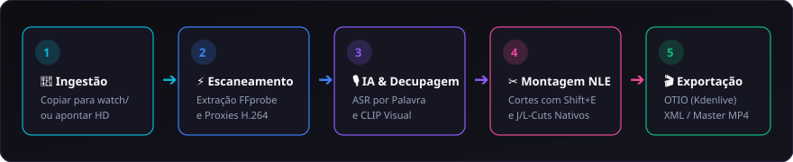

# 🎬 Bem-vindo à Wiki Oficial do CapIAu-Talho

**Ilha de pré-edição, decupagem e assistência inteligente por IA para grandes acervos e documentários**

[-3776AB?logo=python&logoColor=white)](https://www.python.org/)

---

## 🌟 O que é o CapIAu-Talho?

O **CapIAu-Talho** é uma plataforma profissional de **pré-edição, decupagem e logging inteligente** projetada especificamente para documentaristas, editores de making-of e gestores de grandes acervos audiovisuais.

Diferente de plugins convencionais ou ferramentas que tratam IA como uma caixa preta isolada, o CapIAu-Talho integra modelos de **visão computacional**, **transcrição fonética (ASR)**, **biometria facial local** e **processamento de linguagem natural** diretamente a uma **timeline multipista baseada em Canvas 2D (Track-Based NLE)**.

### 🏛️ Os Três Pilares do Sistema

1. **Privacidade e CPU-First Local:** Indexação vetorial, embeddings visuais CLIP e biometria facial com clustering DBSCAN rodam **100% na máquina do usuário sem exigir placa de vídeo dedicada (GPU)**. O módulo facial local não envia recortes ou embeddings biométricos; fluxos opcionais de nuvem podem enviar áudio, keyframes e textos, conforme a configuração.
2. **Edição Guiada por Texto e Visão:** Depoimentos transcritos palavra por palavra são navegáveis e inseríveis na timeline com precisão atômica (`Shift+E`), enquanto a busca semântica em linguagem natural localiza planos visuais em milissegundos.
3. **Zero Aprisionamento Tecnológico (Interoperabilidade NLE):** Monte o rough cut no Talho e exporte instantaneamente para **Kdenlive (OpenTimelineIO nativo)**, **Adobe Premiere Pro**, **DaVinci Resolve** e **Final Cut Pro (XML FCP7 / EDL)** com precisão de frames e conformação de originais.

---

## 👉 Comece aqui

1. Instale em 5 minutos: [[02. Instalação e Configuração|02.-Instalacao-e-Configuracao]] (Python 3.12 recomendado; versões abaixo de 3.14).
2. Faça o roteiro de [[19. Primeiros 15 Minutos e Receitas|19.-Primeiros-15-Minutos-e-Receitas]]: ingerir, transcrever, buscar, montar e exportar.
3. Problemas? [[16. Solução de Problemas e FAQ|16.-Solucao-de-Problemas-e-FAQ]]. Termo desconhecido? [[Glossário|18.-Glossario-Visual-e-Terminologia]].

> [!WARNING]
> O servidor ainda não tem autenticação e aceita qualquer origem. Use apenas em máquina ou rede confiável.

---

## 🗺️ Mapa de Navegação da Wiki

Explore a documentação completa através dos módulos abaixo:

| Seção | Título | Conteúdo Principal |
| :--- | :--- | :--- |
| 🚀 **Início** | [[01. Visão Geral e Conceito\|01.-Visao-Geral-e-Conceito]] | Filosofia, desafios em documentários, acervos e arquitetura híbrida. |
| 🛠️ **Setup** | [[02. Instalação e Configuração\|02.-Instalacao-e-Configuracao]] | Requisitos, Docker, instalação no Windows e Linux/macOS, `.env` e segurança. |
| 🎨 **Interface** | [[03. Design System e Interface NLE\|03.-Design-System-e-Interface-NLE]] | Layout seamless sem gaps, sidebars adaptativas, linhas restauradoras de 4px. |
| 📂 **Acervo** | [[04. Ingestão e Gestão de Acervos\|04.-Ingestao-e-Gestao-de-Acervos]] | Ingestão in-place sem cópia, watch folder, proxies 720p/360p, RAW CR2 e MTS. |
| ✂️ **Edição** | [[05. Timeline e Edição Multipista\|05.-Timeline-e-Edicao-Multipista]] | Canvas 2D NLE, pistas V/A, Sync Lock, Magnetismo, J/L-Cuts e ferramentas de Trim. |
| 🎞️ **Visão** | [[06. Decupagem e Visão Computacional\|06.-Decupagem-Inteligente-e-Visao]] | PySceneDetect (shots/beats), decupagem cromática, chips minimalistas, títulos de IA e CLIP local. |
| 🎙️ **Texto** | [[07. Transcrição e Edição por Texto\|07.-Transcricao-ASR-e-Edicao-por-Texto]] | AssemblyAI/Deepgram (Whisper local experimental), diarização, gaveta de pistas, waveform e inserção rápida. |
| 🔍 **Busca** | [[08. Busca Híbrida e Semântica\|08.-Busca-Hibrida-e-Semantica]] | Busca semântica RAG, similares visuais, filtros avançados e explicações de IA. |
| 👥 **Faces** | [[09. Reconhecimento Facial e Elenco\|09.-Reconhecimento-Facial-e-Elenco]] | SCRFD + ArcFace ONNX (CPU), DBSCAN local, rotulação, fusão de clusters e caixas manuais. |
| 🔊 **Áudio** | [[10. Diagnóstico e Restauração de Áudio\|10.-Audio-Diagnostico-e-Restauracao]] | Medição LUFS EBU R128, denoise local (DPDFNet/GTCRN), Auphonic e EQ 3 bandas. |
| 🌈 **Cor & FX** | [[11. Cor e Viewport NLE\|11.-Cor-Grading-e-Transformacoes-Visuais]] | Perfil de cor das câmeras, ajustes de cor, camada de ajuste, Viewport NLE, Transform e Crop. |
| 📝 **Titler** | [[12. Titler NLE, Legendas e Animação\|12.-Titler-NLE-Legendas-e-Animacao]] | Gerador de títulos, Lower Thirds, legendas queimadas/SRT e animação com keyframes. |
| 🎬 **Export** | [[13. Exportação e Interoperabilidade NLE\|13.-Exportacao-e-Interoperabilidade-NLE]] | Formatos OTIO, XML FCP7, EDL, Render MP4 e integração com Kdenlive/Premiere/Resolve. |
| 🎹 **Atalhos** | [[14. Guia Completo de Atalhos\|14.-Guia-Completo-de-Atalhos]] | Tabela completa de atalhos de teclado (JKL, I/O/E, Shift+E, A, Ferramentas). |
| 🔌 **API** | [[15. Arquitetura Técnica e API REST\|15.-Arquitetura-Tecnica-e-API-REST]] | Camadas, fluxo de dados, SQLite + Qdrant, filas e endpoints REST. |
| 🩺 **Suporte** | [[16. Solução de Problemas e FAQ\|16.-Solucao-de-Problemas-e-FAQ]] | Resolução de problemas comuns, diagnóstico de erros, logs e FAQ. |
| 🗺️ **Futuro** | [[17. Roadmap e Guia de Contribuição\|17.-Roadmap-e-Guia-de-Contribuicao]] | Roadmap, testes e como contribuir. |
| 🧭 **Comece aqui** | [[19. Primeiros 15 Minutos e Receitas\|19.-Primeiros-15-Minutos-e-Receitas]] | Caminho único do primeiro clipe ao arquivo exportado, mais receitas prontas. |
| 📖 **Glossário** | [[18. Glossário Visual e Terminologia\|18.-Glossario-Visual-e-Terminologia]] | Dicionário visual de termos NLE, IA, biometria facial, acústica e intercâmbio com 91 verbetes didáticos e diagramas. |

---

## ⚡ Guia de Inicialização Rápida

1. **Ingestão:** coloque vídeos, áudios ou fotos na pasta `watch/` ou aponte um HD externo na interface.
2. **Indexação:** no menu **Importar**, clique em **Escanear a pasta watch/**. O backend extrai metadados, gera proxies leves e indexa os vetores visuais.
3. **Transcrição:** abra uma entrevista e, no Inspetor, clique em **Transcrever Áudio (ASR)**. As falas aparecem separadas por falante, palavra a palavra.
4. **Montagem:** selecione trechos de texto e tecle `Shift+E`, ou use `I`, `O` e os botões de inserir e sobrescrever.
5. **Exportação:** clique em **Exportar Timeline** e escolha `.otio` (Kdenlive 25.04+) ou `.xml` (Premiere / Resolve / Final Cut).

Passo a passo completo em [[19. Primeiros 15 Minutos e Receitas|19.-Primeiros-15-Minutos-e-Receitas]].

---

## 🔄 Matriz de Interoperabilidade NLE

| Software de Destino | Formato Recomendado | Mídias Conformadas | Suporte a Pistas / Cortes | Guia Dedicado |
| :--- | :--- | :--- | :--- | :--- |
| **Kdenlive (25.04+)** | `.otio` (OpenTimelineIO) | Sim (Original / Proxy) | Multitrack V1-V3 / A1-A4 | [[Ver Guia\|13.-Exportacao-e-Interoperabilidade-NLE]] |
| **Adobe Premiere Pro** | `.xml` (Final Cut Pro 7 XML) | Sim (Relink automático) | Multitrack + Áudio Estéreo | [[Ver Guia\|13.-Exportacao-e-Interoperabilidade-NLE]] |
| **DaVinci Resolve** | `.xml` ou `.otio` | Sim (Timecode nativo) | Multitrack + Sincronia de Áudio | [[Ver Guia\|13.-Exportacao-e-Interoperabilidade-NLE]] |
| **Final Cut Pro X** | `.xml` / FCPXML via OTIO | Sim | Multitrack | [[Ver Guia\|13.-Exportacao-e-Interoperabilidade-NLE]] |
| **Render Direto (Master)** | `.mp4` (H.264 / AAC) | Sim (Render local FFmpeg) | Timeline completa com títulos e áudio | [[Ver Guia\|13.-Exportacao-e-Interoperabilidade-NLE]] |

---

> [!TIP]
> Para navegar rapidamente entre as páginas, utilize a barra de navegação à direita no GitHub Wiki ou os links no índice acima.
